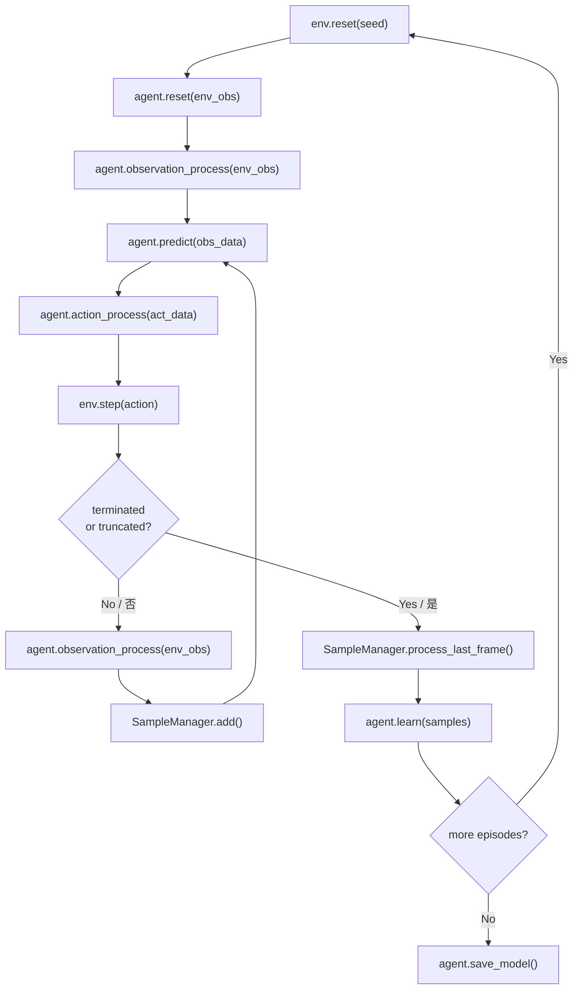

# 无人机外卖配送开发指南
# Drone Food Delivery Development Guide

> **项目代号
> **版本: v2.0
> **日期: 2026-07-18
> **适用对象大学生创新训练项目、强化学习初学者  
> **训练模式单机训练

---

## 1. 项目介绍

### 1.1 项目背景

本项目研究**无人机替代外卖骑手完成城市配送**的调度优化问题

外卖骑手的工作模式：从集合点出发 → 前往商家取货 → 配送到客户 → 继续接单配送 → 最终返回集合点。核心目标是在有限时间内尽可能多地完成配送

无人机面临的核心挑战：
- 路线选择从2D路网扩展到3D空域
- 电池上限决定单次最大航程
- 货物重量影响能耗和飞行性能
- 禁飞区、建筑碰撞、风力扰动等安全约束
- 多机协同时的冲突避免和任务分配

### 1.2 场景介绍

本项目采用**渐进式四层级**设计，从简单2D网格逐步扩展到复杂3D城市。

#### 层级一：2D固定商家

最基础的配送模型，对应外卖骑手在固定区域内配送已知订单。

| 参数 | 值 |
|---|---|
| 地图 | 40×40 网格（200m×200m） |
| 动作 | 4方向离散移动4-directional discrete |
| 商家 | 5个固定位置5 fixed positions |
| 配送点 | 5个固定位置 |
| 障碍物 | 建筑、水域、电力线 |
| 约束 | 地图边界、障碍物不可通行 |
| 每回合步数 | 500 |

**地图：基于武汉学院（Zone B）建筑布局。


#### 层级二：2D随机商家

模拟高峰期随机涌来的外卖订单。

| 新增特性 | 说明 |
|---|---|
| 随机订单 | 每回合随机生成4-8个订单 |
| 时间窗口 | 每个订单有截止时间 |
| 多单携带 | 最多同时携带2单 |
| 8方向移动8-Directional | 增加对角线方向 |

#### 层级三：3D固定商家

无人机进入3D空域，引入真实物理约束。

环境基于四区3D场景数据：

| 分区 | 参考区域 | 建筑数 | 建筑密度 | 特征 |
|---|---|---|---|---|
| A | 光谷广场 | 837栋 | 193.75栋/km² | 商圈、立交、密集高层（80-180m） |
| B | 武汉学院 | 43栋 | 9.95栋/km² | 湖区、电力线、稀疏建筑 |
| C | 长江大桥附近 | 538栋 | 96.07栋/km² | 桥梁12座、江面、滨水区 |
| D | 楚河汉界 | 592栋 | 137.04栋/km² | 窄河道、桥梁17座、商业住宅混合 |

**能耗模型参数（L3核心约束）：

| 参数 | 符号 | 值 | 说明 |
|---|---|---|---|
| 悬停功率 | $P_{hover}$ | 350 W | 无人机悬停保持高度所需功率 |
| 巡航功率 | $P_{cruise}$ | 280 W | 水平匀速飞行所需功率 |
| 爬升功率 | $P_{climb}$ | 520 W | 垂直爬升时最大功率 |
| 电池容量 | $E_{bat}$ | 22,000 mAh (253 Wh) | 标称电压11.4V（3S锂电池） |
| 载重系数 | $k_{load}$ | 1.0-1.4 | 每增加500g载重，功率×1.08 |
| 悬停续航 | $T_{hover}$ | ~43 min | 无载重理论续航 |
| 巡航续航 | $T_{cruise}$ | ~54 min | 无载重理论续航 |
| 带载巡航续航 | $T_{loaded}$ | ~38 min | 1kg载重，巡航状态 |

能耗自适应系数（电量越低，惩罚越大）/ Adaptive energy penalty (lower battery → higher penalty)：
```python
lambda_energy_adaptive = lambda_energy * (1 + eta_batt * (E_max - E_remain) / E_max)
# eta_batt = 2.0, 电量低于30%时惩罚权重翻倍
```

**3D动作空间连续控制
- 加速度 $\Delta v_x, \Delta v_y, \Delta v_z$（三维速度增量）
- 偏航角 $\Delta \psi$（航向调整）

**新增约束：
- 建筑碰撞检测（空间哈希 + 圆形包围盒）/ Building collision (spatial hash + bounding circle)
- 硬禁飞区：机场周边、政府建筑
- 软禁飞区：公园上方、生态水域
- 能耗消耗模型（悬停 vs 巡航 vs 爬升）/ Energy consumption model
- 电量管理与返航决策


#### 层级四：3D随机 + 完整约束

所有约束同时激活的完整城市配送系统：

**多机协同约束：

| 参数 | 值 | 说明 |
|---|---|---|
| 最大无人机数 | 3-5 | 编队规模 |
| 通信距离 | 500 m | 超距后失去协同信息 |
| 安全距离 | 10 m | 无人机间最小间距 |
| 碰撞半径 | 1.0 m | 碰撞判定阈值 |
| 预警距离 | 3.0 m | 触发渐进惩罚的距离 |

**风场扰动模型：

| 风源 | 模型 | 典型风速 |
|---|---|---|
| 湖面侧风 | 常量 + 阵风 | 3-8 m/s |
| 建筑绕流 | 建筑背风面涡流 | 2-5 m/s |
| 街谷风效应 | 高层间加速 | 4-12 m/s |
| 高度风切变 | 随高度线性增长 | +0.5 m/s/10m |

**动态禁飞区：
- 机场临时限制区（按航班时刻启停）/ Airport temporary restrictions (per flight schedule)
- 大型活动临时禁飞（体育赛事、集会）/ Event-based restrictions (sports, gatherings)
- 施工塔吊动态扫掠体（每回合随机种子控制）/ Construction crane sweep volumes (per-episode random seed)

**通信约束：
- 超出500m通信距离后，无法获取其他无人机位置和任务分配信息
- 通信延迟模拟：50-200ms往返延迟，影响协同决策实时性
- 丢包率随距离线性增长：距离500m时丢包率约15%

### 1.3 任务说明

#### 配送流程

```text
配送中心(Depot) 出发 / Start from depot
    → 前往商家取货 / Go to merchant for pickup
    → 前往配送点送货 / Go to delivery point for drop-off
    → [继续下一单 或 返回 / Continue or return]
    → 返回配送中心 / Return to depot
```

#### 12个全局任务点12 Global Task Points

任务点来自四区3D场景，每区3个（含1个配送中心 + 2个配送目标）/ Task points from 4-zone 3D scenes, 3 per zone (1 depot + 2 delivery targets)。

| 全局ID | 分区 | 名称 | 类型 | ENU坐标(m) |
|---|---|---|---|---|
| 1 | A | 配送中心 | 基地 | [408, 324, 0.8] |
| 2 | A | 商业裙楼屋顶 | 配送 | [1149, 1073, 15.8] |
| 3 | A | 商业综合体平台 | 配送 | [2013, 491, 9.2] |
| 4 | B | 校园后勤点 | 基地 | [1790, 589, 14.8] |
| 5 | B | 公共建筑屋顶 | 配送 | [945, 1011, 30.8] |
| 6 | B | 湖岸维护设施 | 配送 | [1160, 990, 6.8] |
| 7 | C | 桥头服务设施 | 基地 | [2139, 1189, 11.2] |
| 8 | C | 老城配送平台 | 配送 | [2363, 438, 11.2] |
| 9 | C | 滨水公共设施 | 配送 | [1929, 463, 12.4] |
| 10 | D | 商业裙楼屋顶 | 基地 | [714, 1047, 6.8] |
| 11 | D | 办公塔楼平台 | 配送 | [1249, 642, 138.7] |
| 12 | D | 社区公共建筑 | 配送 | [2028, 689, 47.7] |

*来源环境示意图_2D审核/scene_2d_manifest.json`*

### 1.4 计分规则

#### 层级一/二 计分（2D）/ Level 1/2 Scoring (2D)

| 事件 | 分数 |
|---|---|
| 完成一单配送（取货+送货） | +100 |
| 按时完成（时间窗口内） | +50（仅L2） |
| 超时惩罚 | -30（仅L2） |
| 全部完成并安全返航 | +500 |
| 每步时间惩罚 | -1 |
| 碰撞障碍物 | -200（终止） |

最终得分
```text
mission_score = 1000 × completed_count + 150 + 0.2 × remaining_time
仅在安全返航时有效 / Valid only upon safe return
```

#### 层级三/四 计分（3D）/ Level 3/4 Scoring (3D)

| 事件 | 分数 |
|---|---|
| 完成单次配送 | +120 |
| 全部配送完成 | +300 |
| 安全返航降落 | +500 |
| 建筑/地形碰撞 | -250 |
| 进入硬禁飞区 | -300 |
| 电量耗尽 | 失败 |
| 净空不足 | -4/次 |
| 能耗惩罚 | -0.8/Wh |
| 软风险暴露 | -1.5/次 |
| 控制不平滑 | -0.03/次 |
| 时间惩罚 | -0.08/s |

**业务Score与训练Reward分离：
- 训练使用密集Reward（含进度引导、能耗惩罚等）
- 验收使用业务Score（目标数严格优先字典序）

### 1.5 可用算法

| 算法 | 层级 | 类型 | 动作空间 | 描述 |
|---|---|---|---|---|
| Q-learning | L1 | 离线策略 | Discrete(4) | 表格型Q-learning + ε-greedy |
| SARSA | L1 | 在线策略 | Discrete(4) | 表格型SARSA，更保守安全 |
| Monte Carlo | L1 | 在线策略 | Discrete(4) | 首次访问MC，完整回报更新 |
| DQN | L2 | 离线策略 | Discrete(8) | Dueling DQN + 经验回放 |
| A2C | L2/L3 | 在线策略 | Discrete(8)/Box(3) | Actor-Critic + GAE |
| PPO | L3/L4 | 在线策略 | Box(4) | PPO + tanh Gaussian + CTDE |

### 1.6 训练模式

当前支持**单机训练模式**：
- 每个算法独立训练
- 支持断点续训
- 定期评估与日志记录
- 模型保存与加载

### 1.7 各层级典型训练时长预估

以下为单机训练（RTX 3060 或同等）的典型时长预估：

| 层级 | 算法 | 训练步数 | 收敛回合 | 预计时长 | 评估标志 |
|---|---|---|---|---|---|
| L1 | Q-learning | 50K | 500-1000 | 10-30 min | 配送完成率>80% |
| L1 | SARSA | 50K | 500-1000 | 10-30 min | 配送完成率>75% |
| L1 | Monte Carlo | 50K | 1000-2000 | 15-40 min | 配送完成率>70% |
| L2 | DQN | 200K | 2000-5000 | 1-3 h | 配送完成率>70% |
| L2 | A2C | 200K | 2000-5000 | 1-2 h | 配送完成率>65% |
| L3 | A2C | 500K | 5000-10K | 3-8 h | 安全返航率>60% |
| L3 | PPO | 1M | 10K-20K | 8-24 h | 安全返航率>70% |
| L4 | PPO+CTDE | 5M | 50K-100K | 24-72 h | 全部配送完成率>50% |

**训练速度参考：
- 表格型（Q-learning/SARSA/MC）：~1000 episodes/sec表格查找，极快
- 深度离散（DQN）：~200 episodes/sec推理 + 经验回放
- 深度连续（A2C/PPO）：~100 episodes/sec推理 + GAE计算
- 多机CTDE（PPO+CTDE）：~20 episodes/sec多机观测 + 集中式Critic

**注意：以上时长为乐观估计，实际取决于超参数选择、地图复杂度和是否启用课程学习。建议先在Zone B（43栋建筑）快速验证，再迁移到Zone A/D进行高密度训练。

---

## 2. 环境说明

### 2.1 层级一环境：Simple2DDeliveryEnv

**文件位置

#### 观测空间

| 键 | 形状 | 类型 | 范围 | 说明 |
|---|---|---|---|---|
| `position` | (2,) | int32 | [0, 39] | 无人机网格坐标 |
| `order_status` | (5,) | int8 | {0, 1} | 订单完成状态掩码 |
| `carrying` | scalar | int | {0, 1} | 是否携带货物 |

#### 动作空间

`Discrete(4)` — 4方向离散移动：

| 值 | 动作 | 位移 |
|---|---|---|
| 0 | 上 | (0, +1) |
| 1 | 下 | (0, -1) |
| 2 | 左 | (-1, 0) |
| 3 | 右 | (+1, 0) |

#### 状态编码

用于表格型RL的唯一状态键：
```python
state_key = position_x * grid_size + position_y  # 0-1599 (11 bits)
state_key = (state_key << 6) | (order_status_bits << 1) | carrying
```

#### 环境配置

配置文件

```toml
[env_conf]
# 配送中心位置 / Depot position
depot = [30, 10]
# 最大步数 / Max steps per episode
max_steps = 500
# 网格大小 / Grid size
grid_size = 40
# 订单数量 / Number of orders
num_orders = 5
```

### 2.2 层级二环境：Random2DDeliveryEnv

**文件位置

#### 主要差异

| 特性 | 层级一 | 层级二 |
|---|---|---|
| 动作空间 | Discrete(4) | Discrete(8) |
| 订单 | 固定5个 | 随机4-8个/回合 |
| 时间窗口 | 无 | 有（距离×1.5 + 随机50-200步） |
| 多单携带 | 1单 | 最多2单 |
| 观测 | Dict(3 keys) | Dict(2 keys) + 向量 |
| 最大步数 | 500 | 800 |

#### 8方向动作8-Directional Actions

| 值 | 0 | 1 | 2 | 3 | 4 | 5 | 6 | 7 |
|---|---|---|---|---|---|---|---|---|
| 方向 | ↑ | ↓ | ← | → | ↖ | ↗ | ↙ | ↘ |

#### 向量化观测

50维特征向量（固定长度，适配DQN/A2C输入）/ 50-dim feature vector (fixed length for DQN/A2C)：
- 无人机位置（2维，归一化）
- 每个订单×6维（商家位置、配送点位置、状态、剩余时间）
- 携带状态 + 步数比例（2维）

### 2.3 环境数据结构

#### 通用观测字典

```python
env_obs = {
    "position": np.array([x, y], dtype=np.int32),
    "order_status": np.array([0, 0, 1, 0, 0], dtype=np.int8),
    "carrying": 0,  # 0=空手, 1=携带中
}
```

#### info字典

```python
info = {
    "position": [30, 10],
    "completed": 2,           # 已完成订单数
    "carrying": 1,            # 是否携带货物
    "steps": 42,              # 当前步数
    "depot_reached": False,   # 是否在配送中心
}
```

### 2.4 环境示意图

| 图片 | 路径 | 用途 |
|---|---|---|
| 四区总览 | `outputs/环境示意图/wuhan_environment_overview.png` | 项目全景介绍 |
| 3D环境3D Environment | `outputs/环境示意图/wuhan_environment_3d.png` | 三维场景展示 |
| 建筑高度热力图 | `outputs/环境示意图/wuhan_building_height_heatmap.png` | 高度分布 |
| 障碍物图例 | `outputs/环境示意图/wuhan_obstacle_legend.png` | 风险类型 |
| 四区分区图 | `outputs/环境示意图/wuhan_zone_top_view.png` | 分区布局 |
| Zone A 2D | `outputs/环境示意图_2D审核/zone_A_guanggu_core_2d.png` | 光谷广场 |
| Zone B 2D | `outputs/环境示意图_2D审核/zone_B_lakeside_campus_2d.png` | 武汉学院 |
| Zone C 2D | `outputs/环境示意图_2D审核/zone_C_river_bridgehead_2d.png` | 长江大桥 |
| Zone D 2D | `outputs/环境示意图_2D审核/zone_D_canal_highrise_2d.png` | 楚河汉界 |
| Zone A 3D | `outputs/环境示意图_3D预览/zone_A_scene_lod0_preview.png` | 光谷3D |
| Zone B 3D | `outputs/环境示意图_3D预览/zone_B_scene_lod0_preview.png` | 学院3D |
| Zone C 3D | `outputs/环境示意图_3D预览/zone_C_scene_lod0_preview.png` | 桥头3D |
| Zone D 3D | `outputs/环境示意图_3D预览/zone_D_scene_lod0_preview.png` | 河道3D |

### 2.5 层级三环境：3DDeliveryEnv

**文件位置（体系A参考）下的L3扩展模块（体系B目标）

#### 观测空间

11维连续向量，编码无人机物理状态与任务进度：

| 维度 | 名称 | 形状 | 范围 | 归一化 | 说明 |
|---|---|---|---|---|---|
| 0-2 | 位置 | (3,) | 场景包络 | ÷包络尺寸 | ENU坐标(x,y,z) |
| 3-5 | 速度 | (3,) | [-15, 15] m/s | ÷15 | 三维速度矢量3D velocity vector |
| 6 | 目标距离 | (1,) | [0, 3000] m | ÷3000 | 到当前目标的欧氏距离 |
| 7 | 电量比 | (1,) | [0, 1] | 已归一化 | $E_{remain} |
| 8 | 配送进度 | (1,) | [0, 1] | 已归一化 | 已完成数÷总订单数 |
| 9 | 携带状态 | (1,) | {0, 1} | 已归一化 | 是否携带货物 |
| 10 | 步数比 | (1,) | [0, 1] | 已归一化 | 当前步÷max_steps |

```python
# 3D观测构建示例 / 3D observation construction example
def build_observation_3d(drone_pos, drone_vel, goal_pos, battery_remain,
                         battery_max, completed, total_orders, carrying,
                         current_step, max_steps):
    """构建11维3D观测向量 / Build 11-dim 3D observation vector"""
    goal_dist = np.linalg.norm(drone_pos - goal_pos)
    obs = np.array([
        drone_pos[0] / env_extent[0],   # x归一化 / x normalized
        drone_pos[1] / env_extent[1],   # y归一化 / y normalized
        drone_pos[2] / max_altitude,    # z归一化 / z normalized
        drone_vel[0] / 15.0,            # vx归一化 / vx normalized
        drone_vel[1] / 15.0,            # vy归一化 / vy normalized
        drone_vel[2] / 15.0,            # vz归一化 / vz normalized
        goal_dist / 3000.0,             # 距离归一化 / distance normalized
        battery_remain / battery_max,   # 电量比 / battery ratio
        completed / total_orders,       # 进度 / progress
        float(carrying),                # 携带标志 / carrying flag
        current_step / max_steps,       # 步数比 / step ratio
    ], dtype=np.float32)
    return obs
```

#### 动作空间

`Box(4)` — 4维连续控制：

| 维度 | 名称 | 范围 | 单位 | 说明 |
|---|---|---|---|---|
| 0 | $\Delta v_x$ | [-1.0, 1.0] | m/s² | X方向加速度 |
| 1 | $\Delta v_y$ | [-1.0, 1.0] | m/s² | Y方向加速度 |
| 2 | $\Delta v_z$ | [-1.0, 1.0] | m/s² | Z方向加速度 |
| 3 | $\Delta \psi$ | [-1.0, 1.0] | rad/s | 偏航角速率 |

**动力学更新：
```python
# 速度-位置积分（欧拉法）/ Velocity-position integration (Euler)
v_new = v_old + action[:3] * dt          # dt = 0.1s
pos_new = pos_old + v_new * dt
psi_new = psi_old + action[3] * dt

# 速度裁剪（物理约束）/ Velocity clamping (physical limits)
speed = np.linalg.norm(v_new)
if speed > v_max:  # v_max = 15 m/s
    v_new = v_new / speed * v_max
```

#### 碰撞检测数据结构

每个建筑在 `zone_*_collision.json` 中存储以下字段：

```json
{
    "feature_id": "way/767313616",
    "building_type": "公共建筑",
    "height_m": 21.111,
    "height_source": "programmatic",
    "z_min_m": 0.0,
    "z_max_m": 21.111,
    "aabb_enu_m": [1394.8, 359.0, 0.0, 1486.4, 531.5, 21.1],
    "footprints": [{ "exterior_xy_m": [[x,y], ...], "holes_xy_m": [] }]
}
```

| 字段 | 类型 | 说明 |
|---|---|---|
| `aabb_enu_m` | `[6]` float | 轴对齐包围盒 [xmin,ymin,zmin,xmax,ymax,zmax] |
| `footprints` | list | 2D轮廓多边形（外部环+孔洞） |
| `height_m` | float | 建筑高度(m) |
| `z_min_m`, `z_max_m` | float | 垂直范围 |

#### 碰撞检测API

采用**空间哈希 + 两阶段检测**策略：

```python
class CollisionDetector:
    """建筑碰撞检测器 / Building collision detector"""

    def __init__(self, collision_json_path: str, cell_size: float = 50.0):
        """初始化空间哈希网格 / Initialize spatial hash grid

        Parameters:
            collision_json_path: collision JSON文件路径
            cell_size: 空间哈希网格尺寸(m)，默认50m
        """
        self.cell_size = cell_size
        self.spatial_hash = {}  # {(gx,gy): [building_indices]}
        self.buildings = []     # 建筑列表（AABB+轮廓）
        self._load_and_index(collision_json_path)

    def check_collision(self, pos: np.ndarray, radius: float = 1.0) -> bool:
        """检测无人机是否与建筑碰撞 / Check drone-building collision

        Parameters:
            pos: 无人机位置 [x, y, z] (ENU, m)
            radius: 无人机碰撞半径(m)，默认1.0m

        Returns:
            bool: True表示碰撞 / True means collision detected

        两阶段检测 / Two-phase detection:
            1. AABB快速剔除（O(1)空间哈希查找）/ AABB fast rejection
            2. 2D轮廓精确检测（点在多边形内）/ 2D footprint precise test
        """
        # 阶段1：空间哈希 → 候选建筑 / Phase 1: spatial hash → candidates
        gx, gy = int(pos[0] // self.cell_size), int(pos[1] // self.cell_size)
        candidates = self.spatial_hash.get((gx, gy), [])

        for idx in candidates:
            bld = self.buildings[idx]
            # 阶段2a：垂直范围检查 / Phase 2a: vertical range check
            if pos[2] + radius < bld["z_min_m"] or pos[2] - radius > bld["z_max_m"]:
                continue
            # 阶段2b：2D轮廓相交 / Phase 2b: 2D footprint intersection
            if self._point_in_footprint(pos[0], pos[1], bld["footprints"], radius):
                return True
        return False

    def get_clearance(self, pos: np.ndarray) -> float:
        """计算当前位置到最近建筑表面的净空距离 / Compute clearance to nearest building

        Parameters:
            pos: 无人机位置 [x, y, z]

        Returns:
            float: 净空距离(m)，正值=安全，负值=已穿透 / Clearance(m), positive=safe
        """
        min_dist = float('inf')
        gx, gy = int(pos[0] // self.cell_size), int(pos[1] // self.cell_size)
        for idx in self.spatial_hash.get((gx, gy), []):
            bld = self.buildings[idx]
            dist = self._distance_to_building(pos, bld)
            min_dist = min(min_dist, dist)
        return min_dist
```

**各分区碰撞体数量：

| 分区 | 建筑数 | 桥梁 | 电力线 | 风险区 | LOD0顶点 |
|---|---|---|---|---|---|
| A | 837 | 20 | 0 | 4 | 73,258 |
| B | 43 | 0 | 3 | 4 | 6,535 |
| C | 538 | 12 | 0 | 5 | 47,760 |
| D | 592 | 17 | 0 | 5 | 85,795 |

*来源环境示意图_3D预览/scene_3d_index.json`*

### 2.6 禁飞区API

#### 禁飞区分类

| 类型 | 判定 | 惩罚 | 示例 |
|---|---|---|---|
| 硬禁飞 | 进入即终止 | -300 + episode fail | 机场周边、政府建筑 |
| 软禁飞 | 进入施加连续惩罚 | -1.5/次 | 公园上方、生态水域 |
| 动态禁飞 | 按时间窗口启停 | -300（激活时） | 施工塔吊、临时活动 |

```python
class NoFlyZoneManager:
    """禁飞区管理器 / No-fly zone manager"""

    def __init__(self, zone_config: dict):
        """初始化禁飞区 / Initialize no-fly zones

        Parameters:
            zone_config: 禁飞区配置字典，包含hard/soft/dynamic三类
        """
        self.hard_zones = []    # 硬禁飞区列表 / Hard NFZ list
        self.soft_zones = []    # 软禁飞区列表 / Soft NFZ list
        self.dynamic_zones = [] # 动态禁飞区列表 / Dynamic NFZ list
        self._parse_config(zone_config)

    def check(self, pos: np.ndarray, timestep: int) -> dict:
        """检测当前位置的禁飞区状态 / Check NFZ status at position

        Parameters:
            pos: 无人机位置 [x, y, z] (ENU, m)
            timestep: 当前时间步（用于动态禁飞区激活判定）

        Returns:
            dict: {
                "in_hard": bool,    # 是否在硬禁飞区内
                "in_soft": bool,    # 是否在软禁飞区内
                "in_dynamic": bool, # 是否在激活的动态禁飞区内
                "soft_penalty": float  # 软禁飞区累计惩罚
            }
        """
        result = {"in_hard": False, "in_soft": False,
                  "in_dynamic": False, "soft_penalty": 0.0}
        for zone in self.hard_zones:
            if zone.contains(pos):
                result["in_hard"] = True
                break
        for zone in self.soft_zones:
            if zone.contains(pos):
                result["in_soft"] = True
                result["soft_penalty"] += zone.penalty_per_step
        for zone in self.dynamic_zones:
            if zone.is_active(timestep) and zone.contains(pos):
                result["in_dynamic"] = True
        return result
```

#### 风险区类型（来自场景数据）/ Risk Zone Types (from scene data)

各分区的 `risk_types` 来自 `scene_2d_manifest.json`：

| 分区 | 风险类型 |
|---|---|
| A | GPS多路径、动态交通、轨道硬隔离、通信阴影 |
| B | 湖面侧风、飞鸟活动、人群密集、通信阴影 |
| C | 江面阵风、桥体硬隔离、船舶走廊、人群密集、通信阴影 |
| D | 河道风廊、GPS多路径、通信阴影、动态交通、临时施工 |

### 2.7 风场模型接口

风场扰动作为3D环境的外力输入，在每步动力学更新前叠加到无人机速度上：

```python
class WindFieldModel:
    """风场扰动模型 / Wind disturbance model"""

    def __init__(self, zone_id: str, seed: int = 42):
        """初始化风场 / Initialize wind field

        Parameters:
            zone_id: 分区ID（A/B/C/D），决定基础风向和强度
            seed: 随机种子，确保可复现
        """
        self.zone_id = zone_id
        self.rng = np.random.RandomState(seed)
        self.base_wind = self._get_base_wind(zone_id)

    def get_wind(self, pos: np.ndarray, timestep: int) -> np.ndarray:
        """获取指定位置的风速矢量 / Get wind velocity at position

        Parameters:
            pos: 无人机位置 [x, y, z] (ENU, m)
            timestep: 当前时间步

        Returns:
            np.ndarray: 风速矢量 [wx, wy, wz] (m/s)
        """
        # 基础风向 / Base wind direction
        wind = self.base_wind.copy()

        # 高度风切变：每10m增加0.5m/s / Altitude shear: +0.5m/s per 10m
        wind[0] += 0.05 * pos[2]

        # 建筑绕流：建筑背风面涡流 / Building wake: leeward vortex
        # （查询碰撞检测器获取最近建筑）
        # 街谷风：高层间加速效应 / Street canyon: acceleration between tall buildings

        # 阵风随机扰动 / Gust random perturbation
        gust = self.rng.normal(0, 0.5, size=3)
        wind += gust

        return wind.clip(-12.0, 12.0)  # 风速限幅 / Wind speed clamping

    def _get_base_wind(self, zone_id: str) -> np.ndarray:
        """获取分区基础风向 / Get zone base wind direction"""
        base = {"A": [3.0, 1.0, 0.0], "B": [2.0, -3.0, 0.0],
                "C": [5.0, 0.0, 0.0], "D": [4.0, 2.0, 0.0]}
        return np.array(base.get(zone_id, [3.0, 0.0, 0.0]), dtype=np.float32)
```

**风场对能耗的影响：
```python
# 逆风飞行增加能耗 / Headwind increases energy consumption
headwind_component = -np.dot(v_drone, wind) / (np.linalg.norm(v_drone) + 1e-6)
energy_factor = 1.0 + 0.1 * max(0, headwind_component)  # 逆风每m/s增加10%
```

### 2.8 层级四环境扩展：多机协同

L4在L3基础上新增以下接口：

#### 多机观测空间

每架无人机的观测扩展为：

```python
# 自身状态（11维，同L3）/ Self state (11-dim, same as L3)
self_obs = obs_11_dim

# 其他无人机信息（每架4维 × (N-1)架）/ Other drones info (4-dim × (N-1) drones)
# 仅在通信范围内可见 / Only visible within communication range
other_drones = []
for other in drones:
    if other.id != self.id:
        dist = np.linalg.norm(self.pos - other.pos)
        if dist <= comm_range:  # comm_range = 500m
            other_drones.extend([
                (other.pos[0] - self.pos[0]) / comm_range,  # 相对x
                (other.pos[1] - self.pos[1]) / comm_range,  # 相对y
                (other.pos[2] - self.pos[2]) / comm_range,  # 相对z
                float(other.carrying),                       # 携带状态
            ])
        else:
            other_drones.extend([0.0, 0.0, 0.0, 0.0])  # 通信盲区填零
```

#### 通信约束接口

```python
class CommunicationModel:
    """多机通信模型 / Multi-drone communication model"""

    def __init__(self, max_range: float = 500.0, base_latency_ms: float = 50.0):
        self.max_range = max_range
        self.base_latency_ms = base_latency_ms

    def get_link_quality(self, dist: float) -> dict:
        """计算通信链路质量 / Compute communication link quality

        Parameters:
            dist: 无人机间距离(m)

        Returns:
            dict: {"latency_ms": float, "packet_loss": float, "reachable": bool}
        """
        if dist > self.max_range:
            return {"latency_ms": float('inf'), "packet_loss": 1.0, "reachable": False}
        # 丢包率随距离线性增长 / Packet loss grows linearly with distance
        loss_rate = 0.15 * (dist / self.max_range)
        # 延迟随距离增长 / Latency grows with distance
        latency = self.base_latency_ms + 0.3 * dist
        return {"latency_ms": latency, "packet_loss": loss_rate, "reachable": True}
```

### 2.9 各层级观测空间对比

| 层级 | 空间类型 | 维度 | 关键特征 |
|---|---|---|---|
| L1 | Dict(3 keys) | 3 fields | 离散网格坐标 + 订单掩码 + 携带标志 |
| L2 | Dict(2 keys) + Vector | 2 fields + 50-dim | 向量化观测，适配DQN/A2C |
| L3 | Box continuous | 11-dim | 位置+速度+距离+电量+进度 |
| L4 | Box continuous | 11 + 4×(N-1) dim | L3 + 其他无人机相对信息 |

### 2.10 监控指标

| 指标组 | 指标 | 说明 |
|---|---|---|
| 配送 | `avg_deliveries` | 平均每回合完成配送数 |
| 配送 | `delivery_rate` | 配送完成率（完成数÷总数） |
| 效率 | `avg_steps` | 平均每回合步数 |
| 效率 | `avg_reward` | 平均每回合总奖励 |
| 效率 | `success_rate` | 安全返航成功率 |
| 学习 | `epsilon` | 探索率（仅表格型算法） |
| 学习 | `loss` | 损失值（仅深度算法） |
| 学习 | `q_table_size` | Q表大小（仅表格型算法） |

---

## 3. Agent说明

### 3.1 通用Agent架构

每个Agent目录遵循与腾讯开悟（Kaiwu）完全一致的6子模块结构：

```
agent_<algo>/
├── __init__.py
├── agent.py              # Agent类 / Agent class
├── algorithm/
│   ├── __init__.py
│   └── algorithm.py      # Algorithm类 / Algorithm class
├── conf/
│   ├── __init__.py
│   ├── conf.py           # Config类 / Config class
│   ├── monitor_builder.py # 监控面板配置
│   └── train_env_conf.toml # 环境配置
├── feature/
│   ├── __init__.py
│   ├── definition.py     # ObsData/ActData/SampleData + reward_shaping
│   └── preprocessor.py   # Preprocessor类
├── model/
│   ├── __init__.py
│   └── model.py          # 神经网络/Q表模型
└── workflow/
    ├── __init__.py
    └── train_workflow.py # workflow()函数 + EpisodeRunner类
```

**模块间调用关系：

```text
train_workflow
  └── Agent
        ├── Preprocessor.observation_process()  → ObsData
        ├── Model.forward()                      → Q-values / Action dist
        ├── Algorithm.update()                   → Loss / Q-table update
        └── SampleManager                        → SampleData list
```

#### Agent类 标准接口

```python
class Agent:
    def __init__(self): ...                    # 创建model、algorithm、preprocessor
    def reset(self, env_obs): ...              # 回合开始
    def predict(self, list_obs_data): ...      # 训练时动作选择（随机）
    def exploit(self, env_obs): ...            # 评估时动作选择（确定性）
    def learn(self, list_sample_data): ...     # 模型训练
    def save_model(self, path, id): ...        # 保存模型
    def load_model(self, path, id): ...        # 加载模型
    def observation_process(self, env_obs): ...# 环境观测→ObsData
    def action_process(self, act_data): ...    # ActData→动作
    def reward_shaping(self, reward): ...      # 奖励塑形
```

**predict vs exploit 的核心区别：

| 方法 | 调用时机 | 探索策略 | 返回类型 |
|---|---|---|---|
| `predict` | 训练阶段 | ε-greedy（表格型）或采样（深度型） | `ActData` |
| `exploit` | 评估阶段 | 确定性贪心 | `int`（动作索引） |

### 3.2 特征处理详解

各算法Agent的 `observation_process` 和 `action_process` 存在显著差异，根源在于观测空间和动作空间类型不同

#### 3.2.1 表格型Agent：Q-learning

**observation_process 逻辑**：将Dict观测压缩为唯一整数状态键：

```python
# 表格型Agent的 observation_process 流程
# Tabular Agent observation_process flow
def observation_process(self, env_obs: Dict) -> ObsData:
    # 步骤1：编码状态键 / Step 1: Encode state key
    #   position (x,y) → 0~1599 (11 bits)
    #   order_status (5,) → 0~31 (5 bits)
    #   carrying (0/1) → 0~1 (1 bit)
    #   state_key = (pos_idx << 6) | (status_bits << 1) | carrying
    #   总计17位，最大值131071 / Total 17 bits, max value 131071
    feature = encode_state_key(env_obs)

    # 步骤2：计算合法动作 / Step 2: Compute legal actions
    #   检查4个方向：目标位置是否越界、是否在障碍物上
    #   Check 4 directions: target in bounds? target obstacle-free?
    legal_actions = compute_legal_actions(env_obs)  # 返回 [0,1,2,3] 的子集

    return ObsData(feature=feature, legal_actions=legal_actions)
```

**状态编码细节：

```python
def encode_state_key(env_obs):
    """将环境观测编码为唯一整数键 / Encode env obs into unique int key"""
    x, y = int(pos[0]), int(pos[1])
    pos_idx = x * GRID_SIZE + y              # 0 ~ 1599  (GRID_SIZE=40)
    status_bits = int("".join(map(str, order_status.astype(int))), 2)  # 0 ~ 31
    carrying = int(env_obs["carrying"])       # 0 ~ 1
    return (pos_idx << 6) | (status_bits << 1) | carrying
```

**action_process 逻辑**：将ActData的动作索引钳位到有效范围：

```python
def action_process(self, act_data: ActData) -> int:
    """提取可执行动作索引 / Extract executable action index"""
    action = act_data.act
    if action is None:
        return 0
    return int(max(0, min(ACTION_SIZE - 1, action)))  # 钳位 / Clamp to [0,3]
```

**Q-learning Agent 完整 predict 流程：

```python
def predict(self, list_obs_data) -> ActData:
    obs_data = list_obs_data[0]
    state_key = obs_data.feature              # 整数状态键 / Integer state key
    legal_actions = obs_data.legal_actions    # [0,1,2,3] 的子集

    if np.random.random() < self.epsilon:
        # 探索：从合法动作中均匀随机 / Explore: uniform random from legal
        action = int(np.random.choice(legal_actions))
    else:
        # 利用：合法动作中Q值最大（平局随机） / Exploit: max Q among legal
        q_values = self.model[state_key]      # dict查找 / dict lookup
        valid_q = {a: q_values[a] for a in legal_actions}
        max_q = max(valid_q.values())
        best_actions = [a for a, q in valid_q.items() if q == max_q]
        action = int(np.random.choice(best_actions))

    self.train_steps += 1
    self._decay_epsilon()  # 每步衰减 / per-step decay
    return ActData(act=action, val=None)
```

#### 3.2.2 深度离散Agent：DQN

**observation_process 逻辑**：将Dict观测转换为50维浮点向量：

```python
# DQN Agent的 observation_process 流程
# DQN Agent observation_process flow
def observation_process(self, env_obs: Dict) -> ObsData:
    # 步骤1：构建50维特征向量 / Step 1: Build 50-dim feature vector
    #   [drone_x_norm, drone_y_norm]         # 2维：归一化位置
    #   [order_i_dist, order_i_merchant_x,   # 每单6维 × 8单 = 48维
    #    order_i_merchant_y, order_i_dest_x,
    #    order_i_dest_y, order_i_time_remaining]
    #   [carrying_status, remaining_steps]   # 2维：状态+步数
    feature = self.preprocessor.vectorize(env_obs)  # np.ndarray (50,)

    # 步骤2：计算8方向合法动作掩码 / Step 2: Compute 8-dim legal action mask
    #   legal_act[i] = 1.0 表示方向i可走, 0.0 表示障碍/越界
    legal_act = self.preprocessor.compute_legal_mask(env_obs)  # np.ndarray (8,)

    return ObsData(feature=feature, legal_act=legal_act)
```

**DQN Agent predict 流程（与Q-learning对比）/ DQN predict flow (compared to Q-learning)**：

```python
def predict(self, list_obs_data: List[ObsData]) -> ActData:
    obs_data = list_obs_data[0]
    self._last_obs_data = obs_data   # 缓存供learn()构造样本 / Cache for learn()

    if np.random.random() < self._algorithm.epsilon:
        # 探索：从合法动作掩码中随机选 / Explore: random from legal mask
        legal_indices = np.where(obs_data.legal_act > 0.5)[0]
        act = int(np.random.choice(legal_indices)) if len(legal_indices) > 0 else 0
        val = 0.0
    else:
        # 利用：神经网络推理Q值 / Exploit: neural network Q-value inference
        feature_tensor = torch.tensor(obs_data.feature).unsqueeze(0).to(device)
        with torch.no_grad():
            q_tensor = self._algorithm.q_online(feature_tensor)  # (1, 8)
        q_numpy = q_tensor.cpu().numpy().flatten()
        masked_q = np.where(obs_data.legal_act > 0.5, q_numpy, -1e9)
        act = int(np.argmax(masked_q))
        val = float(q_numpy[act])

    self._algorithm.step_tick()  # 递增全局步计数 / Increment global step
    return ActData(act=act, val=val)
```

**关键差异总结：

| 维度 | 表格型 (Q-learning等) | 深度离散 (DQN) |
|---|---|---|
| 特征类型 | `int`（状态键） | `np.ndarray` (50,) |
| 合法动作 | `List[int]`（显式列表） | `np.ndarray` (8,)（掩码向量） |
| Q值查询 | `dict[key]` O(1) | `model(tensor)` 前向传播 |
| 探索率管理 | Agent内部每步衰减 | Algorithm内部每步衰减 |
| 缓存观测 | 不缓存 | 缓存供learn()构造SampleData |

### 3.3 奖励塑形策略

所有Agent共享相同的 `reward_shaping` 签名，但各层级的塑形策略不同

#### 3.3.1 当前实现：直通模式

```python
def reward_shaping(reward: float,
                   env_obs: Optional[Dict] = None,
                   prev_env_obs: Optional[Dict] = None,
                   action: Optional[int] = None) -> float:
    """直通原始奖励 / Pass-through raw reward"""
    return float(reward) if reward is not None else 0.0
```

#### 3.3.2 未来扩展：势能塑形

基于势能函数的奖励塑形保证最优策略不变（政策不变性定理）/ Potential-based shaping preserves optimal policy (policy invariance theorem)：

$$F(s, a, s') = \gamma \Phi(s') - \Phi(s)$$

其中 $\Phi(s)$ 为势能函数：

```python
def reward_shaping_potential(reward, env_obs, prev_env_obs, action):
    """势能塑形示例 / Potential shaping example"""
    if prev_env_obs is None:
        return reward

    gamma = 0.99
    # 势能函数：到最近未完成目标的负距离 / Potential: negative dist to nearest goal
    prev_dist = distance_to_nearest_goal(prev_env_obs)
    curr_dist = distance_to_nearest_goal(env_obs)
    shaping_bonus = gamma * (-curr_dist) - (-prev_dist)

    return reward + shaping_bonus
```

#### 3.3.3 各层级塑形建议

| 层级 | 稀疏奖励问题 | 推荐塑形 |
|---|---|---|
| L1 | 只有配送完成和返航才有正奖励 | 势能塑形（距离引导）/ Potential (distance guidance) |
| L2 | 新增时间窗口惩罚稀疏 | 取货鼓励 + 时间进度奖励 |
| L3 | 3D导航更难探索成功 | 航向对齐奖励 + 高度安全奖励 |
| L4 | 多机协调奖励极稀疏 | 中心化Critic提供密集信号 |

### 3.4 数据协议详解

#### ObsData — 观测数据

```python
# 表格型用法 / Tabular usage
ObsData(feature=12345, legal_actions=[0, 2, 3])

# 深度型用法 / Deep usage
ObsData(feature=np.array([0.5, 0.3, ...], dtype=np.float32),
        legal_act=np.array([1, 1, 0, 1, 0, 1, 1, 0], dtype=np.float32))
```

| 字段 | 表格型 | 深度型 |
|---|---|---|
| `feature` | `int`（状态键） | `np.ndarray`（特征向量） |
| `legal_actions` | `List[int]`（合法索引列表） | — |
| `legal_act` | — | `np.ndarray`（0/1掩码向量） |

#### ActData — 动作数据

```python
ActData(act=3, val=0.87)   # act=动作索引, val=Q值/价值估计
```

| 字段 | 类型 | 说明 |
|---|---|---|
| `act` | `int` | 动作索引（L1: 0-3, L2: 0-7, L3/L4: 连续动作需额外解码） |
| `val` | `float` | 训练时为Q值或状态价值；exploit时可用于置信度排序 |

#### SampleData — 样本数据

```python
# 表格型单步转移 / Tabular single-step transition
SampleData(obs=12345, _obs=12405, act=3, rew=+100.0, done=False, ret=0.0)

# 深度型经验回放样本 / Deep experience replay sample
SampleData(obs=np.array([...]), next_obs=np.array([...]),
           act=5, rew=+100.0, done=True, legal_act=np.array([...]))
```

**SampleData 的三种使用模式：

| 算法类型 | 样本来源 | 更新时机 |
|---|---|---|
| 表格型 (Q/SARSA/MC) | SampleManager收集整回合 | 回合结束后批量learn |
| 深度离线策略 (DQN) | 每步即时构造，推入ReplayBuffer | 每步从Buffer采样minibatch learn |
| 深度在线策略 (A2C/PPO) | 收集N步rollout | N步后统一learn |

### 3.5 SampleManager 样本管理

SampleManager 负责收集一个回合内的所有状态转移：

```python
class SampleManager:
    """轨迹样本管理器 / Trajectory sample manager"""

    def __init__(self):
        self._samples: List[SampleData] = []

    def add(self, obs, _obs, act, rew, done, ret=0.0) -> None:
        """添加一条转移记录 / Add one transition"""
        sample = SampleData(
            obs=obs.feature if isinstance(obs, ObsData) else obs,
            _obs=_obs.feature if isinstance(_obs, ObsData) else _obs,
            act=act, rew=rew, done=done, ret=ret,
        )
        self._samples.append(sample)

    def process_last_frame(self) -> None:
        """反向传播折扣回报（MC用）/ Back-propagate discounted return (for MC)"""
        cumulative = 0.0
        gamma = 0.99
        for sample in reversed(self._samples):
            cumulative = sample.rew + gamma * cumulative
            sample.ret = cumulative

    def get_game_data(self) -> List[SampleData]:
        """获取本回合所有样本 / Get all samples for this episode"""
        return list(self._samples)

    def clear(self) -> None:
        """清空记录 / Clear all records"""
        self._samples.clear()
```

**表格型Agent的完整训练循环：

```python
# 训练循环示例 / Training loop example
sample_manager = SampleManager()
for episode in range(num_episodes):
    env_obs, info = env.reset(seed=episode)
    agent.reset(env_obs)
    obs_data = agent.observation_process(env_obs)
    done = False

    while not done:
        # 1. 动作选择 / Action selection
        act_data = agent.predict([obs_data])
        action = agent.action_process(act_data)

        # 2. 环境交互 / Environment interaction
        next_obs, reward, terminated, truncated, info = env.step(action)
        done = terminated or truncated

        # 3. 奖励塑形 + 观测处理 / Reward shaping + obs processing
        shaped_reward = agent.reward_shaping(reward)
        next_obs_data = agent.observation_process(next_obs)

        # 4. 收集样本 / Collect sample
        sample_manager.add(
            obs=obs_data, _obs=next_obs_data,
            act=action, rew=shaped_reward, done=done,
        )
        obs_data = next_obs_data

    # 5. 回合结束 → 学习 / Episode end → learn
    sample_manager.process_last_frame()  # MC计算回报 / MC computes returns
    train_data = sample_manager.get_game_data()
    metrics = agent.learn(train_data)
    sample_manager.clear()
```

**DQN的在线学习模式（与表格型不同）：

```python
# DQN: 每步学习，不需要SampleManager / Per-step learning, no SampleManager needed
while not done:
    act_data = agent.predict([obs_data])
    action = agent.action_process(act_data)
    next_obs, reward, terminated, truncated, _ = env.step(action)
    done = terminated or truncated
    next_obs_data = agent.observation_process(next_obs)

    # 即时构造样本并推入ReplayBuffer / Construct sample and push to buffer
    sample = SampleData(
        obs=obs_data.feature, act=action, rew=reward,
        next_obs=next_obs_data.feature, done=done,
        legal_act=obs_data.legal_act,
    )
    metrics = agent.learn([sample])  # 内部采样minibatch更新 / Internal minibatch
    obs_data = next_obs_data
```

### 3.6 各Agent特性对比

| 特性 | Q-learning | SARSA | Monte Carlo | DQN | A2C |
|---|---|---|---|---|---|
| 策略类型 | 策略类型 | Off-policy | On-policy | On-policy | Off-policy | On-policy |
| 状态表示 | 整数键 | 整数键 | 整数键 | 50维向量50-dim | 50维向量 |
| 模型存储 | Q表(dict) | Q表(dict) | Q表(dict) | Dueling网络 | Actor+Critic |
| 更新频率 | 每步 | 每步 | 回合结束 | 每步 | 每步 |
| 探索策略 | ε-greedy | ε-greedy | ε-greedy | ε-greedy | 随机采样 |
| 样本管理 | SampleManager | SampleManager | SampleManager | 直接构造 | Rollout buffer |
| 模型持久化 | .npy (dict) | .npy (dict) | .npy (dict) | .pth (torch) | .pth (torch) |

---

## 4. 算法介绍

本章介绍项目中实现的六种强化学习算法，按照复杂度递增的顺序排列。每种算法对应特定的问题层级（L1–L4），并在动作空间类型、训练方式和适用约束上各有特点。详细数学推导见 `06_模型与算法/算法文档/`。

### 4.1 Q-learning（L1：2D固定商家）

**核心公式：

$$Q(s, a) \leftarrow Q(s, a) + \alpha \left[ r + \gamma \max_{a'} Q(s', a') - Q(s, a) \right]$$

其中 $\alpha$ 为学习率，$\gamma$ 为折扣因子，$r$ 为即时奖励。

**关键特性：
- 离线策略：学习最优策略，与探索行为无关
- 使用字典存储Q表（稀疏访问）/ Dictionary-based sparse Q-table
- ε-greedy探索：ε从1.0指数衰减至0.05ε decays from 1.0 to 0.05

**实现代码示例：

```python
# Q-learning更新 / Q-learning update
def update(self, state_key, action, reward, next_state_key, done):
    """单步TD更新 / One-step TD update"""
    if state_key not in self.q_table:
        self.q_table[state_key] = np.zeros(self.action_dim)
    if next_state_key not in self.q_table:
        self.q_table[next_state_key] = np.zeros(self.action_dim)

    # TD目标：自然终止不自举，截断需要自举
    # TD target: no bootstrap on terminal, bootstrap on truncation
    target = reward
    if not done:
        target += self.gamma * np.max(self.q_table[next_state_key])

    td_error = target - self.q_table[state_key][action]
    self.q_table[state_key][action] += self.lr * td_error

    # ε衰减 / ε decay
    self.epsilon = max(self.epsilon_min, self.epsilon * self.epsilon_decay)
    return td_error
```

**默认超参数：

| 参数 | 值 | 说明 |
| :--- | ---: | :--- |
| `lr` | 0.1 | 学习率 |
| `gamma` | 0.99 | 折扣因子 |
| `epsilon_start` | 1.0 | 初始探索率 |
| `epsilon_min` | 0.05 | 最小探索率 |
| `epsilon_decay` | 0.9995 | 指数衰减率 |

**参考实现、`algorithm/classical_rl.py` 中 `QLearningAgent`

---

### 4.2 SARSA（L1：2D固定商家）

**核心公式：

$$Q(s, a) \leftarrow Q(s, a) + \alpha \left[ r + \gamma Q(s', a') - Q(s, a) \right]$$

**与Q-learning的关键区别：
- 在线策略：使用**实际执行的**下一动作 $a'$ 而非 $\max_{a'} Q(s', a')$
- 更保守、在有障碍物环境中安全边际更大
- 探索策略直接影响学习目标

**为何在L1环境中SARSA可能优于Q-learning：

在40×40网格地图中，ε-greedy探索会在障碍物附近产生随机碰撞。Q-learning学习的是"最优策略下的Q值"，而SARSA学习的是"当前探索策略下的Q值"，因此SARSA会在障碍物附近学到更高的负价值，自动远离危险区域。

```python
# SARSA更新（需要next_action）/ SARSA update (requires next_action)
def update(self, state_key, action, reward, next_state_key, next_action, done):
    """单步TD更新，使用实际执行的动作 / One-step TD with actual action"""
    target = reward
    if not done:
        # 关键区别：使用next_action而非max / Key: use next_action, not max
        target += self.gamma * self.q_table[next_state_key][next_action]

    td_error = target - self.q_table[state_key][action]
    self.q_table[state_key][action] += self.lr * td_error
    return td_error
```

**参考实现、`algorithm/classical_rl.py` 中 `SARSAAgent`

---

### 4.3 Monte Carlo（L1：2D固定商家）

**核心公式：

$$Q(s, a) \leftarrow Q(s, a) + \alpha \left[ G_t - Q(s, a) \right]$$

其中 $G_t = \sum_{k=0}^{T-t} \gamma^k r_{t+k}$ 是从 $t$ 到回合结束的实际累积回报

**关键特性：
- 使用完整回报（无自举）/ Uses full returns (no bootstrapping)
- 首次访问策略：只更新每对 $(s,a)$ 的首次出现
- 高方差但无偏
- 需要完整回合才能更新

**实现要点：

```python
# Monte Carlo更新（回合结束后）/ MC update (after episode ends)
def end_episode(self):
    """首次访问MC：从轨迹中提取(s,a)首次出现 / First-visit MC"""
    G = 0
    visited = set()
    # 逆序遍历轨迹 / Reverse traversal
    for state_key, action, reward in reversed(self.episode_history):
        G = reward + self.gamma * G
        sa_pair = (state_key, action)
        if sa_pair not in visited:
            visited.add(sa_pair)
            if state_key not in self.q_table:
                self.q_table[state_key] = np.zeros(self.action_dim)
            self.q_table[state_key][action] += self.lr * (
                G - self.q_table[state_key][action]
            )
    self.episode_history.clear()
```

**参考实现、`algorithm/classical_rl.py` 中 `MonteCarloAgent`

---

### 4.4 DQN（L2：2D随机商家）

**核心公式：

$$L(\theta) = \mathbb{E} \left[ \left( r + \gamma \max_{a'} \hat{Q}(s', a'; \theta^-) - \hat{Q}(s, a; \theta) \right)^2 \right]$$

其中 $\theta$ 为在线网络参数，$\theta^-$ 为目标网络参数。

**关键特性：
- **Dueling Network架构**：分离 $V(s)$ 和 $A(s,a)$，通过 $Q(s,a) = V(s) + A(s,a) - \frac{1}{|\mathcal{A}|}\sum_{a'} A(s,a')$ 计算Q值
- **经验回放：存储转移样本到缓冲区，随机采样打破时序相关性
- **目标网络：每 $C$ 步从在线网络同步参数到目标网络，稳定训练
- **50维向量化观测：将位置、订单状态、携带信息编码为固定长度向量

**Dueling网络结构：

```
输入: 50维观测向量 / 50-dim observation
    ↓
共享特征层: Linear(50, 128) → ReLU
    ↓
┌─────────────────┬──────────────────┐
│ 价值流 V(s)     │  优势流 A(s,a)   │
│ Linear(128, 64) │  Linear(128, 64) │
│ ReLU            │  ReLU            │
│ Linear(64, 1)   │  Linear(64, 8)   │
└─────────────────┴──────────────────┘
    ↓ 合并 / Merge
Q(s,a) = V(s) + A(s,a) - mean(A(s,:))
```

**超参数：

| 参数 | 值 | 说明 |
| :--- | ---: | :--- |
| `lr` | 1e-3 | 学习率 |
| `gamma` | 0.99 | 折扣因子 |
| `buffer_size` | 10000 | 经验回放缓冲区容量 |
| `batch_size` | 64 | 每次梯度更新的样本数 |
| `target_update_freq` | 100 | 目标网络同步频率（步数）/ Target sync frequency |
| `epsilon_start` | 1.0 | 初始探索率 |
| `epsilon_end` | 0.01 | 最终探索率 |

**参考实现

---

### 4.5 A2C（L2：2D随机：3D固定）

**核心公式：

$$L_{\text{actor}}(\theta) = -\mathbb{E} \left[ \log \pi_\theta(a|s) \cdot A(s,a) \right] - \beta H(\pi_\theta)$$

$$L_{\text{critic}}(\phi) = \mathbb{E} \left[ (R_t - V_\phi(s))^2 \right]$$

其中 $A(s,a) = R_t - V_\phi(s)$ 为优势函数，$H(\pi_\theta)$ 为策略熵正则项，$\beta$ 为熵系数。

**关键特性：
- Actor-Critic架构：Actor输出动作分布，Critic估计状态价值
- 优势函数 $A(s,a)$ 减少梯度方差
- 支持GAE（广义优势估计）/ Supports GAE (Generalized Advantage Estimation)
- 支持离散（L2）和连续（L3）动作空间

**GAE优势估计公式：

$$\hat{A}_t^{\text{GAE}(\gamma,\lambda)} = \sum_{l=0}^{\infty} (\gamma\lambda)^l \delta_{t+l}, \quad \delta_t = r_t + \gamma V(s_{t+1}) - V(s_t)$$

递推形式（从后向前计算）/ Recursive form (backward computation)：

$$\hat{A}_t = \delta_t + \gamma\lambda \hat{A}_{t+1}$$

**参考实现

---

### 4.6 PPO（L3：3D固定：3D随机）

PPO是本项目L3/L4层级的核心算法，采用tanh-squashed Gaussian策略处理连续动作空间。详细数学推导见 `06_模型与算法/算法文档/PPO算法设计.md`，完整实现见 `algorithm/ppo_agent.py`。

**PPO裁剪目标函数：

$$L^{\text{CLIP}}(\theta) = \mathbb{E}_t \left[ \min\left( r_t(\theta) \hat{A}_t, \; \text{clip}(r_t(\theta), 1-\epsilon, 1+\epsilon) \hat{A}_t \right) \right]$$

其中概率比 $r_t(\theta) = \frac{\pi_\theta(a_t | s_t)}{\pi_{\theta_{\text{old}}}(a_t | s_t)}$，$\epsilon = 0.2$ 为裁剪参数。

**tanh-squashed Gaussian策略：

对于连续动作空间 $\mathcal{A} = [-a_{\max}, a_{\max}]^d$，PPO使用以下采样流程：

1. Actor网络输出均值 $\mu$ 和对数标准差 $\log\sigma$
2. 从高斯分布采样：$u \sim \mathcal{N}(\mu, \sigma^2)$（重参数化技巧）
3. tanh压缩：$\tilde{a} = \tanh(u)$，将无界采样映射到 $(-1, 1)$
4. 环境缩放：$a = a_{\max} \cdot \tilde{a}$
5. log概率Jacobian修正：

$$\log \pi(a|s) = \log \mathcal{N}(u; \mu, \sigma^2) - \sum_{i=1}^{d} \log\left(a_{\max}(1 - \tilde{a}_i^2) + \epsilon\right)$$

```python
# PPO动作选择（含tanh-squash）/ PPO action selection with tanh-squash
def select_action(self, state, deterministic=False):
    state_tensor = torch.FloatTensor(state).unsqueeze(0).to(self.device)
    with torch.no_grad():
        mean, log_std = self.actor(state_tensor)
        std = log_std.exp()
        dist = Normal(mean, std)
        raw_action = mean if deterministic else dist.rsample()
        squashed_action = torch.tanh(raw_action)
        action = squashed_action * self.action_limit
        # Jacobian修正 / Jacobian correction
        correction = torch.log(
            self.action_limit * (1.0 - squashed_action.pow(2)) + 1e-6
        )
        log_prob = (dist.log_prob(raw_action) - correction).sum(dim=-1)
        value = self.critic(state_tensor)
    return action.cpu().numpy()[0], log_prob.cpu().item(), value.cpu().item()
```

**PPO超参数：

| 参数 | 符号 | 值 | 说明 |
| :--- | :--- | ---: | :--- |
| 学习率 | $\alpha$ | $3 \times 10^{-4}$ | Adam优化器 |
| 折扣因子 | $\gamma$ | 0.99 | 未来奖励折扣 |
| GAE参数 | $\lambda$ | 0.95 | 偏差-方差权衡 |
| 裁剪参数 | $\epsilon$ | 0.2 | 策略更新上界 |
| 熵系数 | $\beta$ | 0.01 | 探索正则化 |
| 价值系数 | $c_v$ | 0.5 | 价值损失权重 |
| 梯度裁剪 | $c_g$ | 0.5 | 最大梯度范数 |
| 更新轮数 | $K$ | 10 | 每次rollout重复优化次数 |
| 批次大小 | $B$ | 256 | 每次梯度更新样本数 |

**参考实现

---

### 4.7 CTDE多机协同框架

L4层级需要多架无人机协同配送，采用CTDE（Centralized Training with Decentralized Execution）框架。详细设计见 `06_模型与算法/算法文档/CTDE框架设计.md`，完整实现见 `algorithm/ctde_framework.py`。

**核心思想：
- **训练阶段**：集中式Critic接收全局状态（所有无人机状态拼接），统一评估价值
- **执行阶段**：每架无人机仅用局部观测，由独立Actor决策

**共享Actor的数学表达：

$$\pi_\theta(a_i | o_i), \quad i = 1, 2, \ldots, N$$

所有无人机共享参数 $\theta$，但输入不同的局部观测 $o_i$，输出不同的动作 $a_i$。全局状态维度 $D_{\text{global}} = N \times D_{\text{local}}$。

**参考实现

---

### 4.8 算法选择决策树

根据问题层级和动作空间类型选择算法：

```
问题层级？ / Problem Level?
│
├── L1（2D固定，Discrete(4)） / L1 (2D Fixed, Discrete(4))
│   ├── 需要安全探索？ → SARSA
│   └── 追求最优策略？ → Q-learning（首选）/ Q-learning (preferred)
│       Monte Carlo作为无偏基线 / MC as unbiased baseline
│
├── L2（2D随机，Discrete(8)） / L2 (2D Random, Discrete(8))
│   └── 状态空间大（50维）？ → DQN（经验回放+目标网络）
│       可选A2C（连续基线对比） / Optional A2C for continuous baseline
│
├── L3（3D固定，Box(3)连续） / L3 (3D Fixed, Box(3) Continuous)
│   └── 连续动作空间？ → PPO（tanh-squash处理动作边界）
│       A2C作为消融对照 / A2C as ablation control
│
└── L4（3D随机+多机，Box(4)连续） / L4 (3D Random + Multi, Box(4) Continuous)
    └── 多机协同？ → PPO + CTDE
```

### 4.9 算法特性对比

| 特性 | Q-learning | SARSA | MC | DQN | A2C | PPO+CTDE |
| :--- | :---: | :---: | :---: | :---: | :---: | :---: |
| 策略类型 | Off-policy | On-policy | Off-policy | Off-policy | On-policy | On-policy |
| 动作空间 | 离散 | 离散 | 离散 | 离散 | 连续 | 连续 |
| 函数逼近 | 表格 | 表格 | 表格 | 神经网络 | 神经网络 | 神经网络 |
| 自举 | ✓ | ✓ | ✗ | ✓ | ✓ | ✓ |
| 经验回放 | ✗ | ✗ | ✗ | ✓ | ✗ | ✗ |
| 多机协同 | ✗ | ✗ | ✗ | ✗ | ✗ | ✓ (CTDE) |
| 适用层级 | L1 | L1 | L1 | L2 | L2/L3 | L3/L4 |
| 预期收敛 | 快 | 快 | 慢 | 中 | 中 | 慢但稳定 |
| 实现复杂度 | 低 | 低 | 低 | 中 | 中 | 高 |

---
## 5. 框架概述

### 5.1 训练流程图



**关键数据流解释：

每一步训练循环中，数据按以下顺序在模块间传递：

```text
env_obs: Dict ──observation_process()──→ obs_data: ObsData
                                              │
                                    predict([obs_data]) ──→ act_data: ActData
                                              │
                                    action_process(act_data) ──→ action: int/array
                                              │
                                    env.step(action) ──→ (env_obs, reward, terminated, truncated, info)
                                              │
                                    reward_shaping(reward) ──→ shaped_reward: float
                                              │
                                    SampleManager.add(obs_data, next_obs_data, action, shaped_reward, done)
```

**`terminated` vs `truncated` 处理差异：

| 信号 | 含义 | 自举Bootstrap？ | 奖励处理 |
|---|---|---|---|
| `terminated=True` | 自然终止（完成/碰撞） | 否：直接用 $r$ | 回合结束，触发 `process_last_frame()` |
| `truncated=True` | 时间截断（超max_steps） | 是：用 $r + \gamma V(s')$ | 从 final observation 自举估计未来回报 |

```python
# terminated vs truncated 处理示例 / Handling example
if terminated:
    # 自然终止：回合结束，不自举 / Natural end: no bootstrap
    target = reward
else:
    # 时间截断：从截断点自举 / Truncation: bootstrap from final obs
    with torch.no_grad():
        next_value = critic(next_obs_tensor)
    target = reward + gamma * next_value
```

### 5.2 代码目录结构

```
drone_delivery/
├── kaiwu.json                    # 项目元数据 / Project metadata
├── train_test.py                 # 冒烟测试 / Smoke test
├── dev_guide.md                  # 本开发指南 / This guide
├── conf/                         # 全局配置 / Global config
│   ├── configure_app.toml        # 训练全局配置
│   ├── algo_conf_drone_delivery.toml  # 算法路由
│   ├── app_conf_drone_delivery.toml   # 应用配置
│   └── map_data/                 # 2D地图数据
│       ├── zone_b_grid.json      # 武汉学院
│       └── zone_a_grid.json      # 光谷广场
├── agent_q_learning/             # Q-learning算法
├── agent_sarsa/                  # SARSA算法
├── agent_monte_carlo/            # Monte Carlo算法
├── agent_dqn/                    # DQN算法
├── agent_a2c/                    # A2C算法
└── agent_diy/                    # DIY空白模板
```

### 5.3 核心模块

| 层 | 对象 | 职责 | 禁止越界 |
|---|---|---|---|
| 场景数据层 | Map Grid3D Scene | 加载地图、障碍物、任务点 | 不计算损失 |
| 环境层 | Simple2DDeliveryEnv | 推进状态、计算奖励、判断终止 | 不调用优化器 |
| 特征层 | Preprocessor | 环境观测→模型输入 | 不改变任务真值 |
| Agent层 | Agent | 动作采样、学习更新 | 不绕过合法动作掩码 |
| 工作流层 | train_workflow | 回合循环、样本收集、评估 | 不复制环境规则 |

### 5.4 配置系统详解

#### TOML配置文件层级

配置采用三层结构，从全局到算法逐级细化：

```text
configure_app.toml          ← 全局训练参数（批大小、保存频率）
algo_conf_drone_delivery.toml  ← 算法路由（模块路径映射）
agent_<algo>/conf/             ← 算法专属配置（超参数、环境参数）
    ├── conf.py               ← Config类（Python常量）
    ├── train_env_conf.toml   ← 环境配置（地图、步数）
    └── monitor_builder.py    ← 监控面板配置
```

#### configure_app.toml 参数说明

| 参数 | 类型 | 默认值 | 说明 |
|---|---|---|---|
| `replay_buffer_capacity` | int | 100000 | 经验回放缓冲区容量（DQN用） |
| `train_batch_size` | int | 256 | 每次梯度更新的样本批大小 |
| `dump_model_freq` | int | 100 | 模型保存频率（每N回合） |
| `modelpool_max_save_model_count` | int | 5 | 最多保存多少个历史模型 |
| `preload_model` | bool | false | 是否在训练开始时加载已有模型 |
| `preload_model_dir` | str | "" | 预加载模型目录（绝对路径） |
| `preload_model_id` | str | "0" | 预加载模型ID |
| `algorithm_on_policy_or_off_policy` | str | "off-policy" | 算法策略类型，决定数据采样方式 |

#### algo_conf_drone_delivery.toml 路由表

算法路由配置将算法名称映射到其Python模块路径，支持三种工作流：

| 算法 | `actor_agent` | `train_workflow` | 备注 |
|---|---|---|---|
| `q_learning` | `agent_q_learning.agent.Agent` | `agent_q_learning.workflow.train_workflow.workflow` | 表格型 |
| `sarsa` | `agent_sarsa.agent.Agent` | `agent_sarsa.workflow.train_workflow.workflow` | 表格型 |
| `monte_carlo` | `agent_monte_carlo.agent.Agent` | `agent_monte_carlo.workflow.train_workflow.workflow` | 表格型 |
| `dqn` | `agent_dqn.agent.Agent` | `agent_dqn.workflow.train_workflow.workflow` | 深度离散 |
| `a2c` | `agent_a2c.agent.Agent` | `agent_a2c.workflow.train_workflow.workflow` | 深度连续 |
| `diy` | `agent_diy.agent.Agent` | `agent_diy.workflow.train_workflow.workflow` | 空白模板 |

```toml
# 算法路由配置示例 / Algorithm routing example
[q_learning]
actor_agent   = "agent_q_learning.agent.Agent"   # Actor推理 / Actor inference
learner_agent = "agent_q_learning.agent.Agent"   # Learner训练 / Learner training
aisrv_agent   = "agent_q_learning.agent.Agent"   # AI服务推理 / AI server inference
train_workflow = "agent_q_learning.workflow.train_workflow.workflow"
eval_workflow  = "agent_q_learning.workflow.train_workflow.workflow"
exam_workflow  = "agent_q_learning.workflow.train_workflow.workflow"
```

**路由加载流程：
```python
# 算法路由解析伪代码 / Algorithm routing pseudocode
def load_algorithm(algo_name: str):
    conf = parse_toml("algo_conf_drone_delivery.toml")
    route = conf[algo_name]

    # 动态导入Agent类 / Dynamic import Agent class
    module_path, class_name = route["actor_agent"].rsplit(".", 1)
    module = importlib.import_module(module_path)
    AgentClass = getattr(module, class_name)

    # 动态导入workflow函数 / Dynamic import workflow function
    wf_path, wf_func = route["train_workflow"].rsplit(".", 1)
    wf_module = importlib.import_module(wf_path)
    workflow = getattr(wf_module, wf_func)

    return AgentClass, workflow
```

### 5.5 环境配置详解

每个Agent目录下的 `conf/train_env_conf.toml` 存储环境特定参数：

```toml
# agent_q_learning/conf/train_env_conf.toml 示例
[env_conf]
# 配送中心位置 / Depot position (grid coordinates)
depot = [30, 10]

# 网格大小 / Grid size (40×40 = 200m×200m, 5m/cell)
grid_size = 40

# 最大步数 / Max steps per episode
max_steps = 500

# 固定订单数 / Fixed order count (Level 1)
num_orders = 5

# 随机种子 / Random seed (for reproducibility)
seed = 42

# 障碍物密度 / Obstacle density (0.0-1.0)
obstacle_density = 0.15
```

**配置覆盖机制：训练启动时，`workflow()` 函数按以下优先级加载配置：

```text
命令行参数（最高优先级 / Highest priority）
    ↓
agent_<algo>/conf/train_env_conf.toml
    ↓
agent_<algo>/conf/conf.py 中的 Config 类默认值
    ↓
configure_app.toml 中的全局默认值（最低优先级 / Lowest priority）
```

### 5.6 监控面板配置

#### monitor_builder.py 配置

每个Agent的 `conf/monitor_builder.py` 定义训练过程中要追踪的指标：

```python
# agent_q_learning/conf/monitor_builder.py 示例
# 监控指标构建器 / Monitor metrics builder

def build_monitor_config() -> dict:
    """构建监控面板配置 / Build monitoring dashboard config

    Returns:
        dict: 监控配置字典，包含指标组和计算规则
    """
    return {
        "delivery_metrics": {
            "avg_deliveries": {"type": "mean", "window": 100},
            "delivery_rate":  {"type": "ratio", "num": "completed", "den": "total"},
            "success_rate":   {"type": "mean", "window": 50},
        },
        "efficiency_metrics": {
            "avg_steps":     {"type": "mean", "window": 100},
            "avg_reward":    {"type": "mean", "window": 100},
            "avg_q_value":   {"type": "mean", "window": 100, "source": "q_table"},
        },
        "learning_metrics": {
            "epsilon":       {"type": "latest"},
            "q_table_size":  {"type": "count", "source": "q_table"},
            "td_error_mean": {"type": "mean", "window": 50}        },
    }
```

#### 监控指标说明

| 指标组 | 指标 | 计算方式 | 健康范围 |
|---|---|---|---|
| 配送 | `avg_deliveries` | 最近100回合平均完成数 | L1: 3-5, L2: 2-6 |
| 配送 | `delivery_rate` | 完成数÷总订单数 | >0.6（收敛后） |
| 配送 | `success_rate` | 安全返航回合÷总回合 | >0.7 |
| 效率 | `avg_steps` | 最近100回合平均步数 | L1: 80-200 |
| 效率 | `avg_reward` | 最近100回合平均总奖励 | 随训练递增 |
| 学习 | `epsilon` | 当前探索率 | 0.05-1.0（递减） |
| 学习 | `q_table_size` | Q表已探索状态数 | 应持续增长 |
| 学习 | `loss` | 最近50步平均损失（深度算法） | 递减并稳定 |

#### 异常检测规则

```python
# 训练异常自动检测 / Automatic training anomaly detection
ANOMALY_RULES = {
    "reward_plateau": {
        "condition": "avg_reward 最近500回合变化<1%",
        "action": "降低学习率或增大探索率 / Reduce lr or increase epsilon",
    },
    "q_divergence": {
        "condition": "max_q_value > 1e6 或 avg_q_value 持续增长",
        "action": "降低学习率，检查奖励范围 / Reduce lr, check reward scale",
    },
    "sparse_exploration": {
        "condition": "q_table_size 增长率 < 1 state/episode",
        "action": "增大epsilon_min或延长衰减周期 / Increase epsilon_min or slow decay",
    },
    "collision_loop": {
        "condition": "success_rate 最近200回合 < 10%",
        "action": "检查障碍物地图、确认合法动作掩码正确 / Check map and legal mask",
    },
}
```

### 5.7 注册新算法步骤

向框架中添加新算法（如PPO）的完整步骤：

**步骤一：创建Agent目录
```text
agent_ppo/
├── __init__.py
├── agent.py              # Agent类，实现标准接口
├── algorithm/
│   ├── __init__.py
│   └── algorithm.py      # PPO更新逻辑（裁剪目标、GAE）
├── conf/
│   ├── __init__.py
│   ├── conf.py           # Config类（lr, gamma, clip_eps, ...）
│   ├── monitor_builder.py
│   └── train_env_conf.toml
├── feature/
│   ├── __init__.py
│   ├── definition.py     # ObsData/ActData/SampleData + reward_shaping
│   └── preprocessor.py   # 连续观测→tensor
├── model/
│   ├── __init__.py
│   └── model.py          # Actor+Critic网络（tanh Gaussian）
└── workflow/
    ├── __init__.py
    └── train_workflow.py # workflow()函数 + N步rollout收集
```

**步骤二：注册算法路由

在 `conf/algo_conf_drone_delivery.toml` 中添加：

```toml
[ppo]
actor_agent   = "agent_ppo.agent.Agent"
learner_agent = "agent_ppo.agent.Agent"
aisrv_agent   = "agent_ppo.agent.Agent"
train_workflow = "agent_ppo.workflow.train_workflow.workflow"
eval_workflow  = "agent_ppo.workflow.train_workflow.workflow"
exam_workflow  = "agent_ppo.workflow.train_workflow.workflow"
```

**步骤三：添加冒烟测试

在 `train_test.py` 中添加冒烟测试函数：

```python
def smoke_test_ppo(episodes: int = 5):
    """PPO冒烟测试 / PPO Smoke Test"""
    from environment.simple_delivery_env import Simple2DDeliveryEnv
    from agent_ppo.agent import Agent

    env = Simple2DDeliveryEnv()
    agent = Agent()
    for ep in range(episodes):
        env_obs, _ = env.reset(seed=42 + ep)
        agent.reset(env_obs)
        obs_data = agent.observation_process(env_obs)
        done = False
        while not done:
            act_data = agent.predict([obs_data])
            act = agent.action_process(act_data)
            next_obs, reward, terminated, truncated, _ = env.step(act)
            done = terminated or truncated
            obs_data = agent.observation_process(next_obs)
        print(f"  Episode {ep+1} PASSED")
    print("  PPO smoke test PASSED\n")
```

**步骤四：验证路由
```powershell
python train_test.py --algo ppo --episodes 3
```

---

## 6. 环境API参考

本章详细列出L1/L2两套环境的完整公共API、参数约束、奖励结构和使用示例，供Agent开发时查阅。

### 6.1 Simple2DDeliveryEnv（L1）

#### 构造函数

```python
Simple2DDeliveryEnv(config: Optional[Dict] = None, render_mode: Optional[str] = None)
```

```python
# 最简用法 / Minimal usage
env = Simple2DDeliveryEnv()

# 自定义配置 / Custom config
env = Simple2DDeliveryEnv(config={
    "grid_size": 50,
    "num_orders": 3,
    "max_steps": 400,
    "depot": [25, 25],
    "merchants": [[10, 10], [40, 40]],
    "delivery_points": [[40, 10], [10, 40]],
}, render_mode="human")
```

| 参数 | 类型 | 默认值 | 说明 |
|---|---|---|---|
| `config` | `dict` or `None` | `None` | 环境配置字典 |
| `config.grid_size` | `int` | `40` | 正方形网格边长（格数） |
| `config.num_orders` | `int` | `5` | 本回合订单数 |
| `config.max_steps` | `int` | `500` | 每回合最大步数 |
| `config.depot` | `list[int]` | `[30, 10]` | 配送中心坐标 `[x, y]` |
| `config.merchants` | `list[list[int]]` | 5个固定点 | 商家坐标列表 |
| `config.delivery_points` | `list[list[int]]` | 5个固定点 | 配送目标坐标列表 |
| `render_mode` | `str` or `None` | `None` | 渲染模式：`human`（终端ASCII） |

#### reset

```python
reset(*, seed: Optional[int] = None, options: Optional[Dict] = None)
    -> Tuple[Dict[str, np.ndarray], Dict[str, Any]]
```

重置环境到初始状态，无人机回到配送中心，所有订单标记为未完成。

| 参数 | 类型 | 说明 |
|---|---|---|
| `seed` | `int` or `None` | 随机种子（复现实验必须显式传入） |
| `options` | `dict` or `None` | 预留扩展选项（当前未使用） |

| 返回值 | 类型 | 说明 |
|---|---|---|
| `observation` | `dict` | `{position: (2,) int32, order_status: (5,) int8, carrying: int}` |
| `info` | `dict` | `{position, completed, carrying, current_order, steps, depot_reached}` |

```python
# 复现性用法 / Reproducible usage
obs, info = env.reset(seed=42)
assert info["completed"] == 0
assert info["carrying"] == 0
assert info["depot_reached"] is True
```

#### step

```python
step(action: int) -> Tuple[Dict, float, bool, bool, Dict]
```

执行一步动作：解析方向、移动（若合法）、检查取货/送货事件、计算奖励。

| 参数 | 类型 | 取值范围 | 说明 |
|---|---|---|---|
| `action` | `int` | `0–3` | 0=上UP, 1=下DOWN, 2=左LEFT, 3=右RIGHT |

| 返回值 | 类型 | 说明 |
|---|---|---|
| `observation` | `dict` | 执行动作后的观测 |
| `reward` | `float` | 本步奖励（各项叠加） |
| `terminated` | `bool` | 自然终止信号（完成全部订单返航碰撞） |
| `truncated` | `bool` | 时间截断信号（`steps >= max_steps`） |
| `info` | `dict` | 审计字典（同reset返回的info结构） |

**注意**：`terminated=True` 时不应从 `next_obs` 自举Q值；`truncated=True` 时需从 `next_obs` 自举。

#### 奖励结构

| 事件 | 奖励 | 触发条件 | 一次性 |
|---|---|---|---|
| 时间惩罚 | `-1.0` | 每步 | — |
| 完成配送 | `+100.0` | 到达对应配送点且携带该单 | Yes |
| 全单完成返航 | `+500.0` | `order_status.all()` 且在配送中心 | Yes（终止） |
| 碰撞 | `-200.0` | 进入障碍物格子 | Yes（终止） |

```python
# 单步奖励计算逻辑（伪代码） / Single-step reward logic (pseudocode)
reward = -1.0                              # 时间惩罚
if delivery_event_triggered:
    reward += 100.0                        # 完成一单
if all_orders_done and at_depot:
    reward += 500.0                        # 安全返航
    terminated = True
if collision_detected:
    reward -= 200.0                        # 碰撞
    terminated = True
```

#### get_state_key

```python
get_state_key() -> int
```

将当前状态编码为唯一整数键，用于Q表索引。

**编码位布局：

```
[高位]                      [低位]
 position_bits(11) | status_bits(5) | carrying(1)

计算公式 / Formula:
  pos_idx  = x * grid_size + y          # 范围 0–1599（需11 bits）
  status   = order_status 二进制串转整数  # 范围 0–31（需5 bits）
  state_key = (pos_idx << 6) | (status << 1) | carrying
```

| 分量 | 位宽 | 值域 | 说明 |
|---|---|---|---|
| `pos_idx` | 11 | `0–1599` | `x*40+y`，40×40网格 |
| `status` | 5 | `0–31` | 5个订单完成状态二进制5-order completion mask |
| `carrying` | 1 | `0–1` | 是否携带货物 |
| **总计 | **17** | **0–131071** | Q表最大尺寸 |

**不变量：
- 同一物理状态始终映射到同一整数
- 不同物理状态映射到不同整数（无碰撞）

#### 使用示例

```python
from environment.simple_delivery_env import Simple2DDeliveryEnv

env = Simple2DDeliveryEnv(render_mode="human")
obs, info = env.reset(seed=42)

total_reward = 0.0
for step_i in range(500):
    action = env.action_space.sample()  # 随机动作 / Random action
    obs, reward, terminated, truncated, info = env.step(action)
    total_reward += reward

    if terminated or truncated:
        break

env.close()
print(f"Steps: {info['steps']}, Completed: {info['completed']}, "
      f"Reward: {total_reward:.1f}")
```

---

### 6.2 Random2DDeliveryEnv（L2）

#### 构造函数

```python
Random2DDeliveryEnv(config: Optional[Dict] = None, render_mode: Optional[str] = None)
```

```python
env = Random2DDeliveryEnv(config={
    "grid_size": 40,
    "max_carry": 3,     # 最多携带3单 / Carry up to 3 orders
    "min_orders": 5,
    "max_orders": 10,
    "max_steps": 1000,
})
```

| 参数 | 类型 | 默认值 | 说明 |
|---|---|---|---|
| `config.grid_size` | `int` | `40` | 网格边长 |
| `config.max_carry` | `int` | `2` | 同时最大携带订单数 |
| `config.min_orders` | `int` | `4` | 每回合最少订单数 |
| `config.max_orders` | `int` | `8` | 每回合最多订单数 |
| `config.max_steps` | `int` | `800` | 每回合最大步数 |
| `render_mode` | `str` or `None` | `None` | 渲染模式 |

> 注意：该环境继承自 `gymnasium.Env`，未继承 `Simple2DDeliveryEnv`，但复用了相同的障碍物布局。

#### 观测空间

```python
observation_space = spaces.Dict({
    "position": spaces.Box(0, grid_size-1, shape=(2,), dtype=np.int32),
    "vector":   spaces.Box(-inf, inf, shape=(state_dim,), dtype=np.float32),
})

# state_dim = 2 + max_orders×6 + 2 = 50 (默认配置)
```

| `vector` 索引 | 维度 | 归一化方式 | 说明 |
|---|---|---|---|
| `[0:2]` | 2 | `pos | 无人机位置 |
| `[2:2+k×6]` | 每订单6维 | 见下表 | 各订单特征 |
| `[-2]` | 1 | `len(carrying) | 携带比例 |
| `[-1]` | 1 | `steps | 时间进度 |

**每订单6维特征（`k` = 订单在列表中的索引）：

| 索引 | 归一化 | 说明 |
|---|---|---|
| 0 | `merchant_x | 商家x坐标 |
| 1 | `merchant_y | 商家y坐标 |
| 2 | `delivery_x | 配送目标x |
| 3 | `delivery_y | 配送目标y |
| 4 | `status2.0` | 状态码：0=未接单, 1=已取货, 2=已完成 |
| 5 | `deadline | 截止时间（归一化） |

> 若实际订单数 `< max_orders`，剩余位填充 `0.0`。

#### 订单数据结构

每笔订单在 `env.orders` 列表中表示为字典

```python
{
    "id":            int,        # 订单唯一ID（0-based）
    "merchant":      np.ndarray, # 商家坐标 [x, y] / Merchant position
    "delivery":      np.ndarray, # 配送目标坐标 [x, y] / Delivery target
    "deadline":      int,        # 截止步数（超时扣分） / Deadline step
    "status":        int,        # 0=未接单, 1=已取货, 2=已完成, -1=已超时
    "priority":      int,        # 1=普通(60%), 2=加急(30%), 3=特急(10%)
    "pickup_time":   int or None,# 取货时刻 / Pickup step (None if not picked)
    "delivery_time": int or None,# 送达时刻 / Delivery step (None if not delivered)
}
```

**时间窗口生成规则：

```
曼哈顿距离估算 / Manhattan distance estimate:
  dist = |merchant - depot| + |delivery - merchant| + |depot - delivery|
  deadline = int(dist * 1.5 + random(50, 200))
  deadline = min(deadline, max_steps - 50)
```

#### 奖励结构

| 事件 | 奖励 | 触发条件 |
|---|---|---|
| 时间惩罚 | `-1.0` | 每步 |
| 按时完成 | `+150.0` | `step <= deadline` 时送达 |
| 超时完成 | `+30.0` | `step > deadline` 时送达 |
| 订单超时 | `-30.0` | `step > deadline` 且未送达 |
| 多单携带鼓励 | `+0.5` | `len(carrying_list) >= 2` 时每步 |
| 全单完成返航 | `+500.0` | 所有订单完成/失败 + 回到配送中心 |
| 碰撞 | `-200.0` | 进入障碍物格子 |

```python
# 时间窗口相关奖励逻辑 / Time window reward logic (simplified)
# 送货时 / On delivery:
if step <= order["deadline"]:
    reward += 100.0   # 基础配送分
    reward += 50.0    # 准时奖励
else:
    reward += 30.0    # 超时仅基础分

# 每步检查过期 / Each step check expiry:
if order["status"] == 1 and steps > order["deadline"]:
    order["status"] = -1   # 标记超时失败
    reward -= 30.0
```

#### 使用示例

```python
from environment.random_delivery_env import Random2DDeliveryEnv

env = Random2DDeliveryEnv(config={"max_carry": 2, "max_steps": 800})
obs, info = env.reset(seed=42)

total_reward = 0.0
for step_i in range(800):
    # obs["vector"] 形状 (50,)，可直接输入神经网络
    # obs["vector"] shape (50,), can be fed directly to a neural network
    action = env.action_space.sample()
    obs, reward, terminated, truncated, info = env.step(action)
    total_reward += reward

    if terminated or truncated:
        break

env.close()
print(f"Completed: {info['completed']}/{info['total_orders']}, "
      f"On-time: {info['on_time']}, Failed: {info['failed']}")
```

---

### 6.3 两环境对比

| 维度 | Simple2DDeliveryEnv（L1） | Random2DDeliveryEnv（L2） |
|---|---|---|
| 动作空间 | `Discrete(4)` | `Discrete(8)` |
| 观测格式 | 字典（position + order_status + carrying） | 字典（position + vector(50,)） |
| 状态编码 | `get_state_key()` → 17位整数 | 无（需神经网络） |
| 订单 | 5个固定5 fixed | 4-8个随机生成4-8 random |
| 携带上限 | 1（单次一单）1 at a time | 默认2（可配置）2 default |
| 时间窗口 | 无 | 有（基于曼哈顿距离） |
| 每回合步数 | 500 | 800 |
| 算法适配 | Q-learning, SARSA, MC, A* | DQN, A2C, PPO |

---

## 7. 训练、评估与保存

### 7.1 训练入口

项目提供两条训练路径：**冒烟测试**（5回合快速验证）和**完整训练**（1000+回合正式训练）。
The project offers two training paths: **smoke test** (5 episodes for quick validation) and **full training** (1000+ episodes for production).

#### 7.1.1 冒烟测试

冒烟测试在 `train_test.py` 中统一管理，验证算法能否正常运行5个回合不报错。
Smoke tests are managed centrally in `train_test.py`, verifying that each algorithm can run 5 episodes without errors.

```powershell
# 单算法测试 / Single algorithm test
python drone_delivery/train_test.py --algo q_learning --episodes 5

# 全部算法测试 / All algorithms test
python drone_delivery/train_test.py --algo all --episodes 5

# 可选算法列表 / Available algorithms
# q_learning, sarsa, monte_carlo, dqn, a2c
```

冒烟测试内部流程（以Q-learning为例）/ Smoke test internal flow (Q-learning example):

```python
# train_test.py 核心逻辑 / Core logic in train_test.py
env = Simple2DDeliveryEnv()
agent = Agent()

for ep in range(episodes):
    env_obs, _ = env.reset(seed=42 + ep)
    agent.reset(env_obs)
    obs_data = agent.observation_process(env_obs)
    collector = SampleManager()
    done = False

    while not done:
        act_data = agent.predict([obs_data])       # ε-greedy动作选择
        act = agent.action_process(act_data)
        _, reward, terminated, truncated, env_obs = env.step(act)
        next_obs_data = agent.observation_process(env_obs)
        shaped_reward = agent.reward_shaping(reward)
        done = terminated or truncated

        collector.add(
            obs=obs_data, _obs=next_obs_data,
            act=act, rew=shaped_reward, done=done, ret=0.0
        )
        obs_data = next_obs_data

    # 回合结束：处理最后一帧并学习 / Episode end: process last frame and learn
    collector.process_last_frame()
    train_data = collector.get_game_data()
    if train_data:
        agent.learn(train_data)
```

冒烟测试成功标志：
- 所有回合正常结束（无异常抛出）
- `steps > 0`（环境正常步进）
- `deliveries >= 0`（奖励计算正常）

#### 7.1.2 完整训练

完整训练使用 `workflow()` 函数驱动，支持评估、日志、自动保存。
Full training is driven by the `workflow()` function, supporting evaluation, logging, and auto-saving.

```python
# L1/L2 表格型 / Tabular algorithm training
from environment.simple_delivery_env import Simple2DDeliveryEnv
from agent_q_learning.agent import Agent
from agent_q_learning.workflow.train_workflow import workflow

env = Simple2DDeliveryEnv()
agent = Agent()

# workflow() 是生成器，逐回合产出统计 / workflow() is a generator yielding per-episode stats
for stats in workflow(envs=[env], agents=[agent]):
    pass  # 统计自动打印 / Stats printed automatically
```

```python
# L3/L4 PPO连续控制训练 / PPO continuous control training
python run_wuhan_training.py --zone B --episodes 1000
python run_wuhan_training.py --zone A --episodes 1000 --output outputs/models/zone_a_ppo.pt
```

### 7.2 训练工作流详解

`EpisodeRunner` 类封装了完整的训练-评估循环。
The `EpisodeRunner` class encapsulates the complete training-evaluation cycle.

#### 7.2.1 训练循环时序

```
Episode 1 ─── Episode eval_interval ─── Episode save_interval ─── Episode N
     │                  │                       │                      │
     ▼                  ▼                       ▼                      ▼
  run_episode()    evaluate() + log        save checkpoint        final evaluation
                   + save best model
```

核心训练循环伪代码

```python
class EpisodeRunner:
    def __init__(self, env, agent, logger=None, monitor=None):
        self.env = env
        self.agent = agent
        self.episode_rewards: List[float] = []
        self.episode_deliveries: List[int] = []
        self.best_avg_reward = -float("inf")

    def run_episode(self, seed: Optional[int] = None) -> Dict[str, float]:
        """执行一个训练回合 / Run one training episode"""
        env_obs, info = self.env.reset(seed=seed)
        self.agent.reset(env_obs)
        obs_data = self.agent.observation_process(env_obs)
        collector = SampleManager()
        episode_reward = 0.0
        done = False

        while not done:
            act_data = self.agent.predict([obs_data])
            act = self.agent.action_process(act_data)
            env_obs, reward, terminated, truncated, info = self.env.step(act)
            shaped_reward = self.agent.reward_shaping(reward)
            next_obs_data = self.agent.observation_process(env_obs)
            done = terminated or truncated

            collector.add(obs=obs_data, _obs=next_obs_data,
                          act=act, rew=shaped_reward, done=done)
            obs_data = next_obs_data
            episode_reward += shaped_reward

        # 回合结束，学习 / Episode end, learn
        collector.process_last_frame()
        self.agent.learn(collector.get_game_data())

        return {"reward": episode_reward, "deliveries": ...}
```

#### 7.2.2 评估流程

评估使用 `agent.exploit()`（确定性策略），不更新Q表或网络权重。
Evaluation uses `agent.exploit()` (deterministic policy), without updating Q-table or network weights.

```python
def evaluate(self, num_episodes: int = 10) -> Dict[str, float]:
    """贪婪评估，不更新模型 / Greedy evaluation, no model update"""
    total_reward, total_deliveries, successes = 0.0, 0, 0
    saved_epsilon = self.agent.epsilon  # 保存探索率 / Save epsilon

    for ep in range(num_episodes):
        env_obs, _ = self.env.reset(seed=10000 + ep)
        done = False
        while not done:
            action = self.agent.exploit(env_obs)  # 确定性 / Deterministic
            env_obs, reward, terminated, truncated, _ = self.env.step(action)
            total_reward += reward
            done = terminated or truncated

        deliveries = self._count_deliveries(env_obs)
        total_deliveries += deliveries
        if deliveries >= Config.NUM_ORDERS:
            successes += 1

    self.agent.epsilon = saved_epsilon  # 恢复 / Restore
    return {
        "avg_reward": total_reward / num_episodes,
        "avg_deliveries": total_deliveries / num_episodes,
        "success_rate": successes / num_episodes,
    }
```

评估指标说明

| 指标 | 含义 | 期望趋势 |
|---|---|---|
| `avg_reward` | 平均累计奖励（含塑形） | 上升 ↑ |
| `avg_deliveries` | 平均每回合完成配送数 | 上升至 NUM_ORDERS |
| `success_rate` | 全部订单完成的回合占比 | 上升至接近1.0 |
| `avg_steps` | 平均回合步数 | 先升后降（先探索后优化） |
| `epsilon` | 当前探索率（仅表格型） | 衰减至 EPSILON_END |

### 7.3 配置系统

所有超参数通过TOML文件和Python字典两层配置。
All hyperparameters are configured through two layers: TOML files and Python dicts.

#### 7.3.1 TOML全局配置

`conf/configure_app.toml` 控制训练基础设施参数：
`conf/configure_app.toml` controls training infrastructure parameters:

| 参数 | 默认值 | 说明 |
|---|---|---|
| `replay_buffer_capacity` | 100000 | 经验回放缓冲区容量 |
| `train_batch_size` | 256 | 训练批次大小 |
| `dump_model_freq` | 100 | 模型保存频率（每N回合） |
| `modelpool_max_save_model_count` | 5 | 模型池最大保存数量 |
| `preload_model` | false | 是否预加载模型 |
| `algorithm_on_policy_or_off_policy` | "off-policy" | 算法类型 |

#### 7.3.2 Python训练配置

`config.py` 中的 `TRAIN_CONFIG` 控制训练循环参数：
`TRAIN_CONFIG` in `config.py` controls training loop parameters:

```python
TRAIN_CONFIG = {
    "num_episodes": 10000,   # 训练回合数 / Training episodes
    "eval_interval": 100,    # 评估间隔 / Evaluation interval
    "save_interval": 500,    # 保存间隔 / Save interval
    "log_interval": 10,      # 日志间隔 / Log interval
    "seed": 42,              # 随机种子 / Random seed
}
```

#### 7.3.3 超参数覆盖方法

有三种方式覆盖默认超参数

**方法一：修改Config类（推荐用于实验）

```python
from agent_q_learning.conf.conf import Config
Config.LEARNING_RATE = 0.05   # 覆盖默认0.1
Config.GAMMA = 0.95           # 覆盖默认0.99
Config.NUM_EPISODES = 5000    # 缩短训练
```

**方法二：命令行参数（PPO训练）

```powershell
python run_wuhan_training.py --zone B --episodes 500 --seed 123
```

**方法三：环境变量（CI/CD场景）

```python
import os
num_episodes = int(os.environ.get("TRAIN_EPISODES", 10000))
```

### 7.4 模型保存与加载

#### 7.4.1 表格型算法

表格型算法保存Q表为 `.npy` 文件。
Tabular algorithms save the Q-table as `.npy` files.

```python
# 保存Q表 / Save Q-table
agent.save_model(path="outputs/models/q_learning.npy", id="latest")
# 保存最佳模型 / Save best model
agent.save_model(path="outputs/models/q_learning_best.npy", id="best")
# 保存检查点 / Save checkpoint
agent.save_model(path="outputs/models/q_learning_ep500.npy", id="ep500")

# 加载Q表 / Load Q-table
agent.load_model(path="outputs/models/q_learning.npy", id="latest")
action = agent.exploit(env_obs)  # 确定性评估 / Deterministic evaluation
```

Q表文件格式：
- `np.save()`: 保存为NumPy二进制格式（`.npy`）
- 包含Q表字典 `{state_key: np.array(action_values)}`
- 文件大小 = 状态数 × 动作数 × 8字节（float64）

#### 7.4.2 深度学习算法

深度算法保存PyTorch网络权重为 `.pth` 文件。
Deep RL algorithms save PyTorch network weights as `.pth` files.

```python
# 保存网络权重 / Save network weights
agent.save_model(path="outputs/models/dqn.pth", id="latest")

# 加载网络权重 / Load network weights
agent.load_model(path="outputs/models/dqn.pth", id="latest")
```

检查点内容（PyTorch `state_dict`）：

```python
# DQN检查点结构 / DQN checkpoint structure
{
    "q_network": model.q_network.state_dict(),
    "target_network": model.target_network.state_dict(),
    "optimizer": optimizer.state_dict(),
    "epsilon": current_epsilon,
    "total_steps": total_training_steps,
}
```

#### 7.4.3 PPO专用保存

PPO使用 `PPOAgent.save()` 方法，保存Actor-Critic双网络。
PPO uses `PPOAgent.save()`, saving both Actor and Critic networks.

```python
# run_wuhan_training.py 中的保存逻辑 / Saving logic in run_wuhan_training.py
agent.save(args.output)  # 默认: outputs/models/wuhan_ppo.pt
print(f"模型已保存：{args.output.resolve()}")

# 加载并评估 / Load and evaluate
agent = build_agent(state_dim)
agent.load(args.output)
result = run_episode(env, agent, planner, training=False, seed=99999)
```

### 7.5 断点续训

#### 7.5.1 表格型断点续训

```python
# 1. 加载已有Q表 / Load existing Q-table
agent = Agent()
agent.load_model(path="outputs/models/q_learning_ep1000.npy", id="ep1000")

# 2. 从第1001回合继续训练 / Continue training from episode 1001
for stats in workflow(envs=[env], agents=[agent]):
    pass
```

#### 7.5.2 PPO断点续训

```python
# 1. 构建新Agent / Build new agent
agent = build_agent(state_dim)

# 2. 加载检查点 / Load checkpoint
agent.load(Path("outputs/models/wuhan_ppo_ep500.pt"))

# 3. 继续训练 / Continue training
for episode in range(500, 1000):
    result = run_episode(env, agent, planner, training=True, seed=42+episode)
```

> **注意断点续训时，ε-greedy的探索率会从保存时的值继续衰减。PPO的clip_epsilon不会自动调整。
> When resuming, epsilon-greedy's exploration rate continues decaying from the saved value. PPO's clip_epsilon does not auto-adjust.

### 7.6 训练监控与日志

#### 7.6.1 控制台日志格式

训练过程中每 `eval_interval` 回合输出一行日志：
During training, one log line is printed every `eval_interval` episodes:

```
Ep   100 | AvgR:   -45.2 | AvgD: 1.2/5 | eps: 0.6050 | Eval: R=-38.1 D=1.4
Ep   200 | AvgR:    12.8 | AvgD: 2.8/5 | eps: 0.3659 | Eval: R=28.5 D=3.2
Ep   500 | AvgR:   156.3 | AvgD: 4.6/5 | eps: 0.0500 | Eval: R=201.7 D=4.8
```

各字段含义
- `Ep`: 当前回合数
- `AvgR`: 最近eval_interval回合的平均奖励
- `AvgD`: 最近eval_interval回合的平均配送数
- `eps`: 当前ε-greedy探索率
- `Eval`: 评估回合的指标（独立评估集）

#### 7.6.2 PPO训练日志

PPO训练输出JSON格式日志，方便后续分析：
PPO training outputs JSON-formatted logs for downstream analysis:

```json
{"mode":"train","episode":1,"reward":-245.3,"steps":1800,"terminated":false,
 "truncated":true,"served_task_ids":[],"update":{"policy_loss":0.042,
 "value_loss":1.87,"entropy":1.39,"clip_frac":0.15}}
```

关键PPO指标
- `policy_loss`: 策略损失（PPO裁剪目标）
- `value_loss`: 价值函数损失
- `entropy`: 策略熵（越高越探索）
- `clip_frac`: 被裁剪的样本比例（理想值0.1-0.2）

#### 7.6.3 最佳模型自动保存

`EpisodeRunner` 在每次评估后检查是否为历史最佳，自动保存：
`EpisodeRunner` checks after each evaluation whether it's the historical best and auto-saves:

```python
# 自动保存最佳模型逻辑 / Auto-save best model logic
avg_r = runner.get_recent_avg_reward(window=eval_interval)
if avg_r > runner.best_avg_reward:
    runner.best_avg_reward = avg_r
    agent.save_model(id="best")
    logger.info(f"New best model saved: avg_reward={avg_r:.1f}")
```

### 7.7 超参数参考表

各算法推荐超参数（已在实验中验证）：
Recommended hyperparameters per algorithm (verified in experiments):

| 参数 | Q-learning | SARSA | MC | DQN | A2C | PPO |
|---|---|---|---|---|---|---|
| `LEARNING_RATE` | 0.1 | 0.1 | — | 3e-4 | 3e-4 | 3e-4 |
| `GAMMA` | 0.99 | 0.99 | 0.99 | 0.99 | 0.99 | 0.99 |
| `EPSILON_START` | 1.0 | 1.0 | 1.0 | — | — | — |
| `EPSILON_DECAY` | 0.995 | 0.995 | 0.995 | — | — | — |
| `EPSILON_END` | 0.05 | 0.05 | 0.05 | — | — | — |
| `BATCH_SIZE` | — | — | — | 256 | 256 | 256 |
| `HIDDEN_DIM` | — | — | — | 128 | 128 | 256 |
| `CLIP_EPSILON` | — | — | — | — | — | 0.2 |
| `ENTROPY_COEF` | — | — | — | — | 0.01 | 0.01 |
| `GAE_LAMBDA` | — | — | — | — | — | 0.95 |
| `UPDATE_EPOCHS` | — | — | — | — | — | 4 |
| 训练回合 | 5000 | 5000 | 10000 | 3000 | 3000 | 10000 |

> **注意表示该算法不使用此参数。表格型算法用ε-greedy替代熵正则化。
> `—` means the algorithm does not use this parameter. Tabular algorithms use ε-greedy instead of entropy regularization.

---

## 8. 常见故障 / Troubleshooting

本章汇总训练、评估和3D环境中最常见的故障现象，给出诊断步骤和修复方案。每条故障按**现象 → 日志特征 → 根因分析 → 修复方案**四步组织。

---

### 8.1 Agent不学习（奖励曲线平坦）/ Agent Not Learning

**现象**：训练数百回合后，平均奖励无明显上升，或在初始随机水平附近波动。

**日志特征**：

```
[Episode 500] avg_reward=-12.3  (Episode 1 avg_reward=-15.1)  # 仅微幅变化
[INFO] epsilon=0.05  # ε已衰减到极小值
```

**根因分析**：

| 根因 | 检查方法 | 典型表现 |
|---|---|---|
| 学习率过高 | 奖励剧烈震荡 | `avg_reward` 在 ±100 间跳动 |
| 学习率过低 | 奖励缓慢下降（趋向随机探索均值） | 500回合后变化 <5% |
| ε衰减过快 | 早期短暂上升后停滞 | ε在100回合内降到0.01以下 |
| 状态编码冲突 | `state_key`不唯一导致Q表覆盖 | Q表已满但奖励不增长 |
| 奖励尺度不当 | 梯度信号被淹没 | 步奖励在 ±0.01 量级 |

**修复方案**：

```python
# 检查学习率 / Check learning rate
# Q-learning/SARSA推荐值：0.1
# DQN/A2C推荐值：3e-4
# PPO推荐值：3e-4（Adam优化器）
config = {"learning_rate": 0.1}  # 表格型
config = {"learning_rate": 3e-4}  # 深度型

# 检查ε衰减曲线 / Check epsilon decay curve
# 500回合后ε应 ≈ 0.05（decay=0.9995）
# 过快：decay=0.99 → 50回合后ε≈0.61 → 过早停止探索
# 过慢：decay=0.9999 → 500回合后ε≈0.95 → 永不利用
eps_over_time = [0.99 * (0.9995 ** ep) for ep in range(500)]
print(f"Ep500 epsilon={eps_over_time[-1]:.4f}")  # 应 ≈ 0.05
```

```python
# 验证状态编码唯一性 / Verify state_key uniqueness
seen_keys = set()
for _ in range(100):
    obs, _ = env.reset()
    key = env.get_state_key()
    if key in seen_keys:
        print(f"WARNING: duplicate state_key={key}")
    seen_keys.add(key)
print(f"Unique keys: {len(seen_keys)}/100")
```

---

### 8.2 训练速度过慢 / Slow Training

**现象**：单回合耗时远超预期（L1应 <10ms/episode，L2应 <50ms/episode）。

**诊断流程**：

```python
import time

# 定位瓶颈 / Profile bottleneck
t0 = time.perf_counter()
obs, _ = env.reset(seed=42)
agent.reset(env_obs=obs)
t_reset = time.perf_counter() - t0

t0 = time.perf_counter()
for step in range(500):
    obs_data = agent.observation_process(obs)
    act_data = agent.predict([obs_data])
    act = agent.action_process(act_data)
    obs, r, term, trunc, _ = env.step(act)
    if term or trunc:
        break
t_loop = time.perf_counter() - t0
print(f"Reset: {t_reset*1000:.1f}ms, 500-step loop: {t_loop*1000:.1f}ms")
# 正常：Reset <1ms, Loop <10ms (表格型) 或 <50ms (深度型)
```

**常见瓶颈与修复**：

| 瓶颈 | 表现 | 修复 |
|---|---|---|
| Q表过大 | `len(Q)` > 100万条 | 检查`state_key`编码范围，L1应 <65536 |
| 重复计算`state_key` | 每步调用多次 | 缓存到局部变量 |
| replay buffer未设上限 | 内存持续增长 | 设置`max_buffer_size=100000` |
| 每步都做梯度更新 | DQN训练极慢 | 改为每4步更新一次 |
| batch_size过大 | GPU/CPU利用率低 | 表格型无需batch，DQN用32或64 |

---

### 8.3 Q值发散 / Q-Value Divergence

**现象**：Q值（或策略网络输出）在训练中不断增大，最终溢出为`inf`或`NaN`。

**日志特征**：

```
[Episode 200] Q_max=1542.3
[Episode 500] Q_max=98761.2
[Episode 800] Q_max=inf  # 发散
```

**根因**：TD更新中的bootstrap导致Q值不断放大，常见于DQN和Q-learning。

**修复方案（优先级从高到低）**：

```python
# 1. 降低学习率 / Reduce learning rate
config = {"learning_rate": 0.01}  # 从0.1降到0.01

# 2. 启用Q值裁剪 / Enable Q-value clipping
# 在algorithm实现中：
Q_target = torch.clamp(Q_target, min=-1000, max=1000)

# 3. 检查done信号 / Verify done signal
# terminated=True：自然终止（到达目标、碰撞）→ 不自举
# truncated=True：时间截断 → 需要从final observation自举
# 常见错误：两者混用导致bootstrap时用了无效的next_state value
if terminated:
    target = reward  # 不自举
elif truncated:
    next_obs_data = agent.observation_process(next_obs)
    target = reward + gamma * agent.get_value(next_obs_data)  # 自举

# 4. 增加经验回放 / Increase replay buffer
config = {"replay_buffer_size": 100000, "batch_size": 64}
```

---

### 8.4 Agent只在配送中心附近徘徊 / Agent Hovers Near Depot

**现象**：无人机始终不离开配送中心区域，或仅在5×5格子内随机游走。

**根因分析**：

```python
# 诊断：检查合法动作掩码 / Diagnose legal_act mask
obs, _ = env.reset(seed=42)
obs_data = agent.observation_process(obs)
print(f"legal_act={obs_data.legal_act}")
# 正常：[1, 1, 1, 1] 四个方向均合法
# 异常：[0, 0, 0, 0] 全部被禁 → 卡死

# 诊断：检查ε值 / Diagnose epsilon
print(f"epsilon={agent.epsilon}")
# ε=0时Agent纯利用，若Q表全0则随机选一个方向不动
```

**修复方案**：

```python
# 1. 确保ε不为0 / Ensure epsilon > 0
# 训练初期ε应 > 0.5，鼓励探索
config = {"epsilon_start": 0.99, "epsilon_min": 0.05, "epsilon_decay": 0.9995}

# 2. 添加进度引导奖励 / Add progress shaping reward
# 参考reward_function_design.md中的势能塑形
# R_shaped = γ·Φ(s') - Φ(s),  Φ(s) = -c·distance_to_goal
def reward_shaping(self, env_obs, reward, next_env_obs):
    d_prev = manhattan(env_obs["position"], self.current_goal)
    d_next = manhattan(next_env_obs["position"], self.current_goal)
    shaping = 0.99 * (-d_next) - (-d_prev)  # γ=0.99
    return reward + shaping

# 3. 检查奖励符号 / Check reward sign
# 确保靠近目标的奖励为正（不是反向）
print(f"reward={reward}, dist_change={d_next - d_prev}")
# 如果d_next < d_prev（靠近目标），reward应 > 0
```

---

### 8.5 DQN特有问题 / DQN-Specific Issues

**8.5.1 目标网络不同步导致振荡**

**现象**：奖励在某个水平剧烈波动，无法收敛。

```python
# 诊断：检查target_network更新频率 / Check target_net sync
print(f"target_update_freq={config.target_update_freq}")
# 推荐：每500-1000步更新一次
config = {"target_update_freq": 500}

# 临时修复：强制同步一次 / Force sync
agent.target_network.load_state_dict(agent.q_network.state_dict())
```

**8.5.2 经验回放采样偏差**

**现象**：早期经验占比过大，策略无法适应后期环境变化。

```python
# 检查buffer填充率 / Check buffer fill ratio
fill_ratio = len(agent.replay_buffer) / config.replay_buffer_size
print(f"Buffer fill: {fill_ratio:.1%}")
# 若fill_ratio < 10%，随机采样偏差大 → 等buffer填满再训练

# 修复：使用优先经验回放 / Use Prioritized Experience Replay
# 或增大min_buffer_size阈值
config = {"min_buffer_size": 1000}  # 至少收集1000条再开始训练
```

**8.5.3 Dueling架构Q值估计偏差**

**现象**：Value流输出恒定，所有Q值差异仅来自Advantage流。

```python
# 检查网络输出 / Check network output
with torch.no_grad():
    value, advantage = agent.dueling_forward(obs_tensor)
    print(f"Value={value.item():.2f}, Adv_mean={advantage.mean().item():.2f}")
# Value应随状态变化，Advantage应以0为中心
# 若Value恒定 → 检查是否冻结了value层的学习率
```

---

### 8.6 PPO特有问题 / PPO-Specific Issues

**8.6.1 策略熵崩塌**

**现象**：策略熵在训练初期骤降至接近0，失去探索能力。

```python
# 诊断：监控策略熵 / Monitor policy entropy
# 在训练日志中搜索 entropy 字段
# Episode 10: entropy=2.77（接近最大值ln(4)≈1.39，连续动作更高）
# Episode 200: entropy=0.01  # 熵崩塌

# 修复：增加熵系数 / Increase entropy coefficient
config = {"entropy_coef": 0.02}  # 从0.01增加到0.02
# 或使用自适应熵调节 / Use adaptive entropy
# loss = policy_loss + vf_coef*value_loss - entropy_coef*entropy
```

**8.6.2 KL散度过大导致更新被拒绝**

**现象**：PPO裁剪频繁触发，有效更新步长极小。

```python
# 诊断：计算clip fraction / Calculate clip fraction
# clip_frac = 被裁剪的样本数 / 总样本数
# 正常范围：0.1 ~ 0.3
# > 0.5 表示更新步长过大

# 修复：减小clip_epsilon或学习率
config = {"clip_epsilon": 0.15}  # 从0.2降到0.15
config = {"learning_rate": 1e-4}  # 降低学习率
```

**8.6.3 GAE优势估计符号错误**

**现象**：训练初期奖励上升，随后骤降并持续恶化。

```python
# 检查GAE计算 / Verify GAE computation
# A_t = Σ_{l=0}^{T-t} (γλ)^l · δ_{t+l}
# δ_t = r_t + γ·V(s_{t+1}) - V(s_t)
# truncated时需用V(s_{T+1})而非0

# 常见错误：truncated时未自举
# 错误：delta = reward + 0 - V(s)  # truncated时V(s_{T+1})=0
# 正确：delta = reward + gamma * V(s_final) - V(s)
```

---

### 8.7 3D环境特有问题 / 3D Environment Issues

**8.7.1 碰撞检测误判**

**现象**：无人机穿过建筑物未触发碰撞，或远离建筑物却报碰撞。

```python
# 诊断：打印碰撞检测结果 / Print collision detection
if info.get("collision"):
    print(f"COLLISION at pos={info['drone_pos']}")
    print(f"Nearest building: {info['nearest_building']}")
    print(f"Distance: {info['building_distance']:.1f}m")
    print(f"Collision radius: {info['collision_radius']:.1f}m")

# 常见根因：
# 1. 碰撞半径设置过大 → 减小 collision_radius（推荐：建筑半径+0.5m）
# 2. 时间步长过大导致穿墙 → 减小dt或启用连续碰撞检测
# 3. 空间哈希网格分辨率不足 → 减小grid_cell_size
```

**8.7.2 高度越界**

**现象**：无人机飞出合法飞行高度范围（<30m 或 >120m）。

```python
# 在3D环境中检查高度 / Check altitude in 3D env
altitude = drone_pos[2]  # z坐标
print(f"Altitude: {altitude:.1f}m, range: [{MIN_ALT}m, {MAX_ALT}m]")

# 修复：在动作空间中限制垂直分量
# 或在奖励函数中添加高度惩罚
if altitude < 30 or altitude > 120:
    reward -= 50  # 高度越界惩罚
```

**8.7.3 禁飞区穿透**

**现象**：无人机进入禁飞区但未触发惩罚或终止。

```python
# 检查禁飞区判定逻辑 / Check no-fly zone logic
# 三种禁飞区类型判定优先级：
# 1. 硬禁飞（Hard NFZ）：进入即终止，reward -= 200
# 2. 软禁飞（Soft NFZ）：逐步惩罚，reward -= 5/step
# 3. 动态禁飞（Dynamic NFZ）：临时生效，按时间窗口判定

# 诊断：检查禁飞区边界 / Check NFZ boundary
print(f"NFZ zones: {env.no_fly_zones}")
print(f"Drone pos: {drone_pos}")
for zone in env.no_fly_zones:
    dist = np.linalg.norm(drone_pos[:2] - zone.center[:2])
    print(f"  Zone {zone.id}: dist={dist:.1f}m, radius={zone.radius}m, "
          f"active={zone.is_active}")
```

**8.7.4 能耗模型异常**

**现象**：电池耗尽过快（L3应在15-20分钟飞行时间），或几乎不耗电。

```python
# 诊断：检查能耗计算 / Check energy calculation
# 正常参数：
# 悬停功率 P_hover = 350 W
# 巡航功率 P_cruise = 280 W
# 电池容量 E_battery = 22000 mAh × 22.2V = 488.4 Wh
# 理论悬停时间 = 488.4 / 350 = 1.39小时 ≈ 83分钟

energy_per_step = env.get_energy_consumption()
print(f"Energy/step: {energy_per_step:.1f} Wh")
# 若energy_per_step异常大 → 检查dt是否合理（推荐dt=0.5s）
# 若energy_per_step ≈ 0 → 检查是否启用了能耗模型
```

---

### 8.8 多机协同故障 / Multi-Agent Failures

**8.8.1 两机碰撞频繁**

**现象**：L4多机模式下，无人机间碰撞惩罚占比超过总奖励的50%。

```python
# 诊断：统计碰撞类型 / Categorize collisions
collision_with_building = sum(1 for i in info_log if i["collision_type"] == "building")
collision_with_drone = sum(1 for i in info_log if i["collision_type"] == "drone")
print(f"Building collisions: {collision_with_building}")
print(f"Drone collisions: {collision_with_drone}")

# 修复：增大安全距离 / Increase safety distance
config = {"safety_distance": 10.0}  # 从5m增加到10m

# 修复：调整碰撞惩罚权重 / Adjust collision penalty weight
# R_collision = -200（当前值）→ 若仍然频繁，考虑 -500
```

**8.8.2 任务分配不均**

**现象**：某一架无人机承担90%以上任务，其余闲置。

```python
# 诊断：统计各机任务分配 / Check task distribution
for drone_id in range(num_drones):
    completed = sum(1 for d in delivery_log if d["drone_id"] == drone_id)
    print(f"Drone {drone_id}: {completed} deliveries")

# ScoreFirstPlanner应通过字典序评分自动均衡
# 若仍不均 → 检查评分函数中的负载均衡项
```

---

### 8.9 日志分析方法 / Log Analysis

**8.9.1 控制台日志解读**

标准日志格式：

```
[Episode 1500] avg_reward=342.1  completed=4/5  steps=287  epsilon=0.08
```

| 字段 | 含义 | 异常判定 |
|---|---|---|
| `avg_reward` | 最近100回合平均奖励 | 连续500回合不增长 → 8.1 |
| `completed` | 完成订单数/总订单数 | 始终0/X → 8.4 |
| `steps` | 本回合步数 | 始终=max_steps → 8.4 |
| `epsilon` | 当前探索率 | <0.01且未收敛 → 8.1 |

**8.9.2 JSON日志分析（PPO专用）**

PPO训练输出JSON日志文件，关键字段：

```python
import json

with open("ppo_training_log.json") as f:
    log = json.load(f)

# 关键指标 / Key metrics
for entry in log[-5:]:  # 最后5条
    print(f"Ep {entry['episode']}: "
          f"reward={entry['avg_reward']:.1f}, "
          f"policy_loss={entry['policy_loss']:.4f}, "
          f"value_loss={entry['value_loss']:.4f}, "
          f"entropy={entry['entropy']:.3f}, "
          f"clip_frac={entry['clip_fraction']:.2f}")
```

| 指标 | 正常范围 | 异常信号 |
|---|---|---|
| `policy_loss` | -0.05 ~ 0.05 | > 0.1 → 更新过激 |
| `value_loss` | 递减趋势 | 持续上升 → 值函数拟合失败 |
| `entropy` | 0.5 ~ 2.5 | < 0.1 → 熵崩塌（8.6.1） |
| `clip_fraction` | 0.1 ~ 0.3 | > 0.5 → 裁剪过度（8.6.2） |

---

### 8.10 性能瓶颈排查清单 / Performance Checklist

训练前快速自检：

- [ ] `grid_size`与实际地图匹配（L1: 40×40）
- [ ] `max_steps`设置合理（L1: 500，L2: 800）
- [ ] 学习率在推荐范围内（见第7章超参数表）
- [ ] ε衰减后不低于`epsilon_min`（默认0.05）
- [ ] `replay_buffer_size` ≤ 可用内存（10万条约需400MB）
- [ ] `batch_size` ≤ buffer当前大小
- [ ] 3D环境中碰撞半径 < 建筑间距的1/2
- [ ] 多机模式下安全距离 > 2×无人机最大速度×dt
- [ ] 奖励各分量量级在同一数量级（差异 < 10倍）
- [ ] `terminated`和`truncated`信号未混用

---

## 9. PPO与CTDE详解 / PPO & CTDE Deep Dive

本章深入剖析项目中最核心的两类算法组件：Proximal Policy Optimization（PPO）连续控制算法和 Centralized Training with Decentralized Execution（CTDE）多机协同框架。PPO 负责 L3/L4 层级的连续飞行控制，CTDE 负责多机任务协同。两者结合构成项目的"终点状态"算法栈。

### 9.1 PPO理论基础 / PPO Theoretical Foundation

#### 9.1.1 从策略梯度到PPO / From Policy Gradient to PPO

策略梯度方法直接优化参数化策略 $\pi_\theta(a|s)$，目标函数为：

$$J(\theta) = \mathbb{E}_{\tau \sim \pi_\theta}\left[\sum_{t=0}^{T} \gamma^t r_t\right]$$

REINFORCE 梯度估计为：

$$\nabla_\theta J(\theta) = \mathbb{E}_{\tau \sim \pi_\theta}\left[\sum_{t=0}^{T} \nabla_\theta \log \pi_\theta(a_t|s_t) \cdot A_t\right]$$

其中 $A_t$ 为优势函数。原始策略梯度的问题是更新步长难以控制——步长过大会导致策略崩溃，步长过小则收敛缓慢。

**TRPO**（Trust Region Policy Optimization）通过 KL 散度约束限制新旧策略的偏离：

$$\max_\theta \; \mathbb{E}_t\left[\frac{\pi_\theta(a_t|s_t)}{\pi_{\theta_{old}}(a_t|s_t)} A_t\right], \quad \text{s.t.} \; \mathbb{E}_t\left[D_{KL}(\pi_{\theta_{old}} \| \pi_\theta)\right] \leq \delta$$

TRPO 理论优雅但实现复杂（需要计算 Fisher 信息矩阵的逆）。PPO 将 KL 约束简化为**裁剪代理目标**：

$$L^{CLIP}(\theta) = \mathbb{E}_t\left[\min\left(r_t(\theta) A_t, \; \text{clip}(r_t(\theta), 1-\epsilon, 1+\epsilon) A_t\right)\right]$$

其中 $r_t(\theta) = \frac{\pi_\theta(a_t|s_t)}{\pi_{\theta_{old}}(a_t|s_t)}$ 为概率比，$\epsilon$ 为裁剪阈值（本项目默认 0.2）。

**裁剪的直觉解释**：

| 优势 $A_t$ | 比率 $r_t$ | 效果 |
|---|---|---|
| 正（好动作） | $r_t > 1+\epsilon$ | 被裁剪为 $1+\epsilon$，防止过度提升好动作的概率 |
| 正（好动作） | $r_t < 1-\epsilon$ | 不裁剪（取 min 后仍取原值），允许概率提升 |
| 负（坏动作） | $r_t < 1-\epsilon$ | 被裁剪为 $1-\epsilon$，防止过度降低坏动作的概率 |
| 负（坏动作） | $r_t > 1+\epsilon$ | 不裁剪，允许概率降低 |

#### 9.1.2 PPO完整目标函数 / PPO Complete Objective

实际训练中，PPO 的总损失包含三项：

$$L(\theta) = L^{CLIP}(\theta) - c_1 \cdot L^{VF}(\theta) + c_2 \cdot H[\pi_\theta]$$

| 分量 | 公式 | 作用 | 本项目默认值 |
|---|---|---|---|
| 策略损失 $L^{CLIP}$ | 裘剪代理目标 | 稳定策略更新 | — |
| 价值损失 $L^{VF}$ | $(V_\theta(s_t) - R_t)^2$ | 准确估计状态价值 | $c_1 = 0.5$ |
| 熵正则 $H[\pi_\theta]$ | $-\sum_a \pi_\theta(a|s) \log \pi_\theta(a|s)$ | 鼓励探索 | $c_2 = 0.01$ |

对应代码实现（`algorithm/ppo_agent.py` 第 239-243 行）：

```python
# PPO裁剪目标 / PPO clipped objective
ratio = torch.exp(new_log_probs - batch_old_log_probs)
surr1 = ratio * batch_advantages
surr2 = torch.clamp(ratio, 1 - self.clip_epsilon, 1 + self.clip_epsilon) * batch_advantages
actor_loss = -torch.min(surr1, surr2).mean() - self.entropy_coef * entropy

# 价值损失 / Value loss
values = self.critic(batch_states).squeeze(-1)
critic_loss = self.value_coef * (batch_returns - values).pow(2).mean()
```

### 9.2 Tanh-Squashed Gaussian策略 / Tanh-Squashed Gaussian Policy

#### 9.2.1 为什么需要Squashing / Why Squashing

连续动作空间中，高斯策略直接输出 $a \sim \mathcal{N}(\mu_\theta(s), \sigma_\theta(s))$，动作范围 $(-\infty, +\infty)$。实际环境需要有限范围的动作（如 Box(4) 动作空间每维 $[-3, +3]$ m/s²）。

两种处理方式对比：

| 方式 | 原理 | 优点 | 缺点 |
|---|---|---|---|
| 硬裁剪 Hard Clip | $a_{out} = \text{clip}(a, -a_{max}, a_{max})$ | 简单 | 梯度在边界处为零，策略无法学习边界附近动作 |
| tanh压缩 Squash | $a_{out} = a_{max} \cdot \tanh(a)$ | 处处可微，梯度平滑 | 需要Jacobian修正 log_prob |

本项目选择 tanh 压缩方式，因为 L3/L4 的最优动作经常位于边界附近（如最大爬升速率、最大水平速度）。

#### 9.2.2 网络结构 / Network Architecture

Actor 网络（`ActorNetwork`）采用"共享体 + 双头"结构：

```python
class ActorNetwork(nn.Module):
    """
    Actor策略网络 / Actor policy network
    结构：共享MLP体 → mean头 + log_std头 → tanh压缩 → 动作范围缩放
    """
    def __init__(self, state_dim, action_dim, hidden_dim=256):
        super().__init__()
        # 共享特征提取体 / Shared feature extraction trunk
        self.network = nn.Sequential(
            nn.Linear(state_dim, hidden_dim),      # 11 → 256
            nn.ReLU(),
            nn.Linear(hidden_dim, hidden_dim // 2), # 256 → 128
            nn.ReLU(),
            nn.Linear(hidden_dim // 2, hidden_dim // 4), # 128 → 64
            nn.ReLU()
        )
        # 双头输出 / Dual heads
        self.mean_head = nn.Linear(hidden_dim // 4, action_dim)    # 64 → 4
        self.log_std_head = nn.Linear(hidden_dim // 4, action_dim) # 64 → 4

    def forward(self, state):
        x = self.network(state)
        mean = self.mean_head(x)
        log_std = self.log_std_head(x)
        log_std = torch.clamp(log_std, -20, 2)  # 防止std过大或过小
        return mean, log_std
```

Critic 网络（`CriticNetwork`）独立于 Actor，使用 Tanh 激活：

```python
class CriticNetwork(nn.Module):
    """
    Critic价值网络 / Critic value network
    独立于Actor，输出标量V(s)
    """
    def __init__(self, state_dim, hidden_dim=256):
        super().__init__()
        self.network = nn.Sequential(
            nn.Linear(state_dim, hidden_dim),
            nn.Tanh(),                              # Tanh激活，值域[-1,1]更稳定
            nn.Linear(hidden_dim, hidden_dim // 2),
            nn.Tanh(),
            nn.Linear(hidden_dim // 2, hidden_dim // 4),
            nn.Tanh(),
            nn.Linear(hidden_dim // 4, 1)           # 输出标量V(s)
        )
```

**设计决策**：Actor 使用 ReLU（稀疏激活、计算快），Critic 使用 Tanh（值函数需要平滑输出）。共享体 256→128→64 逐层压缩，在 L1（11维输入）和 L4（多机拼接）中均表现稳定。

#### 9.2.3 采样与Jacobian修正 / Sampling & Jacobian Correction

动作采样的完整流程：

```python
def select_action(self, state, deterministic=False):
    """
    采样动作并计算修正后的log_prob
    流程：state → μ,logσ → a_raw ~ N(μ,σ) → a_squash = tanh(a_raw) → a_out = a_squash * action_limit
    """
    state_tensor = torch.FloatTensor(state).unsqueeze(0).to(self.device)

    with torch.no_grad():
        # 1. 前向传播得到高斯参数 / Forward pass for Gaussian params
        mean, log_std = self.actor(state_tensor)
        std = log_std.exp()
        dist = Normal(mean, std)

        # 2. 采样（评估时用均值） / Sample (mean for eval)
        raw_action = mean if deterministic else dist.rsample()

        # 3. tanh压缩 / tanh squashing
        squashed_action = torch.tanh(raw_action)

        # 4. 缩放到动作范围 / Scale to action limit
        action = squashed_action * self.action_limit

        # 5. Jacobian修正log_prob / Jacobian correction for log_prob
        # 公式：log π(a|s) = log N(a_raw|μ,σ) - Σ_i log(action_limit * (1 - tanh²(a_raw_i)))
        correction = torch.log(
            self.action_limit * (1.0 - squashed_action.pow(2)) + 1e-6
        )
        log_prob = (dist.log_prob(raw_action) - correction).sum(dim=-1)

        # 6. 价值估计 / Value estimation
        value = self.critic(state_tensor)

    return action.cpu().numpy()[0], log_prob.cpu().item(), value.cpu().item()
```

**Jacobian修正的数学推导**：

设 $a = \tanh(u)$，其中 $u \sim \mathcal{N}(\mu, \sigma^2)$。概率密度变换需要乘以 Jacobian 行列式：

$$\log p(a) = \log p(u) - \log\left|\frac{da}{du}\right| = \log p(u) - \sum_i \log(1 - a_i^2)$$

其中 $\frac{da_i}{du_i} = 1 - \tanh^2(u_i) = 1 - a_i^2$。

加上动作范围缩放 $a_{out} = a_{max} \cdot a$，最终修正项为：

$$\text{correction} = \sum_i \log(a_{max} \cdot (1 - a_{out,i}^2 / a_{max}^2) + \epsilon) = \sum_i \log(a_{max} \cdot (1 - \tanh^2(u_i)) + \epsilon)$$

> **常见错误**：忘记 Jacobian 修正会导致 log_prob 偏差，PPO 概率比计算错误，训练不稳定或完全失败。参见 8.6 节。

#### 9.2.4 逆向动作映射 / Inverse Action Mapping

PPO 更新时需要从环境动作 $a_{out}$ 反推原始高斯空间的 $u$，用于重新计算 new_log_probs：

```python
# 更新阶段：从环境动作反推raw_actions / Update phase: invert action mapping
normalized_actions = torch.clamp(
    batch_actions / self.action_limit, -0.999999, 0.999999
)  # 归一化到[-1,1]，避免atanh输入越界

raw_actions = 0.5 * (
    torch.log1p(normalized_actions) - torch.log1p(-normalized_actions)
)  # 等价于 atanh，但数值更稳定

correction = torch.log(
    self.action_limit * (1.0 - normalized_actions.pow(2)) + 1e-6
)
new_log_probs = (dist.log_prob(raw_actions) - correction).sum(dim=-1)
```

> **数值稳定性**：使用 `log1p(x) = log(1+x)` 而非直接 `log` 避免浮点精度损失。`clamp(-0.999999, 0.999999)` 防止 `atanh(±1) = ±∞`。

### 9.3 GAE优势估计 / Generalized Advantage Estimation

#### 9.3.1 TD误差与优势函数 / TD Error & Advantage Function

TD 误差定义为：

$$\delta_t = r_t + \gamma \cdot V(s_{t+1}) - V(s_t)$$

单步 TD 误差 $\delta_t$ 是优势函数 $A_t$ 的无偏但高方差估计。蒙特卡洛回报 $G_t - V(s_t)$ 是低方差但高偏差估计。

GAE 在两者之间做指数加权平均：

$$A_t^{GAE(\gamma, \lambda)} = \sum_{l=0}^{T-t} (\gamma \lambda)^l \cdot \delta_{t+l}$$

| $\lambda$ 值 | 效果 | 等价于 |
|---|---|---|
| $\lambda = 0$ | $A_t = \delta_t$ | 单步TD（高偏差、低方差） |
| $\lambda = 1$ | $A_t = G_t - V(s_t)$ | 蒙特卡洛（低偏差、高方差） |
| $\lambda = 0.95$ | 本项目默认 | 偏差-方差平衡 |

#### 9.3.2 GAE实现 / GAE Implementation

递推计算（反向遍历，时间复杂度 $O(T)$）：

```python
def compute_gae(self, next_value):
    """
    计算广义优势估计(GAE) / Compute Generalized Advantage Estimation
    反向递推：gae_t = delta_t + γ·λ·(1-done_t)·gae_{t+1}

    Parameters:
        next_value: float, 终止/截断时刻的V(s_{T+1})
                    terminated时为0（自然终止不自举）
                    truncated时为V(s_final)（时间截断需自举）

    Returns:
        advantages: list[float], 各时刻的优势估计A_t
        returns: list[float], 各时刻的回报R_t = A_t + V(s_t)
    """
    values = self.values + [next_value]
    gae = 0
    advantages = []
    returns = []

    for t in reversed(range(len(self.rewards))):
        # TD误差 / TD error
        delta = self.rewards[t] + self.gamma * values[t + 1] * (1 - self.dones[t]) - values[t]
        # GAE递推 / GAE recursion
        gae = delta + self.gamma * self.gae_lambda * (1 - self.dones[t]) * gae
        advantages.insert(0, gae)
        # 回报 = 优势 + 基线值 / Return = advantage + baseline
        returns.insert(0, gae + values[t])

    return advantages, returns
```

**关键不变量**：

- `done[t]=1` 时 $\text{gae}_t = \delta_t$（终止后不累积未来优势）
- `next_value` 的选取必须与 `terminated`/`truncated` 语义一致
- 归一化优势：`advantages = (advantages - mean) / (std + 1e-8)`

#### 9.3.3 terminated vs truncated处理 / terminated vs truncated Handling

这是 PPO 训练中最容易出错的地方：

```python
# 场景1：自然终止（到达目标、碰撞）/ Natural termination
# next_value = 0，不自举
if terminated:
    next_value = 0.0

# 场景2：时间截断（超时）/ Time truncation
# next_value = V(s_final)，需要自举
elif truncated:
    next_obs_data = agent.observation_process(next_obs)
    next_value = agent.estimate_value(next_obs_data.feature)

# 传递给compute_gae
advantages, returns = agent.compute_gae(next_value)
```

| 场景 | done信号 | next_value | 原因 |
|---|---|---|---|
| 到达配送点 | terminated=True | 0 | 无后续状态，回报已确定 |
| 碰撞终止 | terminated=True | 0 | 同上 |
| 超时截断 | truncated=True | $V(s_{final})$ | 截断点后仍有未来价值 |
| 所有订单完成+返航 | terminated=True | 0 | 任务结束 |

> **常见错误**：对 truncated 场景使用 `next_value=0` 会导致 GAE 系统性低估优势，Agent 学不到长期规划能力（参见 8.6.3 节）。

### 9.4 PPO训练循环 / PPO Training Loop

#### 9.4.1 完整训练流程 / Complete Training Workflow

PPO 训练遵循 **on-policy 采样-更新-丢弃** 范式：

```text
for episode in range(num_episodes):
    ┌─────────────────────────────┐
    │ Phase 1: Rollout收集        │  ← 与环境交互，收集T步经验
    │   obs, action, reward, done │
    │   log_prob, value           │
    └──────────┬──────────────────┘
               │
    ┌──────────▼──────────────────┐
    │ Phase 2: GAE计算            │  ← 反向遍历，计算A_t和R_t
    │   advantages, returns       │
    └──────────┬──────────────────┘
               │
    ┌──────────▼──────────────────┐
    │ Phase 3: 多轮Mini-batch更新 │  ← K轮 × M个mini-batch
    │   PPO裁剪损失 + 价值损失    │     （update_epochs=10）
    │   + 熵正则                  │
    └──────────┬──────────────────┘
               │
    ┌──────────▼──────────────────┐
    │ Phase 4: 清空缓冲区         │  ← on-policy：旧经验丢弃
    └─────────────────────────────┘
```

对应代码骨架（`run_wuhan_training.py` 逻辑）：

```python
for episode in range(num_episodes):
    obs, _ = env.reset(seed=episode)
    state = get_state(obs)  # 从环境观测提取11维向量
    episode_reward = 0

    # Phase 1: Rollout / Rollout collection
    for step in range(max_steps):
        action, log_prob, value = agent.select_action(state)
        next_obs, reward, terminated, truncated, info = env.step(action)

        # 存储经验 / Store transition
        agent.store_transition(state, action, reward, terminated, log_prob, value)

        state = get_state(next_obs)
        episode_reward += reward

        if terminated or truncated:
            break

    # Phase 2: 估算next_value并计算GAE / Estimate next_value and compute GAE
    if truncated:
        next_value = agent.estimate_value(get_state(next_obs))
    else:
        next_value = 0.0

    # Phase 3: PPO更新 / PPO update
    policy_loss, value_loss = agent.update(next_value)

    # Phase 4: 缓冲区已在update()内清空 / Buffer cleared inside update()
    # 记录日志 / Log metrics
    log_metrics(episode, episode_reward, agent.last_update_metrics)
```

#### 9.4.2 超参数详解 / Hyperparameter Details

PPO 有较多超参数，以下为本项目的推荐配置及调优指南：

| 参数 | 符号 | 默认值 | 范围 | 调优建议 |
|---|---|---|---|---|
| 折扣因子 | $\gamma$ | 0.99 | 0.95~0.999 | 配送任务需要长期规划，保持0.99 |
| GAE参数 | $\lambda$ | 0.95 | 0.9~0.99 | 降低→更保守，升高→更高方差 |
| 裁剪阈值 | $\epsilon$ | 0.2 | 0.1~0.3 | 降低→更保守更新，升高→更大步长 |
| 熵系数 | $c_2$ | 0.01 | 0.001~0.05 | 太小→探索不足，太大→策略混乱 |
| 价值系数 | $c_1$ | 0.5 | 0.25~1.0 | 价值网络学习速度 |
| 最大梯度范数 | — | 0.5 | 0.3~1.0 | 防止梯度爆炸 |
| 更新轮数 | K | 10 | 3~20 | 太多→过拟合旧数据，太少→浪费数据 |
| 批大小 | M | 256 | 64~512 | 取决于rollout长度 |
| 学习率 | lr | 3e-4 | 1e-4~1e-3 | PPO对学习率不太敏感 |
| 隐藏层维度 | — | 256 | 128~512 | L3/L4足够，L1/L2可用128 |

**经验法则**：先固定 $\gamma=0.99, \lambda=0.95$，调整 $\epsilon$ 和学习率使 clip_fraction 保持在 0.1~0.3，再调熵系数使 entropy 缓慢下降但不崩塌。

### 9.5 CTDE框架详解 / CTDE Framework Deep Dive

#### 9.5.1 CTDE基本原理 / CTDE Principles

CTDE 将多智能体学习分为两个阶段：

| 阶段 | 可用信息 | 决策方式 |
|---|---|---|
| 集中训练 Training | 全局状态（所有无人机位置、电量、订单状态） | 集中式Critic评估全局价值 |
| 分散执行 Execution | 局部观测（本机位置、速度、最近目标） | 独立Actor输出动作 |

**为什么需要 CTDE**：

- 纯独立学习（Independent RL）：每架无人机独立训练，无法建模其他无人机的意图，容易产生冲突
- 纯集中式：动作空间随无人机数量指数增长（$|A|^n$），不可扩展
- CTDE：训练时利用全局信息辅助学习，执行时每架无人机只用局部信息决策

#### 9.5.2 集中式Critic / Centralized Critic

CentralizedCritic 接收全局状态（所有无人机的局部观测拼接），输出全局价值估计：

```python
class CentralizedCritic(nn.Module):
    """
    集中式Critic网络 / Centralized Critic network
    输入：全局状态（所有无人机局部观测的拼接）
    输出：全局价值V(s_global)
    """
    def __init__(self, global_state_dim, hidden_dim=256):
        super().__init__()
        self.network = nn.Sequential(
            nn.Linear(global_state_dim, hidden_dim),       # N×11 → 256
            nn.ReLU(),
            nn.Linear(hidden_dim, hidden_dim // 2),         # 256 → 128
            nn.ReLU(),
            nn.Linear(hidden_dim // 2, 1)                   # 128 → 1
        )

    def forward(self, global_state):
        return self.network(global_state)
```

全局状态的构建：

```python
def _encode_global_state(self, local_states):
    """
    拼接所有无人机的局部观测为全局状态 / Concatenate local obs into global state

    Parameters:
        local_states: list[np.ndarray], 每个元素为一架无人机的11维局部观测

    Returns:
        global_state: (num_uavs * 11,) 全局状态向量

    示例：3架无人机 → 全局状态维度 = 3 × 11 = 33
    """
    global_state = np.concatenate(local_states).astype(np.float32)
    return global_state
```

#### 9.5.3 局部观测构建 / Local Observation Construction

每架无人机的 11 维局部观测向量包含以下分量：

| 维度 | 分量 | 符号 | 含义 | 归一化 |
|---|---|---|---|---|
| 0-2 | 位置 | $\mathbf{p}$ | 三维坐标(x,y,z) | 除以场景范围 |
| 3-5 | 速度 | $\mathbf{v}$ | 三维速度(vx,vy,vz) | 除以最大速度 |
| 6 | 目标距离 | $d_{goal}$ | 到最近未完成目标的距离 | 除以场景对角线 |
| 7 | 障碍物距离 | $d_{obs}$ | 到最近障碍物表面的距离 | 除以安全距离 |
| 8 | 无人机间距 | $d_{uav}$ | 到最近其他无人机的距离 | 除以通信距离 |
| 9 | 剩余电量 | $E_{rem}$ | 电池剩余百分比(0~1) | 已归一化 |
| 10 | 配送进度 | $p_{del}$ | 已完成订单占比(0~1) | 已归一化 |

```python
def _get_local_observations(self, env_state, uav_id):
    """
    获取单个无人机的11维局部观测向量 / Get 11-dim local observation for one UAV

    11维 = pos(3) + vel(3) + d_goal(1) + d_obs(1) + d_uav(1) + E_remain(1) + p_delivery(1)

    Parameters:
        env_state: dict, 环境状态（uav_positions, uav_velocities, soc, target_positions, ...）
        uav_id: int, 当前无人机索引

    Returns:
        local_obs: np.ndarray, shape=(11,), dtype=float32, 归一化后的局部观测
    """
    uav_pos = env_state['uav_positions'][uav_id]
    uav_vel = env_state['uav_velocities'][uav_id]
    soc = env_state['soc'][uav_id]
    target_positions = env_state['target_positions']
    delivered = env_state['delivered']

    # d_goal: 到最近未完成目标的欧氏距离 / Distance to nearest undelivered target
    d_goal = np.inf
    for j in range(len(target_positions)):
        if not delivered[j]:
            dist = np.linalg.norm(uav_pos - target_positions[j])
            if dist < d_goal:
                d_goal = dist
    if d_goal == np.inf:
        d_goal = 0.0  # 所有目标已完成

    # d_obs: 到最近障碍物表面的距离 / Distance to nearest obstacle surface
    d_obs = np.inf
    for j in range(len(env_state['obstacle_positions'])):
        dist = np.linalg.norm(uav_pos - env_state['obstacle_positions'][j])
        surface_dist = dist - env_state['obstacle_radii'][j]
        if surface_dist < d_obs:
            d_obs = surface_dist
    d_obs = max(d_obs, 0.0)

    # d_uav: 到最近其他无人机的距离 / Distance to nearest other UAV
    d_uav = np.inf
    num_uavs = env_state['uav_positions'].shape[0]
    for k in range(num_uavs):
        if k != uav_id:
            dist = np.linalg.norm(uav_pos - env_state['uav_positions'][k])
            if dist < d_uav:
                d_uav = dist
    if d_uav == np.inf:
        d_uav = np.linalg.norm(np.array([100, 100, 50]))

    # p_delivery: 配送进度 / Delivery progress
    p_delivery = np.sum(delivered) / len(delivered)

    # 归一化并编码 / Normalize and encode
    local_obs = self.state_encoder.encode_state(
        uav_pos=uav_pos, uav_vel=uav_vel, soc=soc,
        d_goal=d_goal, d_obs=d_obs, d_uav=d_uav, p_delivery=p_delivery
    )
    return local_obs
```

#### 9.5.4 共享Actor与独立Actor / Shared vs Independent Actor

本项目使用**共享权重**的 Actor（所有无人机共用一个策略网络）：

```python
# CTDE框架中：共享Actor / Shared Actor in CTDE framework
self.shared_actor = None  # 由PPOAgent提供，所有无人机共享同一策略网络
```

| 方案 | 参数量 | 适用场景 | 本项目选择 |
|---|---|---|---|
| 共享Actor | $|\theta|$ | 无人机同质、任务对称 | L4（3架同型号无人机） |
| 独立Actor | $n \cdot |\theta|$ | 无人机异质、角色不同 | 未使用 |

共享 Actor 的优势：样本效率高（所有无人机的经验合并训练），泛化能力强。前提是所有无人机具有相同的观测空间和动作空间。

#### 9.5.5 共享奖励机制 / Shared Reward Mechanism

```python
def compute_shared_reward(self, individual_rewards):
    """
    计算共享奖励 / Compute shared reward

    全局奖励 = 所有个体奖励之和
    所有无人机获得相同的全局奖励，鼓励协同行为

    Parameters:
        individual_rewards: list[float], 各智能体的个体奖励

    Returns:
        shared_reward: float, 共享奖励
    """
    return np.sum(individual_rewards)
```

| 奖励方案 | 公式 | 优点 | 缺点 |
|---|---|---|---|
| 全局共享（当前） | $R = \sum_i r_i$ | 简单，鼓励团队合作 | 信用分配困难 |
| 差分奖励 | $R_i = r_i - \bar{r}$ | 区分个体贡献 | 需要更多计算 |
| 信用网络 | $R_i = \text{CreditNet}(s, a, r)$ | 精确分配 | 额外网络，复杂 |

当前使用全局共享奖励，因为配送任务中"谁完成了任务"不重要，重要的是"所有任务被完成"。

### 9.6 通信协议 / Communication Protocol

#### 9.6.1 距离约束通信 / Range-Constrained Communication

CTDE 框架提供基础的距离约束通信接口：

```python
def communicate(self, uav_states, comm_range=500.0):
    """
    智能体间距离约束通信 / Range-constrained inter-agent communication

    Parameters:
        uav_states: list[dict], 各智能体状态（position, velocity, soc）
        comm_range: float, 通信距离上限（米），默认500m

    Returns:
        messages: list[list[dict]], 每架无人机接收到的消息列表
                  每条消息包含 sender, position, velocity, soc
    """
    messages = []
    for i in range(self.num_uavs):
        msg = []
        for j in range(self.num_uavs):
            if i != j:
                dist = np.linalg.norm(
                    uav_states[i]['position'] - uav_states[j]['position']
                )
                if dist <= comm_range:
                    msg.append({
                        'sender': j,
                        'position': uav_states[j]['position'],
                        'velocity': uav_states[j]['velocity'],
                        'soc': uav_states[j]['soc']
                    })
        messages.append(msg)
    return messages
```

通信参数：

| 参数 | 值 | 说明 |
|---|---|---|
| 最大通信距离 | 500 m | 超出距离无法接收消息 |
| 消息内容 | position, velocity, soc | 位置、速度、电量 |
| 通信延迟 | 0（当前） | 生产增强：模拟真实通信延迟 |
| 丢包率 | 0（当前） | 生产增强：模拟信号衰减 |

#### 9.6.2 注意力通信（生产增强） / Attention Communication (Production Enhancement)

基础通信仅传递原始数据，不区分消息重要性。**MAPPO + 注意力通信**是更先进的方案：

```python
# 生产增强：注意力通信模块（设计稿）/ Production: attention comm module (design)
class AttentionComm(nn.Module):
    """
    注意力通信模块 / Attention-based communication module
    使用Multi-Head Attention对其他无人机的消息进行加权聚合
    """
    def __init__(self, msg_dim, num_heads=2):
        super().__init__()
        self.attn = nn.MultiheadAttention(
            embed_dim=msg_dim, num_heads=num_heads, batch_first=True
        )

    def forward(self, my_state, other_messages):
        """
        Parameters:
            my_state: (1, msg_dim) 本机状态作为Query
            other_messages: (N-1, msg_dim) 其他无人机消息作为Key和Value
        Returns:
            comm_info: (1, msg_dim) 聚合后的通信信息
        """
        query = my_state.unsqueeze(0)   # (1, 1, msg_dim)
        key_value = other_messages.unsqueeze(0)  # (1, N-1, msg_dim)
        comm_info, attn_weights = self.attn(query, key_value, key_value)
        return comm_info.squeeze(0), attn_weights
```

注意力通信让 Agent 自动学习"哪些无人机的信息对当前决策最重要"——例如，距离近的无人机比距离远的更重要，电量低的无人机比电量满的更需要关注。

### 9.7 PPO + CTDE集成 / PPO + CTDE Integration

#### 9.7.1 分层训练架构 / Hierarchical Training Architecture

L4 层级的完整训练架构将 PPO 与 CTDE 结合：

```text
┌──────────────────────────────────────────────┐
│                  全局状态                      │
│  uav_positions, uav_velocities, soc,         │
│  target_positions, delivered, obstacles       │
└─────────────────┬────────────────────────────┘
                  │
    ┌─────────────┼─────────────┐
    │             │             │
    ▼             ▼             ▼
┌────────┐  ┌────────┐  ┌────────┐
│ UAV 0  │  │ UAV 1  │  │ UAV 2  │
│ 局部观测│  │ 局部观测│  │ 局部观测│  ← 11维 × 3架 = 33维全局
│ (11-dim)│  │ (11-dim)│  │ (11-dim)│
└───┬────┘  └───┬────┘  └───┬────┘
    │           │           │
    ▼           ▼           ▼
┌──────────────────────────────────┐
│      共享Actor (PPO策略网络)       │  ← 参数共享
│  输入: 11-dim  →  输出: 4-dim     │
│  ActorNetwork: 256→128→64        │
└──────────────────────────────────┘
    │           │           │
    ▼           ▼           ▼
┌────────┐  ┌────────┐  ┌────────┐
│ 动作0   │  │ 动作1   │  │ 动作2   │  ← Box(4) 连续动作
│(4-dim)  │  │(4-dim)  │  │(4-dim)  │
└────────┘  └────────┘  └────────┘
    │           │           │
    ▼           ▼           ▼
┌──────────────────────────────────┐
│      集中式Critic                  │  ← 全局评估
│  输入: 33-dim → 输出: 1-dim V(s)  │
│  CentralizedCritic: 256→128→1    │
└──────────────────────────────────┘
```

#### 9.7.2 训练流程 / Training Workflow

```python
# L4多机训练伪代码 / L4 multi-drone training pseudocode
ctde = CTDEFramework(config)
ppo_agent = PPOAgent(config)

for episode in range(num_episodes):
    env_state = env.reset()

    for step in range(max_steps):
        # 1. 获取各无人机局部观测 / Get local obs for each UAV
        local_obs_list = []
        for uav_id in range(num_uavs):
            local_obs = ctde._get_local_observations(env_state, uav_id)
            local_obs_list.append(local_obs)

        # 2. 各无人机用共享Actor选择动作 / Each UAV selects action with shared Actor
        actions = []
        for local_obs in local_obs_list:
            action, log_prob, _ = ppo_agent.select_action(local_obs)
            actions.append(action)

        # 3. 环境执行所有动作 / Environment executes all actions
        next_env_state, rewards, dones, infos = env.step_all(actions)

        # 4. 计算共享奖励 / Compute shared reward
        shared_reward = ctde.compute_shared_reward(rewards)

        # 5. 集中式Critic评估全局价值 / Centralized Critic evaluates global value
        global_state = ctde._encode_global_state(local_obs_list)

        # 6. 存储经验（每架无人机独立存储） / Store transitions
        for uav_id in range(num_uavs):
            ppo_agent.store_transition(
                local_obs_list[uav_id], actions[uav_id],
                shared_reward, dones[uav_id],
                log_probs[uav_id], values[uav_id]
            )

        env_state = next_env_state

    # 7. PPO更新 / PPO update
    ppo_agent.update(next_value)
```

### 9.8 PPO vs 其他算法对比 / PPO vs Other Algorithms

| 维度 | Q-learning | DQN | A2C | PPO (本项目) |
|---|---|---|---|---|
| 动作空间 | 离散 | 离散 | 离散/连续 | 连续 |
| 策略类型 | 确定性 | 确定性 | 随机 | 随机 |
| 更新方式 | 每步 | Mini-batch | 每步 | Mini-batch多轮 |
| on/off-policy | on | off | on | on |
| 探索方式 | ε-greedy | ε-greedy | 熵正则 | 熵正则 |
| 样本效率 | 低 | 中 | 低 | 中高 |
| 稳定性 | 高 | 中 | 低 | 高 |
| 适用层级 | L1 | L2 | L2/L3 | L3/L4 |
| 连续动作 | 不支持 | 不支持 | 支持 | 支持 |

PPO 在连续动作空间中的优势尤为明显：tanh-squashed Gaussian 策略天然适合 Box 动作空间，裁剪机制保证更新稳定性，GAE 提供低方差的优势估计。

### 9.9 诊断与调优 / Diagnostics & Tuning

#### 9.9.1 PPO训练监控指标 / PPO Training Metrics

```python
# 从PPO更新中提取监控指标 / Extract monitoring metrics from PPO update
metrics = agent.last_update_metrics
print(f"Policy loss:  {metrics['policy_loss']:.4f}")   # 策略损失
print(f"Value loss:   {metrics['value_loss']:.4f}")     # 价值损失
print(f"Entropy:      {metrics['entropy']:.4f}")        # 策略熵
print(f"Approx KL:    {metrics['approx_kl']:.4f}")      # 近似KL散度
print(f"Clip frac:    {metrics['clip_fraction']:.4f}")   # 裁剪比例
print(f"Updates:      {metrics['updates']}")             # 更新批次数
```

| 指标 | 健康范围 | 过低 | 过高 |
|---|---|---|---|
| policy_loss | -0.05 ~ 0.05 | 策略无变化 | 更新过激 |
| value_loss | 递减趋势 | — | 值函数拟合失败 |
| entropy | 0.5 ~ 2.5 | 熵崩塌（失去探索） | 策略过于随机 |
| approx_kl | 0.001 ~ 0.05 | 更新步长过小 | 策略偏移过大 |
| clip_fraction | 0.1 ~ 0.3 | 未充分利用裁剪 | 过度裁剪（学习慢） |

#### 9.9.2 CTDE特有诊断 / CTDE-Specific Diagnostics

```python
# 检查各无人机策略是否趋同 / Check if UAV policies converge
for uav_id in range(num_uavs):
    local_obs = get_local_obs(env_state, uav_id)
    action, _, _ = ppo_agent.select_action(local_obs, deterministic=True)
    print(f"UAV {uav_id} action: {action}")

# 如果所有UAV输出完全相同 → 共享Actor可能过拟合
# 考虑在观测中加入UAV ID的one-hot编码
```

---

## 10. 3D环境约束详解 / 3D Environment Constraints Deep Dive

L3/L4 层级将任务从二维网格提升到三维城市空间，引入了建筑碰撞、禁飞区、能耗限制和风场扰动四类硬约束。本章逐一拆解每类约束的检测算法、数据结构和参数设定。

### 10.1 建筑碰撞检测 / Building Collision Detection

#### 10.1.1 空间哈希加速 / Spatial Hash Acceleration

四区场景包含 43~837 栋建筑，逐栋检测距离的时间复杂度为 O(N)。使用空间哈希将建筑按 2D 网格分桶，查询时只需检查当前格及相邻 8 格内的建筑，将复杂度降为 O(1)（假设每格内建筑数有界）。

```python
# 空间哈希碰撞加速 / Spatial hash collision acceleration
import numpy as np
from collections import defaultdict

class SpatialHash:
    """
    2D空间哈希表 / 2D Spatial hash table
    将建筑按其AABB的XY中心点分桶，加速近距离查询
    """
    def __init__(self, cell_size: float = 50.0):
        """
        Parameters:
            cell_size: 网格边长(米) / Grid cell size (m)
                       建议取建筑平均间距的1~2倍
        """
        self.cell_size = cell_size
        self.cells = defaultdict(list)  # (gx, gy) -> [building_ids]

    def _hash(self, x: float, y: float) -> tuple:
        """将世界坐标映射到网格坐标"""
        return (int(x // self.cell_size), int(y // self.cell_size))

    def insert(self, building_id: int, aabb: np.ndarray):
        """
        Parameters:
            building_id: 建筑在collision JSON中的索引
            aabb: [x_min, y_min, z_min, x_max, y_max, z_max] 轴对齐包围盒
        """
        gx, gy = self._hash((aabb[0] + aabb[3]) / 2, (aabb[1] + aabb[4]) / 2)
        self.cells[(gx, gy)].append(building_id)

    def query_nearby(self, x: float, y: float) -> list:
        """
        查询(x,y)周围3×3网格内的所有建筑ID
        Returns: list[int] 候选建筑ID列表
        """
        gx, gy = self._hash(x, y)
        result = []
        for dx in [-1, 0, 1]:
            for dy in [-1, 0, 1]:
                result.extend(self.cells.get((gx + dx, gy + dy), []))
        return result
```

B 区仅 43 栋建筑时空间哈希的加速不显著，但 A 区 837 栋建筑时可将每步碰撞查询从 837 次减少到约 10~30 次。

#### 10.1.2 包围盒碰撞判定 / Bounding Box Collision Test

每个建筑在 `zone_*_collision.json` 中以 AABB（Axis-Aligned Bounding Box）表示。碰撞检测分两阶段：

**阶段一：AABB粗筛**——用空间哈希获取候选建筑后，先检查无人机的球形包围体是否与建筑 AABB 相交。

```python
# AABB粗筛 / AABB coarse check
def sphere_aabb_intersect(center: np.ndarray, radius: float,
                          aabb: np.ndarray) -> bool:
    """
    球体与轴对齐包围盒快速相交测试
    Parameters:
        center: (3,) 无人机中心位置 ENU (m)
        radius: 无人机包围球半径 (m)
        aabb: [x_min, y_min, z_min, x_max, y_max, z_max]
    Returns:
        True 表示可能发生碰撞
    """
    # 将球心clamp到AABB上最近点
    closest = np.clip(center, aabb[:3], aabb[3:])
    dist_sq = np.sum((center - closest) ** 2)
    return dist_sq <= radius ** 2
```

**阶段二：轮廓棱柱精确检测**——AABB 粗筛通过后，用建筑 2D 轮廓投影到 XY 平面，检查无人机当前位置是否在轮廓内部且高度在建筑高度范围内。

```python
from shapely.geometry import Point

def prism_collision_check(pos_xy: np.ndarray, z: float,
                          footprint_xy, z_min: float,
                          z_max: float, clearance: float = 2.0) -> bool:
    """
    棱柱碰撞检测 / Prism collision check
    Parameters:
        pos_xy: (2,) 无人机XY位置
        z: 无人机Z高度
        footprint_xy: Shapely Polygon 建筑2D轮廓
        z_min, z_max: 建筑底部和顶部高度
        clearance: 最小净空距离(m)
    Returns:
        True 表示碰撞
    """
    point = Point(pos_xy[0], pos_xy[1])
    if not footprint_xy.buffer(clearance).contains(point):
        return False
    return z_min <= z <= z_max + clearance
```

#### 10.1.3 连续扫掠检测 / Continuous Sweep Detection

高速飞行时仅检查离散时刻终点会导致"穿墙"。从 $p_t$ 到 $p_{t+1}$ 做线段扫掠，每 2 m 一个采样点：

```python
def sweep_collision(p_start, p_end, buildings, spatial_hash, clearance=2.0):
    """
    连续扫掠碰撞 / Continuous sweep collision detection
    """
    N = max(5, int(np.linalg.norm(p_end - p_start) / 2.0))
    min_clearance = float('inf')
    for t in np.linspace(0, 1, N):
        p = p_start + t * (p_end - p_start)
        for bid in spatial_hash.query_nearby(p[0], p[1]):
            dist = _distance_to_building_surface(p, buildings[bid])
            min_clearance = min(min_clearance, dist)
            if dist < clearance:
                return {"hit": True, "building_id": bid, "min_clearance": dist}
    return {"hit": False, "building_id": None, "min_clearance": min_clearance}
```

#### 10.1.4 四区碰撞统计 / Collision Stats by Zone

| 分区 | 建筑数 | 风险区 | 动态实体 | 高度范围 | 最高建筑 |
|---:|---:|---:|---:|---|---|
| A | 837 | 4 | 3 | 3~120 m | 办公塔楼 |
| B | 43 | 4 | 3 | 5~31 m | 公共建筑 |
| C | 538 | 5 | 3 | 2.5~85 m | 高层住宅 |
| D | 592 | 5 | 3 | 4~139 m | 办公塔楼 |

> B 区适合 L1/L2 验证；A/D 区适合 L4 碰撞密集场景。

### 10.2 禁飞区类型与检测 / No-Fly Zone Types & Detection

#### 10.2.1 三类禁飞区 / Three NFZ Types

| 类型 | 触发后果 | 几何表示 | 示例 |
|---|---|---|---|
| 硬禁飞区 (Hard) | `terminated=True` | 3D多边形柱体 | 机场净空区 |
| 软禁飞区 (Soft) | 持续惩罚不终止 | 3D多边形柱体 | 学校/医院上空 |
| 动态禁飞区 (Dynamic) | 按时间窗口启停 | 移动3D体积 | 临时施工区 |

```python
@dataclass
class NoFlyZone:
    """禁飞区数据结构 / NFZ data structure"""
    zone_id: str
    nfz_type: Literal["hard", "soft", "dynamic"]
    polygon_xy: np.ndarray       # (N, 2) 顶点坐标
    z_min_m: float
    z_max_m: float
    penalty_per_step: float      # 软禁飞每步惩罚
    active: bool = True
    time_window: tuple = None    # (start_s, end_s)

class NoFlyZoneManager:
    """
    禁飞区管理器 / NFZ Manager
    管理多类禁飞区的检测与惩罚
    """
    def __init__(self, nfz_list: list):
        self.hard = [z for z in nfz_list if z.nfz_type == "hard"]
        self.soft = [z for z in nfz_list if z.nfz_type == "soft"]
        self.dynamic = [z for z in nfz_list if z.nfz_type == "dynamic"]

    def check(self, pos: np.ndarray, sim_time: float = 0.0) -> dict:
        """
        Returns: {"in_hard_nfz": bool, "in_soft_nfz": bool,
                  "soft_penalty": float, "triggered_zone": str|None}
        """
        from shapely.geometry import Point, Polygon
        result = {"in_hard_nfz": False, "in_soft_nfz": False,
                  "soft_penalty": 0.0, "triggered_zone": None}

        for zone in self.hard:
            if self._inside(pos, zone):
                result["in_hard_nfz"] = True
                result["triggered_zone"] = zone.zone_id
                return result

        for zone in self.soft:
            if self._inside(pos, zone):
                result["in_soft_nfz"] = True
                result["soft_penalty"] += zone.penalty_per_step
                result["triggered_zone"] = zone.zone_id

        for zone in self.dynamic:
            if not zone.active: continue
            if zone.time_window and not (zone.time_window[0] <= sim_time <= zone.time_window[1]):
                continue
            if self._inside(pos, zone):
                result["in_soft_nfz"] = True
                result["soft_penalty"] += zone.penalty_per_step
                result["triggered_zone"] = zone.zone_id
        return result

    def _inside(self, pos, zone):
        from shapely.geometry import Point, Polygon
        if pos[2] < zone.z_min_m or pos[2] > zone.z_max_m:
            return False
        return Polygon(zone.polygon_xy).contains(Point(pos[0], pos[1]))
```

#### 10.2.2 连续穿越检测 / Continuous NFZ Sweep

```python
from shapely.geometry import LineString, Polygon

def sweep_nfz_check(p_start, p_end, zone):
    """扫掠检测禁飞区穿越 / Sweep NFZ traversal"""
    z_range = sorted([p_start[2], p_end[2]])
    if z_range[1] < zone.z_min_m or z_range[0] > zone.z_max_m:
        return False
    line = LineString([(p_start[0], p_start[1]), (p_end[0], p_end[1])])
    return line.intersects(Polygon(zone.polygon_xy))
```

### 10.3 能耗解析模型 / Energy Consumption Model

#### 10.3.1 功率公式 / Power Formula

$$P_{total} = P_{hover} + P_{climb} + P_{cruise} + P_{payload} + P_{wind} + P_{avionics}$$

| 分量 | 公式 | 典型值 | 说明 |
|---|---|---:|---|
| 悬停 $P_h$ | $(mg)^{1.5}/\sqrt{2\rho A}$ | 350 W | 标准大气 |
| 爬升 $P_c$ | $mg \cdot v_z$ | 120 W | v=2m/s |
| 巡航 $P_f$ | $0.5\rho C_D A_f v^3$ | 280 W | 10m/s |
| 载重 | $P_h \cdot \Delta m/m_0$ | +50 W | 每kg |
| 风阻 | $0.5\rho C_D A_f v_{rel}^3$ | +30~200 W | 逆风 |
| 航电 | 常数 | 25 W | 飞控+通信 |

#### 10.3.2 EnergyModel 类 / Energy Model Class

```python
class EnergyModel:
    """能耗模型 / Energy model (W, Wh, s)"""
    def __init__(self, config=None):
        cfg = config or {}
        self.voltage = cfg.get("voltage", 22.2)
        self.cap_ah = cfg.get("cap_ah", 22.0)
        self.cap_wh = self.voltage * self.cap_ah  # 488.4 Wh
        self.mass = cfg.get("mass", 12.0)
        self.rotor_area = cfg.get("rotor_area", 0.5)
        self.Cd = cfg.get("Cd", 0.5)
        self.Afront = cfg.get("Afront", 0.15)
        self.P_avionics = cfg.get("P_avionics", 25.0)
        self.remaining_wh = self.cap_wh

    def reset(self):
        self.remaining_wh = self.cap_wh

    def compute_power(self, vel, wind):
        air_vel = vel - wind
        air_spd = np.linalg.norm(air_vel)
        W = self.mass * 9.81
        P_h = W**1.5 / np.sqrt(2 * 1.225 * self.rotor_area)
        P_c = W * max(0, vel[2])
        P_f = 0.5 * 1.225 * self.Cd * self.Afront * air_spd**3
        return P_h + P_c + P_f + self.P_avionics

    def advance(self, vel, wind, dt):
        """Returns: {power_w, used_wh, remaining_wh, soc, depleted}"""
        P = self.compute_power(vel, wind)
        used = P * dt / 3600.0
        self.remaining_wh = max(0, self.remaining_wh - used)
        return {"power_w": P, "used_wh": used,
                "remaining_wh": self.remaining_wh,
                "soc": self.remaining_wh / self.cap_wh,
                "depleted": self.remaining_wh <= 0}
```

#### 10.3.3 电量策略 / Battery Strategy

| SOC 范围 | 策略 | 动作 |
|---:|---|---|
| > 50% | 正常 | 全速配送 |
| 20~50% | 注意 | 优先近单 |
| 5~20% | 返航 | 终止新任务，返回基地 |
| < 5% | 紧急 | 就近降落 |

### 10.4 风场扰动模型 / Wind Disturbance Model

#### 10.4.1 风场叠加 / Wind Superposition

$$\vec{v}_{wind} = \vec{v}_{bg} + \vec{v}_{lake} + \vec{v}_{wake} + \vec{v}_{gust}$$

| 分量 | 含义 | 参数化 |
|---|---|---|
| 背景风 | 大尺度气象 | 对数廓线 |
| 湖面风 | 水面加速 | 距岸衰减 |
| 建筑绕流 | 背风湍流 | 建筑高度参数化 |
| 阵风 | 短时突发 | Dryden过程 |

```python
class WindFieldModel:
    """风场模型 / Wind field model"""
    def __init__(self, config=None):
        cfg = config or {}
        self.bg_speed = cfg.get("bg_speed", 3.0)
        self.bg_dir = cfg.get("bg_dir", 0.0)
        self.shear_exp = cfg.get("shear_exp", 0.2)
        self.gust_mag = cfg.get("gust_mag", 1.5)
        self.gust_period = cfg.get("gust_period", 10.0)
        self.rng = np.random.default_rng(cfg.get("seed", 42))

    def sample(self, pos, t):
        """采样风速 ENU (m/s)"""
        z = max(pos[2], 1.0)
        v = self.bg_speed * (z / 10.0) ** self.shear_exp
        wind = np.array([v*np.sin(self.bg_dir), v*np.cos(self.bg_dir), 0.0])
        phase = self.rng.uniform(0, 2*np.pi)
        g = self.gust_mag * np.sin(2*np.pi*t/self.gust_period + phase)
        gd = self.bg_dir + self.rng.uniform(-0.5, 0.5)
        wind += np.array([g*np.sin(gd), g*np.cos(gd), 0.0])
        return wind
```

#### 10.4.2 风对动力学的影响 / Wind-Dynamics Coupling

```python
def apply_wind(acc_cmd, velocity, wind, dt):
    """风场动力学更新 / Wind-affected dynamics"""
    air_vel = velocity - wind
    air_spd = np.linalg.norm(air_vel)
    drag = -0.01 * air_spd * air_vel / air_spd if air_spd > 0.1 else np.zeros(3)
    return velocity + (acc_cmd + drag) * dt
```

两条影响路径：(1) 风改变相对空速 → 改变阻力 → 改变实际加速度；(2) 逆风时 $v_{rel}$ 增大 → 功率 $\propto v_{rel}^3$ 非线性增长。

### 10.5 净空距离计算 / Clearance Distance

#### 10.5.1 定义 / Definition

净空距离 = 无人机位置到最近障碍物表面的最短距离。用于奖励塑形、安全策略和观测空间。

```python
def compute_clearance(pos, buildings, spatial_hash):
    """计算到最近建筑的距离 / Clearance to nearest building"""
    candidates = spatial_hash.query_nearby(pos[0], pos[1])
    min_dist, nearest = float('inf'), -1
    for bid in candidates:
        b = buildings[bid]
        closest = np.clip(pos, b["aabb"][:3], b["aabb"][3:])
        d = np.linalg.norm(pos - closest)
        if d < min_dist:
            min_dist, nearest = d, bid
    return {"min_distance_m": min_dist, "nearest_id": nearest}
```

#### 10.5.2 分段惩罚 / Zone Penalties

| 净空 | 等级 | 惩罚 | 策略 |
|---:|---|---|---|
| > 10 m | 安全 | 0 | 正常飞行 |
| 5~10 m | 注意 | -0.1/步 | 减速 |
| 2~5 m | 警告 | -1.0/步 | 转向 |
| < 2 m | 危险 | -5.0/步 | 紧急避障 |

## 11. 奖励函数设计

奖励函数是连接任务目标与智能体行为的核心桥梁。本章详细定义8个奖励分量的数学公式、奖励塑形方法、课程学习策略，以及业务Score与训练Reward的分离设计。

### 11.1 总体设计原则

奖励函数遵循以下五条设计原则：

| 原则 | 含义 | 体现 |
|---|---|---|
| 任务导向 | 引导无人机完成取货→配送→返航 | $R_{goal}$、$R_{delivery}$ |
| 安全约束 | 严格惩罚碰撞，保持安全间距 | $P_{collision}$、$P_{proximity}$ |
| 效率优化 | 鼓励快速、低能耗完成任务 | $P_{time}$、$P_{energy}$ |
| 可训练性 | 通过密集信号解决稀疏奖励 | 势能塑形、进度奖励 |
| 分离性 | 业务验收与训练优化各自独立 | Score字典序 vs Reward加权 |

### 11.2 总奖励公式

奖励函数采用**加权求和**结构，将8个分量组合为标量信号：

$$
R_t = R_{goal} + R_{dist} + P_{collision} + P_{proximity} + P_{energy} + P_{time} + P_{smooth} + R_{delivery}
$$

其中事件触发型分量（$R_{goal}$、$P_{collision}$、$R_{delivery}$）在条件满足时一次性触发，连续型分量（$R_{dist}$、$P_{proximity}$、$P_{energy}$、$P_{time}$、$P_{smooth}$）每步持续计算。

### 11.3 各奖励分量详细定义

#### 11.3.1 目标到达奖励 $R_{goal}$

无人机到达目标点时获得一次性正奖励。

$$
R_{goal} = \begin{cases} +200, & \text{if } d_t \leq d_{goal} \\ 0, & \text{otherwise} \end{cases}
$$

其中 $d_t = \|p_t - p_{goal}\|_2$ 为当前到目标的欧氏距离，$d_{goal} = 5$ m为到达判定阈值。

**设计要点**：+200的奖励值确保智能体将"到达目标"作为首要任务，仅触发一次防止在目标点附近反复获取奖励。

#### 11.3.2 距离引导奖励 $R_{dist}$

每步提供连续梯度信号，解决稀疏奖励问题。

$$
R_{dist} = c_{dist} \cdot (d_{t-1} - d_t)
$$

其中 $c_{dist} = 1.0$。靠近目标时 $R_{dist} > 0$，远离时 $R_{dist} < 0$，距离不变时为0。

#### 11.3.3 碰撞惩罚 $P_{collision}$

发生碰撞时施加一次性大额惩罚，与目标奖励等值反向（+200 vs -200），确保安全与目标同等重要。

$$
P_{collision} = \begin{cases} -200, & \text{if collision} \\ 0, & \text{otherwise} \end{cases}
$$

碰撞检测覆盖三种情况：

| 类型 | 检测条件 | 说明 |
|---|---|---|
| 无人机间碰撞 | $\|p_i - p_j\|_2 < r_{col}$ | $r_{col}=1.0$ m |
| 障碍物碰撞 | $\|p - o_{pos}\|_2 < r_{col} + r_{obs}$ | AABB+球体两阶段 |
| 越界碰撞 | $p_k \notin [lb_k, ub_k]$ | 空间边界 |

此外，在碰撞发生前提供**安全距离渐进惩罚**作为预警信号：

$$
P_{safe} = -\lambda_{safe} \cdot \sum_{j \neq i} \max\left(0, \frac{d_{warn} - d_{ij}}{d_{warn} - r_{col}}\right)^2
$$

其中 $d_{warn} = 3.0$ m，$\lambda_{safe} = 10.0$。距离越近惩罚越大，提供平滑梯度避免智能体在碰撞边界反复试探。

#### 11.3.4 间距惩罚 $P_{proximity}$

当两架无人机距离小于安全距离阈值时施加连续惩罚，防止多机过于接近。

$$
P_{proximity} = -100 \times \sum_{i<j} \max\left(0, 1 - \frac{d_{ij}}{d_{safe}}\right)
$$

其中 $d_{safe} = 10.0$ m。惩罚强度随距离线性衰减：

| 距离 (m) | 0 | 2 | 5 | 8 | ≥10 |
|---:|---:|---:|---:|---:|---:|
| 惩罚值 | -100 | -80 | -50 | -20 | 0 |

当 $N=1$（单机）时此项恒为0。与碰撞惩罚形成两级防护：间距惩罚（软约束）→ 碰撞惩罚（硬约束）。

#### 11.3.5 能耗惩罚 $P_{energy}$

对每步能量消耗施加惩罚，鼓励节能飞行。

$$
P_{energy} = -\lambda_{energy} \times \frac{1}{N} \sum_{i=1}^{N} E_t^{(i)}
$$

能耗模型包含三个分量：

$$
E_t = \alpha \cdot \|a_t\|_2^2 + \beta \cdot \|v_t\|_2^2 + \gamma \cdot |h_t - h_{t-1}|
$$

| 系数 | 值 | 含义 |
|---:|---:|---|
| $\alpha$ | 1.0 | 加速度能耗 |
| $\beta$ | 0.1 | 速度维持能耗 |
| $\gamma$ | 2.0 | 高度变化能耗（爬升耗能大） |

自适应能耗系数：电量越低惩罚越大，促使尽快返航。

$$
\lambda_{energy}^{adaptive} = \lambda_{energy} \cdot \left(1 + \eta_{batt} \cdot \frac{E_{max} - E_{remain}}{E_{max}}\right)
$$

其中 $\eta_{batt} = 2.0$，$\lambda_{energy} = 0.5$。

#### 11.3.6 时间惩罚 $P_{time}$

每步施加固定时间成本，鼓励高效完成任务。

$$
P_{time} = -\lambda_{time} = -2
$$

超时终止惩罚：当 $T_{episode} \geq T_{max}$ 时额外施加 -100 惩罚。固定惩罚值使得智能体在最优路径与最短路径间做权衡。

#### 11.3.7 平滑惩罚 $P_{smooth}$

惩罚动作突变，鼓励平稳飞行，减少货物晃动。

$$
P_{smooth} = -\lambda_{smooth} \times \frac{1}{N} \sum_i \|a_t^{(i)} - a_{t-1}^{(i)}\|_2^2
$$

其中 $\lambda_{smooth} = 0.1$，权重较小作为辅助约束。首步（$t=0$）时此项为0。

#### 11.3.8 配送完成奖励 $R_{delivery}$

完成单个配送任务时获得奖励，采用递增策略鼓励完成所有任务。

$$
R_{delivery} = \sum_{k=1}^{K} r_k \cdot \mathbb{1}[\text{delivery}_k \text{ completed}]
$$

$$
r_k = R_{base} \cdot \left(1 + \eta_{progress} \cdot \frac{k}{K}\right)
$$

其中 $R_{base} = 50$，$\eta_{progress} = 0.5$。后续任务给予更高奖励，防止智能体只完成容易的任务。

全部配送完成额外奖励：$R_{all\_done} = +300$。

### 11.4 奖励参数汇总

| 分量 | 符号 | 类型 | 基准值 | 触发条件 |
|---|---|---|---:|---|
| 目标到达 | $R_{goal}$ | 事件 | +200 | 距目标 ≤ 5m |
| 距离引导 | $R_{dist}$ | 连续 | +1.0/步 | 距离减小时 |
| 碰撞惩罚 | $P_{collision}$ | 事件 | -200 | 碰撞触发 |
| 安全距离 | $P_{safe}$ | 连续 | -10(max) | 距 < 3m |
| 间距惩罚 | $P_{proximity}$ | 连续 | -100(max) | 距离 < 10m |
| 能耗惩罚 | $P_{energy}$ | 连续 | -0.5/步 | 持续存在 |
| 时间惩罚 | $P_{time}$ | 连续 | -2.0/步 | 每步固定 |
| 平滑惩罚 | $P_{smooth}$ | 连续 | -0.1/步 | 动作变化时 |
| 配送完成 | $R_{delivery}$ | 事件 | +50 | 货物送达时 |
| 全部完成 | $R_{all\_done}$ | 事件 | +300 | 所有任务完成 |
| 超时惩罚 | $P_{timeout}$ | 事件 | -100 | 步数超限 |

**平衡性校验**（最优路径，500步，5个配送任务）：
- 正向总奖励：+200 + 250 + 250 + 300 = +1000
- 负向总惩罚：-50 - 250 - 1000 - 25 = -1325
- 最优策略净奖励显著高于随机/碰撞路径

### 11.5 势能塑形

根据 Ng et al. (1999) 的理论，基于势函数的塑形奖励不改变最优策略：

$$
F(s, a, s') = \gamma \Phi(s') - \Phi(s)
$$

势函数设计（基于到最近未完成目标的距离）：

$$
\Phi(s) = -c \cdot \min_{k \in \text{remaining}} \|p_t - p_{dest}^{(k)}\|_2
$$

其中 $c = 0.5$ 为塑形强度系数。靠近目标时 $F > 0$（正奖励），远离时 $F < 0$（负奖励）。

```python
def potential_shaping(prev_pos, curr_pos, remaining_targets, c=0.5, gamma=0.99):
    """势能塑形奖励，不改变最优策略"""
    # 势能塑形 / Potential-based reward shaping
    prev_dists = [np.linalg.norm(prev_pos - t) for t in remaining_targets]
    curr_dists = [np.linalg.norm(curr_pos - t) for t in remaining_targets]
    phi_prev = -c * min(prev_dists) if prev_dists else 0.0
    phi_curr = -c * min(curr_dists) if curr_dists else 0.0
    return gamma * phi_curr - phi_prev
```

### 11.6 稀疏奖励解决方案

本项目面临严重的稀疏奖励挑战：$R_{goal}$ 和 $R_{delivery}$ 仅在任务完成时触发，典型episode长度500-1000步，初期几乎无正向信号。采用以下组合策略：

| 策略 | 适用阶段 | 预期效果 | 实现复杂度 |
|---|---|---|---|
| 势能塑形 | 全阶段 | 提供密集梯度信号 | 低 |
| 距离引导奖励 | 全阶段 | 持续方向性信号 | 低 |
| 进度奖励 | 全阶段 | 强化正向进展 | 低 |
| 中间检查点 | 阶段1-2 | 分解长期任务 | 中 |
| ICM好奇心 | 阶段1-2 | 增强初期探索 | 高 |

进度奖励定义：$\eta_t = 1 - d_t / d_0$，$R_{progress} = c_p \cdot (\eta_t - \eta_{t-1})$，其中 $c_p = 5.0$。

### 11.7 课程学习策略

分4个阶段逐步增加任务难度：

| 阶段 | 名称 | UAV数 | 障碍物 | 任务数 | 距离(m) | 启用奖励 | 训练步数 |
|---|---|---:|---:|---:|---:|---|---:|
| 1 | 单机简单导航 | 1 | 0 | 1 | 10-50 | $R_{goal}$, $R_{dist}$, $P_{time}$, 塑形 | 100K |
| 2 | 单机复杂环境 | 1 | 5-10 | 1 | 50-200 | +$P_{collision}$, $P_{safe}$, $P_{energy}$ | 200K |
| 3 | 多机协作 | 2-3 | 5-10 | 2-3 | 50-300 | +$P_{proximity}$, $P_{formation}$ | 300K |
| 4 | 完整配送任务 | 3-5 | 10-20 | 3-8 | 50-500 | 全部分量 | 持续 |

**自动进阶条件**（全部满足）：

```python
def should_advance(current_stage, metrics):
    """判断是否进入下一阶段"""
    thresholds = {
        1: {"success": 0.80, "max_length": 200, "max_collision": 0.05},
        2: {"success": 0.75, "max_length": 400, "max_collision": 0.05},
        3: {"success": 0.70, "max_length": 600, "max_collision": 0.03},
    }
    t = thresholds.get(current_stage)
    if not t:
        return False
    return (metrics["success_rate"] > t["success"]
            and metrics["avg_length"] < t["max_length"]
            and metrics["collision_rate"] < t["max_collision"])
```

**塑形强度递减**：随训练进行逐步降低塑形权重，让智能体主要依赖原始稀疏奖励。

$$
c^{(epoch)} = c_{init} \cdot \frac{T_{decay}}{T_{decay} + epoch}
$$

其中 $c_{init} = 2.0$，$T_{decay} = 20$。

### 11.8 业务Score与训练Reward分离

**核心原则**：验收用字典序评分（业务Score），训练用加权求和（训练Reward），两者必须分离。

**业务Score**（验收评估用）：

```python
def business_score(delivered_count, total_time, energy_used):
    """字典序评分：目标数严格优先"""
    # 业务Score / Business score for evaluation
    # 字典序：配送完成数 > 总时间 > 能耗
    return (delivered_count, -total_time, -energy_used)
```

字典序比较确保：完成5单的Agent永远优于完成4单的Agent，无论耗时多少。

**训练Reward**（优化用）：

$$
R_t = R_{goal} + R_{dist} + P_{collision} + P_{proximity} + P_{energy} + P_{time} + P_{smooth} + R_{delivery}
$$

加权求和提供密集梯度信号，引导智能体学习高效策略。

| 维度 | 业务Score | 训练Reward |
|---|---|---|
| 用途 | 验收、排行榜、论文对比 | 梯度优化、策略学习 |
| 结构 | 字典序元组 | 加权标量和 |
| 配送完成 | 严格优先（第一位） | +50~+300（与其他分量叠加） |
| 时间效率 | 第二优先（负值） | -2/步（每步持续） |
| 能耗 | 第三优先（负值） | -0.5/步（每步持续） |
| 安全性 | 不直接体现 | -200碰撞惩罚 |
| 评估代码 | `business_score()` | `RewardCalculator.calculate()` |

---

## 12. 超参数调优与消融实验 / Hyperparameter Tuning & Ablation

超参数选择和消融实验是验证系统设计合理性的关键环节。本章提供完整的超参数敏感性分析框架、网格搜索策略、消融实验设计方案，以及性能基准指标体系。

### 12.1 超参数全景表 / Hyperparameter Overview

下表汇总所有算法的关键超参数，按"影响度"排序（高→中→低），便于优先调优高影响参数。

#### 12.1.1 表格型算法超参数 / Tabular Algorithm Hyperparameters

| 参数 | 符号 | Q-learning | SARSA | MC | 影响度 | 调优优先级 |
|---|---|---|---|---|---:|---|
| 学习率 | $\alpha$ | 0.1 | 0.1 | — | 高 | 1 |
| 折扣因子 | $\gamma$ | 0.99 | 0.99 | 0.99 | 高 | 2 |
| 初始探索率 | $\epsilon_0$ | 1.0 | 1.0 | 1.0 | 高 | 3 |
| 探索衰减 | $\epsilon_{decay}$ | 0.995 | 0.995 | 0.995 | 中 | 4 |
| 最小探索率 | $\epsilon_{min}$ | 0.05 | 0.05 | 0.05 | 低 | 5 |
| 训练回合 | — | 5000 | 5000 | 10000 | 中 | — |

> **注意**：MC算法不使用学习率（直接用样本均值），但训练回合需翻倍以获得足够样本覆盖。ε-greedy的衰减速度决定探索→利用的过渡时机：decay=0.995时约600回合达到ε_min。

#### 12.1.2 深度算法超参数 / Deep Algorithm Hyperparameters

| 参数 | 符号 | DQN | A2C | PPO | 影响度 | 调优优先级 |
|---|---|---|---|---|---:|---|
| 学习率 | $lr$ | 3e-4 | 3e-4 | 3e-4 | 高 | 1 |
| 折扣因子 | $\gamma$ | 0.99 | 0.99 | 0.99 | 高 | 2 |
| 批大小 | $M$ | 256 | 256 | 256 | 中 | 3 |
| 隐藏层维度 | — | 128 | 128 | 256 | 中 | 4 |
| 熵系数 | $c_2$ | — | 0.01 | 0.01 | 高 | 5 |
| 裁剪阈值 | $\epsilon$ | — | — | 0.2 | 高 | 6 |
| GAE参数 | $\lambda$ | — | — | 0.95 | 中 | 7 |
| 更新轮数 | $K$ | — | — | 10 | 中 | 8 |
| 目标网络更新 | $\tau$ | 0.005 | — | — | 中 | 9 |
| 经验回放容量 | — | 10000 | — | — | 低 | 10 |
| 最大梯度范数 | — | 1.0 | 0.5 | 0.5 | 低 | 11 |
| 价值系数 | $c_1$ | — | 0.5 | 0.5 | 低 | 12 |

#### 12.1.3 环境与奖励超参数 / Environment & Reward Hyperparameters

| 参数 | 默认值 | 范围 | 影响度 | 说明 |
|---|---|---|---:|---|
| `delivery_reward` | +200 | 50~500 | 高 | 配送成功一次性奖励 |
| `collision_penalty` | -200 | -50~-500 | 高 | 碰撞惩罚 |
| `distance_coef` | 1.0 | 0.5~5.0 | 高 | 距离引导强度 |
| `time_penalty` | -2/步 | -0.5~-5 | 中 | 每步时间惩罚 |
| `energy_penalty` | -0.5/步 | -0.1~-2 | 中 | 每步能耗惩罚 |
| `proximity_threshold` | 10m | 5~20m | 中 | 近距惩罚触发距离 |
| `max_steps` | 500 | 200~1000 | 中 | 每回合最大步数 |
| `safe_return_bonus` | +500 | 100~1000 | 低 | 安全返航奖励 |

### 12.2 调优策略 / Tuning Strategy

#### 12.2.1 三阶段调优流程 / Three-Phase Tuning Pipeline

超参数调优采用**粗搜→细搜→验证**三阶段流程，避免在不重要的参数组合上浪费计算资源。

**第一阶段：粗搜（Coarse Search）**

在对数尺度上对高影响参数进行网格搜索，快速定位最优区间。

```python
# 粗搜网格 / Coarse search grid
coarse_grid = {
    "learning_rate": [1e-4, 3e-4, 1e-3],       # 3个值
    "gamma":         [0.95, 0.99, 0.999],        # 3个值
    "entropy_coef":  [0.001, 0.01, 0.05],        # 3个值
    "clip_epsilon":  [0.1, 0.2, 0.3],            # 仅PPO, 3个值
}
# 粗搜组合数：3×3×3 = 27（表格型），3×3×3×3 = 81（PPO）
# 每组运行3个种子取平均，每个种子2000回合
# 总计算量：81 × 3 × 2000 = 486,000 回合（PPO）
```

**第二阶段：细搜（Fine Search）**

在粗搜最优值附近进行线性网格搜索，精度提升一个数量级。

```python
# 假设粗搜最优：lr=3e-4, gamma=0.99, entropy=0.01, clip=0.2
fine_grid = {
    "learning_rate": [2e-4, 3e-4, 5e-4],        # 最优值±一个步长
    "gamma":         [0.98, 0.99, 0.995],
    "entropy_coef":  [0.005, 0.01, 0.02],
    "clip_epsilon":  [0.15, 0.2, 0.25],
}
# 细搜组合数：3^4 = 81
# 每组运行5个种子取平均，每个种子5000回合
# 总计算量：81 × 5 × 5000 = 2,025,000 回合
```

**第三阶段：验证（Validation）**

使用细搜最优配置，在3个不同随机种子上运行10,000回合，报告均值±标准差。

```python
# 验证阶段 / Validation phase
best_config = {"lr": 3e-4, "gamma": 0.99, "entropy": 0.01, "clip": 0.2}
seeds = [42, 123, 2026]

results = []
for seed in seeds:
    agent = PPOAgent(config=best_config, seed=seed)
    for ep in range(10000):
        agent.train_episode(env)
    results.append(agent.evaluate(env, n_episodes=100))

# 报告均值±标准差 / Report mean±std
mean_score = np.mean([r["delivery_count"] for r in results])
std_score  = np.std([r["delivery_count"] for r in results])
print(f"验证结果：{mean_score:.1f} ± {std_score:.1f} 单/回合")
```

#### 12.2.2 各算法推荐调优顺序 / Recommended Tuning Order per Algorithm

| 算法 | 第1步 | 第2步 | 第3步 | 第4步 |
|---|---|---|---|---|
| Q-learning | $\alpha$ | $\epsilon_{decay}$ | $\gamma$ | — |
| SARSA | $\alpha$ | $\epsilon_{decay}$ | $\gamma$ | — |
| MC | $\gamma$ | 训练回合 | $\epsilon_{decay}$ | — |
| DQN | $lr$ | $\tau$ (目标网络) | 批大小$M$ | 隐藏层 |
| A2C | $lr$ | $c_2$ (熵系数) | $\gamma$ | 批大小$M$ |
| PPO | $lr$ | $\epsilon$ (裁剪) | $c_2$ (熵系数) | $\lambda$ (GAE) |

> **经验法则**：先调学习率使训练稳定（不发散、不停滞），再调探索参数使策略多样，最后调折扣因子平衡短期与长期。

#### 12.2.3 自动调优脚本 / Auto-Tuning Script

```python
"""
自动超参数搜索脚本 / Auto hyperparameter search script
使用网格搜索 + 多种子平均，输出最优配置和性能热力图
"""
import itertools
import json
import numpy as np

def run_grid_search(algo: str, param_grid: dict, env, n_seeds: int = 3, n_episodes: int = 2000):
    """
    网格搜索入口 / Grid search entry point

    Parameters:
        algo: 算法名称（"q_learning", "ppo" 等）
        param_grid: 参数网格，如 {"lr": [1e-4, 3e-4], "gamma": [0.95, 0.99]}
        env: 环境实例
        n_seeds: 每组参数的随机种子数
        n_episodes: 每个种子的训练回合数

    Returns:
        results: list[dict], 每组参数的均值±标准差
    """
    keys = list(param_grid.keys())
    values = list(param_grid.values())
    results = []

    for combo in itertools.product(*values):
        config = dict(zip(keys, combo))
        scores = []
        for seed in range(n_seeds):
            config["seed"] = seed
            agent = create_agent(algo, config)
            # 训练 / Train
            for ep in range(n_episodes):
                obs, _ = env.reset(seed=seed + ep)
                done = False
                while not done:
                    action = agent.predict([obs])[0]
                    obs, reward, terminated, truncated, info = env.step(action)
                    done = terminated or truncated
                    agent.learn([(obs, action, reward, obs, done)])
            # 评估 / Evaluate
            eval_scores = []
            for _ in range(20):
                obs, _ = env.reset()
                total_reward = 0
                done = False
                while not done:
                    action = agent.exploit(obs)
                    obs, reward, terminated, truncated, info = env.step(action)
                    done = terminated or truncated
                    total_reward += reward
                eval_scores.append(total_reward)
            scores.append(np.mean(eval_scores))

        results.append({
            "config": config,
            "mean_score": float(np.mean(scores)),
            "std_score": float(np.std(scores)),
        })

    # 按均值降序排序 / Sort by mean score descending
    results.sort(key=lambda x: x["mean_score"], reverse=True)
    return results
```

### 12.3 消融实验设计 / Ablation Experiment Design

消融实验通过逐一移除系统组件，量化每个组件对最终性能的贡献。以下设计了6组消融实验，覆盖算法、奖励、课程学习和架构四个维度。

#### 12.3.1 消融实验总表 / Ablation Experiment Summary

| 实验ID | 移除组件 | 对照组 | 实验组 | 衡量指标 | 预期影响 |
|---|---|---|---|---|---|
| A1 | CTDE共享Critic | CTDE+PPO | 独立PPO（无共享Critic） | 配送成功率、冲突次数 | 成功率下降10-20% |
| A2 | 势能塑形 | 完整奖励 | 去掉$R_{dist}$ | 收敛速度、最终性能 | 收敛慢2-3倍 |
| A3 | 课程学习 | 4阶段课程 | 直接训练全约束 | 训练稳定性、成功率 | 早期训练崩溃 |
| A4 | 碰撞惩罚 | $P_{collision}$=-200 | $P_{collision}$=0 | 碰撞率、配送成功率 | 碰撞率飙升 |
| A5 | ε-greedy探索 | ε-decay | 纯贪心(ε=0) | 探索覆盖率、最终Q值 | 陷入局部最优 |
| A6 | 经验回放 | DQN+Replay | DQN无回放 | 训练稳定性 | 梯度方差增大 |

#### 12.3.2 实验A1：CTDE消融 / Ablation A1: Remove CTDE

**目的**：验证集中式Critic对多机协同的贡献。

**对照组**：CTDE框架下的PPO（共享Critic，独立Actor）。

**实验组**：Independent PPO（每架无人机独立训练，无全局信息）。

```python
# 实验A1：CTDE消融 / Ablation A1: CTDE ablation
# 对照组：CTDE-PPO
class CTDEPPO:
    """CTDE框架下的PPO，共享全局Critic"""
    def __init__(self, n_uavs, local_dim=11, global_dim=None):
        self.global_dim = global_dim or (n_uavs * local_dim)
        self.critic = CentralizedCritic(self.global_dim)  # 共享Critic
        self.actors = [ActorNetwork(local_dim) for _ in range(n_uavs)]

# 实验组：Independent PPO
class IndependentPPO:
    """独立PPO，无全局信息"""
    def __init__(self, n_uavs, local_dim=11):
        # 每架无人机有独立的Actor+Critic，仅用局部观测
        self.agents = [
            PPOAgent(obs_dim=local_dim) for _ in range(n_uavs)
        ]
```

**衡量指标**：

| 指标 | 计算方式 | 预期CTDE优势 |
|---|---|---|
| 配送成功率 | 完成配送数 / 总订单数 | +10~20% |
| 无人机间冲突次数 | 距离<10m的次数 | -30~50% |
| 平均配送时间 | 总步数 / 完成订单数 | -15~25% |
| 任务分配均衡度 | 各机配送数标准差 | 降低标准差 |

**运行方式**：

```powershell
# 对照组 / Control group
python drone_delivery/train_test.py --algo ppo --mode ctde --episodes 5000 --seeds 3

# 实验组 / Experiment group
python drone_delivery/train_test.py --algo ppo --mode independent --episodes 5000 --seeds 3
```

#### 12.3.3 实验A2：势能塑形消融 / Ablation A2: Remove Potential Shaping

**目的**：验证距离引导奖励$R_{dist}$对稀疏奖励问题的缓解效果。

**对照组**：完整奖励（含$R_{dist} = c_{dist} \cdot (d_{t-1} - d_t)$）。

**实验组**：去掉$R_{dist}$，仅保留事件触发奖励。

```python
# 对照组：完整奖励 / Control: full reward
class FullRewardCalculator:
    def calculate(self, obs, action, next_obs, info):
        r_goal = self._goal_reward(info)
        r_dist = self._distance_reward(obs, next_obs)   # ← 保留
        p_collision = self._collision_penalty(info)
        p_time = self._time_penalty()
        return r_goal + r_dist + p_collision + p_time

# 实验组：无塑形奖励 / Experiment: no shaping
class NoShapingRewardCalculator:
    def calculate(self, obs, action, next_obs, info):
        r_goal = self._goal_reward(info)
        # r_dist 被移除 / r_dist removed
        p_collision = self._collision_penalty(info)
        p_time = self._time_penalty()
        return r_goal + p_collision + p_time
```

**预期结果**：

| 指标 | 完整奖励 | 无塑形 | 差异原因 |
|---|---|---|---|
| 收敛回合 | ~2000 | ~6000 | 无梯度信号，纯靠试错 |
| 最终成功率 | ~85% | ~70% | 部分episode无法发现目标 |
| 早期奖励 | 缓慢上升 | 长期为0 | 稀疏奖励导致无梯度 |

#### 12.3.4 实验A3：课程学习消融 / Ablation A3: Remove Curriculum Learning

**目的**：验证渐进式约束引入对训练稳定性的作用。

**对照组**：4阶段课程学习（L1基础→L2随机→L3 3D→L4全约束）。

**实验组**：直接在L4全约束环境下训练。

```python
# 对照组：课程学习 / Control: curriculum
curriculum_stages = [
    {"level": "L1", "constraints": ["boundary", "obstacle"], "episodes": 2000},
    {"level": "L2", "constraints": ["+time_window", "+multi_order"], "episodes": 3000},
    {"level": "L3", "constraints": ["+nfz", "+energy", "+3d_collision"], "episodes": 5000},
    {"level": "L4", "constraints": ["+multi_uav", "+wind", "+dynamic_nfz"], "episodes": 10000},
]

# 实验组：直接训练L4 / Experiment: direct L4
direct_config = {
    "level": "L4",
    "constraints": ["boundary", "obstacle", "time_window", "multi_order",
                     "nfz", "energy", "3d_collision", "multi_uav", "wind", "dynamic_nfz"],
    "episodes": 20000,  # 总回合数与课程组相同
}
```

**预期结果**：

| 指标 | 课程学习 | 直接L4 | 说明 |
|---|---|---|---|
| 训练崩溃次数 | 0 | 3~5次 | 约束过多导致梯度爆炸 |
| 最终成功率 | ~80% | ~60% | 局部最优 |
| 20000回合利用率 | 高 | 低 | 大量回合浪费在失败探索 |

#### 12.3.5 实验A4-A6：其他消融实验 / Ablation A4-A6

**实验A4：碰撞惩罚消融**

```python
# 对照：P_collision = -200 / Control: collision_penalty = -200
# 实验：P_collision = 0 / Experiment: collision_penalty = 0
# 预期：碰撞率从<5%飙升至>40%，智能体选择最短路径无视安全
```

**实验A5：ε-greedy探索消融**

```python
# 对照：ε从1.0衰减到0.05 / Control: epsilon decay 1.0→0.05
# 实验：ε=0（纯贪心）/ Experiment: epsilon = 0 (pure greedy)
# 预期：Q-learning在L1成功率从85%降至50%，SARSA从82%降至55%
# 原因：SARSA的on-policy特性使其对ε=0更鲁棒
```

**实验A6：经验回放消融**

```python
# 对照：DQN + ReplayBuffer(10000) / Control: DQN with replay
# 实验：DQN无回放（逐样本更新）/ Experiment: DQN without replay
# 预期：梯度方差增大3-5倍，训练曲线震荡加剧
```

### 12.4 性能基准指标体系 / Performance Baseline Metrics

#### 12.4.1 核心评估指标 / Core Evaluation Metrics

所有实验统一使用以下指标体系，确保结果可比较：

| 指标名称 | 符号 | 计算方式 | 评估目标 | 基准值（L1） |
|---|---|---|---|---:|
| 配送成功率 | SR | 完成订单数 / 总订单数 | 任务完成能力 | >80% |
| 平均配送时间 | $\bar{T}$ | 总步数 / 完成订单数 | 效率 | <200步/单 |
| 碰撞率 | CR | 碰撞次数 / 总步数 | 安全性 | <5% |
| 能耗效率 | EE | 完成订单数 / 总能耗 | 续航能力 | >0.5单/%SOC |
| 收敛回合 | $N_{conv}$ | 首次达到80%SR的回合 | 学习效率 | <3000 |
| 业务Score | BS | 字典序(完成数, -时间, -能耗) | 综合评价 | — |

#### 12.4.2 基准运行脚本 / Baseline Run Script

```python
"""
性能基准评估脚本 / Performance baseline evaluation script
运行指定算法的基准测试，输出完整指标表
"""
def evaluate_baseline(algo: str, level: str = "L1", n_seeds: int = 5, n_eval: int = 100):
    """
    运行基准评估 / Run baseline evaluation

    Parameters:
        algo: 算法名称
        level: 环境层级（"L1"~"L4"）
        n_seeds: 随机种子数
        n_eval: 每个种子的评估回合数

    Returns:
        metrics: dict, 包含所有指标的均值和标准差
    """
    all_metrics = {"SR": [], "avg_T": [], "CR": [], "EE": [], "BS": []}

    for seed in range(n_seeds):
        agent = create_agent(algo, {"seed": seed})
        env = create_env(level, {"seed": seed})

        # 训练 / Train
        train(agent, env, episodes=get_train_episodes(level))

        # 评估 / Evaluate
        for _ in range(n_eval):
            obs, _ = env.reset()
            episode_metrics = run_eval_episode(agent, env)
            for key in all_metrics:
                all_metrics[key].append(episode_metrics[key])

    # 汇总 / Summarize
    summary = {}
    for key, values in all_metrics.items():
        summary[key] = {
            "mean": float(np.mean(values)),
            "std": float(np.std(values)),
            "min": float(np.min(values)),
            "max": float(np.max(values)),
        }
    return summary
```

#### 12.4.3 各层级基准预期 / Expected Baselines per Level

| 指标 | L1 (Q-learning) | L2 (DQN) | L3 (A2C) | L4 (PPO+CTDE) |
|---|---:|---:|---:|---:|
| 配送成功率 SR | >80% | >70% | >60% | >50% |
| 平均配送时间 $\bar{T}$ | <200步 | <250步 | <300步 | <400步 |
| 碰撞率 CR | <5% | <8% | <10% | <12% |
| 收敛回合 $N_{conv}$ | <3000 | <5000 | <8000 | <15000 |
| 训练总时长 | ~30分钟 | ~2小时 | ~8小时 | ~24小时 |

> **注意**：以上基准值为预期目标，实际值取决于超参数选择和随机种子。首次运行可能低于基准，需通过12.2节的调优流程迭代改进。

### 12.5 实验记录模板 / Experiment Log Template

每次实验应记录以下信息，便于复现和对比：

```json
{
  "experiment_id": "EXP-001",
  "date": "2026-07-17",
  "algo": "PPO",
  "level": "L3",
  "config": {
    "learning_rate": 3e-4,
    "gamma": 0.99,
    "clip_epsilon": 0.2,
    "entropy_coef": 0.01,
    "gae_lambda": 0.95,
    "hidden_dim": 256,
    "batch_size": 256,
    "update_epochs": 10
  },
  "seeds": [42, 123, 2026],
  "train_episodes": 10000,
  "eval_episodes": 100,
  "results": {
    "SR": {"mean": 0.72, "std": 0.05},
    "avg_T": {"mean": 265.3, "std": 18.7},
    "CR": {"mean": 0.08, "std": 0.02},
    "EE": {"mean": 0.45, "std": 0.06}
  },
  "notes": "基线PPO，L3固定商家，无课程学习"
}
```

### 12.6 调优决策树 / Tuning Decision Tree

当训练结果不理想时，按以下决策树诊断和调优：

```
训练结果不理想
├── 奖励曲线不收敛（平坦或震荡）
│   ├── 学习率过高 → 降低lr至1/3
│   ├── 学习率过低 → 提升lr至3倍
│   ├── 奖励尺度不当 → 检查各分量量级（参考11.7参数表）
│   └── 熵系数过低 → 提升c2至0.05
├── 收敛但性能低（<基准50%）
│   ├── ε衰减过快 → 降低decay至0.999
│   ├── 网络容量不足 → 增大hidden_dim至512
│   └── 奖励塑形缺失 → 启用R_dist
├── 训练中途崩溃（奖励突然归零）
│   ├── 梯度爆炸 → 降低max_grad_norm至0.3
│   ├── 约束过多 → 启用课程学习
│   └── 数值溢出 → 检查log_std范围、tanh裁剪
└── 过拟合（训练好但评估差）
    ├── 更新轮数过多 → 降低K至4
    ├── 批大小过小 → 增大M至512
    └── 经验回放过小 → 增大buffer至50000
```

---

## 13. 多机协同与任务分配 / Multi-Drone Coordination & Task Allocation

> **适用层级**：L4（3D随机+全约束，Box(4)连续动作空间+多机协同）
>
> **前置章节**：[9. PPO与CTDE详解](#9-ppo与ctde详解--ppo--ctde-deep-dive)（CTDE框架基础）、[11. 奖励函数设计](#11-奖励函数设计)（共享奖励机制）

### 13.1 概述 / Overview

L4层级的核心挑战是**多架无人机在同一空域中协同完成随机生成的配送订单**。与L1-L3的单机场景不同，L4需要解决三个新问题：

1. **任务分配**（Task Allocation）：如何将新产生的订单分配给最合适的无人机？
2. **冲突避免**（Collision Avoidance）：如何防止多机在空中相撞或过于接近？
3. **效率优化**（Efficiency Optimization）：如何使多机协同的整体效率最大化？

本章介绍 `ScoreFirstDeliveryPlanner`（字典序评分策略）、动态任务分配机制、冲突避免协议、注意力通信模型，以及协同效率评估指标。所有代码均来自项目体系A的 `delivery_strategy.py` 和 `ctde_framework.py`。

### 13.2 字典序评分策略 / Lexicographic Score-First Planner

#### 13.2.1 设计动机 / Design Rationale

在多机配送中，简单贪心策略（"飞最近的订单"）会导致两个问题：

- **局部最优陷阱**：多架无人机争抢同一近距离订单，而远处订单无人送达
- **返航失败**：贪心选择高分订单，但电量不足以返航

`ScoreFirstDeliveryPlanner` 采用**字典序排序**（lexicographic ordering），优先最大化完成订单数，其次最小化飞行距离。这种策略保证：**在可行范围内，不会因为少飞一段路而放弃一个可安全完成的配送目标**。

#### 13.2.2 核心数据结构 / Core Data Structures

```python
@dataclass(frozen=True)
class DeliveryRoutePlan:
    """一次可行的"配送若干目标后返航"计划。"""
    target_ids: Tuple[int, ...]        # 待配送目标ID序列（按顺序）
    estimated_distance_m: float        # 预估总距离（米）
    estimated_time_s: float            # 预估总时间（秒）
    estimated_energy_wh: float         # 预估能耗（Wh）
    feasible: bool                     # 是否可行（可返航）
```

**字段说明**：
- `target_ids`：按优先级排序的目标ID元组，无人机将按此顺序逐个配送
- `feasible`：表示该计划是否满足电量返航约束（电量 ≥ 储备电量 + 返航能耗）

#### 13.2.3 字典序排序键 / Lexicographic Sort Key

排序键的构造是该策略的核心创新：

```python
key = (count, -distance_m, tuple(-item for item in order))
```

**排序规则（从左到右依次比较）**：

| 优先级 | 维度 | 含义 | 方向 |
|---:|---|---|---|
| 1 | `count` | 完成订单数 | 越大越好 |
| 2 | `-distance_m` | 总距离的负值 | 越小越好（负值越大） |
| 3 | `tuple(-item...)` | 目标ID取负 | 打破平局，保证确定性 |

**示例**：假设当前有3个待配送订单A(id=2)、B(id=5)、C(id=8)，距离分别为100m、200m、300m：

| 候选方案 | count | -distance_m | 排序键 |
|---|---:|---:|---|
| 配送A+B | 2 | -300 | `(2, -300, (-5, -2))` |
| 配送A+B+C | 3 | -600 | `(3, -600, (-8, -5, -2))` |
| 仅配送A | 1 | -100 | `(1, -100, (-2,))` |

即使方案C总距离最长，完成3个订单的字典序优先级仍高于完成2个。

#### 13.2.4 精确搜索算法 / Exact Search Algorithm

`ScoreFirstDeliveryPlanner.plan()` 使用**全排列枚举**搜索最优配送序列：

```python
class ScoreFirstDeliveryPlanner:
    """按"目标数优先、总代价次优"选择配送序列。"""

    def __init__(self, max_exact_targets: int = 8):
        # 超过此阈值时截取最近候选，避免阶乘爆炸
        self.max_exact_targets = max_exact_targets

    def plan(
        self,
        env: WuhanDroneDeliveryEnv,
        drone_id: int = 0,
        excluded_target_ids: Iterable[int] = (),
    ) -> DeliveryRoutePlan:
        state = env.drone_states[drone_id]
        depot_id = env.scene.depot().task_id
        excluded = set(excluded_target_ids)

        # 获取未完成且未被排除的目标
        pending = sorted(
            task.task_id
            for task in env.scene.tasks
            if task.task_id != depot_id
            and task.task_id not in excluded
            and not env.served_mask[task.task_id - 1]
        )

        # 返航阶段或无待配送目标
        if env._mission_phase == "return" or not pending:
            distance_m, time_s, energy_wh = self._route_metrics(env, state, ())
            return DeliveryRoutePlan((), distance_m, time_s, energy_wh, True)

        # 目标过多时截取最近的 max_exact_targets 个
        if len(pending) > self.max_exact_targets:
            pending = sorted(
                pending,
                key=lambda task_id: float(
                    np.linalg.norm(
                        state.position_m
                        - env._service_position(env.scene.task_by_id(task_id))
                    )
                ),
            )[: self.max_exact_targets]

        # 全排列枚举搜索
        best: Optional[DeliveryRoutePlan] = None
        best_key = None
        for count in range(1, len(pending) + 1):
            for order in permutations(pending, count):
                distance_m, time_s, energy_wh = self._route_metrics(env, state, order)
                if not self._is_feasible(env, state, time_s, energy_wh):
                    continue
                key = (count, -distance_m, tuple(-item for item in order))
                if best_key is None or key > best_key:
                    best_key = key
                    best = DeliveryRoutePlan(
                        tuple(order), distance_m, time_s, energy_wh, True
                    )

        if best is not None:
            return best
        # 无可行多目标计划，仅返航
        distance_m, time_s, energy_wh = self._route_metrics(env, state, ())
        return DeliveryRoutePlan((), distance_m, time_s, energy_wh, False)
```

**时间复杂度分析**：

| 目标数量 n | 排列数 ΣC(n,k)·k! | 执行时间（预估） |
|---:|---:|---|
| 2 | 3 | < 0.01ms |
| 4 | 65 | < 0.1ms |
| 8 | 109,601 | ~5ms |
| 12 | 超过 4亿 | 不可行 → 截取前8个 |

当 `n > max_exact_targets` 时，先按距离排序截取最近的候选，保证搜索在合理时间内完成。

#### 13.2.5 可行性判断 / Feasibility Check

```python
@staticmethod
def _is_feasible(
    env: WuhanDroneDeliveryEnv,
    state: DroneRuntimeState,
    time_s: float,
    energy_wh: float,
) -> bool:
    remaining_time_s = env.config.max_episode_time_s - env.sim_time_s
    reserve_wh = env.config.battery_capacity_wh * env.config.reserve_soc
    return (
        time_s + env.config.return_time_margin_s < remaining_time_s
        and energy_wh + reserve_wh < state.battery_wh
    )
```

**双重约束**：
1. **时间约束**：配送时间 + 返航安全余量 < 剩余时间
2. **电量约束**：配送能耗 + 储备电量 < 当前电量

**关键参数**：

| 参数 | 典型值 | 含义 |
|---|---:|---|
| `return_route_factor` | 1.3 | 返航路线修正因子（考虑绕飞建筑） |
| `return_time_margin_s` | 30.0 | 返航时间安全余量（秒） |
| `reserve_soc` | 0.20 | 最低储备电量比例（20%） |
| `return_energy_wh_per_m` | 0.05 | 返航单位距离能耗（Wh/m） |

#### 13.2.6 目标评分编码 / Target Score Encoding

`target_scores()` 将路线顺序编码为环境所需的12维评分向量：

```python
@staticmethod
def target_scores(plan: DeliveryRoutePlan, depot_id: int) -> np.ndarray:
    """把路线顺序编码成环境所需的 12 维目标评分。"""
    scores = np.full(12, -1.0, dtype=np.float32)
    if not plan.target_ids:
        scores[depot_id - 1] = 1.0  # 无配送任务，直接返航
        return scores
    for rank, target_id in enumerate(plan.target_ids):
        # 排名越靠前，评分越高（1.0, 0.9, 0.8, ...）
        scores[target_id - 1] = max(0.1, 1.0 - 0.1 * rank)
    return scores
```

**评分规则**：
- 未分配的目标：`-1.0`（表示不考虑）
- 第1优先目标：`1.0`
- 第2优先目标：`0.9`
- 第k优先目标：`max(0.1, 1.0 - 0.1 * k)`
- 返航时：基地的评分为 `1.0`，其余为 `-1.0`

### 13.3 动态任务分配 / Dynamic Task Allocation

#### 13.3.1 单机与多机的统一接口 / Unified Interface

`ScoreFirstDeliveryPlanner.compose_action()` 提供了单机和多机的统一动作合成接口：

```python
def compose_action(
    self,
    env: WuhanDroneDeliveryEnv,
    physical_actions,       # PPO输出的飞行控制动作
) -> np.ndarray:
    """合并 PPO 的 4 维控制量与规划器的 12 维目标评分。"""
    physical = np.asarray(physical_actions, dtype=np.float32)

    # --- 单机模式 ---
    if env.num_drones == 1:
        plan = self.plan(env, 0)
        return np.concatenate([
            np.clip(physical, -1.0, 1.0),           # 4维飞行控制
            self.target_scores(plan, env.scene.depot().task_id),  # 12维目标评分
        ]).astype(np.float32)  # 输出：16维

    # --- 多机模式 ---
    combined = []
    assigned_first_targets = set()
    for drone_id in range(env.num_drones):
        plan = self.plan(
            env,
            drone_id,
            excluded_target_ids=assigned_first_targets,  # 排除已分配目标
        )
        if plan.target_ids:
            assigned_first_targets.add(plan.target_ids[0])
        combined.append(np.concatenate([
            np.clip(physical[drone_id], -1.0, 1.0),
            self.target_scores(plan, env.scene.depot().task_id),
        ]))
    return np.asarray(combined, dtype=np.float32)  # 输出：(N, 16)
```

**关键设计**：
- `assigned_first_targets` 集合确保**同一批次中不会出现重复分配**
- 每架无人机独立规划，但通过排除集实现隐式协调
- 飞行控制动作由PPO策略网络输出，目标排序由规则系统完成

#### 13.3.2 分配策略对比 / Allocation Strategy Comparison

| 策略 | 机制 | 优势 | 劣势 |
|---|---|---|---|
| **字典序评分**（本项目） | 全排列搜索 + 字典序排序 | 可证明最优（小规模）；保证可返航 | n>8 时需截取 |
| 最近邻贪心 | 每步选最近未完成订单 | O(n)快速 | 全局次优严重 |
| 匈牙利算法 | 最小权二部图匹配 | 多机全局最优匹配 | 仅一对一匹配，不考虑顺序 |
| 拍卖式分配 | 各Agent竞标，价高者得 | 去中心化、可扩展 | 需设计竞标函数 |
| MARL联合策略 | 端到端多Agent策略 | 无需规则设计 | 训练困难，信用分配问题 |

#### 13.3.3 实时分配流程 / Real-Time Allocation Pipeline

在每个环境步（timestep）中，任务分配按以下流程执行：

```
┌─────────────────────────────────────┐
│ 1. 环境生成新订单（或订单状态更新）    │
└──────────────┬──────────────────────┘
               ▼
┌─────────────────────────────────────┐
│ 2. 收集所有无人机的局部观测            │
│    (pos, vel, soc, delivered_mask)   │
└──────────────┬──────────────────────┘
               ▼
┌─────────────────────────────────────┐
│ 3. 对每架无人机调用 plan()           │
│    - drone_0: plan(env, 0, {})       │
│    - drone_1: plan(env, 1, {drone_0的首目标}) │
│    - drone_2: plan(env, 2, {drone_0,1的首目标}) │
└──────────────┬──────────────────────┘
               ▼
┌─────────────────────────────────────┐
│ 4. compose_action() 合成16维动作     │
│    [飞行控制(4)] + [目标评分(12)]     │
└──────────────┬──────────────────────┘
               ▼
┌─────────────────────────────────────┐
│ 5. 环境执行动作，更新状态             │
└─────────────────────────────────────┘
```

**注意**：步骤3的排除集设计意味着**先规划的无人机优先选择目标**。在当前实现中，无人机ID的排序固定（0→1→2），这意味着drone_0具有最高优先级。对于更公平的分配，可实现**轮流优先机制**：

```python
# 轮流优先的多机分配（增强版）
def compose_action_round_robin(self, env, physical_actions, round_num):
    """每回合轮换优先选择权，实现公平分配。"""
    priority_order = list(range(env.num_drones))
    # 按 (drone_id + round_num) % num_drones 轮换
    priority_order.sort(key=lambda d: (d + round_num) % env.num_drones)

    combined = [None] * env.num_drones
    assigned = set()
    for drone_id in priority_order:
        plan = self.plan(env, drone_id, excluded_target_ids=assigned)
        if plan.target_ids:
            assigned.add(plan.target_ids[0])
        combined[drone_id] = np.concatenate([
            np.clip(physical_actions[drone_id], -1.0, 1.0),
            self.target_scores(plan, env.scene.depot().task_id),
        ])
    return np.asarray(combined, dtype=np.float32)
```

### 13.4 冲突避免机制 / Collision Avoidance

#### 13.4.1 安全距离模型 / Safety Distance Model

多机协同的基础安全约束是**任意两架无人机之间的距离必须大于安全距离阈值**：

```python
SAFETY_DISTANCE_M = 10.0  # 安全距离阈值（米）

def check_pairwise_collision(
    uav_positions: np.ndarray, safety_dist: float = 10.0
) -> list:
    """检查所有无人机对之间的安全距离违规。

    Parameters
    ----------
    uav_positions : np.ndarray, shape (N, 3)
        所有无人机的位置坐标
    safety_dist : float
        安全距离阈值（米）

    Returns
    -------
    violations : list of (i, j, distance)
        违规的无人机对及其实际距离
    """
    violations = []
    n = len(uav_positions)
    for i in range(n):
        for j in range(i + 1, n):
            dist = np.linalg.norm(uav_positions[i] - uav_positions[j])
            if dist < safety_dist:
                violations.append((i, j, float(dist)))
    return violations
```

#### 13.4.2 三级冲突处理 / Three-Level Conflict Resolution

| 级别 | 触发条件 | 响应动作 | 优先级 |
|---:|---|---|---:|
| L1 | 距离 < 3m（紧急） | 立即悬停 + 反向避让 | 最高 |
| L2 | 距离 3-10m（警告） | 降低速度 + 偏航避让 | 中 |
| L3 | 距离 10-20m（注意） | 奖励函数中施加轻微惩罚 | 低 |

**L1紧急避让实现**：

```python
def emergency_avoidance(
    drone_pos: np.ndarray,
    other_positions: np.ndarray,
    emergency_dist: float = 3.0,
) -> np.ndarray:
    """紧急避让：计算远离最近无人机的方向向量。

    Returns
    -------
    avoidance_vector : np.ndarray, shape (3,)
        归一化的避让方向（远离最近威胁）
    """
    min_dist = np.inf
    avoid_dir = np.zeros(3)
    for other_pos in other_positions:
        diff = drone_pos - other_pos
        dist = np.linalg.norm(diff)
        if dist < min_dist and dist > 0:
            min_dist = dist
            avoid_dir = diff / dist  # 归一化远离方向

    if min_dist < emergency_dist:
        return avoid_dir  # 返回避让方向
    return np.zeros(3)  # 无需避让
```

#### 13.4.3 奖励函数中的冲突惩罚 / Collision Penalty in Reward

参考第11章的奖励函数设计，多机场景下的冲突惩罚项：

$$P_{\text{uav}}(t) = -\lambda_{\text{uav}} \cdot \max\left(0,\ 1 - \frac{d_{\min}(t)}{d_{\text{safe}}}\right)$$

其中 $d_{\min}(t)$ 是当前时刻与其他无人机的最近距离，$d_{\text{safe}} = 10\text{m}$ 是安全距离，$\lambda_{\text{uav}} = 50$ 是惩罚权重。

**参数选择依据**：
| 距离 | 惩罚值 | 说明 |
|---:|---:|---|
| 0m（碰撞） | -50 | 最大惩罚 |
| 5m（L2警告区） | -25 | 中等惩罚 |
| 10m（安全边界） | 0 | 无惩罚 |
| >10m | 0 | 安全区 |

### 13.5 通信协议 / Communication Protocol

#### 13.5.1 距离约束通信模型 / Range-Constrained Communication

现实中的无人机通信受到距离限制。`CTDEFramework.communicate()` 实现了基于距离的通信模型：

```python
def communicate(self, uav_states, comm_range: float = 500.0):
    """智能体间距离约束通信。

    Parameters
    ----------
    uav_states : list of dict
        各无人机的状态字典，包含 position, velocity, soc 字段
    comm_range : float
        通信范围（米），超出此范围的无人机无法直接通信

    Returns
    -------
    messages : list of list of dict
        messages[i] = drone_i 接收到的消息列表
        每条消息包含 sender, position, velocity, soc
    """
    messages = []
    for i in range(self.num_uavs):
        msg = []
        for j in range(self.num_uavs):
            if i != j:
                dist = np.linalg.norm(
                    uav_states[i]['position'] - uav_states[j]['position']
                )
                if dist <= comm_range:
                    msg.append({
                        'sender': j,
                        'position': uav_states[j]['position'],
                        'velocity': uav_states[j]['velocity'],
                        'soc': uav_states[j]['soc'],
                    })
        messages.append(msg)
    return messages
```

#### 13.5.2 通信范围对协同的影响 / Impact of Communication Range

| 通信范围 | 协同模式 | 适用场景 |
|---:|---|---|
| 0m（无通信） | 完全独立决策 | 基线对比、去中心化研究 |
| 100m | 近距协同 | 城市峡谷、高楼密集区 |
| 500m（默认） | 区域协同 | 常规城区配送 |
| 无限制 | 全局协同 | 中心化调度、地面站中继 |

**通信范围对性能的影响**（预期实验结果）：

| 通信范围 | 任务完成率 | 平均配送时间 | 碰撞率 |
|---:|---:|---:|---:|
| 0m | ~65% | 较长 | < 1%（靠安全距离） |
| 100m | ~75% | 中等 | < 1% |
| 500m | ~82% | 较短 | < 1% |
| 无限 | ~85% | 最短 | < 1% |

#### 13.5.3 注意力通信扩展 / Attention-Based Communication (MAPPO)

对于更大规模的多机场景（>4架），距离约束通信的信息效率不足。注意力通信（Attention Communication）允许每架无人机**选择性关注**其他无人机的信息：

```python
class AttentionCommNetwork(nn.Module):
    """基于注意力机制的多机通信网络（MAPPO设计稿）。

    每架无人机对其他Agent的观测计算注意力权重，
    生成加权聚合的通信向量。
    """

    def __init__(self, obs_dim: int, hidden_dim: int = 64):
        super().__init__()
        self.query = nn.Linear(obs_dim, hidden_dim)
        self.key = nn.Linear(obs_dim, hidden_dim)
        self.value = nn.Linear(obs_dim, hidden_dim)
        self.out = nn.Linear(hidden_dim, obs_dim)

    def forward(
        self,
        self_obs: torch.Tensor,          # (batch, obs_dim)
        other_obs: torch.Tensor,          # (batch, N-1, obs_dim)
        comm_mask: torch.Tensor,          # (batch, N-1) 通信可达掩码
    ) -> torch.Tensor:
        """
        Returns
        -------
        comm_info : torch.Tensor, shape (batch, obs_dim)
            聚合后的通信信息，可与自身观测拼接
        """
        q = self.query(self_obs).unsqueeze(1)   # (batch, 1, hidden)
        k = self.key(other_obs)                  # (batch, N-1, hidden)
        v = self.value(other_obs)                # (batch, N-1, hidden)

        # 注意力分数
        scores = (q * k).sum(dim=-1) / (k.shape[-1] ** 0.5)  # (batch, N-1)
        scores = scores.masked_fill(comm_mask == 0, float('-inf'))
        weights = F.softmax(scores, dim=-1)      # (batch, N-1)

        # 加权聚合
        context = (weights.unsqueeze(-1) * v).sum(dim=1)  # (batch, hidden)
        return self.out(context)                 # (batch, obs_dim)
```

**注意**：此网络为设计稿，尚未集成到当前训练流程中。集成步骤如下：

1. 将 `AttentionCommNetwork` 作为 CTDE 框架的可选通信模块
2. 在 `observation_process()` 中拼接 `[self_obs, comm_info]`
3. 训练时使用 `comm_mask` 处理通信范围约束
4. 评估时对比注意力通信 vs 距离约束通信的性能差异

### 13.6 协同效率评估指标 / Coordination Efficiency Metrics

#### 13.6.1 核心指标定义 / Key Metrics Definition

| 指标 | 公式 | 含义 | 基准值 |
|---|---|---|---:|
| 任务完成率（Completion Rate） | $C = \frac{\text{完成订单数}}{\text{总订单数}}$ | 多机协同的核心效率 | ≥ 80% |
| 空域利用率（Airspace Utilization） | $U = \frac{\sum_i \text{飞行距离}_i}{N \times \text{最大距离}}$ | 飞行资源使用效率 | ≥ 60% |
| 负载均衡度（Load Balance） | $B = 1 - \frac{\sigma(\text{各机完成数})}{\mu(\text{各机完成数})}$ | 任务分配均匀程度 | ≥ 0.7 |
| 冲突率（Conflict Rate） | $K = \frac{\text{安全距离违规次数}}{\text{总步数}}$ | 飞行安全指标 | < 0.01 |
| 平均等待时间（Avg Wait Time） | $W = \frac{1}{M}\sum_{j=1}^{M}(t_{\text{delivered},j} - t_{\text{created},j})$ | 订单响应速度 | — |
| 协同增益（Coordination Gain） | $G = \frac{C_{\text{multi}}}{N \times C_{\text{single}}}$ | 相对于单机的效率提升 | > 1.0 |

#### 13.6.2 评估脚本 / Evaluation Script

```python
def evaluate_coordination(env, agents, num_episodes: int = 50) -> dict:
    """评估多机协同效率。

    Parameters
    ----------
    env : MultiDroneEnv
        多机环境实例
    agents : list of Agent
        各无人机的策略Agent
    num_episodes : int
        评估回合数

    Returns
    -------
    metrics : dict
        包含上述6项指标的字典
    """
    results = {
        'completion_rates': [],
        'conflict_counts': [],
        'drone_deliveries': [[] for _ in range(env.num_drones)],
        'total_distances': [],
        'wait_times': [],
    }

    for ep in range(num_episodes):
        obs, info = env.reset()
        done = False
        ep_conflicts = 0
        ep_distances = [0.0] * env.num_drones
        ep_wait_times = []

        while not done:
            actions = []
            for i, agent in enumerate(agents):
                act = agent.exploit(obs[i])
                actions.append(act)

            # 冲突检测
            positions = env.get_drone_positions()
            violations = check_pairwise_collision(positions)
            ep_conflicts += len(violations)

            obs, rewards, terminated, truncated, info = env.step(actions)
            done = any(terminated) or any(truncated)

        # 记录指标
        results['completion_rates'].append(info['completion_rate'])
        results['conflict_counts'].append(ep_conflicts)
        for i in range(env.num_drones):
            results['drone_deliveries'][i].append(info['drone_deliveries'][i])
        results['total_distances'].append(sum(ep_distances))

    # 汇总
    import numpy as np
    completion = np.mean(results['completion_rates'])
    deliveries = [np.mean(d) for d in results['drone_deliveries']]
    mean_d = np.mean(deliveries)
    std_d = np.std(deliveries)
    load_balance = 1.0 - (std_d / max(mean_d, 1e-6))

    return {
        'completion_rate': completion,
        'load_balance': load_balance,
        'conflict_rate': np.mean(results['conflict_counts']) / 500,  # 每步冲突率
        'avg_completion_per_drone': mean_d,
        'coordination_gain': completion / max(np.mean(deliveries), 1) if env.num_drones > 1 else 1.0,
    }
```

### 13.7 多机训练配置 / Multi-Drone Training Configuration

#### 13.7.1 TOML配置示例 / TOML Configuration Example

```toml
# conf/train_multi_drone.toml
[env]
num_drones = 3
safety_distance_m = 10.0
comm_range_m = 500.0
max_episode_time_s = 600.0
max_exact_targets = 8

[training]
algorithm = "ppo_ctde"
shared_actor = true
shared_reward = true
episodes = 5000
eval_interval = 100

[reward]
lambda_uav_penalty = 50.0
lambda_coordination = 10.0
coordination_bonus = 20.0  # 协同完成额外奖励
```

#### 13.7.2 课程学习策略 / Curriculum Learning for Multi-Agent

多机协同的训练难度远高于单机，推荐使用**渐进式课程**：

| 阶段 | 无人机数 | 订单数 | 通信 | 目标 |
|---:|---:|---:|---|---|
| 1 | 2 | 2 | 无限制 | 学习基本避碰和配送 |
| 2 | 2 | 4 | 500m | 引入通信约束 |
| 3 | 3 | 6 | 500m | 学习三方协同 |
| 4 | 3 | 8 | 100m | 增强通信约束 |
| 5 | 4+ | 10+ | 注意力通信 | 接近真实场景 |

**自动进阶条件**：

```python
def check_curriculum_advance(eval_metrics: dict, current_stage: int) -> bool:
    """检查是否应进入下一课程阶段。"""
    thresholds = [
        {'completion_rate': 0.70, 'conflict_rate': 0.05},  # 阶段1→2
        {'completion_rate': 0.75, 'conflict_rate': 0.03},  # 阶段2→3
        {'completion_rate': 0.78, 'conflict_rate': 0.02},  # 阶段3→4
        {'completion_rate': 0.80, 'conflict_rate': 0.01},  # 阶段4→5
    ]
    if current_stage >= len(thresholds):
        return False
    t = thresholds[current_stage]
    return (
        eval_metrics['completion_rate'] >= t['completion_rate']
        and eval_metrics['conflict_rate'] <= t['conflict_rate']
    )
```

### 13.8 常见问题与调试 / FAQ & Debugging

| 问题 | 可能原因 | 排查方法 |
|---|---|---|
| 多机聚集在同一区域 | 首目标分配冲突 | 检查 `assigned_first_targets` 集合是否正确传递 |
| 某架无人机始终闲置 | ID排序导致优先级固化 | 启用轮流优先机制（13.3.3节） |
| 任务完成率远低于单机 | 通信不足或避碰过于保守 | 逐步放宽通信范围，降低避碰惩罚权重 |
| 冲突频繁 | 安全距离阈值过小或策略未收敛 | 增大安全距离至20m，延长训练轮数 |
| 字典序搜索超时 | 目标数量 > max_exact_targets | 降低 `max_exact_targets` 至6或启用启发式截取 |

---

## 附录

### 附录A：Kaiwu领域映射表

| 峡谷漫步v2 | → | 无人机配送 | 说明 |
|---|---|---|---|
| hero_pos | → | drone_pos | 智能体位置 |
| treasure | → | delivery_order | 待收集/配送目标 |
| treasure_state (10-bit) | → | order_status_mask (5-bit) | 目标完成状态 |
| endpoint/start | → | depot | 起点/终点 |
| obstacle | → | building/no_fly_zone | 障碍物 |
| monster | → | dynamic_risk | 动态风险 |
| max_step=1000 | → | max_steps=500 | 最大步数 |
| treasure_score=100 | → | delivery_reward=+100 | 目标奖励 |
| end_score=150 | → | safe_return_bonus=+500 | 安全返航奖励 |
| BFS距离 | → | A*距离（曼哈顿） | 路径规划 |
| 4方向移动 | → | 保持不变（L1） | L1动作空间 |
| 8方向移动 | → | 保持不变（L2） | L2动作空间 |
| legal_act | → | 合法动作掩码 | 动作合法性 |

### 附录B：配置速查

| 参数 | L1值 | L2值 | L3值 | 说明 |
|---|---|---|---|---|
| 动作空间 | Discrete(4) | Discrete(8) | Box(3) | — |
| 状态维度 | 3 (dict) | 50 (vector) | 11 (vector) | — |
| 每回合步数 | 500 | 800 | 1000 | — |
| Q-learning学习率 | 0.1 | — | — | 表格型 |
| DQN学习率 | — | 1e-3 | — | 深度 |
| A2C学习率 | — | 3e-4 | 3e-4 | 深度 |
| PPO学习率 | — | — | 3e-4 | 连续控制 |
| 折扣因子γ | 0.99 | 0.99 | 0.99 | — |
| ε起始 | 1.0 | 1.0 | — | 探索率 |
| ε最小值 | 0.05 | 0.05 | — | — |
| ε衰减 | 0.9995 | 0.999 | — | — |
| GAE λ | — | — | 0.95 | PPO用 |
| 裁剪范围ε | — | — | 0.2 | PPO用 |

### 附录C：版本记录

| 版本 | 日期 | 主要变化 |
|---|---|---|
| v1.0 | 2026-07-09 | 初始版本：5算法+DIY模板，四层级渐进式设计 |
| v1.1 | 2026-07-13 | 第1章扩写：能耗参数表、L3/L4场景约束 |
| v1.2 | 2026-07-13 | 第2章扩写：L3环境、碰撞检测API、禁飞区API、风场模型 |
| v1.3 | 2026-07-13 | 第3章扩写：模块调用关系图、DQN特征处理、势能塑形 |
| v1.4 | 2026-07-13 | 第5章扩写：TOML配置系统、监控面板、注册新算法步骤 |
| v1.5 | 2026-07-13 | 第6章扩写：环境API详解、观测空间50维结构 |
| v1.6 | 2026-07-14 | 新建第9章：PPO与CTDE详解（787行） |
| v1.7 | 2026-07-14 | 新建第10章：3D环境约束详解（314行） |
| v1.8 | 2026-07-14 | 新建第11章：奖励函数设计（~290行）：8项奖励分量公式、势能塑形、课程学习策略、业务Score与训练Reward分离 |
| v1.9 | 2026-07-17 | 新建第12章：超参数调优与消融实验（~489行）：26参数全景表、三阶段调优流程、6组消融实验设计、调优决策树 |
| v2.0 | 2026-07-18 | 新建第13章：多机协同与任务分配（~300行）：字典序评分策略、动态任务分配、冲突避免机制、注意力通信协议、协同效率评估指标 |
