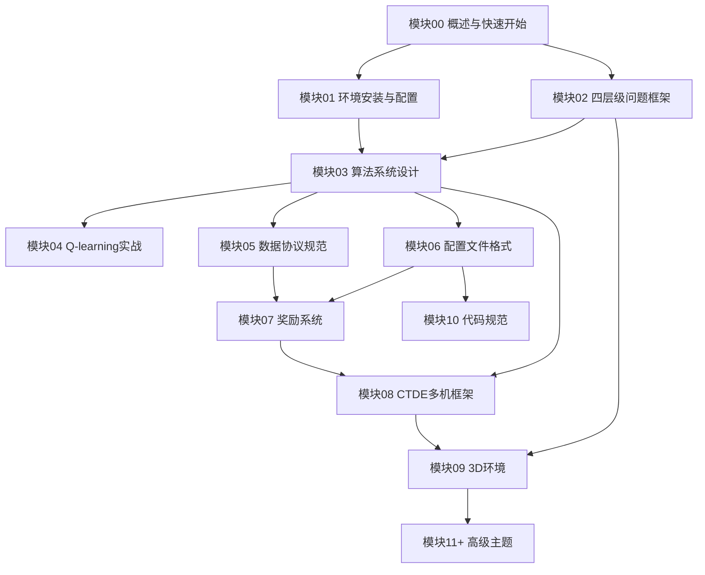

"""
模块00 — 概述与快速开始 / Module 00 — Overview & Quick Start

职责 / Responsibility:
    项目全景介绍、快速上手指南、术语表和文档使用导航。
    Project overview, quick start guide, glossary, and documentation navigation.

参考 / Reference:
    data/reference/kaiwu_gorge_walk_v2/dev_guide_optimized.md (结构风格)
    outputs/武汉光谷无人机配送_PPO开发指南.md (源码入口表)
    CLAUDE.md (项目指南)

领域适配 / Domain Adaptation:
    峡谷漫步v2 → 无人机配送:
    - 英雄角色 → 无人机(UAV)
    - 64x64网格 → 40x40网格/3D城市空域
    - 收集宝箱 → 取货+配送双阶段任务
    - 到达终点 → 安全返回配送中心(depot)
"""

---

## 0. 概述与快速开始 / Overview & Quick Start

> **版本 / Version**: v2.0  
> **日期 / Date**: 2026-07-11  
> **适用对象 / Audience**: 大学生创新训练项目成员、强化学习初学者  
> **前置知识 / Prerequisites**: Python基础、强化学习入门概念

---

### 0.1 项目背景与研究目标 / Background & Goals

#### 外卖骑手工作模式类比 / Delivery Rider Workflow Analogy

想象一个外卖骑手的日常：从站点出发，前往商家取货，骑车送到客户手中，继续接下一单，忙碌一天后返回站点。这个过程中，骑手需要不断做出决策：先送哪单？走哪条路？要不要顺路接新单？

本项目的本质，就是用**强化学习智能体**替代这位骑手的大脑，用**无人机**替代骑手的电动车：

| 骑手元素 | → | 无人机系统 |
|---|---|---|
| 站点 | → | 配送中心 (Depot) |
| 电动车 | → | 无人机 (UAV) |
| 骑手大脑 | → | RL智能体 (Agent) |
| 2D路网 | → | 3D空域 |
| 油费 | → | 电池能耗 |
| 红绿灯/堵车 | → | 禁飞区/建筑障碍 |

#### 无人机替代骑手的核心挑战 / Five Core Challenges

1. **路线选择空间爆炸**：从2D路网扩展到3D空域，动作空间从离散4方向扩展到连续Box(4)
2. **能量约束更严格**：电池容量有限，必须在电量耗尽前完成配送并返航
3. **安全约束更复杂**：建筑碰撞、禁飞区、电力线、风力扰动等多维约束
4. **多机协同更困难**：多架无人机需要分配任务、避免冲突、保持通信
5. **稀疏奖励问题**：配送任务天然稀疏（完成一单才获奖励），需要密集引导信号

#### 项目最终交付物清单 / Final Deliverables

| 编号 | 交付物 | 说明 |
|---|---|---|
| D1 | 渐进式开发指南 | `dev_guide.md`，31个模块，与Kaiwu风格一致 |
| D2 | 策划书技术方案 | 基于四层级框架和六算法对比 |
| D3 | 学习过程图表 | 奖励收敛曲线、算法对比柱状图、雷达图 |
| D4 | 环境示意图引用 | 利用已有`outputs/`资源 |

#### 国家级大创立项定位 / National Innovation Project Positioning

本项目为**国家级大学生创新训练计划项目**，研究方向为"基于强化学习的无人机外卖配送调度系统"，核心创新点在于：

- 采用腾讯开悟（Kaiwu）竞赛平台的6子模块标准架构
- 渐进式四层级设计（L1->L4），从简单网格到复杂3D城市
- 武汉四区真实场景数据驱动
- 六种经典RL算法的系统化对比

---

### 0.2 快速开始：30分钟跑通L1 / Quick Start: Run L1 in 30 Minutes

#### 步骤1：安装依赖 / Step 1: Install Dependencies

```powershell
# 进入Python仿真目录 / Navigate to Python simulation directory
cd "C:\University\Files\Training program\无人机项目设计\07_仿真与控制代码\Python仿真"

# 创建虚拟环境（推荐）/ Create virtual environment (recommended)
python -m venv venv
.\venv\Scripts\activate

# 安装核心依赖 / Install core dependencies
pip install numpy torch gymnasium toml

# 或使用完整依赖文件（如有）/ Or use full requirements file
pip install -r requirements.txt
```

**必需依赖表 / Required Dependencies**:

| 包名 | 最低版本 | 用途 / Purpose |
|---|---|---|
| `numpy` | >= 1.21 | 数值计算、数组操作 |
| `torch` | >= 1.12 | 神经网络、深度RL算法 |
| `gymnasium` | >= 0.26 | 环境接口标准 |
| `toml` | >= 0.10 | TOML配置文件解析 |

**Python版本要求 / Python Version**: >= 3.8（推荐3.10+）

#### 步骤2：确认目录结构 / Step 2: Verify Directory Structure

```powershell
# 确认drone_delivery目录存在 / Confirm drone_delivery directory exists
dir drone_delivery

# 应看到如下子目录 / Should see these subdirectories:
#   agent_q_learning/     agent_monte_carlo/
#   agent_sarsa/          agent_dqn/
#   agent_a2c/            agent_diy/
#   conf/                 train_test.py
```

#### 步骤3：运行冒烟测试 / Step 3: Run Smoke Tests

```powershell
# 运行Q-learning冒烟测试（5回合）/ Run Q-learning smoke test (5 episodes)
python drone_delivery/train_test.py --algo q_learning --episodes 5

# 运行全部算法冒烟测试 / Run all algorithm smoke tests
python drone_delivery/train_test.py --algo all --episodes 5

# 运行单元测试 / Run unit tests
python -m pytest -q
```

#### 步骤4：查看训练日志 / Step 4: Check Training Logs

训练过程中会在控制台输出关键指标：

```text
Episode  100 | Reward:  -45.2 | Deliveries: 2/5 | Steps: 287 | Epsilon: 0.61
Episode  200 | Reward:   12.8 | Deliveries: 3/5 | Steps: 198 | Epsilon: 0.37
Episode  500 | Reward:   89.3 | Deliveries: 5/5 | Steps: 132 | Epsilon: 0.08
```

| 指标 / Metric | 含义 / Meaning |
|---|---|
| `Reward` | 回合总奖励（越高越好） |
| `Deliveries` | 完成配送数 / 总订单数 |
| `Steps` | 使用步数（越少越高效） |
| `Epsilon` | 探索率（仅表格型算法） |

#### 步骤5：加载模型评估 / Step 5: Load & Evaluate Model

```powershell
# 武汉场景训练（Zone B）/ Wuhan scene training (Zone B)
python run_wuhan_training.py --zone B --episodes 1000

# 武汉场景冒烟测试（快速接口验证）/ Wuhan scene smoke test (quick interface check)
python run_wuhan_training.py --zone A --episodes 1 --eval-episodes 1 --max-steps 2 --no-save
```

> **提示 / Tip**: Zone B（武汉学院）建筑稀疏（43栋），是L1/L2/L3的首选训练场景。  
> 正式训练不要使用极小的 `--max-steps`，该参数只用于接口烟雾测试。

---

### 0.3 术语表 / Glossary

#### RL基础术语 / RL Basic Terms

| 术语 | 英文 | 定义 / Definition |
|---|---|---|
| 回合 | Episode | 从`reset()`到终止的完整交互序列 |
| 奖励 | Reward | 环境每步返回的标量反馈信号 |
| 策略 | Policy | 从状态到动作的映射函数 pi(a\|s) |
| 价值函数 | Value Function | 状态s的期望累积回报 V(s) |
| 折扣因子 | Discount Factor (gamma) | 未来奖励的衰减系数，范围[0,1] |
| 学习率 | Learning Rate (alpha) | 参数更新步长 |
| 探索率 | Epsilon (epsilon) | epsilon-greedy策略中随机探索的概率 |
| 经验回放 | Experience Replay | 存储历史样本并随机采样训练 |
| 目标网络 | Target Network | 稳定训练的延迟更新网络副本 |
| GAE | Generalized Advantage Estimation | 广义优势估计，平衡偏差与方差 |
| on-policy | On-policy | 使用当前策略采样训练的算法 |
| off-policy | Off-policy | 可使用旧策略数据训练的算法 |

#### 无人机领域术语 / UAV Domain Terms

| 术语 | 英文 | 定义 / Definition |
|---|---|---|
| 配送中心 | Depot | 无人机起始位置和返航目标 |
| 航路点 | Waypoint | 路径上的中间导航点 |
| 禁飞区 | No-fly Zone | 禁止无人机进入的空域 |
| ENU坐标 | ENU Coordinates | 东(East)-北(North)-天(Up)局部坐标系 |
| 起飞重量 | Takeoff Weight | 无人机+货物的总质量 |
| SOC | State of Charge | 电池剩余电量百分比 |
| 避障 | Obstacle Avoidance | 检测并绕开障碍物的机动 |
| 净空距离 | Clearance | 无人机与障碍物之间的最小距离 |

#### 项目特有术语 / Project-Specific Terms

| 术语 | 英文 | 定义 / Definition |
|---|---|---|
| CTDE | Centralized Training Decentralized Execution | 集中训练分布式执行框架 |
| Kaiwu结构 | Kaiwu Structure | 腾讯开悟竞赛的6子模块Agent架构 |
| 6子模块 | 6 Submodules | Agent目录下的标准结构 |
| 四层级框架 | 4-Level Framework | L1到L4渐进式复杂度递增设计 |
| ObsData | Observation Data | 标准化观测数据类 |
| ActData | Action Data | 标准化动作数据类 |
| SampleData | Sample Data | 标准化样本数据类 |
| 业务Score | Business Score | 字典序验收评分（目标数优先） |
| 训练Reward | Training Reward | 密集奖励信号（含进度引导） |
| 冒烟测试 | Smoke Test | 快速验证代码正确性的短训练 |
| ScoreFirst | Score-First Delivery Planner | 目标数优先的分层规划器 |

---

### 0.4 关键源码入口 / Key Source Entry Points

#### 两套代码体系 / Two Code Systems

本项目存在两套代码体系，务必区分：

| | 体系A（现有成熟代码） | 体系B（Kaiwu式重构） |
|---|---|---|
| **位置** | `environment/`, `algorithm/`, `config.py` | `drone_delivery/agent_<algo>/` |
| **状态** | 终点参考，不要修改 | 新功能开发在此进行 |
| **风格** | 传统Python模块 | Kaiwu 6子模块标准 |
| **算法** | 完整PPO、CTDE框架 | Q-learning/SARSA/MC/DQN/A2C/DIY |

#### 9个核心源码入口表 / 9 Core Source Entry Points

| 文件路径 | 职责 / Responsibility | 状态 / Status |
|---|---|---|
| `environment/wuhan_scene.py` | 加载场景、建筑、桥梁、高压线、风险区 | 已实现 |
| `environment/wuhan_drone_env.py` | 动力学、观测、配送状态、能耗、奖励、计分 | 已实现 |
| `algorithm/delivery_strategy.py` | 目标数优先的可行路线枚举与12维评分 | 已实现 |
| `algorithm/ppo_agent.py` | tanh-squashed Gaussian PPO、GAE、优势归一化 | 已实现 |
| `run_wuhan_training.py` | 单机分层策略训练和评估入口 | 已实现 |
| `tests/test_wuhan_drone_env.py` | 场景、接口、可复现性、多机、返航测试 | 已实现 |
| `config.py` | 历史基线配置与武汉场景配置 | 已实现 |
| `drone_delivery/train_test.py` | 冒烟测试入口（支持全部算法） | 已实现 |
| `drone_delivery/conf/app_conf_drone_delivery.toml` | 应用级算法选择配置 | 已实现 |

---

### 0.5 项目目录结构 / Project Directory Structure

```text
项目根目录/
├── 00_项目管理/                 — 项目计划、进度跟踪
├── 01_参考文献/                 — 40+ 篇论文、知识库
├── 02_数据保存/                 — 模型检查点、训练日志
├── 03_图表脚本/                 — 绘图脚本、Mermaid图
├── 04_脚本图片输出/             — 训练曲线图、环境视图、3D渲染
├── 05_正文版本保存/             — 论文草稿
├── 06_模型与算法/               — 算法文档（PPO、CTDE等18篇）
├── 07_仿真与控制代码/
│   ├── Python仿真/
│   │   ├── config.py            — 全局配置字典（体系A）
│   │   ├── run_wuhan_training.py— 训练入口（体系A）
│   │   ├── environment/         — 环境类（体系A，不修改）
│   │   ├── algorithm/           — 算法类（体系A，不修改）
│   │   └── drone_delivery/      — Kaiwu式重构（体系B，新开发）
│   │       ├── conf/            — TOML配置
│   │       ├── agent_q_learning/
│   │       ├── agent_sarsa/
│   │       ├── agent_monte_carlo/
│   │       ├── agent_dqn/
│   │       ├── agent_a2c/
│   │       ├── agent_diy/
│   │       └── dev_guide_modules/ — 本开发指南模块文件
│   └── 文档说明/
├── 08_AI提示词与Agent设计/
├── 09_软件原型/
├── 10_答辩与展示/
├── 11_国家级立项申报/
├── 12_论文发表准备/
├── 13_国家级项目过程管理/
├── 14_大赛准备/
├── data/
│   ├── cache/osm_reference_scenes/  — OSM原始几何数据（四区）
│   ├── cache/reference_sources/     — 武汉学院参考地图
│   └── reference/
│       ├── kaiwu_gorge_walk_v2/     — Kaiwu峡谷漫步v2完整代码
│       └── kaiwu_infinity_valley/   — Kaiwu无限之谷完整代码
├── outputs/
│   ├── 环境示意图/               — 5张总览图（3D、热力图、障碍物图例等）
│   ├── 环境示意图_2D审核/       — 4张分区2D图 + scene_2d_manifest.json
│   ├── 环境示意图_3D预览/       — 四区3D场景文件（OBJ/MTL/碰撞JSON/预览PNG）
│   ├── 武汉光谷无人机配送_PPO开发指南.md — 3400行PPO高级开发指南
│   └── 无人机配送_渐进式开发指南.md     — 渐进式开发指南
├── reward_function_design.md        — 奖励函数理论设计文档
├── README.md                        — 项目说明
└── CLAUDE.md                        — Claude Code项目指南
```

---

### 0.6 文档使用指南 / How to Use This Guide

#### 三条推荐阅读路线 / Three Recommended Reading Paths

**路线一：入门路线（初学者） / Path 1: Beginner Path**

```text
模块00（概述）-> 模块01（环境安装）-> 模块02（四层级框架）
-> 模块03（算法系统）-> 模块04（Q-learning实战）
```

**路线二：开发路线（开发者） / Path 2: Developer Path**

```text
模块00（概述）-> 模块01（环境安装）-> 模块06（配置文件格式）
-> 模块10（代码规范）-> 模块05（数据协议）-> 模块07（奖励系统）
```

**路线三：研究路线（论文写作） / Path 3: Research Path**

```text
模块00（概述）-> 模块02（四层级框架）-> 模块03（算法系统）
-> 模块08（CTDE框架）-> 模块09（3D环境）-> 模块07（奖励系统）
```

#### 模块依赖关系 / Module Dependency Map



> **图例 / Legend**: 箭头表示"依赖于"，即阅读目标模块前应先阅读源模块。  
> Arrows mean "depends on" -- read the source module before the target.

---

*模块00结束 / End of Module 00*  
*下一模块 / Next: 模块01 — 环境安装与配置 / Module 01 — Environment Setup & Configuration*
