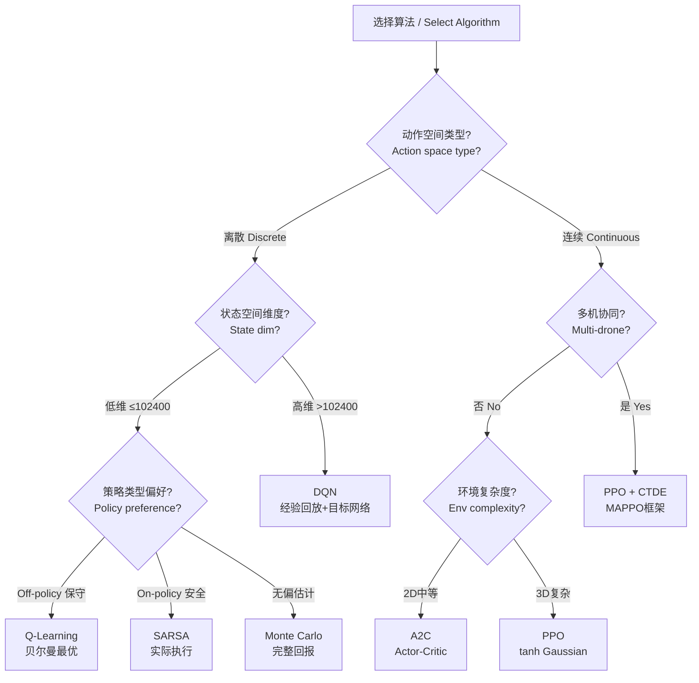

"""
职责 / Responsibility: 六种算法的完整规格说明，覆盖Q-Learning到PPO的原理、公式、代码、超参数和课程学习设计
参考 / Reference: dev_guide.md (v1.0) §4、PPO开发指南v3.0 §algorithm/ppo_agent.py、config.py PPO_CONFIG/NETWORK_CONFIG
领域适配 / Domain Adaptation: Kaiwu峡谷漫步v2表格型算法 → 无人机配送连续控制PPO
"""

---

## 3. 算法体系设计 / Algorithm System Design

本模块详细描述项目中使用的六种强化学习算法，从最简单的表格型Q-Learning到复杂的连续控制PPO，以及贯穿全流程的课程学习策略。

This module details the six RL algorithms used in the project, from the simplest tabular Q-Learning to complex continuous-control PPO, plus the curriculum learning strategy that spans the entire pipeline.

---

### 3.1 算法选择决策树 / Algorithm Selection Decision Tree

选择算法时，根据动作空间类型和状态空间维度进行决策：

When selecting an algorithm, decide based on action space type and state space dimensionality:



**适用场景总表 / Applicable Scenarios**:

| 算法 / Algorithm | 动作空间 / Action | 策略类型 / Policy | 适用层级 / Level | 核心优势 / Key Advantage |
|:---|:---|:---:|:---:|:---|
| Q-Learning | Discrete | Off-policy | L1 | 简单可靠，理论收敛 |
| SARSA | Discrete | On-policy | L1 | 安全保守，障碍物友好 |
| Monte Carlo | Discrete | On-policy | L1 | 无偏估计，无需自举 |
| DQN | Discrete | Off-policy | L2 | 处理高维状态，经验回放 |
| A2C | Discrete/Box | On-policy | L2/L3 | 并行训练，Actor-Critic |
| PPO | Box | On-policy | L3/L4 | 稳定裁剪，连续控制 |

---

### 3.2 Q-Learning（L1表格型）/ Q-Learning (L1 Tabular)

#### 3.2.1 算法原理 / Algorithm Principle

Q-Learning是一种**离线策略**（Off-policy）的表格型强化学习算法，通过贝尔曼最优方程迭代更新Q值表，学习最优动作价值函数 $Q^*(s, a)$。

Q-Learning is an **off-policy** tabular RL algorithm that iteratively updates a Q-value table via the Bellman optimality equation to learn the optimal action-value function $Q^*(s, a)$.

#### 3.2.2 核心更新公式 / Core Update Formula

$$
Q(s, a) \leftarrow Q(s, a) + \alpha \left[ r + \gamma \max_{a'} Q(s', a') - Q(s, a) \right]
$$

其中 / where:
- $\alpha = 0.1$：学习率 / learning rate
- $\gamma = 0.99$：折扣因子 / discount factor
- $r$：即时奖励 / immediate reward
- $\max_{a'} Q(s', a')$：下一状态的最大Q值（**与实际执行动作无关**）/ max Q-value of next state (**independent of actual action taken**)

**Double Q-Learning 变体 / Double Q-Learning Variant**:

为减少Q值过估计，可使用Double Q-Learning / To reduce overestimation, use Double Q-Learning:

$$
Q_1(s, a) \leftarrow Q_1(s, a) + \alpha \left[ r + \gamma Q_2(s', \arg\max_{a'} Q_1(s', a')) - Q_1(s, a) \right]
$$

#### 3.2.3 ε-greedy 探索策略 / ε-Greedy Exploration Strategy

$$
\pi(a|s) =
\begin{cases}
\text{uniform}(\mathcal{A}), & \text{with probability } \varepsilon \\
\arg\max_a Q(s, a), & \text{with probability } 1 - \varepsilon
\end{cases}
$$

指数衰减 / Exponential decay:

$$
\varepsilon_{t+1} = \max(\varepsilon_{min}, \; \varepsilon_t \times \text{decay})
$$

默认参数 / Default parameters: $\varepsilon_0 = 1.0$，$\varepsilon_{min} = 0.05$，$\text{decay} = 0.9995$

#### 3.2.4 代码示例（双语注释）/ Code Example (Bilingual Comments)

```python
# Q-Learning update step / Q-Learning 更新步骤
def update(self, state_key, action, reward, next_state_key, done):
    """
    Core Q-Learning update / 核心Q-Learning更新

    Parameters:
        state_key (int): Current state encoding / 当前状态编码
        action (int): Action taken / 执行的动作
        reward (float): Reward received / 获得的奖励
        next_state_key (int): Next state encoding / 下一状态编码
        done (bool): Whether episode ended / 回合是否结束
    """
    # Current Q-value / 当前Q值
    current_q = self.q_table.get((state_key, action), 0.0)

    # Target Q-value: bootstrap from max (off-policy) / 目标Q值：从最大值自举（离线策略）
    if done:
        target = reward
    else:
        next_max_q = max(
            self.q_table.get((next_state_key, a), 0.0)
            for a in range(self.num_actions)
        )
        target = reward + self.gamma * next_max_q

    # TD error and update / TD误差与更新
    td_error = target - current_q
    self.q_table[(state_key, action)] = current_q + self.alpha * td_error

    # Decay exploration rate / 衰减探索率
    self.epsilon = max(self.epsilon_min, self.epsilon * self.epsilon_decay)
```

#### 3.2.5 监控指标 / Monitoring Metrics

| 指标 / Metric | 说明 / Description | 健康范围 / Healthy Range |
|:---|:---|:---|
| `avg_reward` | 平均每回合奖励 / avg reward per episode | 逐步上升 |
| `epsilon` | 探索率 / exploration rate | 1.0 → 0.05 |
| `q_table_size` | Q表条目数 / Q-table entries | < 102,400 |
| `avg_deliveries` | 平均配送完成数 / avg deliveries | 0 → 5 |
| `success_rate` | 安全返航率 / safe return rate | 逐步上升 |

---

### 3.3 SARSA（L1表格型）/ SARSA (L1 Tabular)

#### 3.3.1 On-policy vs Off-policy 差异 / On-policy vs Off-policy Difference

SARSA是**在线策略**（On-policy）算法，与Q-Learning的核心区别在于：更新时使用**实际执行的下一个动作** $a'$ 而非 $\arg\max$。

SARSA is an **on-policy** algorithm. The key difference from Q-Learning: it uses the **actually executed next action** $a'$ instead of $\arg\max$.

| 特性 / Feature | Q-Learning (Off-policy) | SARSA (On-policy) |
|:---|:---|:---|
| 更新目标 / Update target | $r + \gamma \max_{a'} Q(s', a')$ | $r + \gamma Q(s', a')$ |
| 学习的策略 / Learned policy | 最优策略（与探索无关）/ optimal | 探索策略（考虑ε）/ exploratory |
| 安全性 / Safety | 激进（可能冒险）/ aggressive | 保守（远离危险）/ conservative |
| 收敛速度 / Convergence | 较快 / faster | 较慢 / slower |

#### 3.3.2 安全边际优势 / Safety Margin Advantage

在有障碍物的配送环境中，SARSA的保守性成为优势：

In obstacle-rich delivery environments, SARSA's conservativeness is advantageous:

- Q-Learning可能学到"穿过障碍物附近"的最优策略，但ε探索时仍可能撞上
- SARSA会学到"远离障碍物"的策略，因为ε探索时的碰撞惩罚也会被纳入更新

#### 3.3.3 核心更新公式 / Core Update Formula

$$
Q(s, a) \leftarrow Q(s, a) + \alpha \left[ r + \gamma Q(s', a') - Q(s, a) \right]
$$

注意 $a'$ 是从策略 $\pi(\cdot|s')$ 中**采样得到**的（含ε-greedy），而非 $\arg\max$。

Note that $a'$ is **sampled** from $\pi(\cdot|s')$ (with ε-greedy), not $\arg\max$.

#### 3.3.4 与Q-Learning的代码差异 / Code Difference from Q-Learning

```python
# SARSA update step / SARSA 更新步骤
def update(self, state_key, action, reward, next_state_key, next_action, done):
    """
    Core SARSA update — needs next_action as input
    核心SARSA更新 — 需要下一动作作为输入
    """
    current_q = self.q_table.get((state_key, action), 0.0)

    # Key difference: use actual next_action, not max
    # 关键区别：使用实际的下一动作，而非最大值
    if done:
        target = reward
    else:
        next_q = self.q_table.get((next_state_key, next_action), 0.0)
        target = reward + self.gamma * next_q

    td_error = target - current_q
    self.q_table[(state_key, action)] = current_q + self.alpha * td_error
```

---

### 3.4 Monte Carlo（L1表格型）/ Monte Carlo (L1 Tabular)

#### 3.4.1 首次访问MC算法 / First-Visit MC Algorithm

Monte Carlo方法使用**完整回合的实际累积回报**更新Q值，不使用自举（bootstrapping）。

Monte Carlo methods update Q-values using the **actual cumulative return of the full episode**, without bootstrapping.

```text
首次访问MC算法 / First-Visit MC Algorithm:
1. 使用策略π生成完整回合 {(s_0,a_0,r_1), ..., (s_{T-1},a_{T-1},r_T)}
2. 对回合中每个首次出现的(s,a)对：
   a. 计算从该步开始的折扣回报 G_t
   b. 将G_t加入该(s,a)的回报列表
   c. 更新 Q(s,a) = mean(returns(s,a))
```

#### 3.4.2 完整回报 G_t 计算 / Full Return G_t Computation

$$
G_t = \sum_{k=0}^{T-t-1} \gamma^k r_{t+k+1}
$$

实现时从回合末尾反向计算，避免重复运算 / Implement by reverse traversal to avoid redundant computation:

```python
# Reverse computation of returns / 反向计算回报
def compute_returns(rewards, gamma=0.99):
    """
    Compute discounted returns by reverse traversal
    通过反向遍历计算折扣回报
    """
    returns = []
    G = 0
    for r in reversed(rewards):
        G = r + gamma * G
        returns.insert(0, G)
    return returns
```

#### 3.4.3 偏差-方差权衡分析 / Bias-Variance Tradeoff Analysis

| 方法 / Method | 自举? / Bootstrap? | 偏差 / Bias | 方差 / Variance | 样本效率 / Efficiency |
|:---|:---:|:---:|:---:|:---:|
| Q-Learning | 是 / Yes | 有偏（依赖Q估计）/ biased | 低 / Low | 高 / High |
| SARSA | 是 / Yes | 有偏 / biased | 低 / Low | 高 / High |
| Monte Carlo | 否 / No | **无偏 / unbiased** | **高 / High** | 低 / Low |

Monte Carlo的无偏性意味着：给定足够多回合，Q值会收敛到真实值。但高方差意味着收敛速度较慢。

Monte Carlo's unbiasedness means: given enough episodes, Q-values converge to true values. But high variance means slower convergence.

#### 3.4.4 增量均值更新 / Incremental Mean Update

为避免存储所有历史回报，使用增量均值更新 / To avoid storing all historical returns, use incremental mean:

$$
Q(s, a) \leftarrow Q(s, a) + \frac{1}{N(s, a)} \left[ G_t - Q(s, a) \right]
$$

其中 $N(s, a)$ 为该状态-动作对的访问次数。Where $N(s, a)$ is the visit count for that state-action pair.

```python
# Incremental mean update / 增量均值更新
def update_first_visit(self, episode):
    """
    First-visit MC update for an entire episode
    首次访问MC更新整个回合
    """
    G = 0
    visited = set()
    # Reverse traversal for efficiency / 反向遍历提高效率
    for state_key, action, reward in reversed(episode):
        G = reward + self.gamma * G
        if (state_key, action) not in visited:
            visited.add((state_key, action))
            if (state_key, action) not in self.returns:
                self.returns[(state_key, action)] = []
            self.returns[(state_key, action)].append(G)
            # Incremental mean / 增量均值
            self.q_table[(state_key, action)] = np.mean(
                self.returns[(state_key, action)]
            )
```

---

### 3.5 DQN（L2深度型）/ DQN (L2 Deep)

#### 3.5.1 经验回放缓冲区 / Experience Replay Buffer

打破连续样本之间的相关性，提高样本效率 / Breaks correlation between consecutive samples, improving sample efficiency:

$$
\mathcal{D} = \{(s, a, r, s', \text{done})_1, \ldots, (s, a, r, s', \text{done})_N\}
$$

```python
# Experience replay buffer / 经验回放缓冲区
class ReplayBuffer:
    """
    Fixed-size circular replay buffer
    固定大小环形回放缓冲区
    """
    def __init__(self, capacity=10000):
        self.buffer = deque(maxlen=capacity)

    def push(self, state, action, reward, next_state, done):
        """Store transition / 存储转移"""
        self.buffer.append((state, action, reward, next_state, done))

    def sample(self, batch_size):
        """Random batch sampling / 随机批量采样"""
        return random.sample(self.buffer, batch_size)
```

#### 3.5.2 目标网络 / Target Network

使用延迟更新的**目标网络** $\theta^-$ 稳定训练：

Using a slowly-updated **target network** $\theta^-$ to stabilize training:

$$
L(\theta) = \mathbb{E} \left[ \left( r + \gamma \max_{a'} \hat{Q}(s', a'; \theta^-) - \hat{Q}(s, a; \theta) \right)^2 \right]
$$

**硬更新 / Hard Update**: 每 $C$ 步复制参数 / Copy parameters every $C$ steps:

$$
\theta^- \leftarrow \theta \quad \text{every } C \text{ steps}
$$

默认 $C = 1000$。

**软更新 / Soft Update** (可选 / optional): 每步指数移动平均 / Every-step EMA:

$$
\theta^- \leftarrow \tau \theta + (1 - \tau) \theta^- \quad \text{with } \tau = 0.005
$$

#### 3.5.3 Dueling Network 架构 / Dueling Network Architecture

将Q值分解为状态价值 $V(s)$ 和优势函数 $A(s, a)$ 两路：

Decompose Q-value into state value $V(s)$ and advantage $A(s, a)$ streams:

$$
Q(s, a; \theta) = V(s; \theta_v) + \left( A(s, a; \theta_a) - \frac{1}{|\mathcal{A}|} \sum_{a'} A(s, a'; \theta_a) \right)
$$

```python
class DuelingDQN(nn.Module):
    """
    Dueling DQN network architecture
    Dueling DQN 网络架构
    """
    def __init__(self, state_dim, action_dim, hidden_dim=256):
        super().__init__()
        # Shared feature layer / 共享特征层
        self.feature = nn.Sequential(
            nn.Linear(state_dim, hidden_dim),
            nn.ReLU(),
            nn.Linear(hidden_dim, hidden_dim),
            nn.ReLU(),
        )
        # Value stream / 价值流
        self.value = nn.Linear(hidden_dim, 1)
        # Advantage stream / 优势流
        self.advantage = nn.Linear(hidden_dim, action_dim)

    def forward(self, x):
        feat = self.feature(x)
        val = self.value(feat)
        adv = self.advantage(feat)
        # Combine: Q = V + (A - mean(A)) / 组合
        q = val + adv - adv.mean(dim=-1, keepdim=True)
        return q
```

#### 3.5.4 Huber Loss

使用Huber Loss替代MSE，减少异常值影响 / Use Huber Loss instead of MSE to reduce outlier impact:

$$
L_\delta(a) =
\begin{cases}
\frac{1}{2} a^2, & \text{if } |a| \leq \delta \\
\delta (|a| - \frac{1}{2}\delta), & \text{otherwise}
\end{cases}
$$

默认 $\delta = 1.0$。PyTorch实现 / PyTorch implementation: `nn.SmoothL1Loss()`。

---

### 3.6 A2C（L2/L3深度型）/ A2C (L2/L3 Deep)

#### 3.6.1 Actor-Critic 架构 / Actor-Critic Architecture

```text
                    ┌─────────────┐
                    │  State s_t  │
                    └──────┬──────┘
                           │
              ┌────────────┼────────────┐
              │            │            │
        ┌─────┴─────┐ ┌───┴───┐
        │  Actor π  │ │Critic V│
        │  θ_π      │ │ θ_V   │
        └─────┬─────┘ └───┬───┘
              │            │
        ┌─────┴─────┐ ┌───┴───┐
        │  a_t ~ π  │ │ V(s_t)│
        └─────┬─────┘ └───┬───┘
              │            │
              └─────┬──────┘
                    │
              ┌─────┴─────┐
              │ Advantage  │
              │ A(s,a) =   │
              │ Q(s,a)-V(s)│
              └────────────┘
```

- **Actor**（策略网络）: 输出动作分布 $\pi_\theta(a|s)$
- **Critic**（价值网络）: 估计状态价值 $V_\phi(s)$

#### 3.6.2 优势函数 / Advantage Function

$$
A(s, a) = Q(s, a) - V(s)
$$

单步近似 / Single-step approximation (TD error):

$$
A(s_t, a_t) \approx \delta_t = r_t + \gamma V(s_{t+1}) - V(s_t)
$$

#### 3.6.3 GAE(λ) 公式 / GAE(λ) Formula

广义优势估计（Generalized Advantage Estimation）平衡偏差与方差：

Generalized Advantage Estimation balances bias and variance:

$$
\hat{A}_t^{GAE(\gamma, \lambda)} = \sum_{l=0}^{T-t-1} (\gamma \lambda)^l \delta_{t+l}
$$

其中 / where:

$$
\delta_t = r_t + \gamma V(s_{t+1}) - V(s_t)
$$

- $\lambda = 0$：退化为单步TD（低方差高偏差）/ degenerates to single-step TD
- $\lambda = 1$：退化为Monte Carlo（高方差无偏）/ degenerates to MC
- $\lambda = 0.95$：默认折中值 / default compromise

#### 3.6.4 损失函数 / Loss Functions

**Actor 损失 / Actor Loss**:

$$
L_{actor} = -\mathbb{E} \left[ \log \pi_\theta(a_t|s_t) \cdot \hat{A}_t \right] - \beta \mathcal{H}(\pi_\theta)
$$

**Critic 损失 / Critic Loss**:

$$
L_{critic} = \mathbb{E} \left[ (R_t - V_\phi(s_t))^2 \right]
$$

**总损失 / Total Loss**:

$$
L = L_{actor} + c_1 L_{critic}
$$

其中 $c_1 = 0.5$（`config.py` 中的 `value_coef`），$\beta = 0.01$（`entropy_coef`）。

#### 3.6.5 熵正则化 / Entropy Regularization

$$
\mathcal{H}(\pi_\theta) = -\sum_a \pi_\theta(a|s) \log \pi_\theta(a|s)
$$

熵正则化鼓励探索：当策略过于确定性（熵低）时，增加惩罚项迫使策略保持多样性。

Entropy regularization encourages exploration: when the policy becomes too deterministic (low entropy), the penalty term forces the policy to maintain diversity.

---

### 3.7 PPO（L3/L4深度型）/ PPO (L3/L4 Deep)

#### 3.7.1 tanh-squashed Gaussian 策略 / tanh-Squashed Gaussian Policy

用于连续动作空间，通过tanh函数将高斯采样压缩到 $[-1, 1]$：

For continuous action spaces, compress Gaussian samples to $[-1, 1]$ via tanh:

$$
a = \tanh(\mu_\theta(s) + \sigma_\theta(s) \odot \epsilon), \quad \epsilon \sim \mathcal{N}(0, I)
$$

**雅可比修正 / Jacobian Correction**:

$$
\log \pi(a|s) = \log \mathcal{N}(u; \mu, \sigma^2) - \sum_i \log(1 - \tanh^2(u_i))
$$

其中 $u = \text{arctanh}(a)$ 为逆变换。这保证了log概率的数值正确性。

Where $u = \text{arctanh}(a)$ is the inverse transform. This ensures numerically correct log probabilities.

#### 3.7.2 Clipped Surrogate 目标函数 / Clipped Surrogate Objective

$$
L^{CLIP}(\theta) = \mathbb{E} \left[ \min \left( r_t(\theta) \hat{A}_t, \; \text{clip}(r_t(\theta), 1-\epsilon, 1+\epsilon) \hat{A}_t \right) \right]
$$

其中 / where:
- $r_t(\theta) = \frac{\pi_\theta(a_t|s_t)}{\pi_{\theta_{old}}(a_t|s_t)}$：概率比 / probability ratio
- $\epsilon = 0.2$：裁剪系数 / clipping coefficient

裁剪机制确保新策略不会偏离旧策略太远 / Clipping ensures new policy doesn't deviate too far from old policy.

#### 3.7.3 完整GAE计算 / Full GAE Computation

```python
# GAE computation / GAE 计算
def compute_gae(rewards, values, dones, next_value, gamma=0.99, lam=0.95):
    """
    Compute Generalized Advantage Estimation
    计算广义优势估计

    Parameters:
        rewards (list): Step rewards / 每步奖励
        values (list): State values V(s) / 状态价值
        dones (list): Done flags / 终止标志
        next_value (float): V(s_{T+1}) for bootstrapping / 自举用
        gamma (float): Discount factor / 折扣因子
        lam (float): GAE lambda / GAE参数
    """
    advantages = []
    gae = 0
    # Reverse traversal / 反向遍历
    for t in reversed(range(len(rewards))):
        if t == len(rewards) - 1:
            next_val = next_value
        else:
            next_val = values[t + 1]
        # TD error / TD误差
        delta = rewards[t] + gamma * next_val * (1 - dones[t]) - values[t]
        # GAE accumulation / GAE累积
        gae = delta + gamma * lam * (1 - dones[t]) * gae
        advantages.insert(0, gae)
    returns = [adv + val for adv, val in zip(advantages, values)]
    return advantages, returns
```

#### 3.7.4 MLP网络结构 / MLP Network Structure

**166 -> 256 -> 256 -> 128 -> 16** (L3/L4) / 来自 `config.py NETWORK_CONFIG`:

```python
# Network architecture / 网络架构
# Source: config.py NETWORK_CONFIG

# Actor network / Actor网络
# actor_hidden_dims = [256, 128, 64]
# actor_activation = "ReLU"
# actor_init_gain = 0.01 (orthogonal init)

class Actor(nn.Module):
    """
    Actor network for continuous actions
    连续动作的Actor网络
    """
    def __init__(self, obs_dim=166, act_dim=3, hidden_dims=[256, 128, 64]):
        super().__init__()
        layers = []
        prev_dim = obs_dim
        for h_dim in hidden_dims:
            layers.extend([nn.Linear(prev_dim, h_dim), nn.ReLU()])
            prev_dim = h_dim
        self.trunk = nn.Sequential(*layers)
        self.mean = nn.Linear(prev_dim, act_dim)
        self.log_std = nn.Parameter(torch.ones(act_dim) * -0.5)
        # Orthogonal init / 正交初始化
        self._init_weights(gain=0.01)

# Critic network / Critic网络
# critic_hidden_dims = [256, 128, 64]
# critic_activation = "Tanh"  -- MUST be Tanh, not ReLU / 必须Tanh，禁止ReLU
# critic_init_gain = 1.0

class Critic(nn.Module):
    """
    Critic network for state value estimation
    状态价值估计的Critic网络
    """
    def __init__(self, obs_dim=166, hidden_dims=[256, 128, 64]):
        super().__init__()
        layers = []
        prev_dim = obs_dim
        for h_dim in hidden_dims:
            layers.extend([nn.Linear(prev_dim, h_dim), nn.Tanh()])
            prev_dim = h_dim
        layers.append(nn.Linear(prev_dim, 1))
        self.net = nn.Sequential(*layers)
        self._init_weights(gain=1.0)
```

#### 3.7.5 CNN-MLP 混合架构（可选）/ CNN-MLP Hybrid (Optional)

用于处理局部语义图和高度图输入 / For processing local semantic map and heightmap inputs:

$$
\mathbf{o}_{total} = [\text{CNN}(\mathbf{o}_{map}); \; \text{MLP}(\mathbf{o}_{state})]
$$

```text
输入 / Inputs:
  o_map: 32x32 semantic grid (building types, height, NFZ)
  o_state: 166-dim vector (position, velocity, orders, LiDAR, energy)

处理 / Processing:
  CNN branch: Conv(4,16,3) -> Conv(16,32,3) -> Conv(32,64,3) -> Flatten -> FC(128)
  MLP branch: FC(256) -> FC(128)

合并 / Merge:
  Concat(128, 128) -> FC(256) -> Actor/Critic heads
```

#### 3.7.6 数值稳定性技巧 / Numerical Stability Tricks

| 技巧 / Trick | 说明 / Description |
|:---|:---|
| log_std 限制 / log_std clamping | $\log\sigma \in [-5, 2]$，防止过小或过大方差 |
| 优势归一化 / Advantage normalization | $\hat{A} = (A - \mu_A) / (\sigma_A + 10^{-8})$ |
| 梯度裁剪 / Gradient clipping | `max_grad_norm = 0.5`（`config.py`） |
| Critic用Tanh | Critic激活函数必须为Tanh，防止ReLU死区 |
| Actor正交初始化 | gain=0.01，使初始策略接近均匀分布 |
| 学习率退火 / LR annealing | 余弦退火从 $3 \times 10^{-4}$ 到 $1 \times 10^{-5}$ |

---

### 3.8 算法对比总表 / Algorithm Comparison Summary

#### 3.8.1 六算法统一对比表 / 6-Algorithm Unified Comparison

| 维度 / Dim | Q-Learning | SARSA | Monte Carlo | DQN | A2C | PPO |
|:---|:---:|:---:|:---:|:---:|:---:|:---:|
| 策略类型 / Policy | Off-policy | On-policy | On-policy | Off-policy | On-policy | On-policy |
| 动作空间 / Action | Disc | Disc | Disc | Disc | Disc/Box | Box |
| 网络结构 / Network | Q-table | Q-table | Q-table | MLP/Dueling | Actor+Critic | Actor+Critic |
| 学习率 / LR | 0.1 | 0.1 | — | $10^{-3}$ | $3 \times 10^{-4}$ | $3 \times 10^{-4}$ |
| 折扣因子 / $\gamma$ | 0.99 | 0.99 | 0.99 | 0.99 | 0.99 | 0.99 |
| 批量大小 / Batch | 1 | 1 | episode | 32 | rollout | 256 |
| 更新方式 / Update | per-step | per-step | per-episode | mini-batch | per-step | multi-epoch |
| 自举? / Bootstrap | Yes | Yes | No | Yes | Yes | Yes |
| 经验回放 / Replay | No | No | No | Yes | No | No |
| GAE / $\lambda$ | — | — | — | — | 0.95 | 0.95 |
| 裁剪 / Clip | — | — | — | — | No | Yes ($\epsilon$=0.2) |
| 优势 / Advantage | 简单可靠 | 安全保守 | 无偏 | 高维状态 | 并行高效 | 稳定连续 |
| 劣势 / Disadvantage | 仅离散 | 收敛慢 | 高方差 | 样本效率低 | 方差较大 | 计算成本高 |
| 适用层级 / Level | L1 | L1 | L1 | L2 | L2/L3 | L3/L4 |

#### 3.8.2 五维雷达图描述 / 5-Dimension Radar Description

从以下五个维度评估各算法的相对表现（0-5分）/ Evaluate each algorithm on five dimensions (0-5 scale):

| 维度 / Dimension | Q-Learning | SARSA | MC | DQN | A2C | PPO |
|:---|:---:|:---:|:---:|:---:|:---:|:---:|
| 样本效率 / Sample Efficiency | 4 | 3 | 2 | 3 | 3 | 4 |
| 训练稳定性 / Stability | 5 | 5 | 4 | 3 | 3 | 5 |
| 探索能力 / Exploration | 3 | 3 | 3 | 3 | 4 | 4 |
| 可扩展性 / Scalability | 1 | 1 | 1 | 3 | 4 | 5 |
| 实现简易度 / Simplicity | 5 | 5 | 4 | 3 | 3 | 2 |

---

### 3.9 课程学习设计（C1-C7）/ Curriculum Learning Design

#### 3.9.1 七阶段课程表 / 7-Stage Curriculum Schedule

```text
C1: L1基础导航 / L1 Basic Navigation
    ├── 地图: Zone B (43栋建筑)
    ├── 任务: 完成1个订单配送
    ├── 算法: Q-Learning
    └── 转换: 完成率 > 80%

C2: L1全量配送 / L1 Full Delivery
    ├── 地图: Zone B
    ├── 任务: 5个订单全部配送+返航
    ├── 算法: Q-Learning / SARSA / MC
    └── 转换: 完成率 > 70%

C3: L2随机订单 / L2 Random Orders
    ├── 地图: Zone B
    ├── 任务: 4-8个随机订单+时间窗口
    ├── 算法: DQN / A2C
    └── 转换: 按时完成率 > 60%

C4: L3物理约束 / L3 Physical Constraints
    ├── 地图: Zone B (3D)
    ├── 任务: 固定任务点+禁飞区+能耗
    ├── 算法: A2C / PPO
    └── 转换: 安全返航率 > 50%

C5: L3高密度 / L3 High Density
    ├── 地图: Zone A (837栋建筑)
    ├── 任务: 高密度建筑环境
    ├── 算法: PPO
    └── 转换: 安全返航率 > 40%

C6: L3复杂地形 / L3 Complex Terrain
    ├── 地图: Zone C/D (桥梁+水域)
    ├── 任务: 复杂地形约束
    ├── 算法: PPO
    └── 转换: 安全返航率 > 35%

C7: L4多机协同 / L4 Multi-Drone
    ├── 地图: Zone A+B 联合
    ├── 任务: 3架无人机CTDE协同
    ├── 算法: PPO + CTDE
    └── 转换: 协同效率指标 > 阈值
```

#### 3.9.2 阶段转换条件 / Stage Transition Conditions

| 阶段 / Stage | 指标 / Metric | 阈值 / Threshold | 评估窗口 / Window |
|:---:|:---|:---:|:---:|
| C1 → C2 | 完成1单配送率 / 1-delivery rate | > 80% | 最近100回合 |
| C2 → C3 | 全部5单+返航率 / all-5+return rate | > 70% | 最近100回合 |
| C3 → C4 | 按时完成率 / on-time rate | > 60% | 最近200回合 |
| C4 → C5 | 安全返航率 / safe return rate | > 50% | 最近200回合 |
| C5 → C6 | 安全返航率 / safe return rate | > 40% | 最近300回合 |
| C6 → C7 | 安全返航率 / safe return rate | > 35% | 最近300回合 |

#### 3.9.3 CurriculumManager 使用 / CurriculumManager Usage

```python
class CurriculumManager:
    """
    课程学习管理器 — 控制训练阶段自动进阶
    Curriculum learning manager — auto-advances training stages
    """
    def __init__(self, stages, transition_thresholds):
        """
        Parameters:
            stages (list): Stage configs / 阶段配置列表
            transition_thresholds (dict): Metric -> threshold / 指标->阈值映射
        """
        self.current_stage = 0
        self.stages = stages
        self.thresholds = transition_thresholds
        self.metrics_history = deque(maxlen=100)

    def update(self, metrics: dict) -> bool:
        """
        Check if stage transition should occur
        检查是否应进行阶段转换

        Parameters:
            metrics (dict): Current episode metrics / 当前回合指标

        Returns:
            bool: Whether transition occurred / 是否发生转换
        """
        self.metrics_history.append(metrics)
        if len(self.metrics_history) < 50:
            return False
        # Evaluate transition condition / 评估转换条件
        key = self.stages[self.current_stage]["metric_key"]
        threshold = self.thresholds[key]
        recent_avg = np.mean([m[key] for m in self.metrics_history])
        if recent_avg >= threshold:
            self.current_stage += 1
            self.metrics_history.clear()
            return True
        return False

    @property
    def current_config(self):
        """Get current stage configuration / 获取当前阶段配置"""
        return self.stages[self.current_stage]
```

#### 3.9.4 势能塑形辅助 / Potential-Based Shaping Assist

在课程学习早期阶段，使用势能塑形提供密集引导信号：

In early curriculum stages, use potential-based shaping to provide dense guidance:

$$
F(s, s') = \gamma \Phi(s') - \Phi(s)
$$

$$
\Phi(s) = -\text{distance}(s, \text{nearest\_unvisited\_goal})
$$

势能塑形保证最优策略不变（Policy Invariance Theorem），同时提供距离引导的密集奖励信号。

Potential-based shaping preserves the optimal policy (Policy Invariance Theorem) while providing distance-guided dense reward signals.

---

> **上一节 / Previous**: [2. 四层级问题框架 / Four-Level Problem Framework](02_four_levels.md)
> **下一节 / Next**: [5. 数据协议规范 / Data Protocol Specification](05_data_protocol.md)
