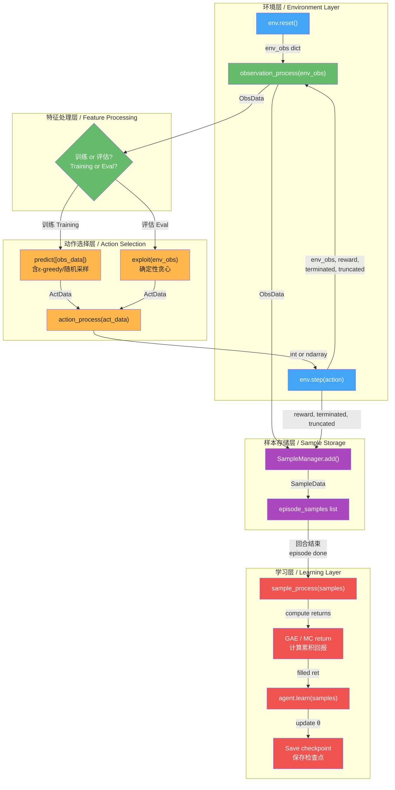

"""
职责 / Responsibility: 数据协议规范完整说明，覆盖create_cls机制、ObsData/ActData/SampleData定义、terminated vs truncated处理
参考 / Reference: dev_guide.md (v1.0) §3.4、Kaiwu峡谷漫步v2 dev_guide_optimized.md、config.py
领域适配 / Domain Adaptation: Kaiwu峡谷漫步v2数据协议 → 无人机配送ObsData/ActData/SampleData
"""

---

## 5. 数据协议规范 / Data Protocol Specification

本模块定义项目中三层数据流转的标准协议：`ObsData`（环境观测）、`ActData`（动作选择）、`SampleData`（训练样本）。这些数据类通过腾讯开悟（Kaiwu）的 `create_cls` 动态类工厂创建，保证Agent各子模块之间的接口一致性。

This module defines the standard three-layer data flow protocol: `ObsData` (environment observation), `ActData` (action selection), and `SampleData` (training sample). These data classes are created via Tencent Kaiwu's `create_cls` dynamic class factory, ensuring interface consistency across all Agent submodules.

---

### 5.1 create_cls 动态数据类 / Dynamic Data Classes with create_cls

#### 5.1.1 Kaiwu机制原理 / Kaiwu Mechanism Principle

腾讯开悟框架使用 `create_cls` 函数动态生成轻量级数据容器类，替代传统的 `@dataclass` 或 `namedtuple`。其核心优势是：无需预先定义类结构，通过关键字参数动态创建实例，且支持任意属性访问。

Tencent Kaiwu uses `create_cls` to dynamically generate lightweight data container classes, replacing traditional `@dataclass` or `namedtuple`. Key advantage: no need to pre-define class structure — create instances dynamically via keyword arguments with arbitrary attribute access.

#### 5.1.2 create_cls 实现 / create_cls Implementation

```python
def create_cls(cls_name: str, **default_kwargs):
    """
    Create a dynamic data class (Kaiwu-style)
    创建动态数据类（开悟风格）

    Parameters:
        cls_name (str): Class name / 类名
        **default_kwargs: Default attribute values / 默认属性值

    Returns:
        type: A new class with __init__ accepting all kwargs
              一个新类，__init__接受所有关键字参数

    Usage:
        ObsData = create_cls("ObsData", feature=None, legal_act=None)
        obs = ObsData(feature=np.array([1,2,3]), legal_act=[True, False])
    """
    def __init__(self, **kwargs):
        # Merge defaults with provided values / 合并默认值与传入值
        for key, value in default_kwargs.items():
            setattr(self, key, kwargs.get(key, value))
        # Also store any extra kwargs / 存储额外关键字参数
        for key, value in kwargs.items():
            if key not in default_kwargs:
                setattr(self, key, value)

    # Dynamically create the class / 动态创建类
    cls = type(cls_name, (object,), {"__init__": __init__})
    return cls
```

#### 5.1.3 使用示例 / Usage Example

```python
# Create the three standard data classes / 创建三个标准数据类
ObsData = create_cls("ObsData", feature=None, legal_act=None)
ActData = create_cls("ActData", act=None, val=None)
SampleData = create_cls("SampleData", obs=None, _obs=None, act=None, rew=None, done=None, ret=None)

# Instantiate / 实例化
obs = ObsData(feature=np.array([0.5, 0.3]), legal_act=[True, True, False, True])
act = ActData(act=2, val=0.85)
sample = SampleData(obs=obs, _obs=next_obs, act=act, rew=100.0, done=False, ret=0.0)

# Attribute access / 属性访问
print(obs.feature)    # [0.5, 0.3]
print(act.act)        # 2
print(sample.rew)     # 100.0
```

---

### 5.2 ObsData 规范 / ObsData Specification

#### 5.2.1 定义 / Definition

```python
ObsData = create_cls("ObsData", feature=None, legal_act=None)
```

#### 5.2.2 feature字段说明 / feature Field Description

`feature` 字段承载从环境观测转换而来的模型输入特征。不同层级的维度不同：

The `feature` field carries model input features converted from environment observations. Dimensions vary by level:

| 层级 / Level | feature 类型 / Type | 维度 / Dim | 说明 / Description |
|:---|:---|:---:|:---|
| L1 | `int` | 1 | state_key 唯一编码 / unique state encoding |
| L2 | `np.ndarray` | 50 | 向量化观测 / vectorized observation |
| L3 | `np.ndarray` | 166 | 3D连续观测向量 / 3D continuous observation |
| L4 | `np.ndarray` | 166 | 单机观测（CTDE Critic用全局拼接）/ per-drone obs |

**L1 feature 示例 / L1 feature Example**:

```python
# L1: state_key is a single integer / state_key是单个整数
state_key = env.get_state_key()  # e.g., 52819
obs_data = ObsData(feature=state_key, legal_act=[True, True, False, True])
```

**L2 feature 示例 / L2 feature Example**:

```python
# L2: 50-dim normalized vector / 50维归一化向量
feature = np.zeros(50, dtype=np.float32)
feature[0:2] = position / grid_size          # 归一化位置
feature[2:32] = order_features_flat          # 订单信息
feature[32] = carrying                       # 携带状态
feature[33] = steps / max_steps              # 步数比例
obs_data = ObsData(feature=feature, legal_act=[True]*8)
```

**L3/L4 feature 示例 / L3/L4 feature Example**:

```python
# L3/L4: 166-dim continuous observation / 166维连续观测
feature = np.concatenate([
    drone_pos_normalized,       # 3  — 位置
    drone_vel_normalized,       # 3  — 速度
    attitude_quat,              # 4  — 姿态
    order_features_flat,        # 60 — 12任务点x5维
    lidar_readings,             # 36 — LiDAR测距
    energy_meta,                # 4  — 电量/时间/载重/航程
    obstacle_nfz_wind,          # 56 — 障碍物/禁飞区/风场
])  # Total: 166
obs_data = ObsData(feature=feature, legal_act=[True, True, True])
```

#### 5.2.3 legal_act字段说明 / legal_act Field Description

`legal_act` 是一个布尔列表，长度等于动作空间大小。`True` 表示该动作在当前状态下合法可执行。

`legal_act` is a boolean list whose length equals the action space size. `True` means the action is legal in the current state.

```python
# L1: 4 actions / L1: 4个动作
legal_act = [True, True, False, True]
# 含义：上=合法，下=合法，左=非法（障碍物），右=合法
# Meaning: UP=legal, DOWN=legal, LEFT=illegal (obstacle), RIGHT=legal

# L2: 8 actions / L2: 8个动作
legal_act = [True, True, True, True, False, True, False, True]
# 对角线方向可能因角落被限制
# Diagonal directions may be restricted at corners

# L3/L4: continuous / L3/L4: 连续动作
legal_act = [True, True, True]
# 连续动作空间通常全为True，约束由环境侧处理
# Continuous action spaces typically all True, constraints handled by env
```

#### 5.2.4 observation_process 四段式API / observation_process 4-Section API

每个Agent必须实现 `observation_process` 方法，将原始环境观测转换为 `ObsData`：

Every Agent must implement `observation_process` to convert raw env observations to `ObsData`:

```python
def observation_process(self, env_obs: dict) -> ObsData:
    """
    Convert raw environment observation to ObsData
    将原始环境观测转换为ObsData

    Parameters:
        env_obs (dict): Raw observation from env.reset()/env.step()
                        来自env.reset()/env.step()的原始观测

    Returns:
        ObsData: Standardized observation data
                 标准化观测数据

    Invariants:
        - feature shape must match model input dimension
          feature形状必须与模型输入维度匹配
        - legal_act length must equal action_space.n (discrete) or action_dim (continuous)
          legal_act长度必须等于action_space.n（离散）或action_dim（连续）
    """
    # --- L1 example / L1示例 ---
    # state_key = self.env.get_state_key()
    # legal_act = self._compute_legal_actions(env_obs["position"])
    # return ObsData(feature=state_key, legal_act=legal_act)

    # --- L2 example / L2示例 ---
    # feature = self._vectorize_observation(env_obs)  # -> (50,)
    # legal_act = self._compute_legal_actions_8dir(env_obs["position"])
    # return ObsData(feature=feature, legal_act=legal_act)

    # --- L3/L4 example / L3/L4示例 ---
    # feature = np.concatenate([...])  # -> (166,)
    # return ObsData(feature=feature, legal_act=[True, True, True])
    ...
```

---

### 5.3 ActData 规范 / ActData Specification

#### 5.3.1 定义 / Definition

```python
ActData = create_cls("ActData", act=None, val=None)
```

#### 5.3.2 act字段（离散int vs 连续ndarray）/ act Field (Discrete int vs Continuous ndarray)

| 层级 / Level | act 类型 / Type | 值域 / Range | 说明 / Description |
|:---|:---|:---:|:---|
| L1 | `int` | {0, 1, 2, 3} | 4方向离散动作 / 4-direction discrete |
| L2 | `int` | {0, 1, ..., 7} | 8方向离散动作 / 8-direction discrete |
| L3 | `np.ndarray` | shape (3,), range [-1,1] | 3D连续控制 / 3D continuous control |
| L4 | `np.ndarray` | shape (4,), range [-1,1] | 4D连续控制 / 4D continuous control |

**离散动作示例 / Discrete action example**:

```python
# L1/L2: integer action / 整数动作
act_data = ActData(act=2, val=None)  # action=LEFT
```

**连续动作示例 / Continuous action example**:

```python
# L3: 3D continuous action / 3D连续动作
action = np.array([0.35, 0.8, -0.1], dtype=np.float32)  # [direction, magnitude, vz]
act_data = ActData(act=action, val=-12.5)  # val = state value estimate

# L4: 4D continuous action / 4D连续动作
action = np.array([0.2, 0.9, 0.0, 0.6], dtype=np.float32)  # +target_priority
act_data = ActData(act=action, val=-15.0)
```

#### 5.3.3 val字段 / val Field

`val` 字段存储Critic网络对当前状态的价值估计 $V(s)$，仅在Actor-Critic类算法（A2C、PPO）中使用。

The `val` field stores the Critic's state value estimate $V(s)$, used only in Actor-Critic algorithms (A2C, PPO).

| 算法 / Algorithm | val 使用 / val Usage |
|:---|:---|
| Q-Learning | `None`（不使用）/ not used |
| SARSA | `None` |
| Monte Carlo | `None` |
| DQN | `None` |
| A2C | $V(s)$（状态价值估计）/ state value estimate |
| PPO | $V(s)$ |

#### 5.3.4 action_process 四段式API / action_process 4-Section API

```python
def action_process(self, act_data: ActData) -> int | np.ndarray:
    """
    Convert ActData to environment-compatible action
    将ActData转换为环境兼容的动作

    Parameters:
        act_data (ActData): Action data from predict()/exploit()
                            来自predict()/exploit()的动作数据

    Returns:
        int or np.ndarray: Action for env.step()
                           传给env.step()的动作

    Invariants:
        - Discrete: return value must be in [0, action_space.n)
          离散: 返回值必须在 [0, action_space.n) 中
        - Continuous: return value must be within action_space bounds
          连续: 返回值必须在action_space边界内
    """
    # --- Discrete example / 离散示例 ---
    # return act_data.act  # int directly usable by env.step()

    # --- Continuous example / 连续示例 ---
    # action = act_data.act  # np.ndarray in [-1, 1]
    # return action  # env handles physical mapping
    ...
```

---

### 5.4 SampleData 规范 / SampleData Specification

#### 5.4.1 定义 / Definition

```python
SampleData = create_cls("SampleData",
    obs=None,      # 当前观测 ObsData / current observation
    _obs=None,     # 下一观测 ObsData / next observation
    act=None,      # 执行的动作 ActData / executed action
    rew=None,      # 奖励 float / reward
    done=None,     # 是否终止 bool / whether terminated
    ret=None,      # 回报 float / return
)
```

#### 5.4.2 六字段详细说明 / 6-Field Detailed Description

| 字段 / Field | 类型 / Type | 说明 / Description | 何时填充 / When Set |
|:---|:---|:---|:---|
| `obs` | `ObsData` | 当前时间步的观测 / observation at current step | `observation_process()` 后立即填充 |
| `_obs` | `ObsData` | 下一时间步的观测 / observation at next step | 下一步 `observation_process()` 后填充 |
| `act` | `ActData` | 当前时间步执行的动作 / action executed at current step | `predict()`/`exploit()` 后填充 |
| `rew` | `float` | 环境返回的即时奖励 / immediate reward from env | `env.step()` 返回后填充 |
| `done` | `bool` | 是否为自然终止 / whether naturally terminated | `env.step()` 返回的 `terminated` 值 |
| `ret` | `float` | 折扣累积回报 / discounted cumulative return | 回合结束后通过 `compute_returns()` 填充 |

**重要**: `done` 字段**只**存储 `terminated`，**不**存储 `truncated`。`truncated` 的处理见5.5节。

**Important**: `done` field stores **only** `terminated`, **not** `truncated`. See Section 5.5 for `truncated` handling.

#### 5.4.3 ret计算方式 / ret Computation Methods

**方法一：Monte Carlo回报（MC算法用）/ Method 1: Monte Carlo Return (for MC)**:

$$
G_t = \sum_{k=0}^{T-t-1} \gamma^k r_{t+k+1}
$$

```python
def compute_mc_returns(samples, gamma=0.99):
    """
    Compute Monte Carlo returns by reverse traversal
    通过反向遍历计算Monte Carlo回报

    Parameters:
        samples (list): List of SampleData / SampleData列表
        gamma (float): Discount factor / 折扣因子
    """
    G = 0.0
    for sample in reversed(samples):
        G = sample.rew + gamma * G
        sample.ret = G
```

**方法二：GAE回报（A2C/PPO用）/ Method 2: GAE Return (for A2C/PPO)**:

$$
\hat{A}_t^{GAE} = \sum_{l=0}^{T-t-1} (\gamma\lambda)^l \delta_{t+l}, \quad \delta_t = r_t + \gamma V(s_{t+1}) - V(s_t)
$$

$$
\text{ret}_t = \hat{A}_t + V(s_t)
$$

```python
def compute_gae_returns(samples, gamma=0.99, lam=0.95, next_value=0.0):
    """
    Compute GAE advantages and returns
    计算GAE优势和回报

    Parameters:
        samples (list): List of SampleData / SampleData列表
        gamma (float): Discount factor / 折扣因子
        lam (float): GAE lambda / GAE参数
        next_value (float): V(s_{T+1}) for bootstrapping / 自举用的V值
    """
    advantages = []
    gae = 0.0
    for t in reversed(range(len(samples))):
        if t == len(samples) - 1:
            next_val = next_value
        else:
            next_val = samples[t + 1].act.val  # V(s_{t+1})
        # TD error / TD误差
        delta = samples[t].rew + gamma * next_val * (1 - samples[t].done) - samples[t].act.val
        # GAE / 广义优势估计
        gae = delta + gamma * lam * (1 - samples[t].done) * gae
        advantages.insert(0, gae)
    # Return = advantage + value / 回报 = 优势 + 价值
    for t, sample in enumerate(samples):
        sample.ret = advantages[t] + sample.act.val
```

#### 5.4.4 sample_process 四段式API / sample_process 4-Section API

```python
def sample_process(self, episode_samples: list) -> list:
    """
    Post-process collected episode samples before learning
    学习前对收集的回合样本进行后处理

    Parameters:
        episode_samples (list): Raw collected SampleData list
                                原始收集的SampleData列表

    Returns:
        list: Processed samples ready for learn()
              处理后可供learn()使用的样本

    Invariants:
        - All samples must have ret filled / 所有样本必须已填充ret
        - done field must reflect terminated only / done字段必须仅反映terminated
        - _obs of last sample must be handled correctly / 最后一个样本的_obs必须正确处理
    """
    # 1. Handle last frame's _obs / 处理最后一帧的_obs
    # 2. Compute returns (MC or GAE) / 计算回报
    # 3. Normalize advantages if needed / 如需则归一化优势
    ...
```

---

### 5.5 terminated vs truncated 正确使用 / Correct Usage of terminated vs truncated

#### 5.5.1 语义区分 / Semantic Distinction

Gymnasium五元组接口将回合结束原因分为两类，**必须严格区分**：

Gymnasium's 5-tuple interface distinguishes two types of episode endings — **must be strictly separated**:

| 类型 / Type | 变量 / Variable | 语义 / Semantics | 示例 / Examples |
|:---|:---:|:---|:---|
| 自然终止 / Natural | `terminated` | 环境进入终态，无后续状态 | 碰撞、全部完成、电量耗尽 |
| 时间截断 / Truncation | `truncated` | 外部限制（步数/时间）到期 | 超max_steps、超max_time |

**核心原则 / Core Principle**: `terminated=True` 时，$s'$ 无意义（终态），回报不再自举；`truncated=True` 时，$s'$ 有意义（被截断但未终态），需要从最终观测自举。

When `terminated=True`, $s'$ is meaningless (terminal state), no bootstrapping; when `truncated=True`, $s'$ is meaningful (truncated but not terminal), bootstrapping from final observation is required.

#### 5.5.2 sample_process中的不同处理 / Different Handling in sample_process

```python
# WRONG: treating truncated as terminated / 错误：把截断当终止
sample.done = terminated or truncated  # DO NOT DO THIS / 不要这样做

# CORRECT: separate handling / 正确：分开处理
sample.done = terminated  # Only natural termination / 仅自然终止

# For truncated episodes, bootstrap from final observation
# 对于截断回合，从最终观测自举
if truncated and not terminated:
    # Get final observation V(s_final) for bootstrapping
    # 获取最终观测V(s_final)用于自举
    final_obs_data = agent.observation_process(final_env_obs)
    with torch.no_grad():
        next_value = critic(final_obs_data.feature).item()
else:
    next_value = 0.0  # Terminated: no future value / 终止：无未来价值
```

#### 5.5.3 常见错误示例 / Common Error Examples

**错误1：混用terminated和truncated / Error 1: Mixing terminated and truncated**:

```python
# WRONG / 错误
done = terminated or truncated
sample = SampleData(obs=obs, _obs=next_obs, act=act, rew=r, done=done, ret=0)
# Problem: truncated episodes will incorrectly bootstrap with V=0
# 问题：截断回合会错误地用V=0自举

# CORRECT / 正确
sample = SampleData(obs=obs, _obs=next_obs, act=act, rew=r, done=terminated, ret=0)
# Handle truncated separately in sample_process / 在sample_process中单独处理截断
```

**错误2：截断回合不自举 / Error 2: Not bootstrapping on truncation**:

```python
# WRONG / 错误
if truncated:
    next_value = 0.0  # Wrong! Episode is not truly over
                       # 错误！回合并未真正结束

# CORRECT / 正确
if truncated:
    # Bootstrap from final observation / 从最终观测自举
    final_obs = env_obs  # Get the final observation / 获取最终观测
    next_value = critic(process(final_obs)).item()
```

**错误3：_obs在终止时指向无效状态 / Error 3: _obs points to invalid state at termination**:

```python
# WRONG / 错误
sample._obs = next_obs_data  # next_obs after terminated is meaningless
                              # terminated后的next_obs无意义

# CORRECT / 正确
if terminated:
    sample._obs = None  # No valid next state / 无有效下一状态
    # Or use a zero-filled placeholder / 或使用零填充占位符
else:
    sample._obs = next_obs_data
```

---

### 5.6 数据流全景图 / Full Data Flow Diagram

#### 5.6.1 Mermaid数据流图 / Mermaid Data Flow Diagram



#### 5.6.2 单步数据流详解 / Single-Step Data Flow Detail

```python
# Step 1: Environment returns raw observation / 环境返回原始观测
env_obs, info = env.reset(seed=42)
# env_obs = {"position": np.array([30, 10]), "order_status": np.array([0,0,0,0,0]), "carrying": 0}

# Step 2: Agent converts to ObsData / Agent转换为ObsData
obs_data = agent.observation_process(env_obs)
# obs_data = ObsData(feature=52819, legal_act=[True, True, False, True])

# Step 3: Agent selects action / Agent选择动作
act_data = agent.predict([obs_data])[0]  # Training: with exploration
# act_data = ActData(act=0, val=None)  # L1: UP, no value estimate

# Step 4: Agent converts to env-compatible action / Agent转换为环境兼容动作
action = agent.action_process(act_data)
# action = 0 (int, directly usable by env.step)

# Step 5: Environment advances / 环境推进
next_env_obs, reward, terminated, truncated, info = env.step(action)
# reward = -1.0 (time penalty), terminated = False, truncated = False

# Step 6: Agent processes next observation / Agent处理下一观测
next_obs_data = agent.observation_process(next_env_obs)

# Step 7: Create SampleData / 创建SampleData
sample = SampleData(
    obs=obs_data,          # 当前观测
    _obs=next_obs_data,    # 下一观测
    act=act_data,          # 执行的动作
    rew=reward,            # 奖励
    done=terminated,       # 仅terminated，不含truncated
    ret=0.0,               # 后续计算
)

# Step 8: Store in buffer / 存入缓冲区
episode_samples.append(sample)
```

#### 5.6.3 各层级数据流差异 / Data Flow Differences by Level

| 阶段 / Stage | L1 | L2 | L3/L4 |
|:---|:---|:---|:---|
| env_obs 类型 | Dict(3 keys) | Dict(2 keys) | Dict(多键) |
| feature 类型 | int (state_key) | ndarray(50) | ndarray(166) |
| legal_act | 4维bool | 8维bool | 3-4维bool（通常全True） |
| act 类型 | int | int | ndarray(3/4) |
| val 字段 | None | None(A2C) / float(DQN) | float |
| done 含义 | terminated only | terminated only | terminated only |
| ret 计算 | MC回报 | MC/GAE | GAE |
| _obs 处理 | 正常填充 | 正常填充 | terminated时None或零填充 |

---

> **上一节 / Previous**: [3. 算法体系设计 / Algorithm System Design](03_algorithms.md)
