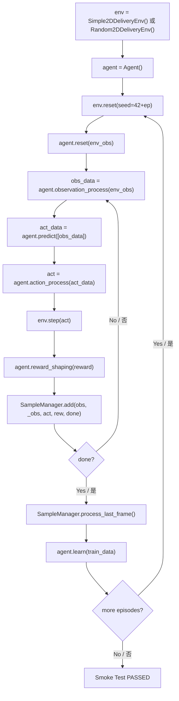

"""
职责 / Responsibility: 训练与评估流程 -- 冒烟测试、完整训练、评估模式、模型保存加载、监控日志、故障排查
参考 / Reference: train_test.py, PPO开发指南v3.0 (§12/§29/§30), reward_function_design.md
领域适配 / Domain Adaptation: 腾讯开悟训练平台 → 单机Python训练 + 冒烟测试脚本
"""

## 7. 训练与评估流程 / Training, Evaluation & Checkpointing

---

### 7.1 训练脚本使用说明 / Training Script Usage

#### 7.1.1 冒烟测试 / Smoke Test

冒烟测试（Smoke Test）是提交代码前**必须运行**的验证步骤，确保算法能正常运行而不崩溃。
Smoke tests are a **mandatory** pre-submission step to verify that algorithms run without exceptions.

**入口文件 / Entry file**: `drone_delivery/train_test.py`

##### 单算法测试 / Single Algorithm Test

```powershell
cd "07_仿真与控制代码\Python仿真"

# Q-learning 冒烟测试 / Q-learning smoke test
python drone_delivery/train_test.py --algo q_learning --episodes 5

# SARSA 冒烟测试 / SARSA smoke test
python drone_delivery/train_test.py --algo sarsa --episodes 5

# Monte Carlo 冒烟测试 / Monte Carlo smoke test
python drone_delivery/train_test.py --algo monte_carlo --episodes 5

# DQN 冒烟测试 / DQN smoke test（使用 Random2DDeliveryEnv）
python drone_delivery/train_test.py --algo dqn --episodes 5

# A2C 冒烟测试 / A2C smoke test（使用 Random2DDeliveryEnv）
python drone_delivery/train_test.py --algo a2c --episodes 5
```

##### 全算法测试 / All Algorithms Test

```powershell
# 依次运行所有算法的冒烟测试 / Run all algorithm smoke tests sequentially
python drone_delivery/train_test.py --algo all --episodes 5
```

冒烟测试通过条件 / Smoke test pass criteria:
- 每个算法完成指定episode数而不抛出异常 / Each algorithm completes specified episodes without exceptions
- 输出 `XXX smoke test PASSED` / Outputs `XXX smoke test PASSED`

##### 参数说明 / Parameter Reference

| 参数 / Parameter | 类型 / Type | 默认值 / Default | 说明 / Description |
|---|---|---|---|
| `--algo` | str | `all` | 算法名称 / Algorithm name: `q_learning`, `sarsa`, `monte_carlo`, `dqn`, `a2c`, `all` |
| `--episodes` | int | `5` | 测试回合数 / Number of test episodes |

##### 冒烟测试内部流程 / Smoke Test Internal Flow



**SARSA特殊说明 / SARSA Special Note**: SARSA需要在每步预选下一个动作（同策略更新），因此循环结构略有不同——在执行动作前先选出下一个动作 `next_act_data`。
SARSA requires pre-selecting the next action at each step (on-policy update), so the loop structure differs slightly.

#### 7.1.2 完整训练 / Full Training

##### 单算法完整训练模板 / Single Algorithm Full Training Template

```python
# Q-learning 完整训练 — 2000回合 / Q-learning full training — 2000 episodes
from environment.simple_delivery_env import Simple2DDeliveryEnv
from drone_delivery.agent_q_learning.agent import Agent
from drone_delivery.agent_q_learning.feature.definition import SampleManager

env = Simple2DDeliveryEnv()
agent = Agent()

total_episodes = 2000
log_interval = 50
eval_interval = 100
save_interval = 500

best_reward = float("-inf")

for ep in range(total_episodes):
    env_obs, _ = env.reset(seed=42 + ep)
    agent.reset(env_obs)
    obs_data = agent.observation_process(env_obs)
    collector = SampleManager()
    ep_reward = 0.0
    done = False

    while not done:
        act_data = agent.predict([obs_data])
        act = agent.action_process(act_data)
        _, reward, terminated, truncated, env_obs = env.step(act)
        next_obs_data = agent.observation_process(env_obs)
        shaped_reward = agent.reward_shaping(reward)
        done = terminated or truncated

        collector.add(
            obs=obs_data, _obs=next_obs_data,
            act=act, rew=shaped_reward, done=done, ret=0.0,
        )
        obs_data = next_obs_data
        ep_reward += reward

    # 回合结束：学习 / End of episode: learn
    collector.process_last_frame()
    train_data = collector.get_game_data()
    if train_data:
        metrics = agent.learn(train_data)

    # 定期日志 / Periodic logging
    if (ep + 1) % log_interval == 0:
        completed = int(env_obs.get("order_status", [0]).sum()) if hasattr(env_obs, "get") else 0
        print(f"Episode {ep+1:>5d}/{total_episodes} | "
              f"reward={ep_reward:>8.1f} | "
              f"deliveries={completed} | "
              f"epsilon={agent.epsilon:.4f} | "
              f"Q_states={agent.q_table_size}")

    # 定期保存 / Periodic save
    if (ep + 1) % save_interval == 0:
        agent.save_model(path="outputs/models", id=f"ep{ep+1}")

# 最终保存 / Final save
agent.save_model(path="outputs/models", id="final")
```

##### DQN/A2C 完整训练 / DQN/A2C Full Training

```python
# DQN 完整训练 — 使用 Random2DDeliveryEnv / DQN full training — using Random2DDeliveryEnv
from environment.random_delivery_env import Random2DDeliveryEnv
from drone_delivery.agent_dqn.agent import Agent
from drone_delivery.agent_dqn.feature.definition import SampleManager

env = Random2DDeliveryEnv()
agent = Agent()

for ep in range(2000):
    env_obs, _ = env.reset(seed=42 + ep)
    agent.reset(env_obs)
    obs_data = agent.observation_process(env_obs)
    collector = SampleManager()
    done = False

    while not done:
        act_data = agent.predict([obs_data])
        act = agent.action_process(act_data)
        _, reward, terminated, truncated, env_obs = env.step(act)
        next_obs_data = agent.observation_process(env_obs)
        shaped_reward = agent.reward_shaping(reward)
        done = terminated or truncated

        collector.add(
            obs=obs_data, _obs=next_obs_data,
            act=act, rew=shaped_reward, done=done, ret=0.0,
        )
        obs_data = next_obs_data

    collector.process_last_frame()
    train_data = collector.get_game_data()
    if train_data:
        agent.learn(train_data)

agent.save_model(path="outputs/models", id="dqn_final")
```

##### 武汉场景PPO训练 / Wuhan Scene PPO Training

```powershell
# B区训练 / Zone B training
python run_wuhan_training.py --zone B --episodes 1000

# A区训练（多机） / Zone A training (multi-UAV)
python run_wuhan_training.py --zone A --episodes 2000

# 快速测试 / Quick test
python run_wuhan_training.py --zone B --episodes 1 --max-steps 2 --no-save
```

| 参数 / Parameter | 类型 / Type | 默认值 / Default | 说明 / Description |
|---|---|---|---|
| `--zone` | str | `B` | 场景分区 / Scene zone: `A`, `B`, `C`, `D` |
| `--episodes` | int | `1000` | 训练回合数 / Training episodes |
| `--max-steps` | int | None | 最大步数 / Max steps per episode |
| `--no-save` | bool | False | 不保存模型 / Do not save model |
| `--seed` | int | `42` | 随机种子 / Random seed |

##### L1对比实验 / L1 Comparative Experiments

```powershell
# 运行L1层级的算法对比实验 / Run L1 level algorithm comparison experiments
python run_level1_experiments.py --episodes 2000 --eval-interval 100

# 快速测试 / Quick test
python run_level1_experiments.py --episodes 100 --eval-interval 10
```

#### 7.1.3 并行种子训练 / Parallel Seed Training

为确保结果统计可靠性，每种算法应使用至少5个不同的随机种子训练。
To ensure statistical reliability, train each algorithm with at least 5 different random seeds.

```powershell
# 5种子训练模板 / 5-seed training template
42,43,44,45,46 | ForEach-Object {
    python drone_delivery/train_test.py --algo q_learning --episodes 2000 --seed $_
}
```

#### 7.1.4 断点续训 / Checkpoint Resume

```python
# 断点续训示例 / Checkpoint resume example
agent = Agent()

# 加载上次的检查点 / Load last checkpoint
# 自动恢复: Q表、epsilon、train_steps、episodes
# Auto-restore: Q-table, epsilon, train_steps, episodes
agent.load_model(path="outputs/models", id="latest")

print(f"Resuming from episode {agent.episodes}, epsilon={agent.epsilon:.4f}")

for ep in range(agent.episodes, 2000):
    # ... 训练循环同上 / training loop same as above ...
    pass

agent.save_model(path="outputs/models", id="resumed_final")
```

**断点续训恢复项 / Checkpoint Resume Restores**:

| 恢复项 / Restored Item | 表格型 / Tabular | 深度型 / Deep |
|---|---|---|
| 模型权重 / Model weights | Q表字典 / Q-table dict | state_dict |
| 探索率 / Epsilon | `epsilon` | N/A (使用log_std) |
| 训练步数 / Train steps | `train_steps` | `global_step` |
| 回合计数 / Episode count | `episodes` | `episodes` |
| 优化器状态 / Optimizer state | N/A | optimizer.state_dict |
| 学习率调度器 / LR scheduler | N/A | scheduler.state_dict |
| 随机状态 / RNG state | N/A | torch.get_rng_state() |

---

### 7.2 评估模式与指标 / Evaluation Mode & Metrics

#### 7.2.1 predict() vs exploit() / predict() vs exploit()

| 维度 / Dimension | predict() | exploit() |
|---|---|---|
| 用途 / Purpose | 训练时动作选择 / Training | 评估时动作选择 / Evaluation |
| 探索行为 / Exploration | 有（ε-greedy或高斯噪声） / Yes | 无（纯贪心/确定性） / No (pure greedy) |
| 返回类型 / Return type | `ActData` | `int`（直接可执行动作） |
| 输入类型 / Input type | `list_obs_data: List[ObsData]` | `env_obs: Dict`（原始环境观测） |
| 适用场景 / Use case | 训练循环中的动作采样 | 最终评估、模型对比、部署 |

**代码对比 / Code Comparison**:

```python
# 训练时：含探索 / Training: with exploration
act_data = agent.predict([obs_data])    # 返回 ActData，可能含随机动作
action = agent.action_process(act_data) # ActData → int

# 评估时：纯贪心 / Evaluation: pure greedy
action = agent.exploit(env_obs)          # 直接返回最优动作 int
# exploit() 内部调用了 observation_process()，无需手动处理
```

#### 7.2.2 核心评估指标定义表 / Core Evaluation Metrics Definition

| 指标 / Metric | 符号 / Symbol | 定义 / Definition | 计算 / Formula | 健康范围 / Healthy |
|---|---|---|---|---|
| 平均配送数 | `avg_deliveries` | 每回合平均完成配送数 | `sum(completed) / N` | 持续上升 / Rising |
| 配送完成率 | `delivery_rate` | 完成订单÷总订单 | `completed / total` | > 70% |
| 平均步数 | `avg_steps` | 每回合平均步数 | `sum(steps) / N` | 递减 / Decreasing |
| 平均奖励 | `avg_reward` | 每回合平均总奖励 | `sum(rew) / N` | 持续上升 / Rising |
| 安全返航率 | `success_rate` | 安全返航回合占比 | `return_cnt / N` | > 80% |
| 碰撞率 | `collision_rate` | 碰撞回合占比 | `col_cnt / N` | < 5% |
| 探索率 | `epsilon` | ε-greedy当前探索率 | `max(0.05, ε×decay)` | → 0.05 |
| Q表大小 | `q_table_size` | 已访问状态数 | `len(model.table)` | 收敛后稳定 / Stable |
| TD误差 | `td_error` | 时序差分误差均值 | `mean(\|target - Q(s,a)\|)` | 递减 / Decreasing |
| 损失值 | `loss` | 神经网络损失值 | 算法特定 / Algo-specific | 递减 / Decreasing |
| 路径效率 | `path_efficiency` | 最短路径÷实际路径 | A*距离÷实际距离 | → 1.0 |

#### 7.2.3 评估频率建议 / Recommended Evaluation Frequency

| 训练阶段 / Phase | episode范围 | 评估间隔 / Interval | 评估episode数 | 评估方式 / Method |
|---|---|---|---|---|
| 探索期 / Exploration | 前20% | 每100回合 / Every 100 | 10 | exploit()确定性 |
| 学习期 / Learning | 20%-80% | 每50回合 / Every 50 | 20 | exploit()确定性 |
| 收敛期 / Convergence | 后20% | 每20回合 / Every 20 | 50 | exploit()确定性 |
| 最终评估 / Final | — | — | 100 | exploit() + 多种子 |

#### 7.2.4 评估代码模板 / Evaluation Code Template

```python
def evaluate_agent(agent, env, n_episodes=50, seed_offset=10000):
    """
    使用exploit()进行确定性评估。
    Evaluate agent using exploit() for deterministic evaluation.

    Parameters
    ----------
    agent : Agent
        已训练的Agent实例 / Trained Agent instance
    env : gym.Env
        环境实例 / Environment instance
    n_episodes : int
        评估回合数 / Number of evaluation episodes
    seed_offset : int
        种子偏移（与训练种子不重叠） / Seed offset

    Returns
    -------
    dict
        包含 avg_reward, avg_deliveries, delivery_rate,
        avg_steps, success_rate, collision_rate
    """
    import numpy as np

    total_rewards, total_deliveries, total_steps = [], [], []
    successes, collisions = 0, 0

    for ep in range(n_episodes):
        env_obs, _ = env.reset(seed=seed_offset + ep)
        ep_reward = 0.0
        done = False

        while not done:
            action = agent.exploit(env_obs)  # 确定性贪心 / Deterministic greedy
            _, reward, terminated, truncated, env_obs = env.step(action)
            ep_reward += reward
            done = terminated or truncated

        total_rewards.append(ep_reward)
        completed = int(env_obs.get("order_status", [0]).sum()) if hasattr(env_obs, "get") else 0
        total_deliveries.append(completed)
        total_steps.append(env.steps)
        if env.info.get("depot_reached", False):
            successes += 1

    return {
        "avg_reward": np.mean(total_rewards),
        "avg_deliveries": np.mean(total_deliveries),
        "delivery_rate": np.mean(total_deliveries) / env.num_orders,
        "avg_steps": np.mean(total_steps),
        "success_rate": successes / n_episodes,
        "collision_rate": collisions / n_episodes,
    }
```

---

### 7.3 模型保存与加载 / Model Save & Load

#### 7.3.1 保存格式 / Save Formats

| 算法类型 / Algo Type | 格式 / Format | 命名模板 / Naming | 保存内容 / Contents |
|---|---|---|---|
| 表格型 (Q-learning/SARSA/MC) | `.npy` | `{algo}_{id}.npy` | Q表字典 + 训练元数据 |
| 深度型 (DQN/A2C/PPO) | `.pth` | `{algo}_{id}.pth` | 网络权重 + 优化器 + 调度器 |

#### 7.3.2 表格型保存内容 / Tabular Save Contents

```python
# save_model() 内部构造的 payload / payload constructed inside save_model()
payload = {
    "action_size": 4,          # 动作空间大小 / Action space size
    "default_q": 0.0,          # 未访问状态默认Q值 / Default Q for unvisited states
    "table": {                 # Q表数据 / Q-table data
        12345: [0.1, 0.3, -0.2, 0.5],   # state_key → Q-values (list of floats)
        67890: [0.0, 0.2, 0.1, -0.1],
    },
    "train_steps": 50000,      # 累计更新步数 / Cumulative update steps
    "epsilon": 0.0523,         # 当前探索率 / Current epsilon
    "episodes": 1500,          # 已完成回合数 / Completed episodes
}
np.save(filepath, payload, allow_pickle=True)
```

#### 7.3.3 深度型保存内容 / Deep Algorithm Save Contents

```python
# PPO/DQN/A2C 保存模板 / Save template for PPO/DQN/A2C
torch.save({
    "model": model.state_dict(),          # Actor + Critic 网络权重
    "optimizer": optimizer.state_dict(),   # Adam 优化器状态
    "scheduler": scheduler.state_dict() if scheduler else None,
    "normalizer": normalizer.state_dict(), # 观测/奖励归一化状态
    "curriculum": curriculum.state_dict(), # 课程学习阶段
    "global_step": global_step,            # 全局环境步
    "scene_manifest_hash": scene_hash,     # 场景哈希
    "config": config,                      # 配置快照
    "rng_state": rng_state,               # 随机状态
    "torch_rng": torch.get_rng_state(),   # PyTorch随机状态
}, path)
```

#### 7.3.4 保存限速策略 / Save Throttling Strategy

| 策略 / Strategy | 触发条件 / Trigger | 文件名 / Filename |
|---|---|---|
| 定期保存 / Periodic | 每100-500回合 / Every 100-500 ep | `{algo}_ep{N}.npy` |
| 最佳保存 / Best | 新最高评估分 / New best score | `{algo}_best.npy` |
| 最终保存 / Final | 训练自然结束 / Training end | `{algo}_final.npy` |
| 紧急保存 / Emergency | KeyboardInterrupt | `{algo}_emergency.npy` |

```python
# 保存限速逻辑 / Save throttling logic
try:
    for ep in range(total_episodes):
        # ... 训练循环 / training loop ...

        if (ep + 1) % save_interval == 0:
            agent.save_model(path="outputs/models", id=f"ep{ep+1}")

        if eval_score > best_score:
            best_score = eval_score
            agent.save_model(path="outputs/models", id="best")

except KeyboardInterrupt:
    agent.save_model(path="outputs/models", id="emergency")
    print("Emergency checkpoint saved!")
```

#### 7.3.5 模型加载示例 / Model Load Example

```python
from drone_delivery.agent_q_learning.agent import Agent

agent = Agent()

# 加载检查点 / Load checkpoint
agent.load_model(path="outputs/models", id="best")

# 验证加载结果 / Verify load result
print(f"Loaded: episodes={agent.episodes}, epsilon={agent.epsilon:.4f}, "
      f"Q_states={agent.q_table_size}, train_steps={agent.train_steps}")

# 评估 / Evaluate
from environment.simple_delivery_env import Simple2DDeliveryEnv
env = Simple2DDeliveryEnv()
env_obs, _ = env.reset(seed=99999)
action = agent.exploit(env_obs)
print(f"First deterministic action: {action}")
```

#### 7.3.6 加载失败处理 / Load Failure Handling

`load_model()` 在以下情况下**静默回退**到空白模型并输出WARNING日志：
`load_model()` **silently falls back** to a fresh model with WARNING log:

| 异常情况 / Exception | 处理方式 / Handling |
|---|---|
| 文件不存在 / File not found | 使用空白Q表 + WARNING日志 |
| 格式不兼容 / Incompatible format | 忽略 + 使用空白表 + WARNING日志 |
| `TypeError` / `ValueError` / `KeyError` | 忽略 + 使用空白表 + WARNING日志 |

---

### 7.4 监控面板与日志 / Monitoring & Logging

#### 7.4.1 monitor_builder.py 配置 / monitor_builder.py Configuration

每个Agent的 `conf/monitor_builder.py` 定义监控面板配置：
Each Agent's `conf/monitor_builder.py` defines the monitoring dashboard:

```python
# 典型配置结构 / Typical configuration structure
MONITOR_CONFIG = {
    "metrics": [
        {"name": "avg_reward",    "type": "line",  "window": 100},
        {"name": "delivery_rate", "type": "line",  "window": 100},
        {"name": "epsilon",       "type": "line",  "window": 1},
        {"name": "q_table_size",  "type": "line",  "window": 1},
        {"name": "td_error",      "type": "line",  "window": 50},
    ],
    "log_interval": 10,       # 每10回合输出一次日志
    "save_interval": 100,     # 每100回合保存一次
    "eval_interval": 50,      # 每50回合评估一次
}
```

#### 7.4.2 推荐日志格式 / Recommended Log Format

```
Episode  500/2000 | reward= 285.3 | deliveries=3.2/5 | steps= 234 |
                   | epsilon=0.153 | Q_states= 8421  | td= 0.042
```

```python
if (ep + 1) % MONITOR_CONFIG["log_interval"] == 0:
    print(f"Episode {ep+1:>5d}/{total_episodes} | "
          f"reward={avg_reward:>8.1f} | "
          f"deliveries={avg_del:.1f}/{num_orders} | "
          f"steps={avg_steps:>4d} | "
          f"epsilon={agent.epsilon:.3f} | "
          f"Q_states={agent.q_table_size:>6d} | "
          f"td={avg_td:.4f}")
```

#### 7.4.3 TensorBoard接入 / TensorBoard Integration

深度算法（DQN/A2C/PPO）推荐接入TensorBoard：
Deep algorithms (DQN/A2C/PPO) should integrate TensorBoard:

```python
from torch.utils.tensorboard import SummaryWriter

writer = SummaryWriter(log_dir="outputs/logs/dqn_experiment1")

# 在训练循环中记录 / Record in training loop
writer.add_scalar("train/reward", avg_reward, ep)
writer.add_scalar("train/delivery_rate", delivery_rate, ep)
writer.add_scalar("train/loss", loss_value, ep)
writer.add_scalar("train/epsilon", agent.epsilon, ep)
writer.add_scalar("train/lr", current_lr, ep)

# 奖励分量分解 / Reward component decomposition
for name, value in reward_components.items():
    writer.add_scalar(f"reward/{name}", value, ep)

writer.close()
```

```powershell
# 启动TensorBoard / Launch TensorBoard
tensorboard --logdir=outputs/logs --port=6006
```

#### 7.4.4 日志等级规范 / Log Level Standards

| 等级 / Level | 用途 / Usage | 示例 / Example |
|---|---|---|
| `DEBUG` | 详细计算细节 | Q值更新详情、状态编码结果 |
| `INFO` | 正常训练进度 | Episode完成、模型保存成功 |
| `WARNING` | 非致命异常 | 模型文件未找到（回退空白表） |
| `ERROR` | 致命错误 | 环境崩溃、张量形状不匹配 |

---

### 7.5 常见故障排查 / Troubleshooting

#### 故障1：Agent不学习（奖励不增长） / Agent Not Learning

| 项 / Item | 详情 / Details |
|---|---|
| **现象** | 训练数百回合后 avg_reward 无明显上升 |
| **原因** | 学习率不当；ε衰减过快/过慢；状态编码冲突；奖励范围不合理 |
| **排查** | 1. 学习率: Q-learning/SARSA建议0.1, DQN/A2C建议3e-4 |
| | 2. ε衰减: 默认decay=0.9995, 500回合后ε≈0.61; 若衰减太快则探索不足 |
| | 3. 状态编码: 检查 `state_key` 计算公式是否有哈希冲突 |
| | 4. 奖励范围: L1应在-200~+500范围 |
| **解决** | 调整学习率和ε衰减参数；验证状态编码唯一性 |

#### 故障2：训练速度过慢 / Training Too Slow

| 项 / Item | 详情 / Details |
|---|---|
| **现象** | 单回合耗时超过1秒 |
| **原因** | Q表过大；深度算法batch_size过大；重复计算 |
| **排查** | 1. 表格型: 检查 `q_table_size`，正常应 < 100K |
| | 2. 深度型: 检查 batch_size 和 replay_buffer 大小 |
| | 3. 检查是否每步做不必要的计算 |
| **解决** | 限制状态空间；减小batch_size；缓存计算结果 |

#### 故障3：Q值发散 / Q-value Divergence

| 项 / Item | 详情 / Details |
|---|---|
| **现象** | Q值趋向正/负无穷，avg_reward剧烈震荡 |
| **原因** | 学习率过高；terminated/truncated混淆；经验回放缓冲区过小 |
| **排查** | 1. 降低学习率至0.01-0.1 |
| | 2. 确认done信号: terminated不自举, truncated需要从final observation自举 |
| | 3. 增大replay buffer |
| **解决** | 降低lr；修正done信号处理；增大replay buffer |

#### 故障4：Agent只在配送中心徘徊 / Agent Loiters Near Depot

| 项 / Item | 详情 / Details |
|---|---|
| **现象** | Agent在depot附近不移动，配送完成率为0 |
| **原因** | 合法动作掩码过于严格；ε过早降为0；奖励信号未传递 |
| **排查** | 1. 检查 `legal_actions` 是否过于限制 |
| | 2. 确认 ε 没有过早降到0（应保持 > 0.05） |
| | 3. 确认配送奖励（+100）能被正确触发 |
| **解决** | 放宽合法动作掩码；增大ε最小值；添加进度引导奖励 |

#### 故障5：一开始就返航 / Immediate Return to Depot

| 项 / Item | 详情 / Details |
|---|---|
| **现象** | Agent一出发就直接返回depot |
| **原因** | 安全返航奖励(+500)远大于配送奖励(+100)；时间惩罚过高 |
| **排查** | 1. 确认安全返航奖励仅在完成配送后才可获得 |
| | 2. 检查 `max_steps` 是否足够（L1需 >= 500步） |
| | 3. 检查 `return_energy_wh_per_m` 是否过大 |
| | 4. 检查 `reserve_soc` 是否过高 |
| **解决** | 限制返航奖励前置条件；调整奖励权重平衡 |

#### 故障6：Gym警告 / Gym Warnings

| 项 / Item | 详情 / Details |
|---|---|
| **现象** | 运行时出现 Gym deprecation warning |
| **原因** | 系统安装的是旧版gym而非gymnasium |
| **排查** | `pip list \| findstr gym` |
| **解决** | `pip install "gymnasium>=0.29,<2"` |

#### 故障7：场景文件找不到 / Scene File Not Found

| 项 / Item | 详情 / Details |
|---|---|
| **现象** | 3D环境加载时 FileNotFoundError |
| **原因** | `scene_dir` 路径不正确或文件缺失 |
| **排查** | 确认目录中存在 `scene_3d_index.json`、分区scene JSON和collision JSON |
| **解决** | 显式设置路径 |

```python
env = WuhanDroneDeliveryEnv({
    "zone_id": "B",
    "scene_dir": r"outputs\环境示意图_3D预览",
})
```

#### 故障8：PPO动作饱和 / PPO Action Saturation

| 项 / Item | 详情 / Details |
|---|---|
| **现象** | PPO输出的动作经常在±1边界（tanh饱和） |
| **原因** | 奖励尺度过大；log_std过小；学习率过高 |
| **排查** | 1. 检查未缩放Reward和 `reward_scale` |
| | 2. 确认 `log_std` 初始值（建议-0.5） |
| | 3. 检查优势归一化是否正确 |
| | 4. 不要在环境之外再次裁剪动作 |
| **解决** | 缩放奖励；增大log_std；降低lr；移除多余裁剪 |

---

> **下一篇 / Next**: [8. 实验设计指南 / Experiment Design Guide](./08_experiment.md)
