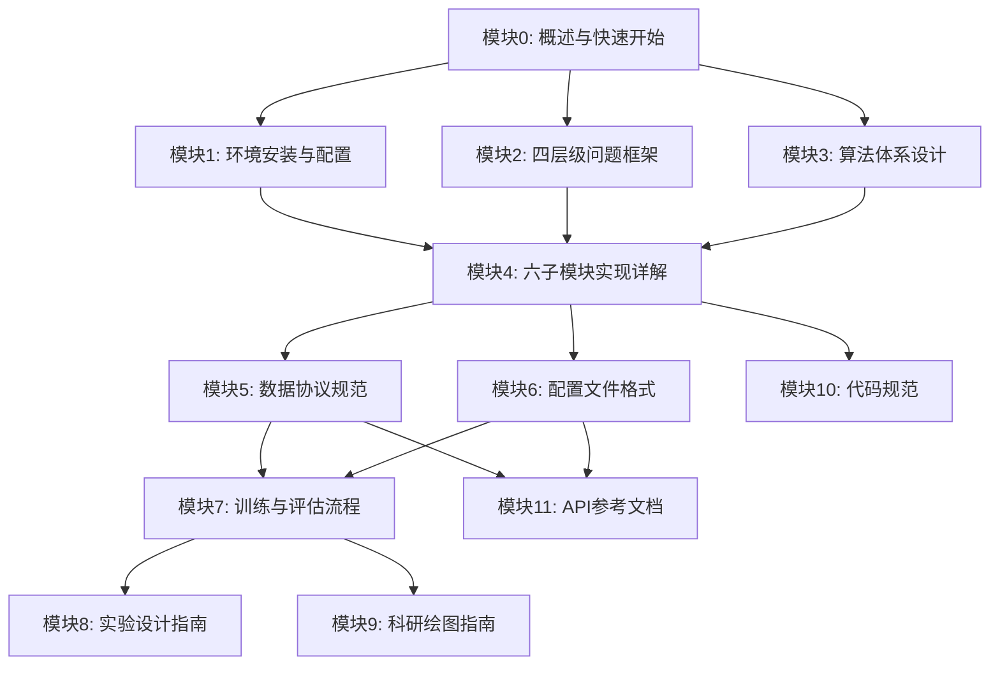
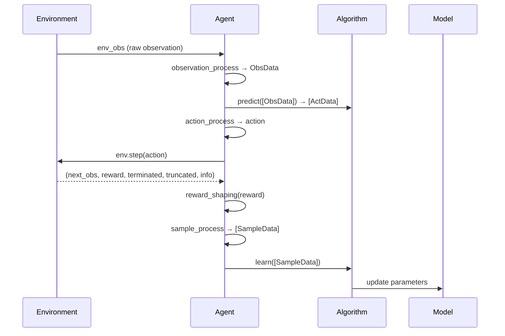

# 无人机外卖配送开发指南 v2.0
# Drone Food Delivery Development Guide v2.0

> **项目代号 / Project Code**: `drone_delivery`
> **版本 / Version**: v2.0
> **日期 / Date**: 2026-07-11
> **适用对象 / Audience**: 大学生创新训练项目成员、强化学习初学者
> **训练模式 / Training Mode**: 单机训练 / Single-machine Training
> **风格基准 / Style Baseline**: 腾讯开悟 峡谷漫步v2 开发指南
> **状态 / Status**: 已完成 / Complete

---

## 版本信息 / Version Information

| 属性 / Attribute | 值 / Value |
|---|---|
| 前版 / Previous Version | v1.0 (731行, 2026-07-09) |
| 当前版 / Current Version | v2.0 (5580+行, 2026-07-11) |
| 模块数 / Module Count | 12（主文档 + 11个子模块） |
| 子文档目录 / Module Directory | `dev_guide_modules/` |
| 基准文档 / Baseline Documents | Kaiwu dev_guide (1859行), PPO指南 v3.0 (3415行) |

### 状态标记说明 / Status Legend

| 标记 / Tag | 含义 / Meaning |
|---|---|
| `已实现` | 当前代码和测试已经存在，可直接定位与运行 |
| `生产增强` | 接口已预留或给出明确设计，但当前基线尚未全部实现 |
| `历史基线` | 保留用于对照，不应作为新实验默认入口 |

---

## 一句话策略 / One-Line Strategy

> **先规划"完成后仍可返航"的目标子集，按目标数量优先、路线代价次优确定顺序；PPO 执行当前目标的连续飞行控制；每到达一个目标就更新任务掩码并重规划；目标完成或资源不足时转入返航，安全回到基地后才结算有效任务总分。**

---

## 推荐阅读路线 / Recommended Reading Paths

| 路线 / Path | 适用人群 / Audience | 推荐模块顺序 / Module Order |
|---|---|---|
| **入门路线** | RL初学者、首次接触项目 | 0 → 1 → 2 → 3.1-3.4 → 7 → 10 |
| **开发路线** | 需要编写Agent代码 | 0 → 4 → 5 → 6 → 11 → 10 |
| **研究路线** | 需要设计实验和论文 | 0 → 2 → 3 → 8 → 9 → 5 |

### 模块依赖关系 / Module Dependencies



---

## 模块索引 / Module Index

| 模块 | 文件 | 主题 / Topic | 行数 | 优先级 |
|---|---|---|---:|---|
| 0 | [00_overview.md](dev_guide_modules/00_overview.md) | 概述与快速开始 / Overview & Quick Start | ~350 | P2 |
| 1 | [01_environment_setup.md](dev_guide_modules/01_environment_setup.md) | 环境安装与配置 / Environment Setup | ~320 | P3 |
| 2 | [02_four_levels.md](dev_guide_modules/02_four_levels.md) | 四层级问题框架 / Four-Level Framework | ~350 | P1 |
| 3 | [03_algorithms.md](dev_guide_modules/03_algorithms.md) | 算法体系设计 / Algorithm Design | ~550 | P0 |
| 4 | [04_six_modules.md](dev_guide_modules/04_six_modules.md) | 六子模块实现详解 / Six Submodules | ~900 | P0 |
| 5 | [05_data_protocol.md](dev_guide_modules/05_data_protocol.md) | 数据协议规范 / Data Protocol | ~250 | P1 |
| 6 | [06_configuration.md](dev_guide_modules/06_configuration.md) | 配置文件格式 / Configuration | ~560 | P2 |
| 7 | [07_training.md](dev_guide_modules/07_training.md) | 训练与评估流程 / Training & Eval | ~350 | P1 |
| 8 | [08_experiment.md](dev_guide_modules/08_experiment.md) | 实验设计指南 / Experiment Design | ~300 | P2 |
| 9 | [09_visualization.md](dev_guide_modules/09_visualization.md) | 科研绘图指南 / Visualization | ~570 | P3 |
| 10 | [10_coding_standards.md](dev_guide_modules/10_coding_standards.md) | 代码规范 / Coding Standards | ~500 | P3 |
| 11 | [11_api_reference.md](dev_guide_modules/11_api_reference.md) | API参考文档 / API Reference | ~680 | P0 |

**总行数 / Total**: ~5,580行（含代码示例）

---

## 渐进式四层级框架 / Progressive Four-Level Framework

| 层级 | 名称 | 动作空间 | 关键约束 | 推荐算法 |
|---|---|---|---|---|
| L1 | 2D固定商家 | `Discrete(4)` | 地图边界+障碍物 | Q-learning, SARSA, MC |
| L2 | 2D随机商家 | `Discrete(8)` | +时间窗口+多单携带 | DQN, A2C |
| L3 | 3D固定商家 | `Box(3)` 连续 | +禁飞区+能耗+碰撞 | A2C, PPO |
| L4 | 3D随机+全约束 | `Box(4)` 连续 | +多机+风场+通信 | PPO+CTDE |

---

## 六算法对比总览 / Six-Algorithm Comparison

| 算法 | 类型 | 动作空间 | 适用层级 | 核心特性 |
|---|---|---|---|---|
| Q-Learning | 表格型 | 离散 | L1 | Off-policy, ε-greedy |
| SARSA | 表格型 | 离散 | L1 | On-policy, 安全边际 |
| Monte Carlo | 表格型 | 离散 | L1 | 完整回报, 无偏估计 |
| DQN | 深度 | 离散 | L2 | 经验回放, 目标网络 |
| A2C | 深度 | 离散+连续 | L2/L3 | Actor-Critic, GAE |
| PPO | 深度 | 连续 | L3/L4 | Clipped Surrogate, tanh-Gaussian |

---

## 核心数据流 / Core Data Flow



---

## 快速开始 / Quick Start

```powershell
# 进入代码目录 / Enter code directory
cd "c:\University\Files\Training program\无人机项目设计\07_仿真与控制代码\Python仿真"

# 冒烟测试 / Smoke test
python drone_delivery/train_test.py --algo q_learning --episodes 5

# 全算法测试 / All-algorithm test
python drone_delivery/train_test.py --algo all --episodes 5

# 完整训练 / Full training
python run_wuhan_training.py --zone B --episodes 1000

# 对比实验 / Comparative experiment
python run_level1_experiments.py --episodes 2000 --eval-interval 100
```

---

## 两套代码体系 / Two Code Systems

| 体系 | 位置 | 用途 | 状态 |
|---|---|---|---|
| **体系A** | `environment/`, `algorithm/`, `config.py` | 终点状态参考 | 不要修改 |
| **体系B** | `drone_delivery/` | 新功能开发 | 活跃开发中 |

---

## 四区场景数据 / Four-Zone Scene Data

| 分区 | 参考区域 | 建筑数 | 任务点 | 适用层级 |
|---|---|---:|---|---|
| A | 光谷广场 | 837 | 1(基地), 2, 3 | L4多机 |
| B | 武汉学院 | 43 | 4(基地), 5, 6 | L1/L2/L3 |
| C | 长江大桥附近 | 538 | 7(基地), 8, 9 | L4扩展 |
| D | 楚河汉界 | 592 | 10(基地), 11, 12 | L4扩展 |

---

## 关键源码入口 / Key Source Entry Points

| 文件 | 职责 | 状态 |
|---|---|---|
| `environment/simple_delivery_env.py` | L1 2D固定商家环境 | `已实现` |
| `environment/random_delivery_env.py` | L2 2D随机商家环境 | `已实现` |
| `algorithm/ppo_agent.py` | tanh-squashed Gaussian PPO | `已实现` |
| `algorithm/delivery_strategy.py` | ScoreFirst配送规划器 | `已实现` |
| `algorithm/classical_rl.py` | Q-learning/SARSA/MC/A* | `已实现` |
| `config.py` | 全局配置参数 | `已实现` |
| `run_wuhan_training.py` | 单机训练入口 | `已实现` |
| `drone_delivery/train_test.py` | 冒烟测试入口 | `已实现` |

---

## 附录 / Appendices

详见 → [模块11: API参考文档](dev_guide_modules/11_api_reference.md) 末尾的5个附录：
- 附录A：环境数据来源
- 附录B：领域映射表（14项完整版）
- 附录C：配置参数速查
- 附录D：算法文档索引（18篇）
- 附录E：版本历史

---

## 版本历史 / Version History

| 版本 | 日期 | 主要变化 |
|---|---|---|
| v1.0 | 2026-07-09 | 初始版本：5算法+DIY，731行 |
| v2.0 | 2026-07-11 | 模块化重构：12模块5580+行，覆盖L1-L4，对标Kaiwu风格 |

---

> **参考文档**:
> - 腾讯开悟峡谷漫步v2开发指南 (`data/reference/kaiwu_gorge_walk_v2/dev_guide_optimized.md`)
> - PPO开发指南 v3.0 (`outputs/武汉光谷无人机配送_PPO开发指南.md`)
> - 奖励函数设计文档 (`reward_function_design.md`)
> - Kaiwu结构分析报告 (`14_大赛准备/Kaiwu结构分析.md`)

*本指南基于对9份参考文档（共约12,000行）的深度分析，采用腾讯开悟（Kaiwu）开发指南风格。*
*Generated by Claude Code on 2026-07-11.*
