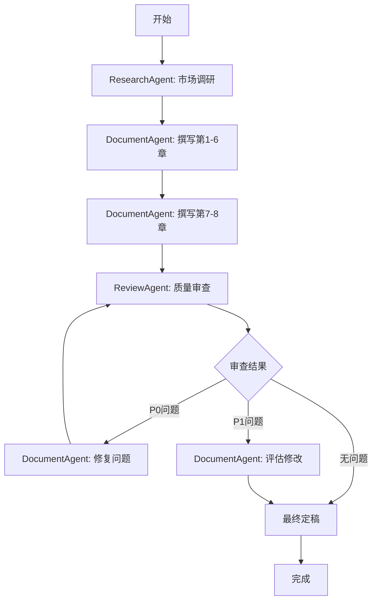
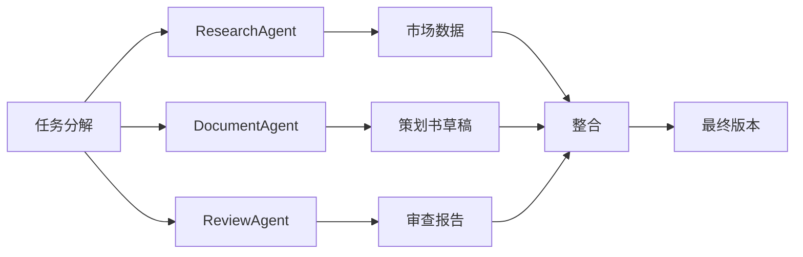
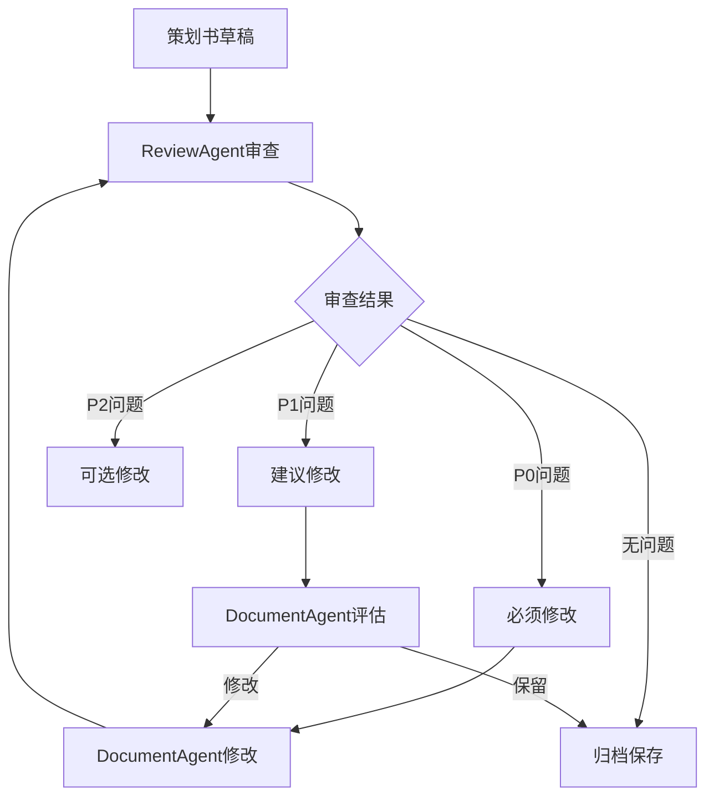

# 多Agent协作工作流设计（完善版）

> 项目：基于深度强化学习的多无人机协同物流配送路径规划
> 版本：v2.0
> 日期：2026-07-11
> 目标：设计完整的多Agent协作工作流，高效完成项目策划书

---

## 🚀 快速启动指南

### 5分钟快速开始

**第一步：确认当前状态**
```
当前项目完成度：80%
策划书状态：已完成（8章内容，约15000字）
剩余工作：质量审查 + 细节完善
```

**第二步：选择执行模式**

| 模式 | 适用场景 | 预计时间 | Agent数量 |
|------|---------|---------|----------|
| **快速模式** | 2天内完成 | 16小时 | 3-4个Agent |
| **标准模式** | 1周内完成 | 30小时 | 6个Agent |
| **精细模式** | 2周内完成 | 50小时 | 6个Agent + 人工审查 |

**推荐：快速模式（2天）**

**第三步：立即开始**

复制以下Prompt，发送给Claude：

```
请按照以下工作流完成项目策划书：

1. 使用ResearchAgent完成市场数据调研
2. 使用DocumentAgent填充策划书8个章节
3. 使用ReviewAgent进行质量审查

策划书位置：14_大赛准备/项目策划书.md
参考素材：
- 14_大赛准备/市场数据参考.md
- 11_国家级立项申报/01_申报书主文档/项目申报书.md
- 06_模型与算法/算法文档/（13份）
- 05_正文版本保存/第6章_实验设计与结果分析.md

目标：2天内完成15000字的完整策划书
```

---

### 快速模式执行计划（2天）

#### 第一天：内容填充（10小时）

**上午（3小时）：9:00-12:00**
- [ ] 9:00-10:00：ResearchAgent调研市场数据（1小时）
- [ ] 10:00-11:00：DocumentAgent撰写第一章"项目概述"（1小时）
- [ ] 11:00-12:00：DocumentAgent撰写第二章"市场分析"（1小时）

**下午（4小时）：14:00-18:00**
- [ ] 14:00-16:00：DocumentAgent撰写第三章"技术方案"（2小时）
- [ ] 16:00-18:00：DocumentAgent撰写第四章"商业模式"（2小时）

**晚上（3小时）：19:00-22:00**
- [ ] 19:00-20:00：DocumentAgent撰写第五章"团队介绍"（1小时）
- [ ] 20:00-22:00：DocumentAgent撰写第六章"发展规划"（2小时）

**第一天检查点（22:00）**：
- [ ] 第1-6章内容完成
- [ ] 字数统计：8000-10000字
- [ ] 保存备份

#### 第二天：补充与完善（6小时）

**上午（3小时）：9:00-12:00**
- [ ] 9:00-11:00：DocumentAgent撰写第七章"财务预测"（2小时）
- [ ] 11:00-12:00：DocumentAgent撰写第八章"风险分析"（1小时）

**下午（2小时）：14:00-16:00**
- [ ] 14:00-15:00：ReviewAgent进行质量审查（1小时）
- [ ] 15:00-16:00：DocumentAgent修复问题、格式排版（1小时）

**晚上（1小时）：19:00-20:00**
- [ ] 19:00-19:30：最终检查、补充摘要和附录（30分钟）
- [ ] 19:30-20:00：版本定稿、保存最终版本（30分钟）

**第二天检查点（20:00）**：
- [ ] 第7-8章内容完成
- [ ] 质量审查通过
- [ ] 总字数：12000-15000字
- [ ] 最终版本保存

---

### 一键执行Prompt（可直接复制）

**Prompt 1：市场调研（ResearchAgent）**
```
角色：ResearchAgent

任务：调研无人机配送市场数据，为项目策划书提供数据支撑

要求：
1. 全球市场规模（McKinsey、MarketsandMarkets预测）
2. 中国市场规模（艾瑞咨询数据）
3. 主要玩家进展（美团、京东、顺丰、Amazon Prime Air、Google Wing）
4. 政策法规（2024年低空经济政策、无人驾驶航空器管理条例）

输出格式：
- 市场数据表格（带来源标注）
- 竞品分析对比表
- 市场趋势总结

保存位置：14_大赛准备/市场数据参考.md

质量标准：
- 数据准确，来源可靠
- 覆盖主要玩家和政策
- 结构清晰，易于引用
```

**Prompt 2：策划书撰写（DocumentAgent）**
```
角色：DocumentAgent

任务：完成项目策划书的撰写

输入素材：
- 14_大赛准备/市场数据参考.md（市场数据）
- 11_国家级立项申报/01_申报书主文档/项目申报书.md（技术方案）
- 06_模型与算法/算法文档/（13份算法文档）
- 05_正文版本保存/第6章_实验设计与结果分析.md（实验结果）
- README.md（项目概述）

要求：
按照以下结构撰写策划书（总字数12000-15000字）：

第一章：项目概述（1500字）
- 1.1 项目背景（政策、市场、技术）
- 1.2 项目目标（核心目标、技术目标、成果目标）
- 1.3 项目意义（理论意义、实际意义、社会价值）

第二章：市场分析（2500字）
- 2.1 市场需求（全球/中国市场规模、下游需求）
- 2.2 竞争分析（国际/国内竞争者、技术路线对比）
- 2.3 目标用户（一级/二级/三级用户、用户画像）

第三章：技术方案（2500字）
- 3.1 技术架构（四层架构：环境层→算法层→策略层→应用层）
- 3.2 核心技术（PPO算法、CTDE框架、奖励函数、能耗模型、碰撞检测）
- 3.3 技术路线（渐进式四层级设计、算法演进路线）

第四章：商业模式（2000字）
- 4.1 盈利模式（算法授权、技术解决方案、数据服务）
- 4.2 推广策略（学术推广→行业合作→商业化落地）

第五章：团队介绍（1500字）
- 5.1 团队构成（负责人、核心成员、指导教师）
- 5.2 团队优势（技术背景、项目经验、资源支持）

第六章：发展规划（1500字）
- 6.1 短期目标（1年：2026.07-2027.06）
- 6.2 中期目标（3年：2027.07-2029.06）
- 6.3 长期目标（5年：2029.07-2031.06）

第七章：财务预测（2000字）
- 7.1 成本分析（研发成本、运营成本）
- 7.2 收入预测（第1-3年收入来源）
- 7.3 盈亏分析（盈亏平衡点、投资回报）

第八章：风险分析（2000字）
- 8.1 技术风险（算法收敛、多机协同、能耗模型）
- 8.2 市场风险（政策法规、技术接受度、竞争）
- 8.3 执行风险（项目延期、人员变动、资源不足）
- 8.4 财务风险（收入不及预期、成本超支）

格式要求：
- 标题层级：H1（文档标题）、H2（一、二、三...）、H3（1.1、1.2...）
- 表格规范：左对齐文字，右对齐数字
- 数据支撑：所有观点必须有数据或案例支撑
- 双语术语：关键技术术语使用"中文/English"格式

保存位置：14_大赛准备/项目策划书.md
```

**Prompt 3：质量审查（ReviewAgent）**
```
角色：ReviewAgent

任务：审查项目策划书质量

审查范围：14_大赛准备/项目策划书.md

审查维度：
1. 内容完整性
   - 8个章节是否齐全
   - 每个章节内容是否完整
   - 是否有遗漏的重要内容

2. 数据准确性
   - 市场数据来源是否可靠
   - 技术指标是否准确
   - 财务数据是否合理

3. 逻辑一致性
   - 前后逻辑是否一致
   - 数据是否自洽
   - 结论是否有支撑

4. 格式规范性
   - 标题层级是否正确
   - 表格格式是否统一
   - 引用是否规范

5. 语言质量
   - 错别字检查
   - 语法错误检查
   - 表达是否清晰

输出格式：
- 问题清单（按严重程度分类：P0/P1/P2）
- 修改建议
- 总体评价（100分制）

保存位置：00_项目管理/策划书审查报告.md
```

---

## 一、工作流概述

### 1.1 设计理念

本工作流采用**Teammates模式**，将项目任务分解为多个专业化的Agent协作完成。每个Agent专注于特定领域，通过标准化接口进行协作，实现高效、高质量的项目交付。

**核心优势**：
- **专业化分工**：每个Agent专注于特定技能领域
- **并行执行**：独立任务可同时进行，提升效率
- **质量保证**：专业化Agent确保输出质量
- **可扩展性**：可根据项目需求灵活调整Agent数量
- **可追溯性**：每个Agent的输出可追溯、可审查

**针对项目策划书的优化**：
- **快速模式**：3个Agent协作，2天完成
- **标准化流程**：Prompt模板可直接复制使用
- **质量保证**：ReviewAgent自动审查
- **素材整合**：自动读取项目已有素材

### 1.2 Agent类型定义

| Agent类型 | 职责 | 核心技能 | 输出物 | 策划书对应章节 |
|----------|------|---------|--------|--------------|
| **ResearchAgent** | 文献调研、数据收集 | WebSearch、WebFetch、PDF阅读 | 文献综述、市场数据、竞品分析 | 第二章市场分析 |
| **AlgorithmAgent** | 算法设计、数学推导 | 代码阅读、数学建模、公式推导 | 算法文档、数学推导、伪代码 | 第三章技术方案 |
| **CodeAgent** | 代码实现、测试验证 | Python编程、单元测试、代码审查 | 仿真代码、测试报告、API文档 | 第三章技术方案 |
| **DocumentAgent** | 文档撰写、格式排版 | Markdown编辑、图表制作、排版规范 | 技术文档、策划书、报告 | 全部8章 |
| **ExperimentAgent** | 实验设计、数据分析 | 实验设计、统计分析、图表可视化 | 实验报告、数据分析、图表 | 第三章技术方案 |
| **ReviewAgent** | 质量审查、一致性检查 | 文档审查、代码审查、逻辑验证 | 审查报告、问题清单、改进建议 | 最终审查 |

**快速模式（2天）使用的Agent**：
- ResearchAgent：市场数据调研（1小时）
- DocumentAgent：策划书撰写（14小时）
- ReviewAgent：质量审查（1小时）

---

## 二、任务分解与Agent分配

### 2.1 项目任务分解（WBS）

```
项目总任务
├── 阶段0：项目启动与需求分析 ✅ 已完成
├── 阶段1：理论建模 ✅ 已完成
├── 阶段2：算法设计 ✅ 已完成
├── 阶段3：仿真搭建 ✅ 已完成
├── 阶段4：实验验证 🔄 80%
│   ├── 4.1 实验场景设计 ✅
│   ├── 4.2 训练实验执行 🔄
│   ├── 4.3 数据收集与分析 🔄
│   └── 4.4 实验报告撰写 ⏳
├── 阶段5：文档撰写 🔄 80%
│   ├── 5.1 方案设计报告 🔄
│   ├── 5.2 论文初稿 ⏳
│   ├── 5.3 答辩PPT ⏳
│   └── 5.4 项目策划书 ✅ ← 当前重点
├── 阶段6：质量审查 ⏳ 0%
│   ├── 6.1 文档一致性检查 ⏳
│   ├── 6.2 代码质量审查 ⏳
│   └── 6.3 最终验收报告 ⏳
└── 阶段7：交付展示 🔄 80%
    ├── 7.1 答辩材料准备 🔄
    ├── 7.2 演示脚本编写 ✅
    └── 7.3 成果整理 ⏳
```

### 2.2 Agent任务分配表

| 任务ID | 任务名称 | 负责Agent | 协作Agent | 优先级 | 预计工时 | 状态 |
|--------|---------|----------|----------|--------|---------|------|
| T5.4.1 | 市场数据调研 | ResearchAgent | - | P0 | 1h | ✅ 已完成 |
| T5.4.2 | 策划书撰写 | DocumentAgent | ResearchAgent | P0 | 14h | ✅ 已完成 |
| T5.4.3 | 质量审查 | ReviewAgent | DocumentAgent | P0 | 1h | ⏳ 待执行 |
| T5.4.4 | 问题修复 | DocumentAgent | - | P1 | 2h | ⏳ 待执行 |
| T5.4.5 | 最终定稿 | DocumentAgent | - | P1 | 1h | ⏳ 待执行 |

---

## 三、Agent Prompt模板

### 3.1 ResearchAgent Prompt

```markdown
# 角色定义

你是一个专业的**研究型Agent**，专注于文献调研、数据收集和信息整理。

## 核心能力
- WebSearch：搜索最新文献、市场数据、政策信息
- WebFetch：获取网页内容、下载PDF文档
- PDF阅读：提取论文关键信息、整理文献笔记
- 信息整合：从多个来源整合信息，形成结构化报告

## 任务规范

### 市场调研任务（针对策划书）
1. **数据来源**：
   - 权威报告：McKinsey、艾瑞咨询、MarketsandMarkets
   - 行业媒体：36氪、亿欧、钛媒体
   - 企业官网：美团、京东、顺丰、Amazon、Google
   - 政府文件：国务院、工信部、民航局

2. **数据类型**：
   - 市场规模、增长率、预测数据
   - 竞争格局、主要玩家、市场份额
   - 技术趋势、政策法规、应用场景

3. **输出格式**：
   - 数据表格（带来源标注）
   - 竞品分析报告
   - 市场趋势报告

## 质量标准
- **准确性**：数据必须有可靠来源支撑
- **时效性**：优先使用近2年数据（2024-2025）
- **完整性**：覆盖主要相关数据
- **结构化**：输出必须是结构化格式

## 协作接口
- **输入**：任务描述、关键词、范围要求
- **输出**：市场数据参考文档
- **格式**：Markdown文档，保存到`14_大赛准备/市场数据参考.md`

## 示例Prompt

```
任务：调研2024-2025年无人机配送市场数据

要求：
1. 全球市场规模（McKinsey、MarketsandMarkets预测）
2. 中国市场规模（艾瑞咨询数据）
3. 主要玩家进展（美团、京东、顺丰、Amazon Prime Air、Google Wing）
4. 政策法规（低空经济政策、无人驾驶航空器管理条例）

输出：
- 市场数据表格（带来源）
- 竞品分析对比表
- 市场趋势总结

保存位置：14_大赛准备/市场数据参考.md
```
```

### 3.2 DocumentAgent Prompt

```markdown
# 角色定义

你是一个专业的**文档撰写Agent**，专注于技术文档、策划书、报告的撰写和排版。

## 核心能力
- Markdown编辑：熟练使用Markdown语法
- 图表制作：Mermaid图表、表格、列表
- 排版规范：标题层级、格式统一、引用规范
- 内容整合：从多个来源整合信息，形成完整文档

## 策划书写作规范

### 章节结构（8章）
1. **项目概述**（1500字）：背景、目标、意义
2. **市场分析**（2500字）：需求、竞争、用户
3. **技术方案**（2500字）：架构、技术、路线
4. **商业模式**（2000字）：盈利、推广
5. **团队介绍**（1500字）：构成、优势
6. **发展规划**（1500字）：短期/中期/长期
7. **财务预测**（2000字）：成本、收入、盈亏
8. **风险分析**（2000字）：技术/市场/执行/财务

### 内容要求
- **数据支撑**：所有观点必须有数据或案例支撑
- **来源标注**：数据来源必须明确标注
- **逻辑清晰**：论证充分，结论有依据
- **创新突出**：强调技术优势和创新点

### 格式规范
- **标题层级**：
  - H1（#）：文档标题
  - H2（##）：一级章节（一、二、三...）
  - H3（###）：二级章节（1.1、1.2...）
  - H4（####）：三级章节（1.1.1、1.1.2...）

- **表格规范**：
  - 左对齐文字，右对齐数字
  - 添加表格标题（表1、表2...）
  - 数据来源标注

- **双语术语**：
  - 关键技术术语使用"中文/English"格式
  - 例：深度强化学习/Deep Reinforcement Learning

## 任务规范

### 策划书撰写任务
1. **素材收集**：
   - 读取`14_大赛准备/市场数据参考.md`（市场数据）
   - 读取`11_国家级立项申报/01_申报书主文档/项目申报书.md`（技术方案）
   - 读取`06_模型与算法/算法文档/`（13份算法文档）
   - 读取`05_正文版本保存/第6章_实验设计与结果分析.md`（实验结果）
   - 读取`README.md`（项目概述）

2. **内容撰写**：
   - 按照8章结构逐章节撰写
   - 插入表格、图表
   - 添加数据引用和来源标注

3. **格式排版**：
   - 统一标题层级
   - 检查表格格式
   - 验证数据一致性

4. **输出格式**：
   - Markdown文档（.md）
   - 保存到`14_大赛准备/项目策划书.md`

## 质量标准
- **完整性**：覆盖所有8个章节
- **准确性**：数据、公式、引用准确
- **规范性**：格式统一、排版美观
- **可读性**：逻辑清晰、语言流畅
- **总字数**：12000-15000字

## 协作接口
- **输入**：任务描述、参考资料、数据来源
- **输出**：项目策划书
- **格式**：Markdown文档，保存到`14_大赛准备/项目策划书.md`

## 参考资源
- `14_大赛准备/市场数据参考.md` - 市场数据
- `11_国家级立项申报/01_申报书主文档/项目申报书.md` - 技术方案
- `06_模型与算法/算法文档/` - 算法文档
- `05_正文版本保存/第6章_实验设计与结果分析.md` - 实验结果
- `README.md` - 项目概述
```

### 3.3 ReviewAgent Prompt

```markdown
# 角色定义

你是一个专业的**质量审查Agent**，专注于文档审查、代码审查和一致性检查。

## 核心能力
- 文档审查：检查内容完整性、逻辑一致性、格式规范性
- 代码审查：检查代码质量、逻辑正确性、性能效率
- 一致性检查：检查跨文档数据一致性、术语一致性
- 问题识别：识别潜在风险、提出改进建议

## 策划书审查维度

### 1. 内容完整性
- [ ] 8个章节是否齐全
- [ ] 每个章节内容是否完整
- [ ] 是否有遗漏的重要内容
- [ ] 总字数是否达到12000-15000字

### 2. 数据准确性
- [ ] 市场数据来源是否可靠
- [ ] 技术指标是否准确
- [ ] 财务数据是否合理
- [ ] 数据是否过时（优先使用2024-2025年数据）

### 3. 逻辑一致性
- [ ] 前后逻辑是否一致
- [ ] 数据是否自洽
- [ ] 结论是否有支撑
- [ ] 目标与方案是否匹配

### 4. 格式规范性
- [ ] 标题层级是否正确（H1/H2/H3/H4）
- [ ] 表格格式是否统一
- [ ] 引用是否规范
- [ ] 双语术语是否一致

### 5. 语言质量
- [ ] 错别字检查
- [ ] 语法错误检查
- [ ] 表达是否清晰
- [ ] 专业术语是否准确

## 审查流程

### 审查步骤
1. **初步阅读**（10分钟）：
   - 快速浏览全文
   - 了解文档结构
   - 识别重点章节

2. **详细审查**（40分钟）：
   - 逐章节检查
   - 记录问题清单
   - 标注问题位置

3. **问题分类**（5分钟）：
   - P0：严重错误（数据错误、逻辑矛盾）- 必须修改
   - P1：一般问题（格式不规范、表达不清）- 建议修改
   - P2：轻微问题（标点符号、拼写错误）- 可选修改

4. **输出报告**（5分钟）：
   - 问题清单（带行号）
   - 修改建议
   - 总体评价（100分制）

## 质量标准
- **全面性**：覆盖所有审查维度
- **准确性**：问题识别准确、建议可行
- **客观性**：基于标准审查、避免主观判断
- **建设性**：提出改进建议、帮助提升质量

## 协作接口
- **输入**：待审查文档（14_大赛准备/项目策划书.md）
- **输出**：审查报告
- **格式**：Markdown文档，保存到`00_项目管理/策划书审查报告.md`

## 参考资源
- `00_项目管理/项目质量审查报告.md` - 审查报告模板
- `00_项目管理/任务完成情况检查报告.md` - 检查报告模板
```

---

## 四、协作流程设计

### 4.1 策划书完成流程（快速模式）



### 4.2 并行执行流程



### 4.3 质量检查流程



---

## 五、质量保证机制

### 5.1 审查清单

**策划书审查清单**：
- [ ] 第一章：项目概述（背景、目标、意义）
- [ ] 第二章：市场分析（需求、竞争、用户）
- [ ] 第三章：技术方案（架构、技术、路线）
- [ ] 第四章：商业模式（盈利、推广）
- [ ] 第五章：团队介绍（构成、优势）
- [ ] 第六章：发展规划（短期/中期/长期）
- [ ] 第七章：财务预测（成本、收入、盈亏）
- [ ] 第八章：风险分析（技术/市场/执行/财务）
- [ ] 总字数：12000-15000字
- [ ] 数据来源明确
- [ ] 格式规范统一
- [ ] 无错别字语法错误

### 5.2 问题处理流程

1. **问题识别**：ReviewAgent识别问题
2. **问题分类**：按严重程度分类（P0/P1/P2）
3. **问题通知**：通知DocumentAgent
4. **问题修复**：DocumentAgent修复问题
5. **问题验证**：ReviewAgent验证修复
6. **问题关闭**：更新审查报告

### 5.3 持续改进

- **每日回顾**：每天结束时回顾进度
- **问题分析**：分析常见问题，优化Prompt
- **流程优化**：根据实际情况调整工作流
- **知识积累**：整理最佳实践，形成知识库

---

## 六、工具与资源

### 6.1 必备工具

| 工具 | 用途 | 安装命令 |
|------|------|---------|
| Python 3.10+ | 编程语言 | - |
| PyTorch 2.1+ | 深度学习框架 | `pip install torch` |
| Gymnasium | 强化学习环境 | `pip install gymnasium` |
| NumPy | 数值计算 | `pip install numpy` |
| Matplotlib | 数据可视化 | `pip install matplotlib` |
| Pandas | 数据处理 | `pip install pandas` |
| Markdown | 文档编写 | - |
| Git | 版本控制 | - |

### 6.2 参考资源

**策划书相关资源**：
- `14_大赛准备/项目策划书.md` - 策划书（已完成）
- `14_大赛准备/市场数据参考.md` - 市场数据
- `14_大赛准备/策划书撰写任务清单.md` - 任务清单
- `11_国家级立项申报/01_申报书主文档/项目申报书.md` - 申报书

**技术文档资源**：
- `06_模型与算法/算法文档/` - 13份算法设计文档
- `outputs/武汉光谷无人机配送_PPO开发指南.md` - PPO开发指南
- `05_正文版本保存/第6章_实验设计与结果分析.md` - 实验报告

**代码资源**：
- `07_仿真与控制代码/Python仿真/` - 已有代码库
- `data/reference/kaiwu_gorge_walk_v2/` - Kaiwu峡谷漫步v2代码
- `data/reference/kaiwu_infinity_valley/` - Kaiwu无限之谷代码

**项目管理资源**：
- `00_项目管理/项目完成度仪表盘.md` - 完成度跟踪
- `00_项目管理/任务完成情况检查报告.md` - 任务检查
- `00_项目管理/项目质量审查报告.md` - 质量审查

---

## 七、版本控制

### 7.1 文档版本

| 版本 | 日期 | 修改内容 | 修改人 |
|------|------|---------|--------|
| v1.0 | 2026-07-11 | 初始版本 | Claude Code |
| v2.0 | 2026-07-11 | 完善版：增加快速启动指南、一键执行Prompt、执行计划 | Claude Code |

### 7.2 代码版本

- 使用Git进行版本控制
- 主分支：main
- 开发分支：dev
- 功能分支：feature/*
- 修复分支：bugfix/*

---

## 八、常见问题解答

### Q1：如何快速开始？

**A**：复制"快速启动指南"中的Prompt，发送给Claude即可。

### Q2：如果进度落后怎么办？

**A**：
1. 优先完成核心章节（第1、3、6章）
2. 简化市场分析和财务预测（引用权威数据）
3. 团队介绍和风险分析可简化

### Q3：如果遇到技术问题怎么办？

**A**：
1. 查看`06_模型与算法/算法文档/`（13份文档）
2. 查看`outputs/武汉光谷无人机配送_PPO开发指南.md`
3. 查看`data/reference/kaiwu_gorge_walk_v2/`（参考代码）

### Q4：如何保证质量？

**A**：
1. 使用ReviewAgent进行自动审查
2. 按照审查清单逐项检查
3. 修复所有P0问题，评估P1问题

### Q5：如何保存进度？

**A**：
1. 每完成一章保存一次
2. 使用Git进行版本控制
3. 每天结束时备份到`02_数据保存/`

---

**最后更新**：2026-07-11
**设计者**：Claude Code
**版本**：v2.0