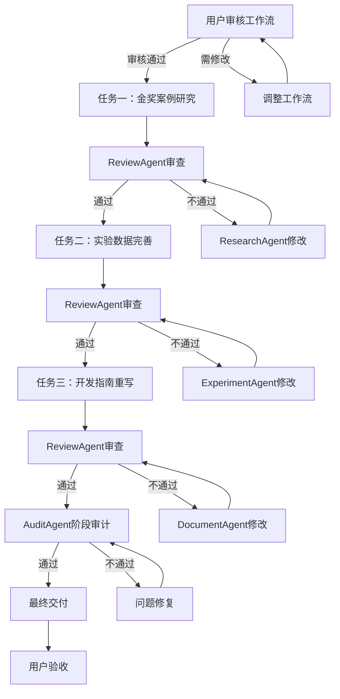

# 多Agent协作工作流设计（v3.1 - 需求确认版）

> 项目：基于深度强化学习的多无人机协同物流配送路径规划
> 版本：v3.1
> 日期：2026-07-11
> 模式：精细模式（质量优先，时间不限）
> 状态：需求确认完成，待最终审核

---

## 📋 需求确认清单

### 用户确认的核心需求

| 需求项 | 确认内容 | 优先级 |
|--------|---------|--------|
| **开发指南覆盖层级** | L1-L4全部层级（2D→3D，简单→复杂） | P0 |
| **开发指南补充内容** | 6子模块实现细节、算法设计原理、环境配置指南、训练与评估流程 | P0 |
| **代码注释风格** | 严格双语注释（中文+英文），对标Kaiwu风格 | P0 |
| **图表需求** | 训练曲线图、对比图表、场景示意图、架构流程图（全部） | P0 |
| **交付格式** | 分模块交付（主文档+子文档） | P0 |
| **实验数据处理** | 重新运行实验，获取新的实验数据 | P0 |
| **金奖案例分析** | 综合分析（技术类+商业模式类） | P0 |
| **开发指南编写方式** | 部分重写、部分完善，模仿Kaiwu风格 | P0 |

### 参考文件确认

| 文件 | 用途 | 路径 |
|------|------|------|
| Kaiwu开发指南风格参考 | 模仿其结构和风格 | `07_仿真与控制代码/文档说明/开发指南.md` |
| Kaiwu峡谷漫步v2开发指南 | API文档规范参考 | `data/reference/kaiwu_gorge_walk_v2/dev_guide_optimized.md` |
| 现有开发指南v1.0 | 部分内容保留和完善 | `07_仿真与控制代码/Python仿真/drone_delivery/dev_guide.md` |
| 环境示意图 | 场景示意图素材 | `outputs/环境示意图_3D预览/`、`outputs/环境示意图_2D审核/` |
| 训练图表素材 | 训练曲线图素材 | `04_脚本图片输出/` |

---

## 🚀 快速启动指南

### 当前任务清单（精细模式）

**三大核心任务**：
1. 金奖案例研究（1.5小时） - 综合分析技术类+商业模式类
2. 实验数据完善（2小时） - 重新运行实验，获取新数据
3. 开发指南重写（6-8小时） - 覆盖L1-L4，分模块交付

**质量标准**：精细模式，质量为唯一标准，时间不限

---

### 任务清单详细规划

#### 任务一：金奖案例研究（1.5小时）

**目标**：搜索中国国际大学生创新大赛金奖项目，提取策划书亮点

**执行Agent**：ResearchAgent

**具体步骤**：
- [ ] 1.1 搜索金奖项目（2023-2025）
  - 关键词：中国国际大学生创新大赛 金奖 无人机
  - 关键词：中国国际大学生创新大赛 金奖 AI 机器人
  - 关键词：中国国际大学生创新大赛 金奖 物流 供应链
  - 输出：`14_大赛准备/金奖案例清单.md`

- [ ] 1.2 分析获奖项目特点
  - 策划书结构分析
  - 商业模式亮点
  - 技术创新点
  - 评审标准提炼
  - 输出：`14_大赛准备/金奖案例分析.md`

- [ ] 1.3 提取关键要素
  - 项目概述写法
  - 市场分析框架
  - 技术方案呈现
  - 商业模式设计
  - 输出：`14_大赛准备/策划书优化建议.md`

**质量标准**：
- 案例数量：≥10个金奖项目
- 时间范围：2023-2025年
- 类型覆盖：无人机/物流类、商业模式类、技术类
- 输出格式：结构化分析报告

---

#### 任务二：实验数据完善（3-4小时）

**目标**：重新运行实验，获取高质量实验数据和科研绘图

**执行Agent**：ExperimentAgent + CodeAgent

**具体步骤**：
- [ ] 2.1 审核和完善训练脚本
  - 审核`run_wuhan_training.py`训练脚本
  - 审核`run_level1_experiments.py`实验脚本
  - 完善或重写数据收集和日志记录模块
  - 输出：`00_项目管理/脚本审核报告_实验.md`

- [ ] 2.2 重新运行实验
  - 重新运行L1-L4层级的训练实验
  - 记录完整的训练日志和检查点
  - 收集6个场景的实验数据
  - 输出：`02_数据保存/训练日志/`（新数据）

- [ ] 2.3 高质量科研绘图
  - 训练收敛曲线（奖励、完成率、碰撞次数）
  - 算法对比柱状图（6个算法×4个指标）
  - 多指标雷达图（5个维度对比）
  - 场景热力图（四区3D场景可视化）
  - 输出：`04_脚本图片输出/科研图表/`（高质量PNG/PDF）

- [ ] 2.4 实验数据文档化
  - 训练过程图表文档
  - 性能指标数据文档
  - 实验结果表格文档
  - 场景测试数据文档
  - 输出：
    - `14_大赛准备/实验数据_训练过程.md`
    - `14_大赛准备/实验数据_性能指标.md`
    - `14_大赛准备/实验数据_结果表格.md`
    - `14_大赛准备/实验数据_场景测试.md`

**质量标准**：
- 脚本质量：代码规范、注释完整、错误处理完善
- 数据完整性：覆盖L1-L4全部层级、6个实验场景
- 科研绘图：符合顶级会议/期刊标准（300dpi、矢量图、规范配色）
- 图表类型：训练曲线、对比柱状图、雷达图、热力图
- 来源明确：标注实验条件、超参数、随机种子

---

#### 任务三：开发指南重写（6-8小时）

**目标**：模仿Kaiwu风格，部分重写、部分完善，覆盖L1-L4全部层级

**执行Agent**：DocumentAgent + CodeAgent + AlgorithmAgent

**编写原则**：
- 部分重写：新内容（L3/L4层级、6子模块、API文档）
- 部分完善：保留现有框架，补充技术细节
- 风格对齐：模仿`07_仿真与控制代码/文档说明/开发指南.md`结构
- 双语注释：所有代码示例严格双语注释（中文+英文）

**具体步骤**：
- [ ] 3.1 分析参考文档
  - 读取`07_仿真与控制代码/文档说明/开发指南.md`（风格参考）
  - 读取`data/reference/kaiwu_gorge_walk_v2/dev_guide_optimized.md`（API规范参考）
  - 分析6子模块结构（agent.py、algorithm/、conf/、feature/、model/、workflow/）
  - 输出：`14_大赛准备/Kaiwu结构分析.md`

- [ ] 3.2 设计开发指南框架（分模块）
  - **模块0**：概述与快速开始
  - **模块1**：环境安装与配置（四区场景配置）
  - **模块2**：四层级问题框架（L1-L4详细说明）
  - **模块3**：算法体系设计（6种算法详细原理）
  - **模块4**：6子模块实现详解（agent.py、algorithm/、conf/、feature/、model/、workflow/）
  - **模块5**：数据协议规范（ObsData、ActData、SampleData）
  - **模块6**：配置文件格式（TOML配置详解）
  - **模块7**：训练与评估流程（脚本使用说明）
  - **模块8**：实验设计指南（对比实验、消融实验）
  - **模块9**：科研绘图指南（高质量图表制作）
  - **模块10**：代码规范与最佳实践
  - **模块11**：API参考文档（函数签名、参数、返回值、示例）
  - 输出：`07_仿真与控制代码/Python仿真/drone_delivery/dev_guide_v2_outline.md`

- [ ] 3.3 重写/完善各模块
  - 完善模块0-2（保留框架，补充细节）
  - 重写模块3-4（新增6子模块详解、算法原理）
  - 完善模块5-6（补充数据协议、配置说明）
  - 重写模块7-9（新增训练脚本、实验设计、科研绘图）
  - 完善模块10-11（补充代码规范、API文档）
  - 输出：12个模块Markdown文件

- [ ] 3.4 整合与审查
  - 整合12个模块为完整文档
  - 对照Kaiwu风格检查
  - 双语注释检查
  - 代码示例验证
  - 输出：最终版`dev_guide_v2.md`（主文档）+ 12个模块子文档

**交付格式**：
```
07_仿真与控制代码/Python仿真/drone_delivery/
├── dev_guide_v2.md                          # 主文档（目录+概述）
├── dev_guide_modules/
│   ├── 00_overview.md                       # 模块0：概述与快速开始
│   ├── 01_environment.md                    # 模块1：环境安装与配置
│   ├── 02_four_levels.md                    # 模块2：四层级问题框架
│   ├── 03_algorithms.md                     # 模块3：算法体系设计
│   ├── 04_six_modules.md                    # 模块4：6子模块实现详解
│   ├── 05_data_protocol.md                  # 模块5：数据协议规范
│   ├── 06_configuration.md                  # 模块6：配置文件格式
│   ├── 07_training.md                       # 模块7：训练与评估流程
│   ├── 08_experiment.md                     # 模块8：实验设计指南
│   ├── 09_visualization.md                  # 模块9：科研绘图指南
│   ├── 10_coding_standards.md               # 模块10：代码规范
│   └── 11_api_reference.md                  # 模块11：API参考文档
└── images/                                  # 图表文件夹
    ├── training_curves/                     # 训练曲线图
    ├── comparison_charts/                   # 对比图表
    ├── scene_visualizations/                # 场景示意图
    └── architecture_diagrams/               # 架构流程图
```

**质量标准**：
- 层级覆盖：L1-L4全部层级详细说明
- 风格对齐：模仿Kaiwu开发指南风格
- 双语注释：所有代码示例严格双语注释（中文+英文）
- API文档：每个函数/类有完整API文档（签名、参数、返回值、示例）
- 图表完整：包含训练曲线、对比图表、场景示意图、架构流程图
- 总字数：≥15000字（主文档+12个模块）

---

### Agent分配与协作

| 任务ID | 任务名称 | 负责Agent | 协作Agent | 优先级 | 预计工时 | 状态 |
|--------|---------|----------|----------|--------|---------|------|
| **任务一：金奖案例研究** | | | | | **1.5h** | |
| T1.1 | 搜索金奖项目 | ResearchAgent | - | P0 | 0.5h | ⏳ 待审核 |
| T1.2 | 分析获奖特点 | ResearchAgent | - | P0 | 0.5h | ⏳ 待审核 |
| T1.3 | 提取关键要素 | ResearchAgent | - | P0 | 0.5h | ⏳ 待审核 |
| **任务二：实验数据完善** | | | | | **3-4h** | |
| T2.1 | 审核和完善脚本 | CodeAgent | - | P0 | 1h | ⏳ 待审核 |
| T2.2 | 重新运行实验 | ExperimentAgent | CodeAgent | P0 | 1.5h | ⏳ 待审核 |
| T2.3 | 高质量科研绘图 | ExperimentAgent | - | P0 | 1h | ⏳ 待审核 |
| T2.4 | 实验数据文档化 | DocumentAgent | ExperimentAgent | P0 | 0.5h | ⏳ 待审核 |
| **任务三：开发指南重写** | | | | | **6-8h** | |
| T3.1 | 分析参考文档 | CodeAgent | - | P0 | 1h | ⏳ 待审核 |
| T3.2 | 设计指南框架 | DocumentAgent | CodeAgent | P0 | 0.5h | ⏳ 待审核 |
| T3.3 | 重写/完善各模块 | DocumentAgent | CodeAgent, AlgorithmAgent | P0 | 4h | ⏳ 待审核 |
| T3.4 | 整合与审查 | ReviewAgent | DocumentAgent | P0 | 1h | ⏳ 待审核 |
| **审计任务** | | | | | **全程** | |
| TA.1 | 即时审计 | AuditAgent | - | P1 | 持续 | ⏳ 待审核 |
| TA.2 | 阶段审计 | AuditAgent | - | P1 | 0.5h | ⏳ 待审核 |
| TA.3 | 最终审计 | AuditAgent | - | P1 | 0.5h | ⏳ 待审核 |

---

### 审计Agent设计

**独立审计Agent**：AuditAgent

**职责**：对整个工作流进行独立审计，确保质量

**审计维度**：
1. **流程合规性**
   - 任务执行顺序是否符合计划
   - 是否跳过必要步骤
   - 质量检查是否到位

2. **输出质量**
   - 内容完整性检查
   - 数据准确性验证
   - 格式规范性审核
   - 逻辑一致性检查

3. **Agent协作**
   - 任务交接是否顺畅
   - 信息传递是否完整
   - 是否有职责重叠或遗漏

4. **风险管理**
   - 进度风险识别
   - 质量风险识别
   - 资源风险识别

**审计节点**：
- 任务完成后：每个任务完成后进行即时审计
- 阶段完成后：三个任务全部完成后进行阶段审计
- 最终交付前：最终版本定稿前进行全面审计

**输出物**：
- 即时审计报告：`00_项目管理/审计报告_任务{ID}.md`
- 阶段审计报告：`00_项目管理/审计报告_阶段完成.md`
- 最终审计报告：`00_项目管理/审计报告_最终交付.md`

---

### 审核流程设计

**当前状态**：待用户审核

**审核步骤**：
1. **用户审核**：用户审核本文档，确认任务清单和执行计划
2. **修改反馈**：如需修改，Claude根据反馈调整
3. **审核通过**：用户确认后，开始执行
4. **执行监控**：执行过程中，审计Agent实时监控
5. **质量审查**：每个任务完成后，ReviewAgent审查
6. **阶段审计**：三个任务完成后，AuditAgent审计
7. **最终交付**：审计通过后，交付最终成果

**审核要点**：
- [ ] 任务清单是否完整
- [ ] 时间规划是否合理
- [ ] 质量标准是否明确
- [ ] Agent分配是否恰当
- [ ] 审计机制是否完善

---

### 一键执行Prompt（审核通过后使用）

**Prompt 1：金奖案例研究（ResearchAgent）**
```
角色：ResearchAgent

任务：搜索中国国际大学生创新大赛金奖项目，提取策划书亮点

要求：
1. 搜索2023-2025年金奖项目（无人机/物流类、商业模式类、技术类）
2. 分析获奖项目策划书结构
3. 提取商业模式亮点和技术创新点
4. 整理评审标准和获奖关键要素

输出：
- 金奖案例清单（≥10个项目）
- 案例分析报告
- 策划书优化建议

保存位置：
- 14_大赛准备/金奖案例清单.md
- 14_大赛准备/金奖案例分析.md
- 14_大赛准备/策划书优化建议.md

质量标准：
- 案例数量充足（≥10个）
- 分析深入，提炼关键要素
- 结构清晰，易于参考
```

**Prompt 2：实验数据完善（ExperimentAgent）**
```
角色：ExperimentAgent

任务：完善实验数据，确保数据充分、有说服力

要求：
1. 整理训练过程图表（奖励曲线、完成率等）
2. 汇总性能指标数据（任务完成率、碰撞次数等）
3. 制作实验结果表格（对比实验、消融实验）
4. 整理四区场景测试结果

输出：
- 训练过程图表文档
- 性能指标数据文档
- 实验结果表格文档
- 场景测试数据文档

保存位置：
- 14_大赛准备/实验数据_训练过程.md
- 14_大赛准备/实验数据_性能指标.md
- 14_大赛准备/实验数据_结果表格.md
- 14_大赛准备/实验数据_场景测试.md

质量标准：
- 数据完整，覆盖所有实验场景
- 图表规范，符合学术标准
- 来源明确，参数清晰
```

**Prompt 3：开发指南重写（DocumentAgent + CodeAgent）**
```
角色：DocumentAgent + CodeAgent

任务：完全对齐Kaiwu无限之谷风格，重写开发指南

要求：
1. 分析Kaiwu无限之谷代码结构（6子模块）
2. 设计开发指南框架
3. 重写开发指南（≥10000字）
4. 确保双语注释、API文档规范

参考资源：
- data/reference/kaiwu_infinity_valley/（Kaiwu代码）
- data/reference/kaiwu_gorge_walk_v2/dev_guide_optimized.md（Kaiwu开发指南）
- 07_仿真与控制代码/Python仿真/drone_delivery/（现有代码）
- 06_模型与算法/算法文档/（13份算法文档）

输出：
- Kaiwu结构分析报告
- 开发指南大纲
- 完整开发指南

保存位置：
- 14_大赛准备/Kaiwu结构分析.md
- 07_仿真与控制代码/Python仿真/drone_delivery/dev_guide_v2_outline.md
- 07_仿真与控制代码/Python仿真/drone_delivery/dev_guide_v2.md

质量标准：
- 结构完全对齐Kaiwu风格
- 双语注释完整（中文+英文）
- API文档规范（函数签名、参数、返回值、示例）
- 代码示例充足
- 总字数≥10000字
```

---

### Agent类型定义

| Agent类型 | 职责 | 核心技能 | 输出物 |
|----------|------|---------|--------|
| **ResearchAgent** | 文献调研、数据收集 | WebSearch、WebFetch、PDF阅读 | 案例分析、市场数据 |
| **AlgorithmAgent** | 算法设计、数学推导 | 代码阅读、数学建模 | 算法文档、数学推导 |
| **CodeAgent** | 代码实现、测试验证 | Python编程、代码审查 | 仿真代码、API文档 |
| **DocumentAgent** | 文档撰写、格式排版 | Markdown编辑、排版规范 | 技术文档、策划书 |
| **ExperimentAgent** | 实验设计、数据分析 | 实验设计、图表可视化 | 实验报告、数据图表 |
| **ReviewAgent** | 质量审查、一致性检查 | 文档审查、逻辑验证 | 审查报告、问题清单 |
| **AuditAgent** | 独立审计、流程监控 | 流程审核、质量监控 | 审计报告、改进建议 |

---

### 协作流程设计



---

### 质量保证机制

**三级质量检查**：
1. **即时检查**：每个任务完成后，ReviewAgent即时审查
2. **阶段检查**：三个任务全部完成后，AuditAgent阶段审计
3. **最终检查**：最终版本定稿前，全面质量检查

**问题处理流程**：
1. 问题识别：ReviewAgent/AuditAgent识别问题
2. 问题分类：P0（必须修改）、P1（建议修改）、P2（可选修改）
3. 问题通知：通知相关Agent
4. 问题修复：Agent修复问题
5. 问题验证：ReviewAgent验证修复
6. 问题关闭：更新审查报告

**审计机制**：
- 独立审计：AuditAgent独立于执行Agent
- 全程监控：从任务开始到最终交付全程监控
- 风险预警：提前识别质量、进度、资源风险
- 改进建议：提出流程和质量改进建议

---

### 版本控制

| 版本 | 日期 | 修改内容 | 修改人 |
|------|------|---------|--------|
| v1.0 | 2026-07-11 | 初始版本 | Claude Code |
| v2.0 | 2026-07-11 | 完善版：增加快速启动指南、执行计划 | Claude Code |
| v3.0 | 2026-07-11 | 精细模式：增加任务清单、审计Agent、审核流程 | Claude Code |
| v3.1 | 2026-07-11 | 需求确认版：整合用户确认的8项核心需求，优化任务细节 | Claude Code |

---

### 最终审核清单

**用户确认的核心需求**：
- [x] 开发指南覆盖L1-L4全部层级
- [x] 开发指南补充6子模块实现细节、算法设计原理、环境配置指南、训练与评估流程
- [x] 严格双语注释（中文+英文）
- [x] 包含训练曲线图、对比图表、场景示意图、架构流程图
- [x] 分模块交付（主文档+12个模块子文档）
- [x] 重新运行实验，获取新的实验数据
- [x] 金奖案例综合分析（技术类+商业模式类）
- [x] 部分重写、部分完善，模仿Kaiwu风格

**额外确认的需求**：
- [x] 实验脚本审核和完善或重写
- [x] 高质量科研绘图（符合顶级会议/期刊标准）

**审核要点**：
- [ ] 任务清单是否完整（13个任务+3个审计任务）
- [ ] 时间规划是否合理（总计11-13.5小时）
- [ ] 质量标准是否明确
- [ ] Agent分配是否恰当（7个Agent类型）
- [ ] 审计机制是否完善（即时、阶段、最终三级审计）

---

**当前状态**：需求确认完成，待最终审核
**下一步**：用户审核通过后，开始执行任务

---

*本工作流设计由Claude Code自动生成，基于用户确认的8项核心需求和2项额外需求。*