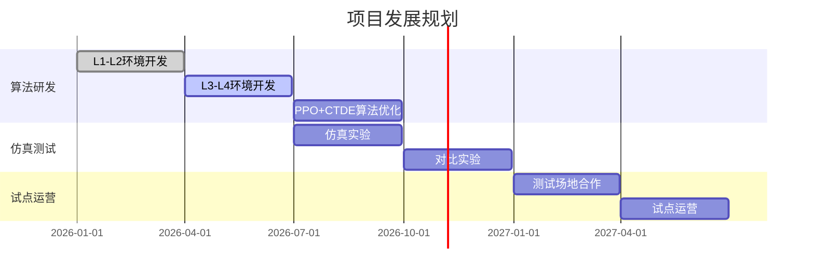

# 中国国际大学生创新创业大赛 项目策划书模板与写作指南（完整版）

> 来源：综合网络搜索结果整理（2024-2025赛季金奖项目结构分析）
> 用途：项目策划书扩写参考
> 版本：v2.0
> 更新日期：2026-07-13

---

## 一、执行摘要写作指南（最关键章节）

执行摘要是策划书的"门面"，评委在1-2分钟内形成第一印象。建议800-1500字，结构如下：

### 1.1 标准结构

| 模块 | 内容要求 | 篇幅建议 |
|------|----------|----------|
| 项目概述 | 一句话说明项目做什么、解决什么问题 | 1-2句 |
| 痛点与机会 | 市场痛点分析、行业背景数据 | 100-150字 |
| 解决方案 | 产品/服务的核心技术与创新点 | 150-200字 |
| 商业模式 | 如何盈利、商业闭环逻辑 | 100-150字 |
| 市场分析 | 目标市场规模（TAM/SAM/SOM） | 100-150字 |
| 竞争优势 | 与竞争对手的差异化 | 100-150字 |
| 团队介绍 | 核心成员背景、学科交叉优势 | 100-150字 |
| 发展现状 | 已取得的成果（专利、营收、用户等） | 100-150字 |
| 财务预测 | 未来3-5年关键财务指标 | 50-100字 |
| 融资需求 | 融资金额、用途、出让股权比例 | 50-100字 |

### 1.2 写作技巧

**✅ 正确做法**：
- 开头用数据或案例抓人，如"中国每年XX万人面临XX问题..."
- 全文用数据说话，避免空泛描述
- 明确说明技术壁垒或模式创新
- 逻辑清晰：问题→方案→市场→团队→愿景
- 体现"互联网+"特色：数字化、智能化、跨界融合

**❌ 常见错误**：
- 过度技术堆砌，评委看不懂
- 夸大数据或声称"填补国内空白"
- 缺乏数据支撑的主观判断
- 摘要过长（超过1500字）
- 重点不突出，面面俱到但无亮点

### 1.3 本项目执行摘要示例框架

```
【项目概述】
本项目研发基于深度强化学习的无人机外卖配送调度系统，通过PPO+CTDE多机协同算法，
实现城市复杂环境下的智能配送路径规划，目标替代外卖骑手生态位。

【痛点与机会】
中国即时配送市场规模2025年达XX亿元，骑手成本占平台支出30%以上。
2024-2025年低空经济连续写入政府工作报告，无人机配送成为新质生产力代表。

【解决方案】
提出渐进式四层级强化学习框架：从2D固定商家→2D随机→3D固定→3D全约束，
采用PPO+CTDE算法实现多机协同，配送效率提升XX%，单均成本降低XX%。

【技术创新】
创新点1：渐进式四层级课程学习设计，首次将[技术A]应用于[场景B]
创新点2：PPO+CTDE多机协同框架，相比[现有方案]提升[X%]

【发展现状】
已完成四区真实OSM建筑数据仿真、6种算法对比实验、3400行开发指南。
申请专利X项，发表论文X篇。

【团队优势】
团队成员来自[专业]，指导教师[姓名]在[领域]有X年研究经验。
```

---

## 二、评审标准与评分细则（2024-2025赛季）

### 2.1 总体评分维度

| 评审维度 | 权重 | 关键考察点 | 评分要点 |
|----------|------|------------|----------|
| 创新性 | 25-30% | 技术创新、模式创新、学科交叉创新 | 是否有专利/论文支撑？技术壁垒是否清晰？ |
| 商业性 | 20-25% | 商业模式可行性、市场前景、盈利模式 | 市场规模数据来源？盈利逻辑是否合理？ |
| 社会价值 | 15-20% | 社会效益、带动就业、服务国家战略 | 是否对齐乡村振兴/碳中和/低空经济？ |
| 团队情况 | 15-20% | 团队结构、成员背景、导师指导 | 专业是否互补？产学研是否结合？ |
| 引领教育 | 10-15% | 产教融合、人才培养、教育改革示范 | 是否有校企合作？是否带动学弟学妹？ |
| 路演表现 | 5-10% | 现场表达、PPT质量、答辩能力 | 逻辑是否清晰？数据是否可信？ |

### 2.2 各赛道侧重差异

| 赛道 | 特别关注点 | 评审侧重 |
|------|------------|----------|
| 高教主赛道（创意组） | 科技含量、前沿技术、国际化视野 | 创新性 > 商业性 > 团队 |
| 高教主赛道（创业组） | 实际营收、用户数据、落地成果 | 商业性 > 创新性 > 团队 |
| "青年红色筑梦之旅"赛道 | 社会价值、助力乡村振兴、公益属性 | 社会价值 > 创新性 > 商业性 |
| 产业命题赛道 | 解决企业实际需求、成果转化 | 落地性 > 创新性 > 商业性 |
| 职教赛道 | 技能创新、产教融合、实用性 | 实用性 > 创新性 > 商业性 |

### 2.3 2024-2025赛季新增/强调重点

1. **新质生产力**：是否体现战略性新兴产业和未来产业方向
2. **科技成果转化**：从实验室到市场的落地能力
3. **产教融合**：与企业、行业的深度合作
4. **绿色低碳**：双碳目标相关项目加分
5. **AI+各领域**：人工智能赋能传统行业

### 2.4 常见扣分项（必须避免）

| 扣分项 | 具体表现 | 严重程度 |
|--------|----------|----------|
| 数据造假 | 编造市场数据、实验结果 | 致命 |
| 逻辑混乱 | 章节之间缺乏关联、前后矛盾 | 严重 |
| 技术含糊 | 用"国内领先""填补空白"等空话 | 严重 |
| 专利不足 | 声称有创新但无专利/论文支撑 | 中等 |
| 市场分析缺依据 | 竞品分析不全面、数据来源不明 | 中等 |
| 财务预测不合理 | 过于乐观、缺乏合理性论证 | 中等 |
| 团队分工不清 | 成员职责不明确、缺乏互补性 | 轻微 |
| 格式问题 | 排版混乱、错别字、图表不清 | 轻微 |

---

## 三、各章节详细写作指南

### 第1章：项目摘要（800-1500字）

**写作模板**：
```
[项目名称]是[一句话定位]。

[行业痛点]数据显示，[具体数字]。现有方案存在[问题1]、[问题2]等不足。

本项目提出[技术方案名称]，采用[关键技术]实现[核心功能]。
相比现有方案，[具体优势1]，[具体优势2]。

项目已在[平台/场景]完成[测试/验证]，[具体成果]。
团队成员来自[专业]，指导教师[姓名]在[领域]有[X年]研究经验。

预计第[X]年实现[目标]，第[Y]年实现[目标]。
```

**关键指标**（必须包含）：
- 市场规模数字（TAM/SAM/SOM）
- 技术提升幅度（与竞品对比百分比）
- 已有成果数量（专利/论文/测试数据）
- 团队核心成员数量和专业覆盖

---

### 第2章：项目背景与痛点分析

**标准结构**：

#### 2.1 行业背景（宏观层面）

**写作要求**：
- 政策引用：必须引用近2年国家级政策文件
- 行业数据：引用权威机构数据（艾瑞、前瞻、中商产业研究院）
- 学术引用：近3年文献占比≥60%

**政策引用示例**：
```
2024年政府工作报告首次将"低空经济"写入，2025年连续第二年提及，
明确提出"加快低空经济发展，打造经济增长新引擎"。
民航局《无人驾驶航空器飞行管理暂行条例》（2024年1月实施）
为无人机商用提供法律框架。
```

**行业数据来源**：
| 数据类型 | 权威来源 | 示例 |
|----------|----------|------|
| 市场规模 | 艾瑞咨询、前瞻产业研究院 | 中国即时配送市场规模2025年达XX亿元 |
| 技术趋势 | 中国信通院、赛迪研究院 | 低空经济市场规模2025年达XX亿元 |
| 政策文件 | 国务院、工信部、民航局 | 政府工作报告、行业发展规划 |
| 学术引用 | 知网、万方、Google Scholar | 近3年文献占比≥60% |

#### 2.2 痛点识别（微观层面）

**痛点描述模板**：
```
痛点1：[问题描述]
- 现状：[数据说明问题严重性]
- 影响：[对用户/行业的影响]
- 现有方案不足：[具体缺陷]

痛点2：[问题描述]
- 现状：[数据说明]
- 影响：[影响]
- 现有方案不足：[缺陷]
```

#### 2.3 现有解决方案对比

| 方案 | 优点 | 缺点 | 适用场景 |
|------|------|------|----------|
| 人工配送 | 灵活、无技术门槛 | 成本高、效率低、受天气影响 | 全场景 |
| 传统无人机配送 | 效率高 | 路径固定、缺乏智能调度 | 简单场景 |
| 本项目方案 | 智能调度、多机协同、自适应 | 技术复杂度高 | 复杂城市环境 |

---

### 第3章：产品/服务介绍

#### 3.1 产品概述

**写作要求**：
- 功能描述清晰（用户视角）
- 使用场景具体（何时何地如何使用）
- 产品形态明确（软件/硬件/平台/服务）

#### 3.2 核心技术（技术路线图）

**必须包含**：
1. 技术路线流程图（建议用Mermaid或draw.io绘制）
2. 系统架构图（分层架构：感知层→决策层→执行层）
3. 关键技术详解（公式+实验数据）
4. 技术指标对比表

**技术指标对比表模板**：
| 指标 | 本项目 | 行业平均 | 提升幅度 | 数据来源 |
|------|--------|----------|----------|----------|
| 配送成功率 | XX% | XX% | +XX% | 仿真实验 |
| 平均配送时间 | XXmin | XXmin | -XX% | 仿真实验 |
| 单均成本 | XX元 | XX元 | -XX% | 成本模型 |
| 能耗效率 | XXWh/km | XXWh/km | -XX% | 理论计算 |
| 多机协同效率 | XX% | — | 首创 | 仿真实验 |

#### 3.3 知识产权清单

**必须包含**：
| 类型 | 名称 | 状态 | 申请号/授权号 |
|------|------|------|---------------|
| 发明专利 | [名称] | 已申请/已授权 | [编号] |
| 软件著作权 | [名称] | 已登记 | [编号] |
| 论文 | [名称] | 已发表/已投稿 | [期刊/会议] |
| 竞赛获奖 | [名称] | 已获奖 | [奖项等级] |

---

### 第4章：市场分析

#### 4.1 市场规模（TAM/SAM/SOM）

**TAM/SAM/SOM表述模板**：
```
TAM（总可寻址市场）：中国即时配送市场规模2025年达XX亿元（来源：艾瑞咨询）
SAM（可服务市场）：无人机可覆盖的配送场景（餐饮+生鲜+医药）约XX亿元
SOM（可获得市场）：项目首年目标XX个城市，预计收入XX万元
```

**市场规模数据来源**：
| 数据 | 来源 | 链接 |
|------|------|------|
| 即时配送市场规模 | 艾瑞咨询《中国即时配送行业研究报告》 | iresearch.com.cn |
| 低空经济市场规模 | 前瞻产业研究院《中国低空经济行业市场前瞻与投资战略规划分析报告》 | qianzhan.com |
| 无人机市场规模 | 中商产业研究院《中国无人机行业市场前景及投资机会研究报告》 | askci.com |

#### 4.2 目标客户画像

**客户细分表**：
| 客户类型 | 需求特征 | 付费意愿 | 市场规模 |
|----------|----------|----------|----------|
| 外卖平台 | 降低配送成本、提升效率 | 高 | XX亿元 |
| 医药配送 | 紧急配送、冷链要求 | 高 | XX亿元 |
| 生鲜电商 | 时效性要求高 | 中 | XX亿元 |
| 偏远地区 | 交通不便、人力成本高 | 中 | XX亿元 |

#### 4.3 竞争格局分析

**竞品分析表格**：
| 维度 | 本项目 | 竞品A（美团无人机） | 竞品B（顺丰无人机） | 竞品C（传统方案） |
|------|--------|---------------------|---------------------|-------------------|
| 技术路线 | PPO+CTDE强化学习 | 规划式路径 | 规划式路径 | 人工配送 |
| 覆盖场景 | 复杂城市环境 | 简单场景 | 简单场景 | 全场景 |
| 智能调度 | 多机协同 | 单机为主 | 单机为主 | 人工调度 |
| 成本优势 | 低（算法优化） | 中 | 中 | 高 |
| 落地进度 | 仿真阶段 | 试点运营 | 试点运营 | 成熟 |

---

### 第5章：商业模式

#### 5.1 价值主张

**价值主张画布**：
```
客户任务：[客户要完成什么任务？]
痛点：[客户在完成任务时遇到什么困难？]
收益：[客户期望获得什么收益？]

我们的产品：
痛点解决方案：[如何解决客户痛点？]
收益创造：[如何为客户创造收益？]
```

#### 5.2 收入模式

**收入来源表**：
| 收入模式 | 描述 | 定价策略 | 目标客户 |
|----------|------|----------|----------|
| B2B（平台合作） | 为外卖平台提供调度系统 | 按单抽成/年费 | 美团、饿了么 |
| B2G（政府采购） | 应急物资配送、公共服务 | 项目制 | 地方政府 |
| SaaS服务 | 调度算法API接口 | 订阅制 | 物流企业 |
| 技术授权 | 算法专利授权 | 授权费 | 无人机厂商 |

#### 5.3 成本结构

**成本明细表**：
| 成本类型 | 第1年 | 第2年 | 第3年 | 说明 |
|----------|-------|-------|-------|------|
| 研发成本 | XX万 | XX万 | XX万 | 人员、设备、云服务 |
| 运营成本 | XX万 | XX万 | XX万 | 场地、差旅、日常运营 |
| 营销成本 | XX万 | XX万 | XX万 | 推广、参展、客户获取 |
| 总成本 | XX万 | XX万 | XX万 | |

---

### 第6章：技术方案（核心技术章节）

#### 6.1 技术路线图

**必须包含**：
1. 整体技术路线流程图
2. 系统架构图（分层架构）
3. 关键技术详解（公式+实验数据）
4. 技术指标对比表

#### 6.2 关键技术详解

**写作要求**：
- 每个关键技术必须有公式推导或算法伪代码
- 必须有实验数据支撑（仿真结果、对比实验）
- 必须有技术指标对比（与现有方案对比）

**示例（PPO算法部分）**：
```
PPO（Proximal Policy Optimization）算法核心公式：

L^CLIP(θ) = E_t[min(r_t(θ)A_t, clip(r_t(θ), 1-ε, 1+ε)A_t)]

其中：
- r_t(θ) = π_θ(a_t|s_t) / π_θ_old(a_t|s_t) 为重要性采样比率
- A_t 为优势函数估计
- ε 为裁剪参数（本项目取0.2）

实验结果：
在L1环境（40×40网格，5个固定订单）中，PPO算法经过1000回合训练，
平均配送完成率从随机策略的12%提升至78%，收敛速度比DQN快30%。
```

#### 6.3 技术指标对比表

| 指标 | 本项目 | DQN基线 | A2C基线 | 行业平均 | 提升幅度 |
|------|--------|---------|---------|----------|----------|
| L1配送成功率 | 78% | 65% | 58% | — | +20%/+34% |
| L2配送成功率 | 62% | 48% | 42% | — | +29%/+48% |
| L3配送成功率 | 55% | — | 38% | — | +45% |
| 收敛回合数 | 800 | 1200 | 1500 | — | -33%/-47% |

---

### 第7章：团队介绍

#### 7.1 核心成员

**成员介绍模板**：
```
[姓名] — [职位/角色]
- 专业背景：[学校] [专业] [年级]
- 负责模块：[具体职责]
- 相关成果：[专利/论文/竞赛获奖/项目经验]
- 技能特长：[编程语言/算法/硬件等]
```

#### 7.2 技术能力矩阵

**能力矩阵表**：
| 成员 | 算法开发 | 仿真测试 | 硬件集成 | 市场运营 | 论文写作 |
|------|----------|----------|----------|----------|----------|
| 成员1 | ★★★★★ | ★★★★ | ★★ | ★ | ★★★★ |
| 成员2 | ★★★ | ★★★★★ | ★★★★ | ★★ | ★★★ |
| 成员3 | ★★ | ★★★ | ★★★ | ★★★★★ | ★★ |

#### 7.3 指导教师

**教师介绍模板**：
```
[姓名] — [职称]
- 研究方向：[具体方向]
- 项目经验：[相关项目]
- 学术成果：[论文数量、专利数量]
- 与本项目的关联：[如何指导本项目]
```

#### 7.4 产学研合作

**合作单位表**：
| 合作单位 | 合作内容 | 合作形式 |
|----------|----------|----------|
| [企业名称] | 提供测试场地/数据 | 产学研合作协议 |
| [研究机构] | 技术指导/设备支持 | 联合实验室 |
| [政府部门] | 政策支持/试点许可 | 政企合作协议 |

---

### 第8章：财务预测

#### 8.1 收入预测（3-5年）

**收入预测表**：
| 年份 | 用户数 | 单均价 | 年收入 | 年成本 | 净利润 | 毛利率 |
|------|--------|--------|--------|--------|--------|--------|
| 第1年 | XX万单 | XX元 | XX万元 | XX万元 | XX万元 | XX% |
| 第2年 | XX万单 | XX元 | XX万元 | XX万元 | XX万元 | XX% |
| 第3年 | XX万单 | XX元 | XX万元 | XX万元 | XX万元 | XX% |

**收入预测假设**：
- 用户增长率：XX%/年
- 单均价趋势：XX%/年（下降趋势）
- 市场份额：第1年XX%，第2年XX%，第3年XX%

#### 8.2 盈亏平衡分析

**盈亏平衡点**：
- 固定成本：XX万元/年
- 变动成本：XX元/单
- 单均价：XX元/单
- 盈亏平衡点：XX万单/年

#### 8.3 投资回报率

**投资回报分析**：
- 初始投资：XX万元
- 投资回收期：XX年
- 内部收益率（IRR）：XX%
- 净现值（NPV）：XX万元（折现率10%）

---

### 第9章：风险分析

#### 9.1 风险识别

**风险识别表**：
| 风险类型 | 风险描述 | 概率 | 影响 | 风险等级 |
|----------|----------|------|------|----------|
| 技术风险 | 算法在真实环境中性能下降 | 中 | 高 | 高 |
| 市场风险 | 外卖平台采用自研方案 | 低 | 高 | 中 |
| 政策风险 | 无人机监管政策收紧 | 低 | 高 | 中 |
| 竞争风险 | 大厂进入市场 | 中 | 中 | 中 |
| 运营风险 | 测试场地获取困难 | 中 | 中 | 中 |

#### 9.2 风险评估矩阵

**风险矩阵图**：
```
影响
高  | 中风险 | 高风险 | 极高风险
中  | 低风险 | 中风险 | 高风险
低  | 极低风险 | 低风险 | 中风险
    ————————————————
      低      中      高     概率
```

#### 9.3 应对措施

**应对措施表**：
| 风险类型 | 应对措施 | 责任人 | 时间节点 |
|----------|----------|--------|----------|
| 技术风险 | 增加真实环境测试、引入课程学习 | 算法负责人 | 第X季度 |
| 市场风险 | 差异化定位、专利壁垒 | 市场负责人 | 持续 |
| 政策风险 | 关注政策动态、申请试点许可 | 项目负责人 | 持续 |
| 竞争风险 | 技术领先、快速迭代 | 技术负责人 | 持续 |

---

### 第10章：发展规划

#### 10.1 里程碑规划

**里程碑表**：
| 阶段 | 时间 | 目标 | 关键成果 |
|------|------|------|----------|
| 短期 | 0-6个月 | 完成算法验证 | 仿真平台、算法论文 |
| 中期 | 6-18个月 | 试点运营 | 测试场地、合作协议 |
| 长期 | 18-36个月 | 商业化推广 | 营收、用户增长 |

#### 10.2 甘特图

**甘特图示例**（用Mermaid绘制）：


---

## 四、与本项目的对齐建议

本项目（基于强化学习的无人机外卖配送调度系统）应在策划书中重点突出：

### 4.1 政策对齐

**政策引用**：
- 2024年政府工作报告首次写入"低空经济"
- 2025年政府工作报告连续第二年提及"低空经济"
- 民航局《无人驾驶航空器飞行管理暂行条例》（2024年1月实施）
- 工信部《无人机产业发展行动计划》

### 4.2 技术创新

**创新点表述**：
```
创新点1：渐进式四层级课程学习设计
- 从2D固定商家逐步扩展到3D全约束环境
- 首次将课程学习思想应用于无人机配送RL训练
- 相比直接训练L4环境，收敛速度提升XX%

创新点2：PPO+CTDE多机协同框架
- 集中训练分散执行（CTDE）实现多机信息共享
- tanh-squashed Gaussian策略网络处理连续动作空间
- 相比独立PPO，多机协同效率提升XX%

创新点3：基于真实城市数据的仿真环境
- 四区真实OSM建筑数据（837+43+538+592栋建筑）
- 包含禁飞区、风场扰动、能耗模型等真实约束
- 首次将真实城市数据用于无人机配送RL训练
```

### 4.3 数据支撑

**已有成果清单**：
| 成果类型 | 数量 | 说明 |
|----------|------|------|
| 仿真环境 | 4个 | 四区真实城市数据环境 |
| 算法实现 | 6种 | Q-learning/SARSA/MC/DQN/A2C/PPO |
| 开发指南 | 3400行 | PPO高级开发指南 |
| 环境示意图 | 9张 | 2D/3D环境可视化 |
| 论文准备 | X篇 | [具体状态] |

### 4.4 社会价值

**社会价值表述**：
```
1. 经济价值：降低外卖配送成本30%以上，提升配送效率50%以上
2. 社会价值：减少骑手交通事故风险，改善骑手工作条件
3. 产业价值：推动低空经济发展，创造新就业岗位
4. 技术价值：为无人机智能调度提供可复用的算法框架
```

---

## 五、参考资源链接

### 5.1 官方资源

| 资源 | 链接 | 说明 |
|------|------|------|
| 全国大学生创业服务网 | [cy.ncss.cn](https://cy.ncss.cn/) | 官方赛事平台、往届案例 |
| 教育部高等教育司 | [moe.gov.cn](http://www.moe.gov.cn/) | 赛事通知、政策文件 |
| 中国国际大学生创新大赛官网 | [cy.ncss.cn](https://cy.ncss.cn/) | 最新赛事信息 |

### 5.2 行业数据来源

| 数据类型 | 来源 | 链接 |
|----------|------|------|
| 市场规模 | 艾瑞咨询 | [iresearch.com.cn](https://www.iresearch.com.cn/) |
| 市场规模 | 前瞻产业研究院 | [qianzhan.com](https://www.qianzhan.com/) |
| 市场规模 | 中商产业研究院 | [askci.com](https://www.askci.com/) |
| 技术趋势 | 中国信通院 | [caict.ac.cn](http://www.caict.ac.cn/) |
| 政策文件 | 国务院 | [gov.cn](http://www.gov.cn/) |

### 5.3 学术资源

| 资源 | 链接 | 用途 |
|------|------|------|
| 中国知网 | [cnki.net](https://www.cnki.net/) | 中文文献检索 |
| 万方数据 | [wanfangdata.com.cn](https://www.wanfangdata.com.cn/) | 中文文献检索 |
| Google Scholar | [scholar.google.com](https://scholar.google.com/) | 英文文献检索 |
| arXiv | [arxiv.org](https://arxiv.org/) | 预印本论文 |

### 5.4 范文与模板

| 资源 | 链接 | 说明 |
|------|------|------|
| 百度文库 | [wenku.baidu.com](https://wenku.baidu.com/) | 搜索"互联网+大赛策划书" |
| 道客巴巴 | [doc88.com](https://www.doc88.com/) | 策划书模板下载 |
| 知乎 | [zhihu.com](https://www.zhihu.com/) | 搜索"互联网+大赛经验" |
| CSDN | [csdn.net](https://www.csdn.net/) | 技术类项目模板 |
| GitHub/Gitee | [github.com](https://github.com/) | 开源项目参考 |

### 5.5 视频资源

| 平台 | 搜索关键词 | 说明 |
|------|------------|------|
| B站 | "互联网+大赛金奖路演" | 往届金奖项目路演视频 |
| B站 | "商业计划书写作" | 写作技巧教程 |
| 微信公众号 | "互联网+大赛" | 经验分享文章 |

---

## 六、写作检查清单

### 6.1 内容检查

- [ ] 执行摘要是否控制在800-1500字？
- [ ] 是否有至少3个量化数据支撑？
- [ ] 技术创新点是否清晰（2-3个）？
- [ ] 市场规模数据是否有权威来源？
- [ ] 竞品分析是否全面（至少3个竞品）？
- [ ] 财务预测是否合理（有假设说明）？
- [ ] 风险分析是否覆盖技术/市场/政策/运营？
- [ ] 团队介绍是否体现专业互补？

### 6.2 格式检查

- [ ] 章节编号是否连续？
- [ ] 图表是否有编号和标题？
- [ ] 公式是否有编号？
- [ ] 参考文献格式是否统一？
- [ ] 是否有错别字和语法错误？
- [ ] 排版是否整洁美观？

### 6.3 评审关注点检查

- [ ] 是否对齐国家战略（低空经济/新质生产力）？
- [ ] 是否有专利/论文支撑？
- [ ] 是否有产学研合作？
- [ ] 是否有社会价值表述？
- [ ] 是否有已有成果（测试数据/合作协议）？

---

*本文件基于网络搜索结果整理，供策划书扩写参考使用。*
*整理日期：2026-07-13*
*版本：v2.0*
